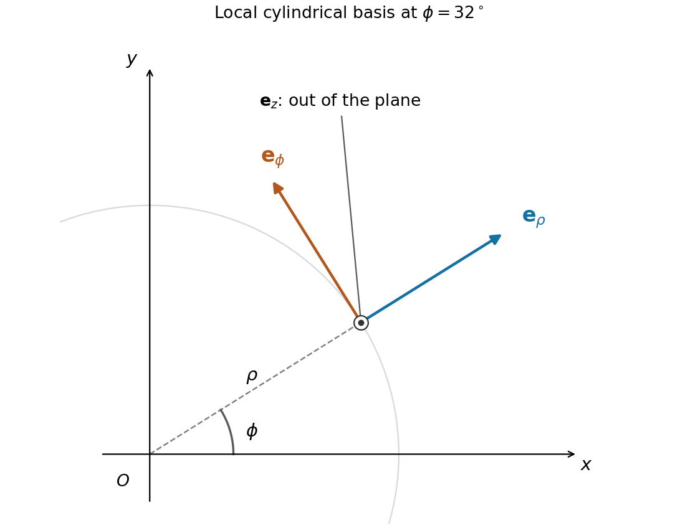

<h1 id="1/solution">Solution</h1>

↑ **Parent:** [1](../1.md)

For a twice continuously differentiable [vector field](../../../../vector-field.md) in [Cartesian coordinates](../../../../cartesian-coordinate-system.md), the [curl](../../../../curl.md) and [divergence](../../../../divergence.md) are

$$
\nabla\times\mathbf v=(\partial_yv_z-\partial_zv_y,\ \partial_zv_x-\partial_xv_z,\ \partial_xv_y-\partial_yv_x),\qquad\nabla\cdot\mathbf v=\partial_xv_x+\partial_yv_y+\partial_zv_z.
$$

Put $\boldsymbol\omega=\nabla\times\mathbf v$. Using the [Levi-Civita symbol](../../../../levi-civita-symbol.md), the [Kronecker delta](../../../../kronecker-delta.md) contraction and the [product rule](../../../../product-rule.md),

$$
\begin{aligned}
[\nabla\times(\mathbf v\times\boldsymbol\omega)]_i
&=\partial_j(v_i\omega_j-v_j\omega_i)\\
&=\omega_j\partial_jv_i-v_j\partial_j\omega_i-\omega_i\partial_jv_j+v_i\partial_j\omega_j.
\end{aligned}
$$

The last term vanishes because the [divergence of a curl is zero](../../../../divergence-of-a-curl-is-zero.md): the symmetric mixed derivatives contract against an antisymmetric symbol. Thus the [curl of a cross product](../../../../curl-of-a-cross-product.md) identity becomes

$$
\boxed{\nabla\times(\mathbf v\times\boldsymbol\omega)=(\boldsymbol\omega\cdot\nabla)\mathbf v-(\mathbf v\cdot\nabla)\boldsymbol\omega-\boldsymbol\omega(\nabla\cdot\mathbf v).}
$$

For [orthogonal coordinates](../../../../orthogonal-coordinates.md) $q_i$ with [position vector](../../../../position-vector.md) $\mathbf r(q_1,q_2,q_3)$, the [scale factors of orthogonal coordinates](../../../../scale-factors-of-orthogonal-coordinates.md) and local [unit vectors](../../../../unit-vector.md) are

$$
h_i=\left|\frac{\partial\mathbf r}{\partial q_i}\right|,\qquad\mathbf e_i=\frac1{h_i}\frac{\partial\mathbf r}{\partial q_i},\qquad d\mathbf r=\sum_i h_i\mathbf e_i\,dq_i.
$$

Orthogonality gives $ds^2=\sum_i h_i^2dq_i^2$, and right-handedness fixes $\mathbf e_1\times\mathbf e_2=\mathbf e_3$. In [cylindrical coordinates](../../../../cylindrical-coordinate-system.md), $\mathbf r=(\rho\cos\phi,\rho\sin\phi,z)$, so

$$
\boxed{h_\rho=1,\quad h_\phi=\rho,\quad h_z=1,\qquad \mathbf e_\rho=(\cos\phi,\sin\phi,0),\quad\mathbf e_\phi=(-\sin\phi,\cos\phi,0),\quad\mathbf e_z=(0,0,1).}
$$

The radial vector points away from the axis; the azimuthal vector is tangent in the direction of increasing $\phi$; $\mathbf e_z$ is the Cartesian positive $z$ direction. The azimuthal basis is undefined on the coordinate axis itself.

**[Figure 1](#1/image-cylindrical-unit-vectors-relative-to-cartesian-axes-viewed-from-positive-z). Cylindrical unit vectors relative to Cartesian axes, viewed from positive z**.

For the axial velocity profile, the [cylindrical coordinates](../../../../cylindrical-coordinate-system.md) formula gives

$$
\boxed{\boldsymbol\omega=\nabla\times\mathbf u=-\partial_\rho u_z\,\mathbf e_\phi=2u_0\rho\,\mathbf e_\phi.}
$$

The associated [cross product](../../../../cross-product.md) is

$$
\boxed{\mathbf u\times\boldsymbol\omega=-2u_0^2\rho(1-\rho^2)\mathbf e_\rho.}
$$

This field has only a radial component depending on $\rho$, so its [curl](../../../../curl.md) is zero. Also $\nabla\cdot\mathbf u=\partial_z u_z=0$. The identity above therefore yields

$$
\boxed{(\boldsymbol\omega\cdot\nabla)\mathbf u=(\mathbf u\cdot\nabla)\boldsymbol\omega.}
$$

In fact both [directional derivatives](../../../../directional-derivative.md) vanish: the first differentiates $u_z\mathbf e_z$ only in the azimuthal direction, and the second differentiates $\boldsymbol\omega$ only in the $z$ direction. All physical vector fields extend smoothly through $\rho=0$, despite the coordinate-basis singularity.

## ↑ Ancestors (12)

1. [1](../1.md)
2. [Paper 1](../../paper-1-split.md)
3. [2011](../../split.md)
4. [Past exam of the mathematics course of the year 2 of the natural sciences course of the University of Cambridge](../../../split.md)
5. [Mathematics course of the year 2 of the natural sciences course of the University of Cambridge](../../../../mathematics-course-of-the-year-2-of-the-natural-sciences-course-of-the-university-of-cambridge.md)
6. [Year 2 of the natural sciences course of the University of Cambridge](../../../../year-2-of-the-natural-sciences-course-of-the-university-of-cambridge.md)
7. [Year of the natural sciences course of the University of Cambridge](../../../../year-of-the-natural-sciences-course-of-the-university-of-cambridge.md)
8. [Natural sciences course of the University of Cambridge](../../../../natural-sciences-course-of-the-university-of-cambridge.md)
9. [Course of the University of Cambridge](../../../../course-of-the-university-of-cambridge.md)
10. [University of Cambridge](../../../../university-of-cambridge-split.md)
11. [List of universities](../../../../list-of-universities.md)
12. [Codex Wiki](../../../../split.md)
