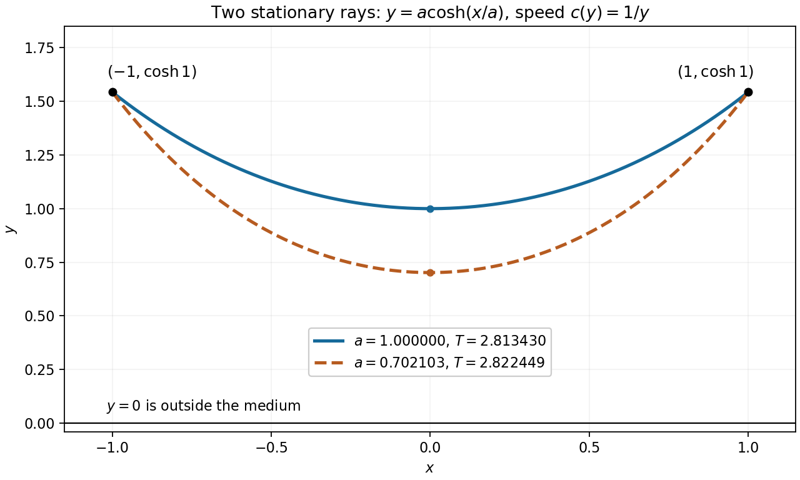

<h1 id="9/solution">Solution</h1>

↑ **Parent:** [9](../9.md)

For endpoint-preserving variations of a [functional](../../../../functional.md), the [Euler-Lagrange equation](../../../../euler-lagrange-equation.md) is

$$
\boxed{F_y-\frac{d}{dx}F_{y'}=0.}
$$

Along an extremal, the [chain rule](../../../../chain-rule.md) gives $d(F-y'F_{y'})/dx=F_x+y'[F_y-dF_{y'}/dx]=F_x$. Thus when $F$ has no explicit $x$ dependence, the [Beltrami identity](../../../../beltrami-identity.md) is

$$
\boxed{F-y'F_{y'}=A.}
$$

For a positive speed profile, the elapsed-time integrand in [Fermat principle](../../../../fermat-principle.md) is $F=\sqrt{1+(y')^2}/c(y)$. Its first integral gives

$$
\frac1{c(y)\sqrt{1+(y')^2}}=A>0,\qquad\frac{dx}{dy}=\pm\frac{Ac(y)}{\sqrt{1-A^2c(y)^2}}.
$$

Integrating each monotone-height branch yields

$$
\boxed{\int^y\frac{Ac(\widehat y)}{\sqrt{1-A^2c(\widehat y)^2}}d\widehat y=\pm(x+B).}
$$

Real branches require $Ac(y)\leq1$. Turning points are joined in the original graph $y(x)$, even though the inverse derivative is singular there.

For the inverse-height speed profile, this becomes $dx/dy=\pm a/\sqrt{y^2-a^2}$, with $a=A>0$. Integration gives $x-b=\pm a\operatorname{arcosh}(y/a)$, so the [light rays](../../../../light-ray.md) are [catenaries](../../../../catenary.md)

$$
y(x)=a\cosh\frac{x-b}{a}.
$$

Equal endpoint heights at opposite $x$ values force $b=0$, since the real hyperbolic cosine is even and strictly increases with the absolute value of its argument. The remaining endpoint condition is $a\cosh(1/a)=\cosh1$. One exact solution is $a=1$, giving

$$
\boxed{y(x)=\cosh x,\qquad y_{\min}=1,\qquad T=\int_{-1}^1\cosh^2x\,dx=1+\frac12\sinh2\simeq2.813430204.}
$$

Here $ds/dx=\cosh x$ and $1/c(y)=y=\cosh x$ account for the squared hyperbolic cosine in the time integral.

**The stated endpoints also allow a second stationary ray.** Set $t=1/a$. The function $\cosh t/t$ decreases and then increases: its derivative has the sign of $t\sinh t-\cosh t$, whose derivative is $t\cosh t>0$. Its unique minimum occurs where $t\tanh t=1$, at $t\simeq1.199679$. Since the known root $t=1$ lies below this minimum's location, there is exactly one further root, $t\simeq1.4242930655$. Thus the [two stationary catenary rays in an inverse-height speed profile](../../../../two-stationary-catenary-rays-in-an-inverse-height-speed-profile.md) also include

$$
\boxed{y(x)=a\cosh(x/a),\qquad a\simeq0.7021026952,\qquad y_{\min}=a,\qquad T=a+\frac{a^2}{2}\sinh\frac2a\simeq2.822449145.}
$$

No extra condition in the question selects uniquely between these rays. The minimum height is a minimum along the chosen ray, not a global travel-time assertion. Indeed, competitors descending vertically to height $\eta>0$, crossing horizontally, and rising again have time $\cosh^2(1)-\eta^2+2\eta$. As $\eta\downarrow0$ this tends to $\cosh^2(1)\simeq2.381098$, below both stationary times. Their corners can be smoothed, so [Fermat principle](../../../../fermat-principle.md) here must be understood as stationarity rather than unrestricted global minimization.

**[Figure 2](#9/image-two-stationary-light-rays-through-the-same-endpoints-in-an-inverse-height-speed-profile). Two stationary light rays through the same endpoints in an inverse-height speed profile**.

## ↑ Ancestors (12)

1. [9](../9.md)
2. [Paper 1](../../paper-1-split.md)
3. [2011](../../split.md)
4. [Past exam of the mathematics course of the year 2 of the natural sciences course of the University of Cambridge](../../../split.md)
5. [Mathematics course of the year 2 of the natural sciences course of the University of Cambridge](../../../../mathematics-course-of-the-year-2-of-the-natural-sciences-course-of-the-university-of-cambridge.md)
6. [Year 2 of the natural sciences course of the University of Cambridge](../../../../year-2-of-the-natural-sciences-course-of-the-university-of-cambridge.md)
7. [Year of the natural sciences course of the University of Cambridge](../../../../year-of-the-natural-sciences-course-of-the-university-of-cambridge.md)
8. [Natural sciences course of the University of Cambridge](../../../../natural-sciences-course-of-the-university-of-cambridge.md)
9. [Course of the University of Cambridge](../../../../course-of-the-university-of-cambridge.md)
10. [University of Cambridge](../../../../university-of-cambridge-split.md)
11. [List of universities](../../../../list-of-universities.md)
12. [Codex Wiki](../../../../split.md)
