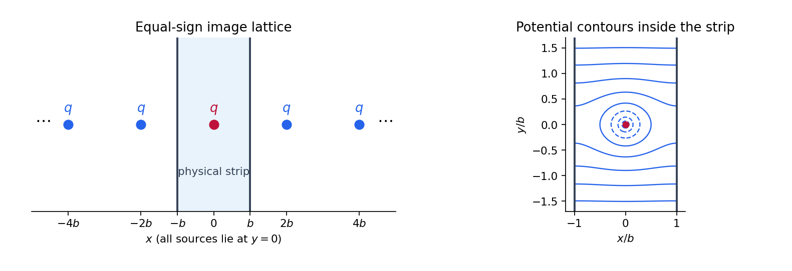

<h1 id="3/solution">Solution</h1>

↑ **Parent:** [3](../3.md)

Write $\rho=|\mathbf x-\mathbf y|$. A rotationally symmetric [fundamental solution of the Laplace equation](../../../../fundamental-solution-of-the-laplace-equation.md) is [harmonic](../../../../harmonic-function.md) for $\rho>0$. The [Laplace equation in polar coordinates](../../../../laplace-equation-in-polar-coordinates.md) reduces to $(\rho G')'=0$, so $G=A\log\rho+B$. Integrate $-\Delta G=\delta^{(2)}(\mathbf x-\mathbf y)$ over a disk of radius $\epsilon$ around the source. The [divergence theorem](../../../../divergence-theorem.md) gives

$$
1=-\int_{\partial D_\epsilon}\partial_\rho G\,ds=-2\pi A.
$$

Taking $B=0$ therefore gives

$$
\boxed{G(\mathbf x,\mathbf y)=-\frac1{2\pi}\log|\mathbf x-\mathbf y|.}
$$

Changing the reference length inside the logarithm merely adds a constant. Notice the sign convention: the potential equation in this question is $\Delta V=q\delta^{(2)}$, whereas this [Green function](../../../../green-s-function-split.md) satisfies $-\Delta G=\delta^{(2)}$. Thus the point-source potential used below is $-qG=+(q/2\pi)\log\rho$.

For the two insulating walls, successive [Euclidean reflections](../../../../reflection-mathematics.md) in $x=b$ and $x=-b$ generate sources of strength $q$ at $(2nb,0)$ for every [integer](../../../../integer-split.md) $n$. Only $n=0$ lies inside the physical strip. This is the [Neumann image lattice for a point source in a strip](../../../../neumann-image-lattice-for-a-point-source-in-a-strip.md). Set

$$
r_n=\sqrt{(x-2nb)^2+y^2}.
$$

The raw sum of logarithmic potentials diverges by additive constants. A well-defined potential is obtained by pairing opposite images and subtracting their constant reference terms:

$$
\boxed{V(x,y)=\frac q{2\pi}\left[\log r_0+\sum_{n=1}^\infty\left(\log r_n+\log r_{-n}-2\log(2nb)\right)\right]+C.}
$$

Each paired summand is $O(n^{-2})$ on compact subsets away from the source. The [series](../../../../series-mathematics.md) therefore has local [uniform convergence](../../../../uniform-convergence.md), as do the required derivative series. It gives

$$
\boxed{\frac{\partial V}{\partial y}=\frac q{2\pi}\sum_{n\in\mathbb Z}\frac{y}{(x-2nb)^2+y^2}.}
$$

In the corresponding $x$-derivative, the images pair as $n$ and $1-n$ at $x=b$, and as $n$ and $-1-n$ at $x=-b$. Their opposite horizontal separations make the derivatives cancel. Thus both homogeneous [Neumann boundary conditions](../../../../neumann-boundary-condition.md) hold. The constructed solution is even in $y$; without a condition at infinity the side conditions alone would allow further homogeneous [harmonic functions](../../../../harmonic-function.md).

For fixed $y>0$, [uniform convergence](../../../../uniform-convergence.md) on $[-b,b]$ permits integration term by term. The $n$th term has integral

$$
\int_{-b}^b\frac{y\,dx}{(x-2nb)^2+y^2}=\arctan\frac{(2n+1)b}{y}-\arctan\frac{(2n-1)b}{y}.
$$

Here $\arctan$ is the ordinary real [inverse trigonometric function](../../../../inverse-trigonometric-functions.md), taking values in $(-\pi/2,\pi/2)$. Summing from $-N$ to $N$ makes a [telescoping series](../../../../telescoping-series.md):

$$
\int_{-b}^b\partial_yV\,dx=\frac q{2\pi}\lim_{N\to\infty}2\arctan\frac{(2N+1)b}{y}=\boxed{\frac q2}.
$$

The source flux splits equally between the upper and lower parts of the strip. The next two parts give the single-wall constructions that underlie the image lattice.

**[Figure 1](#3/image-equal-sign-image-sources-and-the-physical-strip-between-two-insulating-boundaries). Equal-sign image sources and the physical strip between two insulating boundaries**.

## ↑ Ancestors (12)

1. [3](../3.md)
2. [Paper 2](../../paper-2-split.md)
3. [2011](../../split.md)
4. [Past exam of the mathematics course of the year 2 of the natural sciences course of the University of Cambridge](../../../split.md)
5. [Mathematics course of the year 2 of the natural sciences course of the University of Cambridge](../../../../mathematics-course-of-the-year-2-of-the-natural-sciences-course-of-the-university-of-cambridge.md)
6. [Year 2 of the natural sciences course of the University of Cambridge](../../../../year-2-of-the-natural-sciences-course-of-the-university-of-cambridge.md)
7. [Year of the natural sciences course of the University of Cambridge](../../../../year-of-the-natural-sciences-course-of-the-university-of-cambridge.md)
8. [Natural sciences course of the University of Cambridge](../../../../natural-sciences-course-of-the-university-of-cambridge.md)
9. [Course of the University of Cambridge](../../../../course-of-the-university-of-cambridge.md)
10. [University of Cambridge](../../../../university-of-cambridge-split.md)
11. [List of universities](../../../../list-of-universities.md)
12. [Codex Wiki](../../../../split.md)
