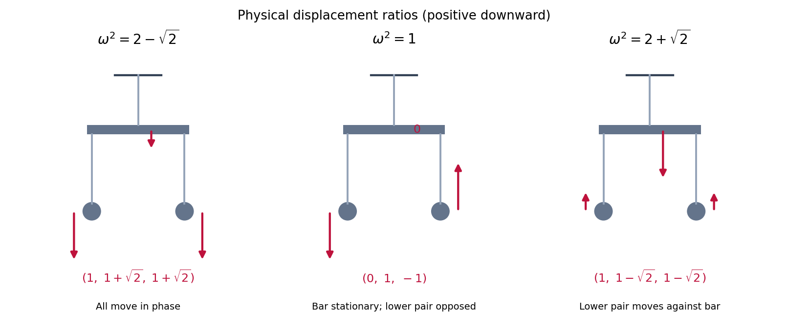

<h1 id="7/solution">Solution</h1>

↑ **Parent:** [7](../7.md)

The [Lagrangian](../../../../lagrangian.md) is $\mathcal L=T-\mathcal V$, and the [Euler-Lagrange equations](../../../../euler-lagrange-equation.md) are

$$
\frac d{dt}\frac{\partial\mathcal L}{\partial\dot q_i}-\frac{\partial\mathcal L}{\partial q_i}=0.
$$

At a rest [equilibrium](../../../../equilibrium-point-of-a-dynamical-system.md) $q=0$, $\partial_i\mathcal V(0)=0$ for all three coordinates. The [Taylor expansion](../../../../taylor-expansion.md) therefore starts as

$$
\mathcal V(q)=\mathcal V(0)+\frac12\sum_{ij}q_i\left.\frac{\partial^2\mathcal V}{\partial q_i\partial q_j}\right|_0q_j+O(|q|^3).
$$

The symmetric [Hessian matrix](../../../../hessian-matrix.md) is the matrix $\mathsf V$ of the quadratic [potential energy](../../../../potential-energy.md). If a quadratic coefficient vanishes along a direction, higher-order terms can be the first nonconstant terms there; equilibrium by itself does not imply strict stability.

Write $\mathsf T_0=\mathsf T(0)$. Terms involving the variation of $\mathsf T(q)$ are cubic in small displacements and velocities, so the quadratic [small oscillation](../../../../small-oscillation.md) Lagrangian is

$$
\mathcal L_2=\frac12\dot q^T\mathsf T_0\dot q-\frac12q^T\mathsf Vq,
\qquad \mathsf T_0\ddot q+\mathsf Vq=0.
$$

A [normal mode](../../../../normal-mode.md) has fixed displacement ratios, $q(t)=v\cos(\omega t+\phi)$. Its [angular frequency](../../../../angular-frequency.md) $\omega$ is an [eigenfrequency](../../../../eigenfrequency.md), or normal frequency, and satisfies the [generalized eigenvalue problem for small oscillations](../../../../generalized-eigenvalue-problem-for-small-oscillations.md)

$$
\mathsf Vv=\omega^2\mathsf T_0v,\qquad \det(\mathsf V-\omega^2\mathsf T_0)=0.
$$

Here $\mathsf T_0$ is positive definite for independent physical coordinates and positive masses. A stable quadratic minimum makes $\omega^2\geq0$; a negative value would describe exponential instability rather than oscillation.

For the suspended bar, let $\kappa_0$ and $\kappa_1$ denote the actual incremental [spring constants](../../../../spring-constant.md) of the upper and each lower [spring](../../../../spring.md). The physical displacement of the bar is $q_1$, while the lower spring extensions change by $q_2-q_1$ and $q_3-q_1$. Consequently

$$
T=\frac12\left(M\dot q_1^2+m\dot q_2^2+m\dot q_3^2\right),\quad
\mathcal V_2=\frac12\kappa_0q_1^2+\frac12\kappa_1\left[(q_2-q_1)^2+(q_3-q_1)^2\right].
$$

The linear gravitational and elastic terms cancel at the loaded [equilibrium](../../../../equilibrium-point-of-a-dynamical-system.md). Expanding the remaining squares gives the [small-oscillation mass and stiffness matrices](../../../../small-oscillation-mass-and-stiffness-matrices.md)

$$
\mathsf T_0=\begin{pmatrix}M&0&0\\0&m&0\\0&0&m\end{pmatrix},\qquad
\mathsf V=\begin{pmatrix}\kappa_0+2\kappa_1&-\kappa_1&-\kappa_1\\-\kappa_1&\kappa_1&0\\-\kappa_1&0&\kappa_1\end{pmatrix}.
$$

Thus

$$
\boxed{\mathcal L_2=\frac12\left[M\dot q_1^2+m\dot q_2^2+m\dot q_3^2-\kappa_0q_1^2-\kappa_1(q_2-q_1)^2-\kappa_1(q_3-q_1)^2\right].}
$$

**Source convention:** the printed matrix is obtained by setting $\kappa_0=\lambda/L$ and $\kappa_1=\mu/l$. Although the PDF prose calls $\lambda,\mu$ spring constants, that matrix treats them as elastic parameters whose ratios to the stated lengths are the incremental stiffnesses. If they are read literally as Hooke-law [spring constants](../../../../spring-constant.md), the divisions by $L,l$ should instead be omitted. The numerical case has $L=l=1$, so this discrepancy does not affect its results.

With the numerical parameters, $\mathsf T_0=\operatorname{diag}(2,1,1)$ and

$$
\mathsf V=\begin{pmatrix}6&-1&-1\\-1&1&0\\-1&0&1\end{pmatrix}.
$$

Use the exchange symmetry of the lower masses to find the [vertical modes of a horizontally constrained suspended bar](../../../../vertical-modes-of-a-horizontally-constrained-suspended-bar.md). The antisymmetric vector $v_a=(0,1,-1)^T$ obeys $\mathsf Vv_a=\mathsf T_0v_a$, giving $\omega_a=1$. In the symmetric sector put $v=(A,B,B)^T$ and $s=\omega^2$. The two independent equations are

$$
(6-2s)A-2B=0,\qquad -A+(1-s)B=0.
$$

Their determinant gives $s^2-4s+2=0$, so $s=2\pm\sqrt2$. Taking $A=1$, the full set is

$$
\boxed{\begin{array}{c|c}
\text{angular frequency}&\text{relative displacements }(q_1,q_2,q_3)\\\hline
\sqrt{2-\sqrt2}&(1,1+\sqrt2,1+\sqrt2)\\
1&(0,1,-1)\\
\sqrt{2+\sqrt2}&(1,1-\sqrt2,1-\sqrt2)
\end{array}.}
$$

In the lowest [normal mode](../../../../normal-mode.md), all three masses move in phase, with the lower masses moving about $2.414$ times as far as the bar. In the antisymmetric [normal mode](../../../../normal-mode.md), the bar stays still and the lower masses move equally in opposite directions; their changing forces on the bar cancel. In the highest [normal mode](../../../../normal-mode.md), the lower masses move together against the bar, with magnitude about $0.414$ of its displacement. Any small motion is a superposition of these three modes.

**[Figure 2](#7/image-relative-vertical-displacements-in-the-three-normal-modes-with-the-bar-constrained-to-remain-horizontal). Relative vertical displacements in the three normal modes, with the bar constrained to remain horizontal**.

## ↑ Ancestors (12)

1. [7](../7.md)
2. [Paper 2](../../paper-2-split.md)
3. [2011](../../split.md)
4. [Past exam of the mathematics course of the year 2 of the natural sciences course of the University of Cambridge](../../../split.md)
5. [Mathematics course of the year 2 of the natural sciences course of the University of Cambridge](../../../../mathematics-course-of-the-year-2-of-the-natural-sciences-course-of-the-university-of-cambridge.md)
6. [Year 2 of the natural sciences course of the University of Cambridge](../../../../year-2-of-the-natural-sciences-course-of-the-university-of-cambridge.md)
7. [Year of the natural sciences course of the University of Cambridge](../../../../year-of-the-natural-sciences-course-of-the-university-of-cambridge.md)
8. [Natural sciences course of the University of Cambridge](../../../../natural-sciences-course-of-the-university-of-cambridge.md)
9. [Course of the University of Cambridge](../../../../course-of-the-university-of-cambridge.md)
10. [University of Cambridge](../../../../university-of-cambridge-split.md)
11. [List of universities](../../../../list-of-universities.md)
12. [Codex Wiki](../../../../split.md)
