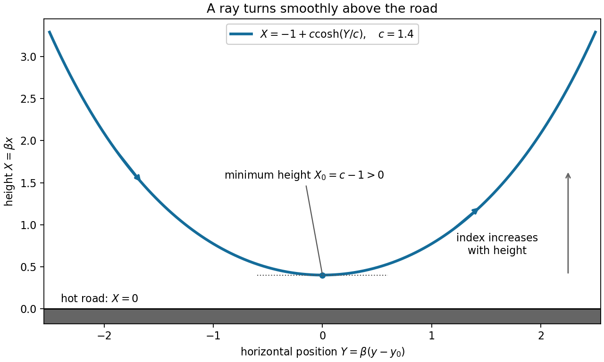

# Paper 1

↑ **Parent:** [2012](../2012.md)

[https://www.maths.cam.ac.uk/undergradnst/files/2012/PaperNST_IB_1.pdf](https://www.maths.cam.ac.uk/undergradnst/files/2012/PaperNST_IB_1.pdf)

**Table of contents**

- [1](#1)
  - [Solution](#1/solution)
- [2](#2)
  - [Solution](#2/solution)
- [3](#3)
  - [Solution](#3/solution)
- [4](#4)
  - [Solution](#4/solution)
- [5](#5)
  - [i](#5/i)
    - [Solution](#5/i/solution)
  - [ii](#5/ii)
    - [Solution](#5/ii/solution)
    - [a](#5/ii/a)
      - [Solution](#5/ii/a/solution)
    - [b](#5/ii/b)
      - [Solution](#5/ii/b/solution)
    - [c](#5/ii/c)
      - [Solution](#5/ii/c/solution)
- [6](#6)
  - [i](#6/i)
    - [Solution](#6/i/solution)
    - [a](#6/i/a)
      - [Solution](#6/i/a/solution)
    - [b](#6/i/b)
      - [Solution](#6/i/b/solution)
  - [ii](#6/ii)
    - [Solution](#6/ii/solution)
    - [a](#6/ii/a)
      - [Solution](#6/ii/a/solution)
    - [b](#6/ii/b)
      - [Solution](#6/ii/b/solution)
- [7](#7)
  - [i](#7/i)
    - [Solution](#7/i/solution)
    - [a](#7/i/a)
      - [Solution](#7/i/a/solution)
    - [b](#7/i/b)
      - [Solution](#7/i/b/solution)
  - [ii](#7/ii)
    - [Solution](#7/ii/solution)
    - [a](#7/ii/a)
      - [Solution](#7/ii/a/solution)
    - [b](#7/ii/b)
      - [Solution](#7/ii/b/solution)
- [8](#8)
  - [a](#8/a)
    - [Solution](#8/a/solution)
  - [b](#8/b)
    - [Solution](#8/b/solution)
  - [c](#8/c)
    - [Solution](#8/c/solution)
  - [d](#8/d)
    - [Solution](#8/d/solution)
  - [e](#8/e)
    - [Solution](#8/e/solution)
- [9](#9)
  - [i](#9/i)
    - [Solution](#9/i/solution)
    - [a](#9/i/a)
      - [Solution](#9/i/a/solution)
    - [b](#9/i/b)
      - [Solution](#9/i/b/solution)
  - [ii](#9/ii)
    - [Solution](#9/ii/solution)
    - [a](#9/ii/a)
      - [Solution](#9/ii/a/solution)
    - [b](#9/ii/b)
      - [Solution](#9/ii/b/solution)
    - [c](#9/ii/c)
      - [Solution](#9/ii/c/solution)
- [10](#10)
  - [i](#10/i)
    - [Solution](#10/i/solution)
    - [a](#10/i/a)
      - [Solution](#10/i/a/solution)
    - [b](#10/i/b)
      - [Solution](#10/i/b/solution)
  - [ii](#10/ii)
    - [Solution](#10/ii/solution)
    - [a](#10/ii/a)
      - [Solution](#10/ii/a/solution)
    - [b](#10/ii/b)
      - [Solution](#10/ii/b/solution)

## 1

↑ **Parent:** [Paper 1](paper-1.md)

<h3 id="1/solution">Solution</h3>

↑ **Parent:** [1](#1)

Using [Cartesian coordinates](../../linear-algebra.md#cartesian-coordinate-system), the [Levi-Civita symbol](../../multivariable-calculus.md#levi-civita-symbol) and the [Einstein summation convention](../../multilinear-algebra.md#einstein-notation), the constant-vector assumption gives

$$
\begin{aligned}
[\nabla\times(\mathbf a\times\mathbf F)]_i
&=\epsilon_{ijk}\epsilon_{klm}a_l\partial_jF_m\\
&=(\delta_{il}\delta_{jm}-\delta_{im}\delta_{jl})a_l\partial_jF_m\\
&=a_i\partial_jF_j-a_j\partial_jF_i.
\end{aligned}
$$

Recognizing the [divergence](../../multivariable-calculus.md#divergence) and [directional derivative](../../multivariable-calculus.md#directional-derivative) proves

$$
\boxed{\nabla\times(\mathbf a\times\mathbf F)=\mathbf a(\nabla\cdot\mathbf F)-(\mathbf a\cdot\nabla)\mathbf F.}
$$

Here the contractions use the [Kronecker delta](../../multilinear-algebra.md#kronecker-delta).

For an oriented piecewise smooth surface $S$ with boundary $C$, [Stokes theorem](../../multivariable-calculus.md#stokes-theorem) states

$$
\oint_C\mathbf Q\cdot d\mathbf l=\int_S(\nabla\times\mathbf Q)\cdot d\mathbf S,
$$

where the orientations obey the [right-hand rule](../../electromagnetism.md#right-hand-rule) and $\mathbf Q$ is continuously differentiable near $S$. Apply it to $\mathbf Q=\mathbf F\times\mathbf a$. The [scalar triple product](../../multilinear-algebra.md#scalar-triple-product) gives

$$
\begin{aligned}
\mathbf a\cdot\oint_Cd\mathbf l\times\mathbf F
&=\oint_C(\mathbf F\times\mathbf a)\cdot d\mathbf l\\
&=\int_S\left[(\mathbf a\cdot\nabla)\mathbf F-\mathbf a(\nabla\cdot\mathbf F)\right]\cdot d\mathbf S.
\end{aligned}
$$

The last integrand is $\mathbf a\cdot[(d\mathbf S\times\nabla)\times\mathbf F]$, as the component formula

$$
[(d\mathbf S\times\nabla)\times\mathbf F]_i=dS_j\partial_iF_j-dS_i\partial_jF_j
$$

shows. Since $\mathbf a$ is arbitrary, the [cross-product form of Stokes theorem](../../multivariable-calculus.md#cross-product-form-of-stokes-theorem) follows:

$$
\boxed{\oint_Cd\mathbf l\times\mathbf F=\int_S(d\mathbf S\times\nabla)\times\mathbf F.}
$$

The derivatives in the surface expression act on $\mathbf F$, not on the surface element.

For the specified square, the path is clockwise when viewed from positive $z$, so the compatible [unit normal](../../differential-geometry.md#unit-normal) is $-\mathbf e_z$. On the first and fourth edges, $d\mathbf l$ and $\mathbf r$ are parallel, giving zero [cross product](../../vector-space.md#cross-product). On the second edge, $y=1$ and $x$ runs from $0$ to $1$, so $d\mathbf l\times\mathbf r=\mathbf e_z\,dx$ contributes $\mathbf e_z$. On the third edge, $x=1$ and $y$ runs from $1$ to $0$, so the contribution is $-\mathbf e_z\int_1^0dy=\mathbf e_z$. Thus the [line integral](../../multivariable-calculus.md#line-integral) is $2\mathbf e_z$.

For an independent [surface integral](../../multivariable-calculus.md#surface-integral), $\partial_iF_j=\delta_{ij}$ and $\nabla\cdot\mathbf F=3$ for the [position vector](../../classical-mechanics.md#position-vector) field. Its integrand is therefore $d\mathbf S-3d\mathbf S=-2d\mathbf S$. The square has unit area and downward orientation, giving

$$
\boxed{\oint_Cd\mathbf l\times\mathbf r=2\mathbf e_z=\int_S(-2d\mathbf S).}
$$

## 2

↑ **Parent:** [Paper 1](paper-1.md)

<h3 id="2/solution">Solution</h3>

↑ **Parent:** [2](#2)

For a spherically symmetric [number density](../../statistical-physics.md#number-density), the radial [Laplacian](../../multivariable-calculus.md#laplacian) is $r^{-2}\partial_r(r^2\partial_rn)$. Applying [separation of variables](../../partial-differential-equation.md#separation-of-variables) and choosing the separation constant $-k^2$ gives

$$
\frac{R''+2R'/r}{R}=\frac{T'}T-\lambda=-k^2,
$$

so the [ordinary differential equations](../../differential-equation.md#ordinary-differential-equation) are

$$
\boxed{R''+\frac2rR'+k^2R=0,\qquad T'=(\lambda-k^2)T.}
$$

The radial problem is an [eigenvalue problem](../../linear-operator-theory.md#eigenvalue-problem) for $-\Delta$ with [Dirichlet boundary conditions](../../differential-equation.md#dirichlet-boundary-condition), hence $k^2>0$: multiplying the radial equation by $r^2\overline R$ and integrating gives $k^2\int_0^ar^2|R|^2dr=\int_0^ar^2|R'|^2dr>0$ for a nonzero regular mode vanishing at $a$.

To solve it explicitly, set $R=f/r$, corresponding to the suggested power $p=-1$. The equation reduces to $f''+k^2f=0$, so

$$
R(r)=\frac{A\sin(kr)+B\cos(kr)}r.
$$

Finiteness at the origin forces $B=0$, and the [Dirichlet boundary condition](../../differential-equation.md#dirichlet-boundary-condition) at $r=a$ requires $k=m\pi/a$ for an integer $m\geq1$. The absence of interior zeros excludes $m\geq2$, selecting the fundamental [normal mode](../../wave-equation.md#normal-mode). If $n_c>0$ denotes the initial central density, the result is

$$
\boxed{n(r,t)=n_c\frac{\sin(\pi r/a)}{\pi r/a}\exp\left[\left(\lambda-\frac{\pi^2}{a^2}\right)t\right],\qquad 0\leq r\leq a,}
$$

where the sine ratio is defined as $1$ at the origin. It is strictly positive in the interior for every finite time. The arbitrary positive scale $n_c$ cannot be fixed without additional initial data.

The spatial factor is time independent, so the density and the total [neutron](../../neutron.md) population have the same exponential growth rate. Thus the [spherical reaction-diffusion growth threshold](../../diffusion-equation.md#spherical-reaction-diffusion-growth-threshold) is

$$
\boxed{\lambda>\frac{\pi^2}{a^2}.}
$$

At equality the fundamental mode is stationary; below it the mode decays. For fixed $\lambda>0$, the equivalent critical-radius condition is $a>\pi/\sqrt\lambda$. This is the competition between multiplication in the bulk and [diffusion](../../thermodynamics.md#diffusion) loss at the surface in the stated dimensionless model.

## 3

↑ **Parent:** [Paper 1](paper-1.md)

<h3 id="3/solution">Solution</h3>

↑ **Parent:** [3](#3)

The homogeneous equation is a [Cauchy-Euler equation](../../linear-ordinary-differential-equation.md#cauchy-euler-equation). Trying $y=x^m$ gives the repeated [indicial root](../../linear-ordinary-differential-equation.md#indicial-root)

$$
m(m-1)+3m+1=(m+1)^2=0.
$$

Hence, for $x>0$,

$$
\boxed{y_h=\frac{C_1+C_2\log x}{x}.}
$$

Both independent solutions diverge at the origin, so no nonzero homogeneous combination satisfies the zero-origin conditions by continuous extension.

For a source point $\xi>0$, finiteness on $0<x<\xi$ forces the [Green function](../../green-s-function.md) to vanish on that side. On $x>\xi$, continuity and the unit first-derivative jump require

$$
G(\xi^+,\xi)=0,\qquad G_x(\xi^+,\xi)=1.
$$

Using the homogeneous solutions gives the [causal Green function for a repeated-root Euler operator](../../green-s-function.md#causal-green-function-for-a-repeated-root-euler-operator)

$$
\boxed{G(x,\xi)=\begin{cases}0,&0\leq x<\xi,\\\displaystyle\frac{\xi^2}{x}\log\frac{x}{\xi},&x\geq\xi>0.\end{cases}}
$$

Indeed, the [Wronskian](../../linear-ordinary-differential-equation.md#wronskian) of $x^{-1}$ and $x^{-1}\log x$ is $x^{-3}$, and direct [differentiation](../../calculus.md#differentiation) gives $G_x(\xi^+,\xi)=1$. Since $G$ is continuous, its second derivative produces precisely a unit [Dirac delta](../../distribution-theory.md#dirac-delta-function), with no derivative of a delta. For each positive source it is identically zero near the origin, so both required origin values vanish. The differential operator itself is interpreted on $x>0$; no value of its singular coefficients at zero is needed.

Integrating against the forcing yields

$$
y(x)=\int_0^\infty G(x,\xi)\xi\,d\xi=\frac1x\int_0^x\xi^3\log\frac{x}{\xi}\,d\xi=x^3\int_0^1s^3\log\frac1s\,ds.
$$

The last [integral](../../integral.md) equals $1/16$, by [integration by parts](../../calculus.md#integration-by-parts) or differentiating $\int_0^1s^pds=1/(p+1)$. Consequently

$$
\boxed{y(x)=\frac{x^3}{16}.}
$$

Substitution gives $y''+3y'/x+y/x^2=(6+9+1)x/16=x$, while $y(0)=y'(0)=0$. The divergent homogeneous solutions prove uniqueness in the regular class. No boundary condition at infinity was imposed or required.

## 4

↑ **Parent:** [Paper 1](paper-1.md)

<h3 id="4/solution">Solution</h3>

↑ **Parent:** [4](#4)

Complete the square in the [Fourier transform](../../fourier-transform.md) exponent:

$$
-\lambda x^2-ikx=-\lambda\left(x+\frac{ik}{2\lambda}\right)^2-\frac{k^2}{4\lambda}.
$$

The supplied shifted [Gaussian integral](../../integral.md#gaussian-integral) therefore gives

$$
\boxed{\widehat f(k)=\sqrt{\frac\pi\lambda}\exp\left(-\frac{k^2}{4\lambda}\right).}
$$

This is the [Fourier transform of a Gaussian](../../fourier-analysis.md#fourier-transform-of-a-gaussian), with angular-wavenumber convention $e^{-ikx}$.

Take the spatial [Fourier transform](../../fourier-transform.md) of the [heat equation](../../diffusion-equation.md#heat-equation). Two [integrations by parts](../../calculus.md#integration-by-parts), with decaying fields and first derivatives at infinity, give $\mathcal F[\psi_{xx}]=-k^2\widetilde\psi$. Thus each mode satisfies the [ordinary differential equation](../../differential-equation.md#ordinary-differential-equation)

$$
\boxed{\partial_t\widetilde\psi(k,t)=-k^2\widetilde\psi(k,t).}
$$

Inserting the transformed [initial condition](../../differential-equation.md#initial-condition) and integrating the time equation gives

$$
\boxed{\widetilde\psi(k,t)=\sqrt{\frac\pi\lambda}\exp\left[-\left(t+\frac1{4\lambda}\right)k^2\right].}
$$

Finally set $A=t+1/(4\lambda)>0$. The [inverse Fourier transform](../../fourier-transform.md#inverse-fourier-transform), evaluated by the same Gaussian identity, gives

$$
\begin{aligned}
\psi(x,t)&=\frac1{2\pi}\sqrt{\frac\pi\lambda}\int_{-\infty}^{\infty}e^{-Ak^2+ikx}dk\\
&=\frac1{2\sqrt{\lambda A}}e^{-x^2/(4A)}.
\end{aligned}
$$

Equivalently the [Gaussian initial data for the heat equation](../../diffusion-equation.md#gaussian-initial-data-for-the-heat-equation) evolve as

$$
\boxed{\psi(x,t)=\frac1{\sqrt{1+4\lambda t}}\exp\left[-\frac{\lambda x^2}{1+4\lambda t}\right],\qquad t>0.}
$$

The profile broadens and its peak decreases, while its total [integral](../../integral.md) remains $\sqrt{\pi/\lambda}$, as required by [diffusion](../../thermodynamics.md#diffusion) without loss on the whole line. Direct differentiation verifies the equation and the initial limit.

## 5

↑ **Parent:** [Paper 1](paper-1.md)

<h3 id="5/i">i</h3>

↑ **Parent:** [5](#5)

<h4 id="5/i/solution">Solution</h4>

↑ **Parent:** [I](#5/i)

Let $v_1,\ldots,v_n$ be the [linearly independent](../../vector-space.md#linear-independence) [eigenvectors](../../linear-operator-theory.md#eigenvector), and form $V=(v_1\ \cdots\ v_n)$. This [matrix](../../vector-space.md#matrix) is invertible and $AV=VD$, where $D=\operatorname{diag}(\lambda_1,\ldots,\lambda_n)$. Hence

$$
\boxed{V^{-1}AV=D,}
$$

which proves [diagonalizability](../../linear-operator-theory.md#diagonalizable-matrix).

If $B=P^{-1}AP$, then $P^{-1}v_j$ are linearly independent [eigenvectors](../../linear-operator-theory.md#eigenvector) of $B$ with the same [eigenvalues](../../linear-operator-theory.md#eigenvalue). Explicitly, with $W=P^{-1}V$,

$$
\boxed{W^{-1}BW=V^{-1}P(P^{-1}AP)P^{-1}V=D.}
$$

Thus [matrix similarity](../../linear-algebra.md#matrix-similarity) preserves diagonalizability.

<h3 id="5/ii">ii</h3>

↑ **Parent:** [5](#5)

<h4 id="5/ii/solution">Solution</h4>

↑ **Parent:** [Ii](#5/ii)

The [spectral theorem](../../hilbert-space.md#spectral-theorem) for a [Hermitian matrix](../../hilbert-space.md#hermitian-operator) supplies a [unitary matrix](../../linear-operator-theory.md#unitary-matrix) $U$ and real diagonal matrix $D=\operatorname{diag}(\lambda_1,\ldots,\lambda_n)$ with $A=UDU^\dagger$. This single representation gives all three conclusions below.

<h4 id="5/ii/a">a</h4>

↑ **Parent:** [Ii](#5/ii)

<h5 id="5/ii/a/solution">Solution</h5>

↑ **Parent:** [A](#5/ii/a)

For a positive integer $k$, cancellation of $U^\dagger U=I$ gives $A^k=UD^kU^\dagger$. The [trace](../../linear-algebra.md#matrix-trace) is invariant under [matrix similarity](../../linear-algebra.md#matrix-similarity), since $\operatorname{tr}(XY)=\operatorname{tr}(YX)$, and the [determinant](../../multilinear-algebra.md#determinant) is multiplicative. Therefore

$$
\boxed{\operatorname{tr}(A^k)=\operatorname{tr}(D^k)=\sum_{j=1}^n\lambda_j^k,\qquad \det(A^k)=\det(D^k)=\prod_{j=1}^n\lambda_j^k.}
$$

This includes zero eigenvalues without requiring $A$ to be invertible.

<h4 id="5/ii/b">b</h4>

↑ **Parent:** [Ii](#5/ii)

<h5 id="5/ii/b/solution">Solution</h5>

↑ **Parent:** [B](#5/ii/b)

The convergent [power series](../../sequence-and-series.md#power-series) defining the [matrix exponential](../../linear-operator-theory.md#matrix-exponential) gives $e^A=Ue^DU^\dagger$, with $e^D=\operatorname{diag}(e^{\lambda_1},\ldots,e^{\lambda_n})$. Hence the [matrix exponential determinant identity](../../linear-operator-theory.md#matrix-exponential-determinant-identity) is

$$
\boxed{\det(e^A)=\prod_{j=1}^ne^{\lambda_j}=e^{\sum_j\lambda_j}=e^{\operatorname{tr}A}.}
$$

The diagonalization proof uses the given Hermitian hypothesis; the identity itself holds for every square real or complex matrix.

<h4 id="5/ii/c">c</h4>

↑ **Parent:** [Ii](#5/ii)

<h5 id="5/ii/c/solution">Solution</h5>

↑ **Parent:** [C](#5/ii/c)

Applying $A^2=A$ to an [eigenvector](../../linear-operator-theory.md#eigenvector) gives $\lambda_j^2=\lambda_j$, so each [eigenvalue](../../linear-operator-theory.md#eigenvalue) is either zero or one. If all are one, the [spectral theorem](../../hilbert-space.md#spectral-theorem) gives $A=I$, hence $\det A=1$ and $\operatorname{tr}A=n$. Otherwise, if $m$ eigenvalues are one, with $0\leq m<n$, then

$$
\boxed{\det A=0,\qquad\operatorname{tr}A=m<n.}
$$

Thus the [trace](../../linear-algebra.md#matrix-trace) of this [orthogonal projection](../../hilbert-space.md#orthogonal-projection) equals its [rank](../../quadratic-form.md#rank-one-quadratic-form), including $m=0$ for the zero matrix.

## 6

↑ **Parent:** [Paper 1](paper-1.md)

<h3 id="6/i">i</h3>

↑ **Parent:** [6](#6)

<h4 id="6/i/solution">Solution</h4>

↑ **Parent:** [I](#6/i)

The decomposition is $A=H+iS$. Both matrices are [Hermitian](../../hilbert-space.md#hermitian-operator): $H^\dagger=H$ and $S^\dagger=S$, directly from their definitions and complex conjugation of $1/(2i)$. The matrix $H$ is the [Hermitian part of a matrix](../../hilbert-space.md#hermitian-part-of-a-matrix), whereas $S$ is the Hermitian matrix obtained by dividing the skew-Hermitian part by $i$.

<h4 id="6/i/a">a</h4>

↑ **Parent:** [I](#6/i)

<h5 id="6/i/a/solution">Solution</h5>

↑ **Parent:** [A](#6/i/a)

Multiply the [eigenvalue equation](../../linear-operator-theory.md#eigenvalue-equation) $Ax=\lambda x$ on the left by $x^\dagger$. The [unit vector](../../vector-space.md#unit-vector) normalization is $x^\dagger x=1$, so

$$
\boxed{\lambda=x^\dagger Ax=x^\dagger Hx+i\,x^\dagger Sx.}
$$

No [normal matrix](../../linear-operator-theory.md#normal-matrix) assumption on $A$ is needed: this is an identity for each normalized eigenvector.

<h4 id="6/i/b">b</h4>

↑ **Parent:** [I](#6/i)

<h5 id="6/i/b/solution">Solution</h5>

↑ **Parent:** [B](#6/i/b)

For any [Hermitian matrix](../../hilbert-space.md#hermitian-operator) $K$, the scalar $x^\dagger Kx$ is real because its [complex conjugate](../../complex-analysis.md#complex-conjugate) equals $x^\dagger K^\dagger x=x^\dagger Kx$. Applying this to $H,S$ in part (a) gives

$$
\boxed{\operatorname{Re}\lambda=x^\dagger Hx,\qquad\operatorname{Im}\lambda=x^\dagger Sx.}
$$

These are the real and imaginary [quadratic forms](../../quadratic-form.md) associated with the [numerical range](../../quantum-theory.md#numerical-range) of $A$.

<h3 id="6/ii">ii</h3>

↑ **Parent:** [6](#6)

<h4 id="6/ii/solution">Solution</h4>

↑ **Parent:** [Ii](#6/ii)

Use the [inner product](../../inner-product.md) $\langle u,v\rangle=u^\dagger v$ on $\mathbb C^n$. The distinct real [eigenvalues](../../linear-operator-theory.md#eigenvalue) permit a full orthonormal eigenvector expansion; the two child solutions establish that expansion and apply it to the proposed [quadratic form](../../quadratic-form.md).

<h4 id="6/ii/a">a</h4>

↑ **Parent:** [Ii](#6/ii)

<h5 id="6/ii/a/solution">Solution</h5>

↑ **Parent:** [A](#6/ii/a)

For $Bx_i=\lambda_ix_i$, Hermitian symmetry gives

$$
\lambda_jx_i^\dagger x_j=x_i^\dagger Bx_j=(Bx_i)^\dagger x_j=\lambda_ix_i^\dagger x_j.
$$

Distinct [eigenvalues](../../linear-operator-theory.md#eigenvalue) therefore imply $x_i^\dagger x_j=0$ for $i\ne j$. Together with the unit normalizations,

$$
\boxed{x_i^\dagger x_j=\delta_{ij}.}
$$

The $n$ mutually orthogonal nonzero vectors are linearly independent and span the $n$-dimensional space, so they form an [orthonormal basis](../../inner-product.md#orthonormal-basis). Here $\delta_{ij}$ is the [Kronecker delta](../../multilinear-algebra.md#kronecker-delta).

<h4 id="6/ii/b">b</h4>

↑ **Parent:** [Ii](#6/ii)

<h5 id="6/ii/b/solution">Solution</h5>

↑ **Parent:** [B](#6/ii/b)

Expand $v=\sum_jc_jx_j$, where $c_j=x_j^\dagger v$. By [orthonormality](../../inner-product.md#orthonormal-set),

$$
\boxed{\beta=\sum_j|c_j|^2(\lambda_j-a)(\lambda_j-b).}
$$

Since the [spectrum](../../linear-operator-theory.md#spectrum-functional-analysis) avoids $[a,b]$, each $\lambda_j$ is either below $a$ or above $b$, making every product strictly positive. This proves [positivity of a quadratic polynomial across a spectral gap](../../linear-operator-theory.md#positivity-of-a-quadratic-polynomial-across-a-spectral-gap):

$$
\boxed{\beta\geq\delta\|v\|^2,\qquad\delta=\min_j(\lambda_j-a)(\lambda_j-b)>0.}
$$

In particular **$\beta>0$ for every nonzero $v$**. For $v=0$, $\beta=0$; the printed strict claim for an arbitrary vector must exclude this case.

## 7

↑ **Parent:** [Paper 1](paper-1.md)

<h3 id="7/i">i</h3>

↑ **Parent:** [7](#7)

<h4 id="7/i/solution">Solution</h4>

↑ **Parent:** [I](#7/i)

The [complex potential of a two-dimensional potential flow](../../fluid-mechanics.md#complex-potential-of-a-two-dimensional-potential-flow) combines the [velocity potential](../../fluid-mechanics.md#velocity-potential) $u$ with the [stream function](../../fluid-mechanics.md#stream-function) $v$. For its [holomorphic](../../holomorphic-function.md) representation, the [Cauchy-Riemann equations](../../analysis.md#cauchy-riemann-equations) are $u_x=v_y$ and $u_y=-v_x$.

<h4 id="7/i/a">a</h4>

↑ **Parent:** [I](#7/i)

<h5 id="7/i/a/solution">Solution</h5>

↑ **Parent:** [A](#7/i/a)

Since $\mathbf V=\nabla u$, its [divergence](../../multivariable-calculus.md#divergence) is the [Laplacian](../../multivariable-calculus.md#laplacian) of the velocity potential. Using the [Cauchy-Riemann equations](../../analysis.md#cauchy-riemann-equations) and equality of mixed [partial derivatives](../../multivariable-calculus.md#partial-derivative) gives

$$
\boxed{\nabla\cdot\mathbf V=u_{xx}+u_{yy}=(v_y)_x-(v_x)_y=0.}
$$

Thus this is an [incompressible flow](../../fluid-mechanics.md#incompressible-flow), and $u$ is a [harmonic function](../../partial-differential-equation.md#harmonic-function).

<h4 id="7/i/b">b</h4>

↑ **Parent:** [I](#7/i)

<h5 id="7/i/b/solution">Solution</h5>

↑ **Parent:** [B](#7/i/b)

The [derivative](../../calculus.md#derivative) of a [holomorphic function](../../holomorphic-function.md) can be evaluated using an increment along the real axis:

$$
f'(z)=u_x+iv_x=u_x-iu_y.
$$

Identifying the components of the [gradient](../../multivariable-calculus.md#gradient) $\mathbf V=\nabla u$ gives

$$
\boxed{f'(z)=V_x-iV_y.}
$$

<h3 id="7/ii">ii</h3>

↑ **Parent:** [7](#7)

<h4 id="7/ii/solution">Solution</h4>

↑ **Parent:** [Ii](#7/ii)

For $\operatorname{Re}z>0$, the defining [Gamma integral](../../complex-analysis.md#gamma-integral) converges at zero and at infinity and defines a [holomorphic function](../../holomorphic-function.md). The [Gamma function recurrence](../../complex-analysis.md#gamma-function-recurrence) then supplies its [meromorphic continuation](../../holomorphic-function.md#meromorphic-continuation) to the rest of the complex plane, as used below.

<h4 id="7/ii/a">a</h4>

↑ **Parent:** [Ii](#7/ii)

<h5 id="7/ii/a/solution">Solution</h5>

↑ **Parent:** [A](#7/ii/a)

For $\operatorname{Re}z>0$, [integration by parts](../../calculus.md#integration-by-parts) gives

$$
\Gamma(z+1)=\int_0^\infty t^ze^{-t}dt=\left[-t^ze^{-t}\right]_0^\infty+z\int_0^\infty t^{z-1}e^{-t}dt.
$$

The boundary term vanishes because $t^{\operatorname{Re}z}\to0$ at zero and exponential decay dominates any fixed power at infinity. Thus

$$
\boxed{\Gamma(z+1)=z\Gamma(z),\qquad \Gamma(1)=\int_0^\infty e^{-t}dt=1.}
$$

This also gives $\Gamma(n+1)=n!$ for nonnegative integers, linking the [Gamma function](../../complex-analysis.md#gamma-function) to the [factorial](../../combinatorics.md#factorial).

<h4 id="7/ii/b">b</h4>

↑ **Parent:** [Ii](#7/ii)

<h5 id="7/ii/b/solution">Solution</h5>

↑ **Parent:** [B](#7/ii/b)

Iterate the [Gamma function recurrence](../../complex-analysis.md#gamma-function-recurrence) to obtain, near $z=-m$ for $m\geq0$,

$$
\Gamma(z)=\frac{\Gamma(z+m+1)}{z(z+1)\cdots(z+m)}.
$$

The numerator is holomorphic and equals $\Gamma(1)=1$ at $z=-m$. Exactly one denominator factor, $z+m$, vanishes; the product of the remaining factors there is $(-m)(-m+1)\cdots(-1)=(-1)^m m!$. Thus there is a [simple pole](../../isolated-singularity.md#simple-pole), with [Gamma function residue at a nonpositive integer](../../complex-analysis.md#gamma-function-residue-at-a-nonpositive-integer)

$$
\boxed{\operatorname*{Res}_{z=-m}\Gamma(z)=\lim_{z\to-m}(z+m)\Gamma(z)=\frac{(-1)^m}{m!}.}
$$

For $m=0$ the empty product is one. The same recurrence with a sufficiently large shift defines the continuation at every point away from these integers, so no further poles occur. At the poles, the recurrence is an identity of [meromorphic functions](../../isolated-singularity.md#meromorphic-function), rather than an equality of finite values.

## 8

↑ **Parent:** [Paper 1](paper-1.md)

<h3 id="8/a">a</h3>

↑ **Parent:** [8](#8)

<h4 id="8/a/solution">Solution</h4>

↑ **Parent:** [A](#8/a)

Insert the [power series](../../sequence-and-series.md#power-series) and equate the coefficient of $x^n$. In the [Legendre differential equation](../../linear-ordinary-differential-equation.md#legendre-differential-equation) this gives

$$
(n+2)(n+1)a_{n+2}+[\ell(\ell+1)-n(n+1)]a_n=0.
$$

Hence the [recurrence relation](../../sequence-and-series.md#recurrence-relation) is

$$
\boxed{a_{n+2}=\frac{(n-\ell)(n+\ell+1)}{(n+1)(n+2)}a_n,\qquad n\geq0.}
$$

The free coefficients $a_0,a_1$ generate the independent even and odd series, respectively. They converge at least for $|x|<1$, up to the nearest singular points of the equation.

<h3 id="8/b">b</h3>

↑ **Parent:** [8](#8)

<h4 id="8/b/solution">Solution</h4>

↑ **Parent:** [B](#8/b)

For a nonnegative integer $\ell$, the chain of the same parity as $\ell$ reaches $n=\ell$, where the numerator of the [recurrence relation](../../sequence-and-series.md#recurrence-relation) vanishes. The next coefficient and every later coefficient in that chain are zero, producing a polynomial of degree $\ell$. Normalizing it at $x=1$ gives the [Legendre polynomial](../../linear-ordinary-differential-equation.md#legendre-polynomial) $P_\ell$.

The opposite-parity chain never reaches $n=\ell$. Its other possible zero, $n=-\ell-1$, is negative and cannot occur, so a nonzero initial coefficient produces a nonterminating [power series](../../sequence-and-series.md#power-series). It is linearly independent of $P_\ell$ and can be scaled to the [Legendre function of the second kind](../../linear-ordinary-differential-equation.md#legendre-function-of-the-second-kind) $Q_\ell$.

The degree statement requires **$\ell\geq0$**, as the examples in part (c) indicate. For a negative integer $\ell$, the same equation has the nonnegative degree $-\ell-1$, because $\ell(\ell+1)=(-\ell-1)(-\ell)$. A polynomial cannot literally have negative degree.

<h3 id="8/c">c</h3>

↑ **Parent:** [8](#8)

<h4 id="8/c/solution">Solution</h4>

↑ **Parent:** [C](#8/c)

For $\ell=0$ the terminating even solution is constant; for $\ell=1$ the terminating odd solution is proportional to $x$. For $\ell=2$, the recurrence gives $a_2=-3a_0$; for $\ell=3$ it gives $a_3=-5a_1/3$. Imposing the [Legendre polynomial](../../linear-ordinary-differential-equation.md#legendre-polynomial) normalization at $1$ yields

$$
\boxed{P_0(x)=1,\quad P_1(x)=x,\quad P_2(x)=\frac{3x^2-1}{2},\quad P_3(x)=\frac{5x^3-3x}{2}.}
$$

<h3 id="8/d">d</h3>

↑ **Parent:** [8](#8)

<h4 id="8/d/solution">Solution</h4>

↑ **Parent:** [D](#8/d)

Let $W=P_\ell Q_\ell'-P_\ell'Q_\ell$. Differentiation cancels the cross terms, and the [Legendre differential equation](../../linear-ordinary-differential-equation.md#legendre-differential-equation) gives

$$
\begin{aligned}
W'&=P_\ell Q_\ell''-P_\ell''Q_\ell\\
&=\frac{2x}{1-x^2}(P_\ell Q_\ell'-P_\ell'Q_\ell)=\frac{2x}{1-x^2}W.
\end{aligned}
$$

Thus $[(1-x^2)W]'=0$, so

$$
\boxed{W(x)=\frac{A_\ell}{1-x^2},}
$$

with $A_\ell$ independent of $x$ on each interval avoiding the singular endpoints. This is the [Abel identity](../../linear-ordinary-differential-equation.md#abel-s-identity). Linear independence forces $A_\ell\ne0$, and its value depends on the chosen normalization of $Q_\ell$.

<h3 id="8/e">e</h3>

↑ **Parent:** [8](#8)

<h4 id="8/e/solution">Solution</h4>

↑ **Parent:** [E](#8/e)

Since $P_0=1$, part (d) gives $Q_0'=A_0/(1-x^2)$. A [partial fraction decomposition](../../isolated-singularity.md#partial-fraction-decomposition) and integration give, for $-1<x<1$,

$$
Q_0(x)=\frac{A_0}{2}\log\frac{1+x}{1-x}+B.
$$

The condition at zero fixes $B=0$. Thus the full conclusion from the stated condition is

$$
\boxed{Q_0(x)=A_0\operatorname{arctanh}x=\frac{A_0}{2}\log\frac{1+x}{1-x},\qquad A_0\ne0.}
$$

That condition alone does not fix the multiplicative constant. With the usual [Legendre function of the second kind](../../linear-ordinary-differential-equation.md#legendre-function-of-the-second-kind) normalization $Q_0'(0)=1$, one has $A_0=1$. On real exterior intervals replace the logarithm by $\log|(1+x)/(1-x)|$; complex continuation requires a choice of logarithm branch.

## 9

↑ **Parent:** [Paper 1](paper-1.md)

<h3 id="9/i">i</h3>

↑ **Parent:** [9](#9)

<h4 id="9/i/solution">Solution</h4>

↑ **Parent:** [I](#9/i)

Take endpoint-preserving variations $y+\varepsilon\eta$, with $\eta(a)=\eta(b)=0$. The first variation of the [functional](../../calculus-of-variations.md#functional) is $\delta I=\int_a^b(f_y\eta+f_{y'}\eta')dx$; [integration by parts](../../calculus.md#integration-by-parts) supplies the differential equation and its conserved quantity below.

<h4 id="9/i/a">a</h4>

↑ **Parent:** [I](#9/i)

<h5 id="9/i/a/solution">Solution</h5>

↑ **Parent:** [A](#9/i/a)

The boundary term $[f_{y'}\eta]_a^b$ vanishes, so stationarity and the [fundamental lemma of the calculus of variations](../../calculus-of-variations.md#fundamental-lemma-of-the-calculus-of-variations) give the [Euler-Lagrange equation](../../analysis.md#euler-lagrange-equation)

$$
\boxed{f_y-\frac{d}{dx}f_{y'}=0.}
$$

<h4 id="9/i/b">b</h4>

↑ **Parent:** [I](#9/i)

<h5 id="9/i/b/solution">Solution</h5>

↑ **Parent:** [B](#9/i/b)

If $f$ is independent of $y$, then $f_y=0$ and the [Euler-Lagrange equation](../../analysis.md#euler-lagrange-equation) reduces to $d f_{y'}/dx=0$. Therefore the [first integral](../../differential-equation.md#first-integral) is

$$
\boxed{f_{y'}=C.}
$$

This is the conserved generalized momentum for a [cyclic coordinate](../../lagrangian-mechanics.md#cyclic-coordinate).

<h3 id="9/ii">ii</h3>

↑ **Parent:** [9](#9)

<h4 id="9/ii/solution">Solution</h4>

↑ **Parent:** [Ii](#9/ii)

By [Fermat principle](../../mathematical-physics.md#fermat-principle), a [light ray](../../geometrical-optics.md#light-ray) makes optical travel time stationary. Multiplication by the constant vacuum [speed of light](../../special-relativity.md#speed-of-light) does not change the stationary paths, so the functional can be taken to be the [refractive index](../../electromagnetic-wave.md#refractive-index) integrated over [arc length](../../riemannian-geometry.md#arc-length). The constant denoted $c$ below is an integration constant, not that vacuum speed.

<h4 id="9/ii/a">a</h4>

↑ **Parent:** [Ii](#9/ii)

<h5 id="9/ii/a/solution">Solution</h5>

↑ **Parent:** [A](#9/ii/a)

The integrand $f=n(x)\sqrt{1+(y')^2}$ has no explicit dependence on $y$, so part (i) gives

$$
\frac{n(x)y'}{\sqrt{1+(y')^2}}=c.
$$

For positive [refractive index](../../electromagnetic-wave.md#refractive-index) and a regular graph with $n(x)>|c|$, squaring and then restoring the sign of $y'$ yields

$$
\boxed{\frac{dy}{dx}=\frac{c}{\sqrt{n(x)^2-c^2}}.}
$$

It is the continuous-medium version of [Snell's law](../../partial-differential-equation.md#snell-s-law), expressing conserved horizontal optical momentum. The [Euler-Lagrange equation](../../analysis.md#euler-lagrange-equation) establishes stationarity; on a monotone-height segment, convexity of the integrand in $y'$ also gives a minimum among graphs with fixed endpoints.

<h4 id="9/ii/b">b</h4>

↑ **Parent:** [Ii](#9/ii)

<h5 id="9/ii/b/solution">Solution</h5>

↑ **Parent:** [B](#9/ii/b)

For the displayed form take $c>0$ and $1+\beta x\geq c$. Substitute $s=(1+\beta x)/c$ in the [first integral](../../differential-equation.md#first-integral):

$$
y-y_0=\frac c\beta\int_1^{(1+\beta x)/c}\frac{ds}{\sqrt{s^2-1}}=\frac c\beta\operatorname{arcosh}\frac{1+\beta x}{c}.
$$

Inverting the [hyperbolic cosine](../../calculus.md#hyperbolic-cosine) gives the [catenary light ray in a linear refractive index](../../geometrical-optics.md#catenary-light-ray-in-a-linear-refractive-index)

$$
\boxed{x(y)=-\frac1\beta+\frac c\beta\cosh\left[\frac\beta c(y-y_0)\right].}
$$

The minimum occurs at $y=y_0$ and $x=x_0=(c-1)/\beta$, so the integration constant has the specified meaning. The integral above describes the $y\geq y_0$ graph branch; the other sign of the square root continues it smoothly to the other side of the turning point in $x(y)$.

The signed-constant qualification matters: for $c<0$ in part (a), integration reverses horizontal direction, and the positive prefactor in the full catenary is $|c|/\beta$, with minimum height $(|c|-1)/\beta$. The printed expression presupposes $c>0$. The separate case $c=0$ gives $y$ constant, a vertical ray. At the turning point $dy/dx$ diverges, so $y(x)$ is not a single regular graph across it, although $x(y)$ is smooth.

<h4 id="9/ii/c">c</h4>

↑ **Parent:** [Ii](#9/ii)

<h5 id="9/ii/c/solution">Solution</h5>

↑ **Parent:** [C](#9/ii/c)

For $c>1$, the [catenary](../../analysis.md#catenary) has a positive minimum height $x_0=(c-1)/\beta$ above the road. Its derivatives are

$$
x'(y)=\sinh\left[\frac\beta c(y-y_0)\right],\qquad x''(y)=\frac\beta c\cosh\left[\frac\beta c(y-y_0)\right]>0.
$$

Thus the [light ray](../../geometrical-optics.md#light-ray) is symmetric about $y=y_0$, descends towards a horizontal tangent at its minimum, and then rises. It never intersects the road. This smooth upward bending in the [refractive index](../../electromagnetic-wave.md#refractive-index) gradient produces an inferior [mirage](../../geometrical-optics.md#mirage), without reflection at the road.

**[Figure 1](#9/ii/c/image-a-turning-light-ray-above-a-hot-road-in-a-linearly-increasing-refractive-index). A turning light ray above a hot road in a linearly increasing refractive index**.

## 10

↑ **Parent:** [Paper 1](paper-1.md)

<h3 id="10/i">i</h3>

↑ **Parent:** [10](#10)

<h4 id="10/i/solution">Solution</h4>

↑ **Parent:** [I](#10/i)

Write the energy form as $Q[\psi]=\int_\alpha^\beta(p|\psi'|^2+q|\psi|^2)dx$ and the weighted squared norm as $N[\psi]=\int_\alpha^\beta w|\psi|^2dx$. For real coefficients and appropriate homogeneous boundary conditions, the [Sturm-Liouville problem](../../sturm-liouville-theory.md#sturm-liouville-problem) is the stationary-point equation for their [Rayleigh quotient](../../linear-operator-theory.md#rayleigh-quotient) $Q/N$.

<h4 id="10/i/a">a</h4>

↑ **Parent:** [I](#10/i)

<h5 id="10/i/a/solution">Solution</h5>

↑ **Parent:** [A](#10/i/a)

One suitable choice is homogeneous [Dirichlet boundary conditions](../../differential-equation.md#dirichlet-boundary-condition), $\psi(\alpha)=\psi(\beta)=0$, with variations vanishing there. Assume real $q$ and the stated positive $p,w$. Introduce a [Lagrange multiplier](../../mathematical-optimization.md#lagrange-multiplier) $\mu$ for $N[\psi]=1$. For real variations, [integration by parts](../../calculus.md#integration-by-parts) gives

$$
\delta(Q-\mu N)=2[p\psi'\eta]_\alpha^\beta+2\int_\alpha^\beta[-(p\psi')'+q\psi-\mu w\psi]\eta\,dx.
$$

The boundary term vanishes, so the [fundamental lemma of the calculus of variations](../../calculus-of-variations.md#fundamental-lemma-of-the-calculus-of-variations) yields

$$
\boxed{-(p\psi')'+q\psi=\mu w\psi.}
$$

Multiplying this equation by $\psi$, integrating, and using the boundary conditions gives $Q[\psi]=\mu N[\psi]=\mu$. Thus the multiplier, the eigenvalue, and the constrained stationary value coincide. Conversely every normalized eigenfunction makes the first variation vanish for all tangent variations satisfying $\delta N=0$.

Homogeneous [Neumann boundary conditions](../../differential-equation.md#neumann-boundary-condition), $p\psi'=0$ at both endpoints, or mixed Dirichlet and Neumann conditions also work with this energy form. General [Robin boundary conditions](../../differential-equation.md#robin-boundary-condition) require the corresponding boundary terms in the form; they cannot simply be inserted into the displayed unmodified integral.

<h4 id="10/i/b">b</h4>

↑ **Parent:** [I](#10/i)

<h5 id="10/i/b/solution">Solution</h5>

↑ **Parent:** [B](#10/i/b)

For a regular [self-adjoint](../../linear-operator-theory.md#self-adjoint-operator) problem with a lowest [eigenvalue](../../linear-operator-theory.md#eigenvalue) and a complete [orthonormal eigenbasis](../../linear-operator-theory.md#orthonormal-eigenbasis) in the [weighted inner product](../../inner-product.md#weighted-inner-product), expand an admissible trial function as $\psi=\sum_jc_j\psi_j$. Then

$$
\frac{Q[\psi]}{N[\psi]}=\frac{\sum_j\lambda_j|c_j|^2}{\sum_j|c_j|^2}\geq\lambda_0.
$$

The [Rayleigh-Ritz variational principle](../../linear-operator-theory.md#rayleigh-ritz-variational-principle) therefore provides the upper bound

$$
\boxed{\lambda_0\leq\min_{\text{chosen trial family}}\frac{Q[\psi]}{N[\psi]}.}
$$

Choose a family satisfying the essential boundary conditions and finite energy, evaluate the quotient, and minimize over its parameters. Enlarging the trial family can only improve or preserve the bound; equality is attained if it includes an exact ground eigenfunction. For a finite linear trial space, this becomes a generalized matrix eigenvalue problem.

<h3 id="10/ii">ii</h3>

↑ **Parent:** [10](#10)

<h4 id="10/ii/solution">Solution</h4>

↑ **Parent:** [Ii](#10/ii)

Here $p=w=1$ and $q=x^2$ on the whole real line. The [quantum harmonic oscillator](../../quantum-harmonic-oscillator.md) energy form is $Q[\psi]=\int_{\mathbb R}(|\psi'|^2+x^2|\psi|^2)dx$. Admissible trials have a square-integrable [weak derivative](../../distribution-theory.md#weak-derivative) and finite potential energy; they need not have a classical second derivative everywhere.

<h4 id="10/ii/a">a</h4>

↑ **Parent:** [Ii](#10/ii)

<h5 id="10/ii/a/solution">Solution</h5>

↑ **Parent:** [A](#10/ii/a)

Put $C_a=\sqrt{15/(16a^5)}$, with $a>0$. Direct [integration](../../integral.md) confirms the normalization:

$$
\int_{-a}^aC_a^2(a^2-x^2)^2dx=C_a^2\frac{16a^5}{15}=1.
$$

The [kinetic energy](../../energy.md#kinetic-energy) and [potential energy](../../energy.md#potential-energy) terms in the dimensionless [Rayleigh quotient](../../linear-operator-theory.md#rayleigh-quotient) are

$$
K=C_a^2\int_{-a}^a4x^2dx=\frac5{2a^2},\qquad V=C_a^2\int_{-a}^ax^2(a^2-x^2)^2dx=\frac{a^2}{7}.
$$

Thus $\lambda_0\leq5/(2a^2)+a^2/7$. Differentiating with respect to $a$ gives $-5/a^3+2a/7=0$, so the unique minimizing width is $a=(35/2)^{1/4}$. The two energy contributions are equal there, and the [compact parabolic trial bound for the quantum harmonic oscillator](../../linear-operator-theory.md#compact-parabolic-trial-bound-for-the-quantum-harmonic-oscillator) is

$$
\boxed{a_{\rm opt}=\left(\frac{35}{2}\right)^{1/4},\qquad\lambda_0\leq\sqrt{\frac{10}{7}}\simeq1.195229.}
$$

The trial is continuous and zero at $\pm a$, so its weak first derivative is $-2C_ax$ inside and zero outside. The jumps of that derivative do not add delta terms to the first derivative, and its squared norm is finite. The energy-form calculation is therefore valid even though the trial does not belong to the operator domain of the harmonic oscillator. Applying the second-derivative operator naively and omitting its endpoint distributions would be incorrect.

<h4 id="10/ii/b">b</h4>

↑ **Parent:** [Ii](#10/ii)

<h5 id="10/ii/b/solution">Solution</h5>

↑ **Parent:** [B](#10/ii/b)

For any nonzero constant $C$, differentiating $\psi_0=Ce^{-x^2/2}$ gives $\psi_0''=(x^2-1)\psi_0$. Hence

$$
\boxed{(-d^2/dx^2+x^2)\psi_0=\psi_0,\qquad\lambda_0=1.}
$$

It is indeed the lowest [eigenvalue](../../linear-operator-theory.md#eigenvalue), since the factorization $H=(-d/dx+x)(d/dx+x)+1$ makes $\langle\psi,H\psi\rangle\geq\|\psi\|^2$, with equality for this Gaussian. The variational bound exceeds the exact value by $\sqrt{10/7}-1\simeq0.195229$, or about **$19.52\%$**.

The PDF's prefactor $1/\sqrt{2\pi}$ does not normalize this [wavefunction](../../wave-function.md): its squared norm is $1/(2\sqrt\pi)$. The normalized [ground state](../../quantum-mechanics.md#ground-state) has prefactor $\pi^{-1/4}$. This normalization error does not affect the eigenvalue, because the equation is homogeneous in the wavefunction.

## ↑ Ancestors (10)

1. [2012](../2012.md)
2. [Past exam of the mathematics course of the year 2 of the natural sciences course of the University of Cambridge](../../past-exam-of-the-mathematics-course-of-the-year-2-of-the-natural-sciences-course-of-the-university-of-cambridge.md)
3. [Mathematics course of the year 2 of the natural sciences course of the University of Cambridge](../../university-of-cambridge.md#mathematics-course-of-the-year-2-of-the-natural-sciences-course-of-the-university-of-cambridge)
4. [Year 2 of the natural sciences course of the University of Cambridge](../../university-of-cambridge.md#year-2-of-the-natural-sciences-course-of-the-university-of-cambridge)
5. [Year of the natural sciences course of the University of Cambridge](../../university-of-cambridge.md#year-of-the-natural-sciences-course-of-the-university-of-cambridge)
6. [Natural sciences course of the University of Cambridge](../../university-of-cambridge.md#natural-sciences-course-of-the-university-of-cambridge)
7. [Course of the University of Cambridge](../../university-of-cambridge.md#course-of-the-university-of-cambridge)
8. [University of Cambridge](../../university-of-cambridge.md)
9. [List of universities](../../README.md#list-of-universities)
10. [Codex Wiki](../../README.md)
