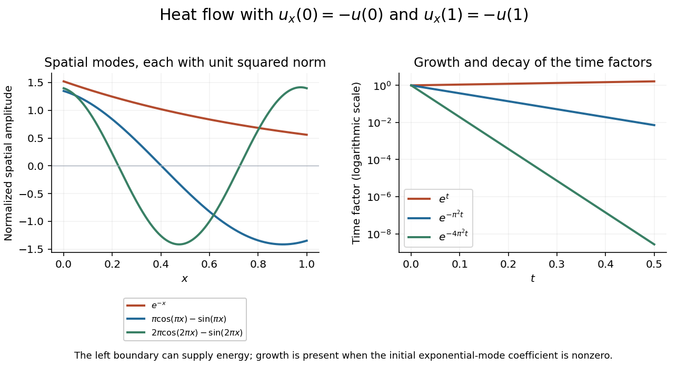

<h1 id="2/solution">Solution</h1>

↑ **Parent:** [2](../2.md)

Use [separation of variables](../../../../separation-of-variables.md) with $u=W(x)T(t)$ and choose $W''/W=T'/T=k$. Then $T=e^{kt}$ and $W'(0)=-W(0)$, $W'(1)=-W(1)$.

If $k=0$, write $W=A+Bx$. The first condition gives $B=-A$, and the second gives $A+2B=0$. Together they force $A=B=0$, so this case contributes only the zero solution.

If $k=\alpha^2>0$, write $W=A\cosh(\alpha x)+B\sinh(\alpha x)$. The first condition gives $B=-A/\alpha$. The second becomes

$$
W'(1)+W(1)=A(\alpha-\alpha^{-1})\sinh\alpha=0.
$$

A nonzero solution therefore requires $\alpha=1$, giving $W\propto e^{-x}$ and time factor $e^t$.

If $k=-\beta^2<0$, write $W=A\cos(\beta x)+B\sin(\beta x)$. Now $B=-A/\beta$, and the remaining condition is $-A(\beta+\beta^{-1})\sin\beta=0$. Thus $\beta=n\pi$, $n\geq1$. Choosing a convenient amplitude gives $W_n=n\pi\cos(n\pi x)-\sin(n\pi x)$. The complete [Sturm-Liouville eigenfunction expansion](../../../../sturm-liouville-eigenfunction-expansion.md) is consequently

$$
\boxed{u(x,t)=c_0e^{t-x}+\sum_{n=1}^\infty c_ne^{-n^2\pi^2t}W_n(x).}
$$

These are self-adjoint separated [Robin boundary conditions](../../../../robin-boundary-condition.md): the boundary form $[f^*g'-f'^*g]_0^1$ vanishes because both functions satisfy $y'=-y$ at each end. The regular interval problem has a complete orthogonal eigenbasis; the calculation includes its one negative eigenvalue for $-D^2$, not only its positive ones.

To project the initial data, calculate the squared norms:

$$
\int_0^1e^{-2x}dx=\frac{1-e^{-2}}2,\qquad\int_0^1W_n^2dx=\frac{n^2\pi^2+1}{2}.
$$

The second identity uses the half-unit integrals of $\cos^2(n\pi x)$ and $\sin^2(n\pi x)$ and the zero integral of their product. By [orthogonal projection](../../../../orthogonal-projection.md),

$$
\boxed{c_0=\frac{2}{1-e^{-2}}\int_0^1e^{-x}f(x)dx,\qquad c_n=\frac{2}{n^2\pi^2+1}\int_0^1f(x)W_n(x)dx.}
$$

For square-integrable $f$, the initial expansion is understood in that norm. Classical agreement of boundary derivatives at $t=0$ requires compatible smoother data.

This is [Robin diffusion with a growing mode](../../../../robin-diffusion-with-a-growing-mode.md), in the reflected version of its positive-coordinate-derivative example. Growth is not a contradiction: the outward derivative is $-u_x$ at the left endpoint, so these conditions are not dissipative outward-normal conditions at both ends. Indeed

$$
\frac12\frac d{dt}\int_0^1u^2dx=u(0,t)^2-u(1,t)^2-\int_0^1u_x^2dx,
$$

and the boundary can supply energy. The growing contribution is absent exactly when the displayed integral defining $c_0$ vanishes.

**[Figure 1](#2/image-the-growing-exponential-mode-and-two-decaying-oscillatory-modes-satisfy-the-same-coordinate-derivative-boundary-conditions). The growing exponential mode and two decaying oscillatory modes satisfy the same coordinate-derivative boundary conditions**.

## ↑ Ancestors (12)

1. [2](../2.md)
2. [Paper 2](../../paper-2-split.md)
3. [2012](../../split.md)
4. [Past exam of the mathematics course of the year 2 of the natural sciences course of the University of Cambridge](../../../split.md)
5. [Mathematics course of the year 2 of the natural sciences course of the University of Cambridge](../../../../mathematics-course-of-the-year-2-of-the-natural-sciences-course-of-the-university-of-cambridge.md)
6. [Year 2 of the natural sciences course of the University of Cambridge](../../../../year-2-of-the-natural-sciences-course-of-the-university-of-cambridge.md)
7. [Year of the natural sciences course of the University of Cambridge](../../../../year-of-the-natural-sciences-course-of-the-university-of-cambridge.md)
8. [Natural sciences course of the University of Cambridge](../../../../natural-sciences-course-of-the-university-of-cambridge.md)
9. [Course of the University of Cambridge](../../../../course-of-the-university-of-cambridge.md)
10. [University of Cambridge](../../../../university-of-cambridge-split.md)
11. [List of universities](../../../../list-of-universities.md)
12. [Codex Wiki](../../../../split.md)
