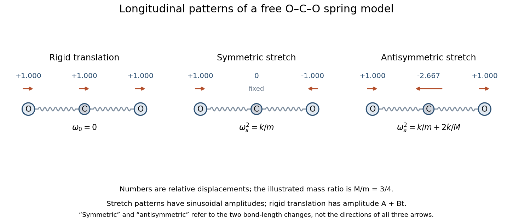

<h1 id="7/solution">Solution</h1>

↑ **Parent:** [7](../7.md)

Use displacements $x=(x_1,x_2,x_3)^T$ of the left oxygen, carbon and right oxygen along a common positive direction. In this harmonic model the [kinetic energy](../../../../kinetic-energy.md) and [elastic potential energy](../../../../elastic-energy.md) are

$$
T=\frac12m\dot x_1^2+\frac12M\dot x_2^2+\frac12m\dot x_3^2,\qquad V=\frac k2[(x_2-x_1)^2+(x_3-x_2)^2].
$$

Thus the [generalized eigenvalue problem for small oscillations](../../../../generalized-eigenvalue-problem-for-small-oscillations.md) is $Kv=\omega^2\mathsf Mv$, where

$$
K=k\begin{pmatrix}1&-1&0\\-1&2&-1\\0&-1&1\end{pmatrix},\qquad\mathsf M=\operatorname{diag}(m,M,m).
$$

The [normal modes of three masses connected by two equal springs](../../../../normal-modes-of-three-masses-connected-by-two-equal-springs.md) give the three independent solutions

$$
\boxed{\begin{array}{c|c|c}
\text{mode}&v&\omega^2\\\hline
\text{translation}&v_0=(1,1,1)^T&0\\
\text{symmetric stretch}&v_s=(1,0,-1)^T&k/m\\
\text{antisymmetric stretch}&v_a=(1,-2m/M,1)^T&k/m+2k/M
\end{array}.}
$$

The second row follows by holding the centre fixed and moving the end masses oppositely. In the remaining internal mode the end displacements are equal, and zero displacement of the [centre of mass](../../../../center-of-mass.md) gives $2mv_1+Mv_2=0$, yielding the third row; substitution verifies its frequency. Both nonzero modes have fixed centre of mass. In the symmetric stretch the two bond-length changes are equal; in the antisymmetric stretch they are opposite.

**[Figure 2](#7/image-longitudinal-mode-directions-of-the-free-three-mass-molecular-model-the-zero-mode-translates-every-mass-together). Longitudinal mode directions of the free three-mass molecular model; the zero mode translates every mass together**.

The [zero mode](../../../../zero-mode.md) occurs because a uniform translation changes neither spring length, so $Kv_0=0$. It represents free [center-of-mass motion](../../../../center-of-mass-motion.md), not an additional restoring vibration. Its general time amplitude is $A+Bt$. Only one translational zero mode exists in the restricted one-dimensional model; transverse and rotational motion are outside its specified coordinates.

For the initial impulse, all displacement amplitudes at zero time vanish. Resolve the initial velocity into these three mode shapes:

$$
(u,0,0)^T=\frac{mu}{M+2m}v_0+\frac u2v_s+\frac{Mu}{2(M+2m)}v_a.
$$

Writing $\omega_s=\sqrt{k/m}$ and $\omega_a=\sqrt{k/m+2k/M}$ gives the [impulse on an end mass of a free symmetric three-mass chain](../../../../impulse-on-an-end-mass-of-a-free-symmetric-three-mass-chain.md):

$$
\boxed{x(t)=\frac{mu}{M+2m}t\,v_0+\frac{u}{2\omega_s}\sin(\omega_st)v_s+\frac{Mu}{2(M+2m)\omega_a}\sin(\omega_at)v_a.}
$$

In particular

$$
\begin{aligned}
x_1(t)&=V_{\rm cm}t+\frac{u}{2\omega_s}\sin\omega_st+\frac{Mu}{2(M+2m)\omega_a}\sin\omega_at,\\
x_2(t)&=V_{\rm cm}t-\frac{mu}{(M+2m)\omega_a}\sin\omega_at,\\
x_3(t)&=V_{\rm cm}t-\frac{u}{2\omega_s}\sin\omega_st+\frac{Mu}{2(M+2m)\omega_a}\sin\omega_at,
\end{aligned}
$$

where $V_{\rm cm}=mu/(M+2m)$. The initial derivatives are $(u,0,0)$, as required. The [carbon dioxide](../../../../carbon-dioxide.md) model therefore drifts uniformly while undergoing both internal stretches. Its total momentum is the initial $mu$; omitting the zero mode would incorrectly hold the centre of mass fixed.

## ↑ Ancestors (12)

1. [7](../7.md)
2. [Paper 2](../../paper-2-split.md)
3. [2012](../../split.md)
4. [Past exam of the mathematics course of the year 2 of the natural sciences course of the University of Cambridge](../../../split.md)
5. [Mathematics course of the year 2 of the natural sciences course of the University of Cambridge](../../../../mathematics-course-of-the-year-2-of-the-natural-sciences-course-of-the-university-of-cambridge.md)
6. [Year 2 of the natural sciences course of the University of Cambridge](../../../../year-2-of-the-natural-sciences-course-of-the-university-of-cambridge.md)
7. [Year of the natural sciences course of the University of Cambridge](../../../../year-of-the-natural-sciences-course-of-the-university-of-cambridge.md)
8. [Natural sciences course of the University of Cambridge](../../../../natural-sciences-course-of-the-university-of-cambridge.md)
9. [Course of the University of Cambridge](../../../../course-of-the-university-of-cambridge.md)
10. [University of Cambridge](../../../../university-of-cambridge-split.md)
11. [List of universities](../../../../list-of-universities.md)
12. [Codex Wiki](../../../../split.md)
