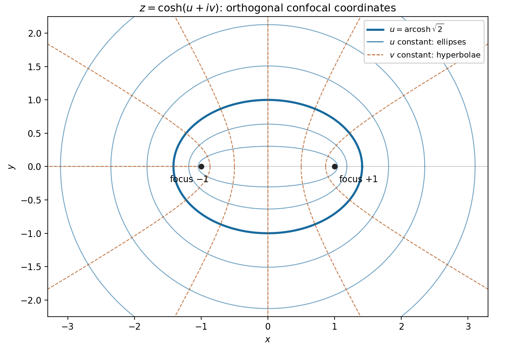

<h1 id="7/iii/solution">Solution</h1>

↑ **Parent:** [Iii](../iii.md)

Inverting $u+iv=\operatorname{arcosh}z$ gives $z=\cosh(u+iv)$, hence the [elliptic coordinates](../../../../../elliptic-coordinates.md)

$$
x=\cosh u\cos v,\qquad y=\sinh u\sin v.
$$

Eliminating $v$ at fixed $u>0$ gives the [ellipse](../../../../../ellipse.md)

$$
\boxed{\frac{x^2}{\cosh^2u}+\frac{y^2}{\sinh^2u}=1.}
$$

Its focal distance is $\sqrt{\cosh^2u-\sinh^2u}=1$. At fixed $v$, eliminating $u$ instead gives the [hyperbola](../../../../../hyperbola.md)

$$
\boxed{\frac{x^2}{\cos^2v}-\frac{y^2}{\sin^2v}=1.}
$$

Its focal distance is also one, so both families have foci $(\pm1,0)$. A fixed $v$ traces an appropriate half of the hyperbola; complementary coordinate values complete it. Degenerate values give the focal segment and portions of the coordinate axes. Away from these degeneracies the curves are orthogonal by part (i), or by $\mathbf r_u\cdot\mathbf r_v=0$ in the displayed parametrization. A branch of the inverse is used locally; its real part with $u\geq0$ is single-valued outside the focal segment.

**[Figure 1](#7/iii/image-confocal-ellipses-and-hyperbolae-generated-by-the-complex-inverse-hyperbolic-cosine). Confocal ellipses and hyperbolae generated by the complex inverse hyperbolic cosine**.

## ↑ Ancestors (13)

1. [Iii](../iii.md)
2. [7](../../7.md)
3. [Paper 1](../../../paper-1-split.md)
4. [2013](../../../split.md)
5. [Past exam of the mathematics course of the year 2 of the natural sciences course of the University of Cambridge](../../../../split.md)
6. [Mathematics course of the year 2 of the natural sciences course of the University of Cambridge](../../../../../mathematics-course-of-the-year-2-of-the-natural-sciences-course-of-the-university-of-cambridge.md)
7. [Year 2 of the natural sciences course of the University of Cambridge](../../../../../year-2-of-the-natural-sciences-course-of-the-university-of-cambridge.md)
8. [Year of the natural sciences course of the University of Cambridge](../../../../../year-of-the-natural-sciences-course-of-the-university-of-cambridge.md)
9. [Natural sciences course of the University of Cambridge](../../../../../natural-sciences-course-of-the-university-of-cambridge.md)
10. [Course of the University of Cambridge](../../../../../course-of-the-university-of-cambridge.md)
11. [University of Cambridge](../../../../../university-of-cambridge-split.md)
12. [List of universities](../../../../../list-of-universities.md)
13. [Codex Wiki](../../../../../split.md)
