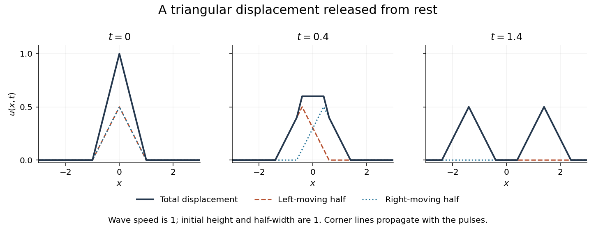

<h1 id="5/iv/solution">Solution</h1>

↑ **Parent:** [Iv](../iv.md)

Zero initial velocity selects the cosine solution of the transformed equation:

$$
\widetilde u(k,t)=\widetilde f(k)\cos(ckt)=\frac{2(1-\cos k)}{k^2}\cos(ckt),
$$

with the removable value one at $k=0$. Since $\cos(ckt)=(e^{ickt}+e^{-ickt})/2$, the [Fourier shift theorem](../../../../../fourier-shift-theorem.md) gives

$$
\boxed{u(x,t)=\frac12f(x-ct)+\frac12f(x+ct)=\frac12(1-|x-ct|)_++\frac12(1-|x+ct|)_+,}
$$

where $r_+=\max(r,0)$. This is [triangular pulse splitting under the wave equation](../../../../../triangular-pulse-splitting-under-the-wave-equation.md), a special case of the [D'Alembert formula](../../../../../d-alembert-s-formula.md).

The two half-height triangles move in opposite directions at speed $|c|$. Their sum initially reproduces the full triangle; once $|c|t>1$ their supports are disjoint. The field vanishes outside $|x|\leq1+|c|t$, consistent with [finite propagation speed](../../../../../finite-propagation-speed.md). For $c=0$ it simply remains $f(x)$.

**[Figure 1](#5/iv/image-a-triangular-displacement-released-from-rest-splits-into-two-translating-half-amplitude-pulses-their-overlap-adds). A triangular displacement released from rest splits into two translating half-amplitude pulses; their overlap adds**.

Because the triangular profile has slope discontinuities, this is a [weak solution](../../../../../weak-solution.md) rather than a globally twice differentiable solution. The initial velocity is zero in the distributional or square-integrable sense, and pointwise away from the initial corners. A classical pointwise time derivative need not exist at those corners; for example $u(0,t)=1-|ct|$ near $t=0$. The initial conditions must be interpreted consistently with this nonsmooth displacement.

## ↑ Ancestors (13)

1. [Iv](../iv.md)
2. [5](../../5.md)
3. [Paper 2](../../../paper-2-split.md)
4. [2013](../../../split.md)
5. [Past exam of the mathematics course of the year 2 of the natural sciences course of the University of Cambridge](../../../../split.md)
6. [Mathematics course of the year 2 of the natural sciences course of the University of Cambridge](../../../../../mathematics-course-of-the-year-2-of-the-natural-sciences-course-of-the-university-of-cambridge.md)
7. [Year 2 of the natural sciences course of the University of Cambridge](../../../../../year-2-of-the-natural-sciences-course-of-the-university-of-cambridge.md)
8. [Year of the natural sciences course of the University of Cambridge](../../../../../year-of-the-natural-sciences-course-of-the-university-of-cambridge.md)
9. [Natural sciences course of the University of Cambridge](../../../../../natural-sciences-course-of-the-university-of-cambridge.md)
10. [Course of the University of Cambridge](../../../../../course-of-the-university-of-cambridge.md)
11. [University of Cambridge](../../../../../university-of-cambridge-split.md)
12. [List of universities](../../../../../list-of-universities.md)
13. [Codex Wiki](../../../../../split.md)
