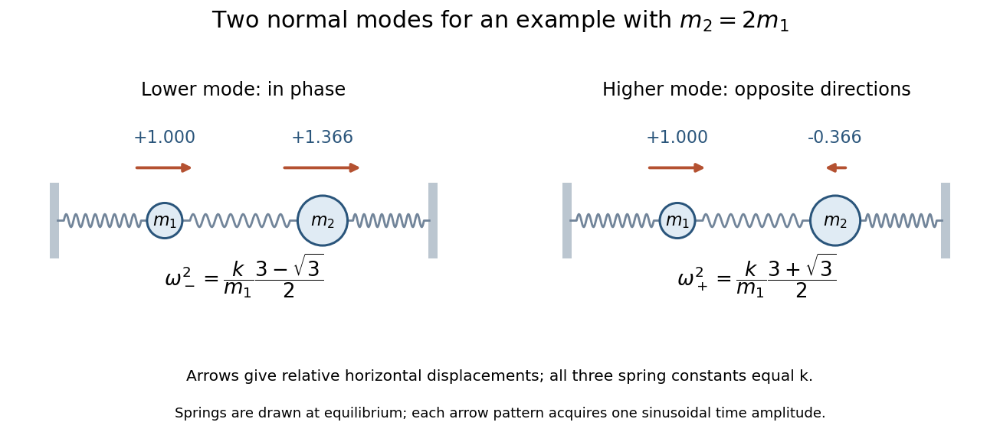

<h1 id="7/i/solution">Solution</h1>

↑ **Parent:** [I](../i.md)

Take both displacement coordinates positive to the right. The [kinetic energy](../../../../../kinetic-energy.md) and [elastic potential energy](../../../../../elastic-energy.md) are

$$
T=\frac12m_1\dot x_1^2+\frac12m_2\dot x_2^2,\qquad V=\frac k2[x_1^2+(x_2-x_1)^2+x_2^2].
$$

Thus the equations of motion are $m_1\ddot x_1=-2kx_1+kx_2$ and $m_2\ddot x_2=kx_1-2kx_2$. With $x=v\cos(\omega t+\varphi)$, the [generalized eigenvalue problem for small oscillations](../../../../../generalized-eigenvalue-problem-for-small-oscillations.md) is

$$
\left[k\begin{pmatrix}2&-1\\-1&2\end{pmatrix}-\omega^2\begin{pmatrix}m_1&0\\0&m_2\end{pmatrix}\right]v=0.
$$

Its determinant gives $m_1m_2\omega^4-2k(m_1+m_2)\omega^2+3k^2=0$. Put $D=\sqrt{m_1^2-m_1m_2+m_2^2}$. The [two-mass three-spring normal modes](../../../../../two-mass-three-spring-normal-modes.md) have

$$
\boxed{\omega_\mp^2=\frac{k(m_1+m_2\mp D)}{m_1m_2},\qquad v_\mp=(1,r_\mp)^T,\qquad r_\mp=\frac{m_2-m_1\pm D}{m_2}.}
$$

Both squared frequencies are positive because $(m_1+m_2)^2-D^2=3m_1m_2>0$. Also $D>|m_2-m_1|$, so $r_->0$ and $r_+<0$: the lower mode moves the masses in phase, and the higher mode moves them oppositely. A general mode is an arbitrary sinusoidal amplitude multiplying its fixed shape.

For equal masses these reduce to $v_-=(1,1)$, $\omega_-^2=k/m$ and $v_+=(1,-1)$, $\omega_+^2=3k/m$. For unequal masses the vectors need not be Euclidean-orthogonal; they are orthogonal in the mass inner product, $m_1+m_2r_-r_+=0$.

**[Figure 2](#7/i/image-in-phase-and-out-of-phase-mode-directions-for-an-illustrative-unequal-mass-system-arrow-lengths-show-relative-displacements). In-phase and out-of-phase mode directions for an illustrative unequal-mass system; arrow lengths show relative displacements**.

## ↑ Ancestors (13)

1. [I](../i.md)
2. [7](../../7.md)
3. [Paper 2](../../../paper-2-split.md)
4. [2013](../../../split.md)
5. [Past exam of the mathematics course of the year 2 of the natural sciences course of the University of Cambridge](../../../../split.md)
6. [Mathematics course of the year 2 of the natural sciences course of the University of Cambridge](../../../../../mathematics-course-of-the-year-2-of-the-natural-sciences-course-of-the-university-of-cambridge.md)
7. [Year 2 of the natural sciences course of the University of Cambridge](../../../../../year-2-of-the-natural-sciences-course-of-the-university-of-cambridge.md)
8. [Year of the natural sciences course of the University of Cambridge](../../../../../year-of-the-natural-sciences-course-of-the-university-of-cambridge.md)
9. [Natural sciences course of the University of Cambridge](../../../../../natural-sciences-course-of-the-university-of-cambridge.md)
10. [Course of the University of Cambridge](../../../../../course-of-the-university-of-cambridge.md)
11. [University of Cambridge](../../../../../university-of-cambridge-split.md)
12. [List of universities](../../../../../list-of-universities.md)
13. [Codex Wiki](../../../../../split.md)
