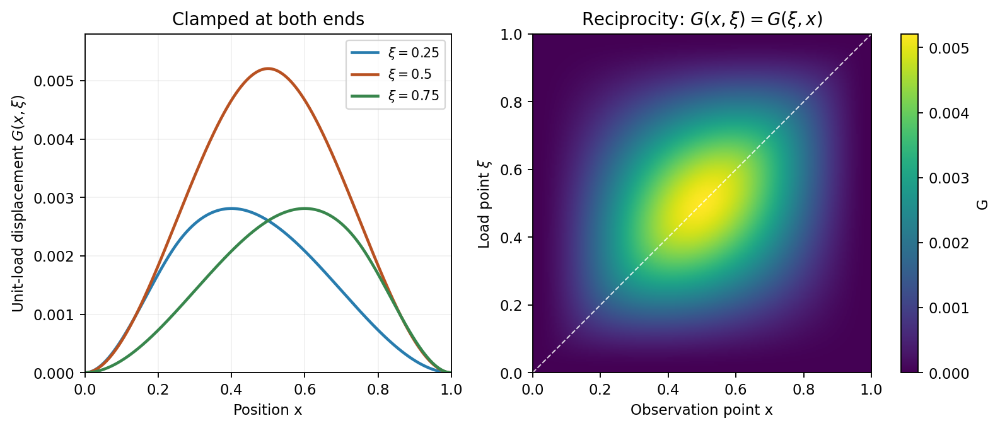
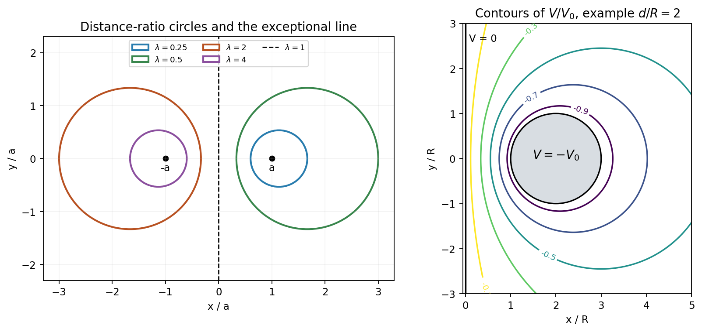

# Paper 1

↑ **Parent:** [2014](../2014.md)

[https://www.maths.cam.ac.uk/undergradnst/files/2014/PaperNST_IB_1.pdf](https://www.maths.cam.ac.uk/undergradnst/files/2014/PaperNST_IB_1.pdf)

**Table of contents**

- [1](#1)
  - [i](#1/i)
    - [Solution](#1/i/solution)
  - [ii](#1/ii)
    - [Solution](#1/ii/solution)
  - [iii](#1/iii)
    - [Solution](#1/iii/solution)
- [2](#2)
  - [i](#2/i)
    - [Solution](#2/i/solution)
  - [ii](#2/ii)
    - [Solution](#2/ii/solution)
- [3](#3)
  - [Solution](#3/solution)
- [4](#4)
  - [i](#4/i)
    - [Solution](#4/i/solution)
  - [ii](#4/ii)
    - [Solution](#4/ii/solution)
  - [iii](#4/iii)
    - [Solution](#4/iii/solution)
  - [iv](#4/iv)
    - [Solution](#4/iv/solution)
  - [v](#4/v)
    - [Solution](#4/v/solution)
- [5](#5)
  - [i](#5/i)
    - [Solution](#5/i/solution)
  - [ii](#5/ii)
    - [Solution](#5/ii/solution)
  - [iii](#5/iii)
    - [Solution](#5/iii/solution)
- [6](#6)
  - [i](#6/i)
    - [Solution](#6/i/solution)
  - [ii](#6/ii)
    - [Solution](#6/ii/solution)
    - [a](#6/ii/a)
      - [Solution](#6/ii/a/solution)
    - [b](#6/ii/b)
      - [Solution](#6/ii/b/solution)
    - [c](#6/ii/c)
      - [Solution](#6/ii/c/solution)
  - [iii](#6/iii)
    - [Solution](#6/iii/solution)
- [7](#7)
  - [i](#7/i)
    - [Solution](#7/i/solution)
  - [ii](#7/ii)
    - [Solution](#7/ii/solution)
  - [iii](#7/iii)
    - [Solution](#7/iii/solution)
- [8](#8)
  - [Solution](#8/solution)
- [9](#9)
  - [i](#9/i)
    - [Solution](#9/i/solution)
  - [ii](#9/ii)
    - [Solution](#9/ii/solution)
- [10](#10)
  - [i](#10/i)
    - [Solution](#10/i/solution)
  - [ii](#10/ii)
    - [Solution](#10/ii/solution)

## 1

↑ **Parent:** [Paper 1](paper-1.md)

<h3 id="1/i">i</h3>

↑ **Parent:** [1](#1)

<h4 id="1/i/solution">Solution</h4>

↑ **Parent:** [I](#1/i)

Work in a [Cartesian coordinate system](../../linear-algebra.md#cartesian-coordinate-system), write $\partial_j=\partial/\partial x_j$, and use the [Einstein summation convention](../../multilinear-algebra.md#einstein-notation). For a twice continuously differentiable [vector field](../../multivariable-calculus.md#vector-field), the contraction of two [Levi-Civita symbols](../../multivariable-calculus.md#levi-civita-symbol) gives

$$
\begin{aligned}
[\nabla\times(\nabla\times u)]_i&=\epsilon_{ijk}\epsilon_{klm}\partial_j\partial_lu_m\\
&=(\delta_{il}\delta_{jm}-\delta_{im}\delta_{jl})\partial_j\partial_lu_m\\
&=\partial_i(\partial_ju_j)-\partial_j\partial_ju_i.
\end{aligned}
$$

Here the [Kronecker deltas](../../multilinear-algebra.md#kronecker-delta) select components, and equality of mixed [partial derivatives](../../multivariable-calculus.md#partial-derivative) gives the [curl of the curl identity](../../multivariable-calculus.md#curl-of-the-curl-identity)

$$
\boxed{\nabla\times(\nabla\times u)=\nabla(\nabla\cdot u)-\nabla^2u.}
$$

For the second identity, the same contraction followed by the [product rule](../../calculus.md#product-rule) yields

$$
\begin{aligned}
[\nabla\times(u\times v)]_i&=\partial_j(u_iv_j-u_jv_i)\\
&=u_i\partial_jv_j-v_i\partial_ju_j+v_j\partial_ju_i-u_j\partial_jv_i.
\end{aligned}
$$

Thus the [curl of a cross product](../../multivariable-calculus.md#curl-of-a-cross-product) is

$$
\boxed{\nabla\times(u\times v)=u(\nabla\cdot v)-v(\nabla\cdot u)+(v\cdot\nabla)u-(u\cdot\nabla)v.}
$$

The directional [derivatives](../../calculus.md#derivative) in the last two terms act on the [vector field](../../multivariable-calculus.md#vector-field) immediately to their right.

<h3 id="1/ii">ii</h3>

↑ **Parent:** [1](#1)

<h4 id="1/ii/solution">Solution</h4>

↑ **Parent:** [Ii](#1/ii)

For a sufficiently smooth [vector field](../../multivariable-calculus.md#vector-field) $A$ on a volume with piecewise smooth closed boundary and outward [unit normal vector](../../differential-geometry.md#unit-normal), the [divergence theorem](../../multivariable-calculus.md#divergence-theorem) states

$$
\boxed{\int_V\nabla\cdot A\,dV=\int_S A\cdot\hat n\,dS.}
$$

Expanding the [divergence of a cross product](../../multivariable-calculus.md#divergence-of-a-cross-product) by the [product rule](../../calculus.md#product-rule) gives $\nabla\cdot(F\times G)=G\cdot(\nabla\times F)-F\cdot(\nabla\times G)$. Apply the theorem to $A=F\times G$ to obtain

$$
\boxed{\int_V[G\cdot(\nabla\times F)-F\cdot(\nabla\times G)]\,dV=\int_S(F\times G)\cdot\hat n\,dS.}
$$

<h3 id="1/iii">iii</h3>

↑ **Parent:** [1](#1)

<h4 id="1/iii/solution">Solution</h4>

↑ **Parent:** [Iii](#1/iii)

Use the full field in the PDF, including the exponential term missing from the transcription. Its [divergence](../../multivariable-calculus.md#divergence) is

$$
\nabla\cdot F=[z\sin(yz)+3x^2]-z\sin(yz)+3y^2=3(x^2+y^2).
$$

The exponential in the third component has zero $z$ [derivative](../../calculus.md#derivative). In [cylindrical coordinates](../../multivariable-calculus.md#cylindrical-coordinate-system), the solid has $0\leq r\leq2$ and $0\leq z\leq4-r^2$. Therefore the [divergence theorem](../../multivariable-calculus.md#divergence-theorem) gives the outward [flux](../../mathematical-physics.md#flux)

$$
\begin{aligned}
\int_S F\cdot\hat n\,dS&=\int_0^{2\pi}\int_0^2\int_0^{4-r^2}3r^2\,r\,dz\,dr\,d\phi\\
&=6\pi\int_0^2(4r^3-r^5)\,dr=\boxed{32\pi}.
\end{aligned}
$$

The [integration](../../integral.md) includes the entire closed boundary, both cap and base.

## 2

↑ **Parent:** [Paper 1](paper-1.md)

<h3 id="2/i">i</h3>

↑ **Parent:** [2](#2)

<h4 id="2/i/solution">Solution</h4>

↑ **Parent:** [I](#2/i)

For the established time-periodic response, take a complex separated solution $v=X(x)e^{i\omega t}$ and set $u=\operatorname{Re}v$. The [diffusion equation](../../diffusion-equation.md) gives $X''=(i\omega/\nu)X$. For $\omega>0$, define the penetration depth $\delta=\sqrt{2\nu/\omega}$; the spatial roots are $\pm(1+i)/\delta$. Decay at infinity selects

$$
v(x,t)=U_0e^{-(1+i)x/\delta}e^{i\omega t}.
$$

Its real part is the solution of [Stokes' second problem](../../viscous-fluid-flow.md#stokes-second-problem):

$$
\boxed{u(x,t)=U_0e^{-x/\delta}\cos(\omega t-x/\delta),\qquad\delta=\sqrt{\frac{2\nu}{\omega}}.}
$$

The velocity amplitude decays exponentially, while the phase lags by $x/\delta$. Direct substitution verifies the [diffusion equation](../../diffusion-equation.md), and the two [boundary conditions](../../differential-equation.md#boundary-condition) follow immediately.

**These data select a unique periodic response, but do not specify an arbitrary initial transient.** With no initial velocity supplied, one may add any suitable solution of the homogeneous-boundary diffusion problem. The displayed solution is the usual established oscillatory flow after transients have decayed.

<h3 id="2/ii">ii</h3>

↑ **Parent:** [2](#2)

<h4 id="2/ii/solution">Solution</h4>

↑ **Parent:** [Ii](#2/ii)

Separate variables as $u=X(x)T(t)$. The zero values at both plates give the [Fourier sine basis](../../fourier-series.md#fourier-sine-basis)

$$
X_j(x)=\sin\frac{j\pi x}{L},\qquad T_j(t)=e^{-\nu j^2\pi^2t/L^2},\qquad j\geq1.
$$

Expand the initial profile using [orthogonality](../../inner-product.md#orthogonal-vectors). With $s=x/L$, its coefficients are

$$
A_j=\frac2L\int_0^LU_0\left(\frac xL-\frac{x^2}{L^2}\right)\sin\frac{j\pi x}{L}\,dx=2U_0\int_0^1s(1-s)\sin(j\pi s)\,ds=\frac{4U_0[1-(-1)^j]}{j^3\pi^3}.
$$

Consequently

$$
\boxed{u(x,t)=\frac{8U_0}{\pi^3}\sum_{\substack{j\geq1\\j\ {
m odd}}}\frac{\sin(j\pi x/L)}{j^3}e^{-\nu j^2\pi^2t/L^2}.}
$$

Only odd modes occur because the initial profile is symmetric about the midpoint. The coefficients are absolutely summable, so [dominated convergence](../../measure-theory.md#dominated-convergence-theorem) gives $\boxed{u(x,t)\to0}$ uniformly as $t\to\infty$. The slowest decay rate is $\nu\pi^2/L^2$, associated with $j=1$.

## 3

↑ **Parent:** [Paper 1](paper-1.md)

<h3 id="3/solution">Solution</h3>

↑ **Parent:** [3](#3)

**Kernel conditions.** The [clamped-beam Green function](../../elasticity-physics.md#clamped-beam-green-function) must obey $G(0,\xi)=G_x(0,\xi)=G(1,\xi)=G_x(1,\xi)=0$. Away from $x=\xi$, $G_{xxxx}=0$. At the load point, $G,G_x,G_{xx}$ are continuous and

$$
\boxed{G_{xxx}(\xi+,\xi)-G_{xxx}(\xi-,\xi)=1.}
$$

A jump in any lower [derivative](../../calculus.md#derivative) would create a [derivative](../../calculus.md#derivative) of the [Dirac delta](../../distribution-theory.md#dirac-delta-function), rather than the single point load required by $D_x^4G=\delta(x-\xi)$.

**Construction.** A particularly simple representation is

$$
G(x,\xi)=ax^2+bx^3+\frac{(x-\xi)_+^3}{6}.
$$

It already enforces the left-end conditions and the correct source jump. The right-end conditions give $a+b=-(1-\xi)^3/6$ and $2a+3b=-(1-\xi)^2/2$, hence

$$
a=\frac{\xi(1-\xi)^2}{2},\qquad b=-\frac{(1-\xi)^2(1+2\xi)}6.
$$

For $x<\xi$ this is already factored; for $x>\xi$, expanding and refactoring gives

$$
\boxed{G(x,\xi)=\begin{cases}\dfrac{x^2(1-\xi)^2}{6}[3\xi-(1+2\xi)x],&x\leq\xi,\\\dfrac{\xi^2(1-x)^2}{6}[3x-(1+2x)\xi],&x\geq\xi.\end{cases}}
$$

The formulas agree at the junction. The forced displacement is obtained by integrating this kernel against $f$; for continuous loads it satisfies the equation and all four end conditions. Uniqueness follows because a cubic with zero value and slope at both ends is identically zero.

**Reciprocity.** In terms of $x_<=\min(x,\xi)$ and $x_>=\max(x,\xi)$, the same expression is

$$
G(x,\xi)=\frac{x_<^2(1-x_>)^2}{6}[3x_>-(1+2x_>)x_<].
$$

It is visibly symmetric under interchange of $x$ and $\xi$. Thus the [reciprocity of the clamped-beam Green function](../../elasticity-physics.md#reciprocity-of-the-clamped-beam-green-function) gives

$$
\boxed{y_1(x_2)=G(x_2,x_1)=G(x_1,x_2)=y_2(x_1).}
$$

Equivalently, two [integrations by parts](../../calculus.md#integration-by-parts) show [self-adjointness](../../linear-operator-theory.md#self-adjoint-operator) of $D_x^4$ under the clamped conditions, with bilinear form $\int u''v''dx$.

**[Figure 1](#3/image-point-load-deflections-and-the-symmetric-green-function-of-a-clamped-beam). Point-load deflections and the symmetric Green function of a clamped beam**.

## 4

↑ **Parent:** [Paper 1](paper-1.md)

<h3 id="4/i">i</h3>

↑ **Parent:** [4](#4)

<h4 id="4/i/solution">Solution</h4>

↑ **Parent:** [I](#4/i)

With the stated negative sign in the forward exponential, the [inverse Fourier transform](../../fourier-transform.md#inverse-fourier-transform) is

$$
\boxed{f(x)=\frac1{2\pi}\int_{-\infty}^{\infty}\widetilde f(k)e^{ikx}\,dk.}
$$

For example, this holds pointwise for [Schwartz functions](../../fourier-analysis.md#schwartz-function); more general square-integrable functions use the corresponding mean-square interpretation.

<h3 id="4/ii">ii</h3>

↑ **Parent:** [4](#4)

<h4 id="4/ii/solution">Solution</h4>

↑ **Parent:** [Ii](#4/ii)

Differentiate under the [Fourier transform](../../fourier-transform.md) [integral](../../integral.md):

$$
\frac{d^n\widetilde f}{dk^n}=\int_{-\infty}^{\infty}(-ix)^nf(x)e^{-ikx}\,dx=(-i)^n\widetilde g(k).
$$

Hence the [Fourier transform of a polynomial multiple](../../fourier-transform.md#fourier-transform-of-a-polynomial-multiple) is

$$
\boxed{\widetilde g(k)=i^n\frac{d^n\widetilde f(k)}{dk^n}.}
$$

Absolute integrability of the required moments justifies differentiation under the [integral](../../integral.md). The identity also extends to [tempered distributions](../../fourier-analysis.md#tempered-distribution).

<h3 id="4/iii">iii</h3>

↑ **Parent:** [4](#4)

<h4 id="4/iii/solution">Solution</h4>

↑ **Parent:** [Iii](#4/iii)

Let $A(k)$ be the [Fourier transform](../../fourier-transform.md) of $e^{-x^2}$. Since $(e^{-x^2})'=-2xe^{-x^2}$, [integration by parts](../../calculus.md#integration-by-parts) gives $\mathcal F[xe^{-x^2}]=-(ik/2)A(k)$. Differentiation under the [integral](../../integral.md) then yields $A'(k)=-(k/2)A(k)$. The Gaussian [integral](../../integral.md) supplies $A(0)=\sqrt\pi$, so

$$
A(k)=\sqrt\pi e^{-k^2/4}.
$$

Applying part (ii) with $n=1$ gives

$$
\boxed{\mathcal F[xe^{-x^2}](k)=iA'(k)=-\frac{i\sqrt\pi}{2}k e^{-k^2/4}.}
$$

It is imaginary and odd, as expected for the transform of a real odd function.

<h3 id="4/iv">iv</h3>

↑ **Parent:** [4](#4)

<h4 id="4/iv/solution">Solution</h4>

↑ **Parent:** [Iv](#4/iv)

For sufficiently rapidly decaying functions, substitute the [inverse Fourier transform](../../fourier-transform.md#inverse-fourier-transform) of $g$ and interchange the [integrals](../../integral.md):

$$
\begin{aligned}
\int_{-\infty}^{\infty}f(x)^*g(x)\,dx&=\frac1{2\pi}\int_{-\infty}^{\infty}\widetilde g(k)\left[\int_{-\infty}^{\infty}f(x)^*e^{ikx}\,dx\right]dk\\
&=\boxed{\frac1{2\pi}\int_{-\infty}^{\infty}\widetilde f(k)^*\widetilde g(k)\,dk.}
\end{aligned}
$$

The bracketed [integral](../../integral.md) is the [complex conjugate](../../complex-analysis.md#complex-conjugate) of $\widetilde f(k)$. This is [Parseval's identity](../../fourier-analysis.md#parseval-identity) for the chosen normalization. One may first prove it for [Schwartz functions](../../fourier-analysis.md#schwartz-function), where the interchanges are justified, and then extend it to $L^2$ by the [Plancherel theorem](../../fourier-analysis.md#plancherel-theorem).

<h3 id="4/v">v</h3>

↑ **Parent:** [4](#4)

<h4 id="4/v/solution">Solution</h4>

↑ **Parent:** [V](#4/v)

Differentiating $\int e^{-a x^2}dx=\sqrt{\pi/a}$ with respect to $a>0$ gives $\int x^2e^{-a x^2}dx=\sqrt\pi/(2a^{3/2})$. Therefore

$$
\boxed{E=\int_{-\infty}^{\infty}x^2e^{-2x^2}\,dx=\frac{\sqrt\pi}{4\sqrt2}.}
$$

From part (iii), $|\widetilde f(k)|^2=(\pi/4)k^2e^{-k^2/2}$. Its frequency-side energy is

$$
\frac1{2\pi}\int_{-\infty}^{\infty}|\widetilde f(k)|^2dk=\frac18\int_{-\infty}^{\infty}k^2e^{-k^2/2}dk=\frac{\sqrt{2\pi}}8=\frac{\sqrt\pi}{4\sqrt2},
$$

in agreement with [Parseval's identity](../../fourier-analysis.md#parseval-identity).

## 5

↑ **Parent:** [Paper 1](paper-1.md)

<h3 id="5/i">i</h3>

↑ **Parent:** [5](#5)

<h4 id="5/i/solution">Solution</h4>

↑ **Parent:** [I](#5/i)

A [Hermitian matrix](../../hilbert-space.md#hermitian-operator) satisfies $H^\dagger=H$, where $\dagger$ denotes the [conjugate transpose](../../linear-operator-theory.md#conjugate-transpose). For a nonzero [eigenvector](../../linear-operator-theory.md#eigenvector) $v$ with $Hv=\lambda v$, the scalar $v^\dagger Hv$ equals its own [complex conjugate](../../complex-analysis.md#complex-conjugate), and

$$
\lambda=\frac{v^\dagger Hv}{v^\dagger v}\in\mathbb R.
$$

Thus **every Hermitian [eigenvalue](../../linear-operator-theory.md#eigenvalue) is real**.

A [unitary matrix](../../linear-operator-theory.md#unitary-matrix) satisfies $U^\dagger U=UU^\dagger=I$. If $Uv=\mu v$, preservation of the squared [norm](../../normed-vector-space.md#norm) gives

$$
v^\dagger v=(Uv)^\dagger(Uv)=|\mu|^2v^\dagger v.
$$

Since $v\neq0$, $\boxed{|\mu|=1}$. These statements concern complex [eigenvectors](../../linear-operator-theory.md#eigenvector), even when the [matrix](../../vector-space.md#matrix) entries happen to be real.

<h3 id="5/ii">ii</h3>

↑ **Parent:** [5](#5)

<h4 id="5/ii/solution">Solution</h4>

↑ **Parent:** [Ii](#5/ii)

The absolutely convergent [matrix exponential](../../linear-operator-theory.md#matrix-exponential) series gives

$$
U^\dagger=(e^{iH})^\dagger=e^{(iH)^\dagger}=e^{-iH}
$$

for Hermitian $H$. The exponents $iH$ and $-iH$ commute, so their exponentials multiply to the exponential of their sum:

$$
\boxed{U^\dagger U=e^{-iH}e^{iH}=I,\qquad UU^\dagger=I.}
$$

Hence $U$ is unitary. Alternatively, an [orthonormal eigenbasis](../../linear-operator-theory.md#orthonormal-eigenbasis) of $H$ turns the exponential [eigenvalues](../../linear-operator-theory.md#eigenvalue) into $e^{i\lambda_j}$, all on the [unit circle](../../complex-analysis.md#complex-unit-circle).

<h3 id="5/iii">iii</h3>

↑ **Parent:** [5](#5)

<h4 id="5/iii/solution">Solution</h4>

↑ **Parent:** [Iii](#5/iii)

Taking the adjoint of $U=M+iN$ gives $U^\dagger=M-iN$. In particular, the [Hermitian parts of a unitary matrix](../../linear-operator-theory.md#hermitian-parts-of-a-unitary-matrix) are uniquely determined:

$$
M=\frac{U+U^\dagger}{2},\qquad N=\frac{U-U^\dagger}{2i}.
$$

Expanding both unitary identities gives

$$
U^\dagger U=M^2+N^2+i(MN-NM)=I,\qquad UU^\dagger=M^2+N^2-i(MN-NM)=I.
$$

Subtracting shows $MN=NM$, and adding gives $M^2+N^2=I$. If $Mv=\mu v$, commutation implies $M(Nv)=\mu Nv$. The assumed simple spectrum makes the [eigenspace](../../linear-operator-theory.md#eigenspace) one-dimensional, so $Nv=\nu v$. Thus $M,N$ have a common [orthonormal eigenbasis](../../linear-operator-theory.md#orthonormal-eigenbasis).

On such a [vector](../../vector-space.md#vector), $Uv=(\mu+i\nu)v$. If the corresponding unitary [eigenvalue](../../linear-operator-theory.md#eigenvalue) is $u=e^{i\theta}$, then

$$
\boxed{\mu=\operatorname{Re}u=\cos\theta,\qquad\nu=\operatorname{Im}u=\sin\theta.}
$$

The formulas for $M,N$ also show the same [eigenvalue](../../linear-operator-theory.md#eigenvalue) correspondence directly from $Uv=uv$ and $U^\dagger v=u^*v$. Degeneracies do not prevent existence of a common basis, although the simple-spectrum assumption makes the elementary proof immediate.

## 6

↑ **Parent:** [Paper 1](paper-1.md)

<h3 id="6/i">i</h3>

↑ **Parent:** [6](#6)

<h4 id="6/i/solution">Solution</h4>

↑ **Parent:** [I](#6/i)

The [spectral theorem for real symmetric matrices](../../linear-algebra.md#spectral-theorem-for-real-symmetric-matrices) supplies real [eigenvalues](../../linear-operator-theory.md#eigenvalue) and an [orthonormal eigenbasis](../../linear-operator-theory.md#orthonormal-eigenbasis). Compute [eigenvectors](../../linear-operator-theory.md#eigenvector), normalize them, and within each repeated-eigenvalue [eigenspace](../../linear-operator-theory.md#eigenspace) choose an orthonormal basis. Distinct [eigenspaces](../../linear-operator-theory.md#eigenspace) are already orthogonal because symmetry gives $(\lambda-\mu)v^Tw=0$ for [eigenvectors](../../linear-operator-theory.md#eigenvector) with [eigenvalues](../../linear-operator-theory.md#eigenvalue) $\lambda,\mu$.

Use the resulting basis [vectors](../../vector-space.md#vector) as columns of $O$. Then

$$
\boxed{O^TO=I,\qquad O^TMO=D=\operatorname{diag}(\lambda_1,\ldots,\lambda_n).}
$$

The order and signs of the columns can be chosen freely; rotations within a repeated-eigenvalue [eigenspace](../../linear-operator-theory.md#eigenspace) are also allowed.

<h3 id="6/ii">ii</h3>

↑ **Parent:** [6](#6)

<h4 id="6/ii/solution">Solution</h4>

↑ **Parent:** [Ii](#6/ii)

Use the orthogonal change of coordinates

$$
\boxed{x'=O^Tx,\qquad x=Ox'.}
$$

It preserves distances and angles and gives $x^TMx=x'^TDx'$. Thus the [quadric surface](../../euclidean-geometry.md#quadric-surface) is expressed along its [principal axes](../../rigid-body-dynamics.md#principal-axis) as

$$
\boxed{\lambda_1x_1'^2+\lambda_2x_2'^2+\lambda_3x_3'^2=k.}
$$

The following three cases are the subparts of (ii) in the original PDF.

<h4 id="6/ii/a">a</h4>

↑ **Parent:** [Ii](#6/ii)

<h5 id="6/ii/a/solution">Solution</h5>

↑ **Parent:** [A](#6/ii/a)

Writing the common positive [eigenvalue](../../linear-operator-theory.md#eigenvalue) as $\lambda$, the equation is $|x'|^2=k/\lambda$. Hence it is a [sphere](../../euclidean-geometry.md#sphere) with

$$
\boxed{\text{centre }0,\qquad\text{radius }\sqrt{k/\lambda}.}
$$

Every orthonormal set of axes is a principal-axis set in this fully degenerate case.

<h4 id="6/ii/b">b</h4>

↑ **Parent:** [Ii](#6/ii)

<h5 id="6/ii/b/solution">Solution</h5>

↑ **Parent:** [B](#6/ii/b)

Let $\lambda_1=\lambda_2=\lambda>0$ and $\lambda_3=-\gamma<0$. Then

$$
\frac{x_1'^2+x_2'^2}{k/\lambda}-\frac{x_3'^2}{k/\gamma}=1.
$$

This is a **[one-sheet hyperboloid](../../differential-geometry.md#one-sheet-hyperboloid) of revolution** around the $x_3'$ axis. Its circular waist has radius $\sqrt{k/\lambda}$ at $x_3'=0$, and its radius grows with $|x_3'|$. In the original coordinates the axis is the [eigenvector](../../linear-operator-theory.md#eigenvector) direction belonging to the negative [eigenvalue](../../linear-operator-theory.md#eigenvalue).

<h4 id="6/ii/c">c</h4>

↑ **Parent:** [Ii](#6/ii)

<h5 id="6/ii/c/solution">Solution</h5>

↑ **Parent:** [C](#6/ii/c)

The coordinate $x_1'$ does not occur. The perpendicular cross-section is

$$
\frac{x_2'^2}{k/\lambda_2}+\frac{x_3'^2}{k/\lambda_3}=1.
$$

Thus the surface is an **[elliptic cylinder](../../euclidean-geometry.md#elliptic-cylinder)** extending in both directions along the zero-eigenvalue axis. Its cross-sectional semiaxes are $\sqrt{k/\lambda_2}$ and $\sqrt{k/\lambda_3}$. It becomes a circular cylinder when the two positive [eigenvalues](../../linear-operator-theory.md#eigenvalue) coincide.

<h3 id="6/iii">iii</h3>

↑ **Parent:** [6](#6)

<h4 id="6/iii/solution">Solution</h4>

↑ **Parent:** [Iii](#6/iii)

The [matrix](../../vector-space.md#matrix) is $M=2I-ee^T$, where $e=(1,1,1)^T$. Along $\hat e=e/\sqrt3$, its [eigenvalue](../../linear-operator-theory.md#eigenvalue) is $2-3=-1$. Every [vector](../../vector-space.md#vector) perpendicular to $e$ has [eigenvalue](../../linear-operator-theory.md#eigenvalue) two. For example, use the orthonormal basis

$$
u_1=\frac{(1,-1,0)}{\sqrt2},\qquad u_2=\frac{(1,1,-2)}{\sqrt6},\qquad u_3=\frac{(1,1,1)}{\sqrt3}.
$$

The principal-coordinate equation is

$$
2\xi^2+2\eta^2-\zeta^2=3,\qquad\frac{\xi^2+\eta^2}{3/2}-\frac{\zeta^2}{3}=1.
$$

It depends only on distance from the $u_3$ axis and position along it, so every rotation about that axis preserves the surface. Therefore

$$
\boxed{\text{the rotational axis is the line }x_1=x_2=x_3,\text{ with direction }(1,1,1).}
$$

This is a [one-sheet hyperboloid](../../differential-geometry.md#one-sheet-hyperboloid) with waist radius $\sqrt{3/2}$. The repeated positive [eigenvalue](../../linear-operator-theory.md#eigenvalue) makes the two transverse [principal axes](../../rigid-body-dynamics.md#principal-axis) nonunique.

## 7

↑ **Parent:** [Paper 1](paper-1.md)

<h3 id="7/i">i</h3>

↑ **Parent:** [7](#7)

<h4 id="7/i/solution">Solution</h4>

↑ **Parent:** [I](#7/i)

For real-direction increments, [complex differentiability](../../holomorphic-function.md#complex-differentiability) gives $f'=u_x+iv_x$. For imaginary-direction increments it gives $f'=(u_y+iv_y)/i=v_y-iu_y$. Equating these expressions gives the [Cauchy-Riemann equations](../../analysis.md#cauchy-riemann-equations)

$$
\boxed{u_x=v_y,\qquad u_y=-v_x.}
$$

A [holomorphic function](../../holomorphic-function.md) is smooth, so mixed [partial derivatives](../../multivariable-calculus.md#partial-derivative) commute. Differentiating these equations gives

$$
u_{xx}+u_{yy}=v_{yx}-v_{xy}=0,\qquad v_{xx}+v_{yy}=-u_{yx}+u_{xy}=0.
$$

Thus both real and imaginary parts are [harmonic functions](../../partial-differential-equation.md#harmonic-function):

$$
\boxed{\nabla^2u=\nabla^2v=0.}
$$

<h3 id="7/ii">ii</h3>

↑ **Parent:** [7](#7)

<h4 id="7/ii/solution">Solution</h4>

↑ **Parent:** [Ii](#7/ii)

Squaring the ratio of moduli gives

$$
(x-a)^2+y^2=\lambda^2[(x+a)^2+y^2].
$$

For $\lambda\neq1$, complete the square to obtain the [Apollonius circle](../../euclidean-geometry.md#circles-of-apollonius)

$$
\boxed{\left(x-\frac{a(1+\lambda^2)}{1-\lambda^2}\right)^2+y^2=\left(\frac{2a\lambda}{|1-\lambda^2|}\right)^2.}
$$

Its centre is $(a(1+\lambda^2)/(1-\lambda^2),0)$ and its radius is $2a\lambda/|1-\lambda^2|$. The centres are positive for $\lambda<1$ and negative for $\lambda>1$.

**At the allowed exceptional value $\lambda=1$, the locus is the line $x=0$**, the [perpendicular bisector](../../euclidean-geometry.md#perpendicular-bisector) of the two fixed points. It is a generalized circle, but not an ordinary finite-radius circle. The point $z=-a$ is excluded from the original ratio.

<h3 id="7/iii">iii</h3>

↑ **Parent:** [7](#7)

<h4 id="7/iii/solution">Solution</h4>

↑ **Parent:** [Iii](#7/iii)

For a circle in the right half-plane use $0<\lambda<1$. Its centre and radius from part (ii) satisfy $d^2-R^2=a^2$. Hence choose

$$
\boxed{a=\sqrt{d^2-R^2}.}
$$

Put $\tau_0=\operatorname{arcosh}(d/R)$. Then $\sinh\tau_0=a/R$ and

$$
\lambda=e^{-\tau_0}=\frac{d-a}{R}=\frac{R}{d+a}.
$$

Indeed the [Apollonius circle](../../euclidean-geometry.md#circles-of-apollonius) has centre $a\coth\tau_0=d$ and radius $a/\sinh\tau_0=R$. Its logarithmic modulus is therefore $-\tau_0$, while on $x=0$ the modulus is one. The [logarithmic Dirichlet potential between a circle and a line](../../analysis.md#logarithmic-dirichlet-potential-between-a-circle-and-a-line) is

$$
\boxed{V(x,y)=\frac{V_0}{\operatorname{arcosh}(d/R)}\log\left|\frac{z-a}{z+a}\right|.}
$$

The logarithmic singularity at $a$ lies inside the excluded disk, since $d-a<R$. The other singularity, at $-a$, lies outside the right half-plane. Thus the real logarithmic modulus is harmonic throughout the required region and has exactly the two specified boundary values.

Local branches of the complex logarithm justify harmonicity; its real part is globally single-valued even though the complex logarithm need not be single-valued around the excluded disk. The displayed solution is bounded and tends to zero at infinity. A boundedness or corresponding far-field condition supplies uniqueness in this unbounded domain; finite boundary values alone do not rule out unbounded additional harmonic solutions. The same geometry appears in [cylinder-plane image charges](../../mathematics.md#cylinder-plane-image-charges).

**[Figure 2](#7/iii/image-apollonius-circles-and-a-bounded-harmonic-potential-outside-a-circle-beside-a-line). Apollonius circles and a bounded harmonic potential outside a circle beside a line**.

## 8

↑ **Parent:** [Paper 1](paper-1.md)

<h3 id="8/solution">Solution</h3>

↑ **Parent:** [8](#8)

**Singular points.** Normalizing the equation gives $p=2/x$ and $q=1-\ell(\ell+1)/x^2$. The only finite singular point is $x=0$, and it is regular because $xp$ and $x^2q$ are analytic there. At infinity put $t=1/x$ and $Y(t)=y(1/t)$; the equation becomes

$$
Y''+\left[\frac1{t^4}-\frac{\ell(\ell+1)}{t^2}\right]Y=0.
$$

The fourth-order pole makes $t=0$ an [irregular singular point](../../complex-analysis.md#irregular-singular-point), so **infinity is irregular**.

**Exponents and recurrence.** Substitution of a series for a [Frobenius solution](../../complex-analysis.md#frobenius-solution) gives the [indicial equation](../../linear-ordinary-differential-equation.md#indicial-equation)

$$
\sigma(\sigma+1)-\ell(\ell+1)=0,\qquad\boxed{\sigma=\ell\quad\text{or}\quad\sigma=-\ell-1.}
$$

With negative-index coefficients set to zero, the coefficient equation is

$$
\boxed{[(j+\sigma)(j+\sigma+1)-\ell(\ell+1)]a_j=-a_{j-2}.}
$$

For $\sigma=\ell$, it gives $a_1=0$ and

$$
a_j=-\frac{a_{j-2}}{j(j+2\ell+1)},\qquad j\geq2.
$$

For $\sigma=-\ell-1$, it gives

$$
a_j=-\frac{a_{j-2}}{j(j-2\ell-1)},\qquad j\geq1,\quad j\neq2\ell+1.
$$

For $\ell\geq1$, $a_1=0$. At the exceptional odd index $j=2\ell+1$, the recurrence becomes $a_{2\ell-1}=0$, which is already satisfied. Thus $a_{2\ell+1}$ is free; choosing it to be zero gives an independent pure-even series times $x^{-\ell-1}$. A nonzero choice adds a multiple of the regular solution. For $\ell=0$, this freedom occurs at $j=1$ itself. This [Frobenius resonance in the spherical Bessel equation](../../bessel-function.md#frobenius-resonance-in-the-spherical-bessel-equation) is compatible, so no logarithmic term is needed despite the integer separation of exponents.

**Normalized regular solution.** Set $\sigma=\ell$ and $a_0=2^\ell\ell!/(2\ell+1)!$. The proposed even coefficients

$$
a_{2s}=\frac{2^\ell(-1)^s(s+\ell)!}{s!(2s+2\ell+1)!}
$$

satisfy $a_{2s}/a_{2s-2}=-1/[2s(2s+2\ell+1)]$, precisely the recurrence above. Therefore

$$
\boxed{j_\ell(x)=2^\ell x^\ell\sum_{s=0}^\infty\frac{(-1)^s(s+\ell)!}{s!(2s+2\ell+1)!}x^{2s}.}
$$

This is the regular [Spherical Bessel function](../../bessel-function.md#spherical-bessel-function). The coefficient ratio tends to zero, so its series converges for every finite $x$; the other even-series factor also has infinite radius, although the prefactor has a pole at zero.

For $\ell=0$, the coefficients reduce to $(-1)^s/(2s+1)!$, giving

$$
\boxed{j_0(x)=\frac{\sin x}{x},\qquad j_0(0)=1.}
$$

Directly, $x^2j_0'=x\cos x-\sin x$, whose [derivative](../../calculus.md#derivative) is $-x\sin x$. Thus $(x^2j_0')'+x^2j_0=0$, verifying the equation. The independent singular branch at $\ell=0$ can be chosen as $\cos x/x$.

## 9

↑ **Parent:** [Paper 1](paper-1.md)

<h3 id="9/i">i</h3>

↑ **Parent:** [9](#9)

<h4 id="9/i/solution">Solution</h4>

↑ **Parent:** [I](#9/i)

For a variation $q\mapsto q+\epsilon\eta$ with $\eta(t_0)=\eta(t_1)=0$, the first variation is

$$
\delta S=\int_{t_0}^{t_1}(L_q\eta+L_{\dot q}\dot\eta)dt=[L_{\dot q}\eta]_{t_0}^{t_1}+\int_{t_0}^{t_1}\left(L_q-\frac d{dt}L_{\dot q}\right)\eta\,dt.
$$

The endpoint term vanishes. Since the interior variation is arbitrary, the [fundamental lemma of the calculus of variations](../../calculus-of-variations.md#fundamental-lemma-of-the-calculus-of-variations) gives the [Euler-Lagrange equation](../../analysis.md#euler-lagrange-equation)

$$
\boxed{\frac d{dt}\frac{\partial L}{\partial\dot q}-\frac{\partial L}{\partial q}=0.}
$$

Along such a trajectory,

$$
\frac d{dt}\left(\dot qL_{\dot q}-L\right)=\dot q\left(\frac d{dt}L_{\dot q}-L_q\right)-L_t=-L_t.
$$

If $L$ has no explicit time dependence, the first [integral](../../integral.md) is therefore

$$
\boxed{\dot q\frac{\partial L}{\partial\dot q}-L=\text{constant}.}
$$

Its negative is the equivalent Beltrami form. For the usual time-independent mechanical [Lagrangian](../../calculus-of-variations.md#lagrangian) $L=T-V$ with quadratic velocity dependence, this conserved quantity is the total [mechanical energy](../../energy.md#mechanical-energy) $T+V$.

<h3 id="9/ii">ii</h3>

↑ **Parent:** [9](#9)

<h4 id="9/ii/solution">Solution</h4>

↑ **Parent:** [Ii](#9/ii)

Use the angle orientation in the PDF: $M$ has coordinates $(R\sin\theta,-R\cos\theta)$ relative to the hoop centre. The wrapped string segment has length $R(\pi/2-\theta)$. As $\theta$ increases, it releases length $R\theta$, so the suspended mass moves _down_ by $R\theta$. Both speeds have magnitude $R|\dot\theta|$.

Thus the [hoop with a suspended counterweight](../../lagrangian-mechanics.md#hoop-with-a-suspended-counterweight) has

$$
T=\frac12(M+m)R^2\dot\theta^2,\qquad V=-MgR\cos\theta-mgR\theta+\text{constant},
$$

and $L=T-V$. The [Euler-Lagrange equation](../../analysis.md#euler-lagrange-equation) gives

$$
\boxed{(M+m)R\ddot\theta=g(m-M\sin\theta).}
$$

At equilibrium,

$$
\boxed{\theta_0=\arcsin(m/M),\qquad0<\theta_0<\pi/2.}
$$

The positive curvature $V''(\theta_0)=MgR\cos\theta_0$ establishes stability. Put $\theta=\theta_0+\delta$ and linearize. The equilibrium force cancels, leaving

$$
\ddot\delta+\omega^2\delta=0,\qquad\omega^2=\frac{Mg\cos\theta_0}{(M+m)R}=\frac gR\sqrt{\frac{M-m}{M+m}}.
$$

Hence

$$
\boxed{\omega=\left(\frac{M-m}{M+m}\right)^{1/4}\sqrt{\frac gR}.}
$$

For $M\gg m$, $\theta_0\simeq m/M$ and $\omega\to\sqrt{g/R}$, the small-oscillation frequency of a [simple pendulum](../../simple-pendulum.md) of length $R$. The [linearization](../../algebra.md#linearization) assumes an amplitude small enough to remain inside the stated angular range and a taut string throughout.

**[Figure 3](#9/ii/image-independent-hoop-and-counterweight-geometry-and-the-stable-minimum-of-its-potential-energy). Independent hoop-and-counterweight geometry and the stable minimum of its potential energy**.

## 10

↑ **Parent:** [Paper 1](paper-1.md)

<h3 id="10/i">i</h3>

↑ **Parent:** [10](#10)

<h4 id="10/i/solution">Solution</h4>

↑ **Parent:** [I](#10/i)

Write $N[\psi]=\int_a^b(p\psi'^2+q\psi^2)dx$ and $D[\psi]=\int_a^bw\psi^2dx>0$. For a real variation, with $\Lambda=N/D$,

$$
\delta\Lambda=\frac2D\left\{[p\psi'\delta\psi]_a^b+\int_a^b[-(p\psi')'+q\psi-\Lambda w\psi]\delta\psi\,dx\right\}.
$$

Suitable endpoint conditions are homogeneous [Dirichlet boundary conditions](../../differential-equation.md#dirichlet-boundary-condition), homogeneous [Neumann boundary conditions](../../differential-equation.md#neumann-boundary-condition) $p\psi'=0$, or one of each. They remove the variation boundary term and the product $[p\psi\psi']_a^b$. Stationarity for all interior variations is equivalent to

$$
\boxed{-(p\psi')'+q\psi=\Lambda w\psi.}
$$

Conversely, multiplication of an eigenfunction equation by $\psi$ and [integration by parts](../../calculus.md#integration-by-parts) gives $N=\lambda D$, hence $\boxed{\Lambda[\psi]=\lambda}$. General Robin data require their boundary-energy contributions unless these endpoint products happen to vanish.

Use an eigenbasis orthonormal with respect to the weight: $\int_a^bw\psi_i^*\psi_jdx=\delta_{ij}$. For complex coefficients use the Hermitian version of the quotient, with absolute squares. Self-adjointness gives

$$
\boxed{\Lambda[\widetilde\psi]=\frac{\sum_{i\geq0}|c_i|^2\lambda_i}{\sum_{i\geq0}|c_i|^2}\geq\lambda_0.}
$$

When $c_0\neq0$, dividing numerator and denominator by $|c_0|^2$ yields

$$
\boxed{\widetilde\lambda=\frac{\lambda_0+\sum_{i\geq1}|a_i|^2\lambda_i}{1+\sum_{i\geq1}|a_i|^2},\qquad a_i=c_i/c_0.}
$$

If $c_0=0$, these ratios are undefined, but the unscaled formula and upper-bound conclusion remain valid. The assumptions are a problem with a [self-adjoint operator](../../linear-operator-theory.md#self-adjoint-operator) bounded below and a complete eigenbasis, with the trial function in its energy-form domain. The [Rayleigh-Ritz method](../../finite-element-method.md#rayleigh-ritz-method) minimizes this quotient over an admissible trial family, obtaining an upper bound on $\lambda_0$. Higher eigenfunctions are stationary directions and need not be unrestricted extrema.

<h3 id="10/ii">ii</h3>

↑ **Parent:** [10](#10)

<h4 id="10/ii/solution">Solution</h4>

↑ **Parent:** [Ii](#10/ii)

The [boundary conditions](../../differential-equation.md#boundary-condition) on the positive half-line, absent from the transcription, select the [half-harmonic oscillator](../../quantum-harmonic-oscillator.md#half-harmonic-oscillator). The trial state $xe^{-\alpha x}$ with $\alpha>0$ satisfies both endpoints and has finite [norm](../../normed-vector-space.md#norm) and energy. [Integration by parts](../../calculus.md#integration-by-parts), with vanishing endpoint term, gives

$$
\Lambda(\alpha)=\frac{\int_0^\infty[|\widetilde\psi'|^2+x^2|\widetilde\psi|^2]dx}{\int_0^\infty|\widetilde\psi|^2dx}.
$$

Using $\int_0^\infty x^ne^{-2\alpha x}dx=n!/(2\alpha)^{n+1}$, the three required [integrals](../../integral.md) are

$$
\int_0^\infty\widetilde\psi^2dx=\frac1{4\alpha^3},\qquad\int_0^\infty(\widetilde\psi')^2dx=\frac1{4\alpha},\qquad\int_0^\infty x^2\widetilde\psi^2dx=\frac3{4\alpha^5}.
$$

Thus the [exponential trial state for a half-harmonic oscillator](../../quantum-harmonic-oscillator.md#exponential-trial-state-for-a-half-harmonic-oscillator) gives $\Lambda(\alpha)=\alpha^2+3/\alpha^2$. Its [derivative](../../calculus.md#derivative) vanishes at $\alpha^4=3$, and the [arithmetic-geometric mean inequality](../../mathematical-optimization.md#arithmetic-geometric-mean-inequality) confirms the global minimum:

$$
\boxed{\alpha_*=3^{1/4},\qquad\lambda_0\leq\lambda_{\rm estimate}=2\sqrt3\simeq3.46410.}
$$

For comparison, the exact lowest half-line state is proportional to $xe^{-x^2/2}$ and has [eigenvalue](../../linear-operator-theory.md#eigenvalue) three. The exponential trial family gives a valid upper bound rather than an exact [eigenvalue](../../linear-operator-theory.md#eigenvalue).

## ↑ Ancestors (10)

1. [2014](../2014.md)
2. [Past exam of the mathematics course of the year 2 of the natural sciences course of the University of Cambridge](../../past-exam-of-the-mathematics-course-of-the-year-2-of-the-natural-sciences-course-of-the-university-of-cambridge.md)
3. [Mathematics course of the year 2 of the natural sciences course of the University of Cambridge](../../university-of-cambridge.md#mathematics-course-of-the-year-2-of-the-natural-sciences-course-of-the-university-of-cambridge)
4. [Year 2 of the natural sciences course of the University of Cambridge](../../university-of-cambridge.md#year-2-of-the-natural-sciences-course-of-the-university-of-cambridge)
5. [Year of the natural sciences course of the University of Cambridge](../../university-of-cambridge.md#year-of-the-natural-sciences-course-of-the-university-of-cambridge)
6. [Natural sciences course of the University of Cambridge](../../university-of-cambridge.md#natural-sciences-course-of-the-university-of-cambridge)
7. [Course of the University of Cambridge](../../university-of-cambridge.md#course-of-the-university-of-cambridge)
8. [University of Cambridge](../../university-of-cambridge.md)
9. [List of universities](../../README.md#list-of-universities)
10. [Codex Wiki](../../README.md)
