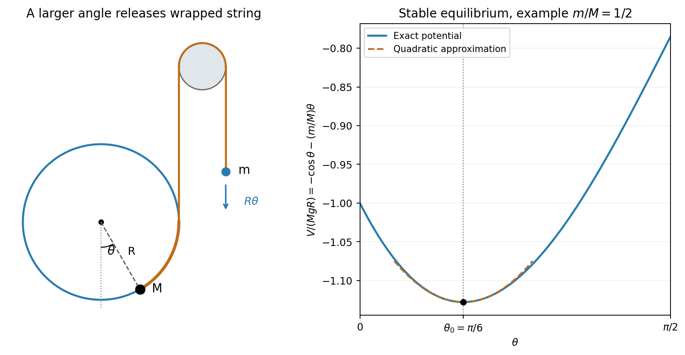

<h1 id="9/ii/solution">Solution</h1>

↑ **Parent:** [Ii](../ii.md)

Use the angle orientation in the PDF: $M$ has coordinates $(R\sin\theta,-R\cos\theta)$ relative to the hoop centre. The wrapped string segment has length $R(\pi/2-\theta)$. As $\theta$ increases, it releases length $R\theta$, so the suspended mass moves _down_ by $R\theta$. Both speeds have magnitude $R|\dot\theta|$.

Thus the [hoop with a suspended counterweight](../../../../../hoop-with-a-suspended-counterweight.md) has

$$
T=\frac12(M+m)R^2\dot\theta^2,\qquad V=-MgR\cos\theta-mgR\theta+\text{constant},
$$

and $L=T-V$. The [Euler-Lagrange equation](../../../../../euler-lagrange-equation.md) gives

$$
\boxed{(M+m)R\ddot\theta=g(m-M\sin\theta).}
$$

At equilibrium,

$$
\boxed{\theta_0=\arcsin(m/M),\qquad0<\theta_0<\pi/2.}
$$

The positive curvature $V''(\theta_0)=MgR\cos\theta_0$ establishes stability. Put $\theta=\theta_0+\delta$ and linearize. The equilibrium force cancels, leaving

$$
\ddot\delta+\omega^2\delta=0,\qquad\omega^2=\frac{Mg\cos\theta_0}{(M+m)R}=\frac gR\sqrt{\frac{M-m}{M+m}}.
$$

Hence

$$
\boxed{\omega=\left(\frac{M-m}{M+m}\right)^{1/4}\sqrt{\frac gR}.}
$$

For $M\gg m$, $\theta_0\simeq m/M$ and $\omega\to\sqrt{g/R}$, the small-oscillation frequency of a [simple pendulum](../../../../../simple-pendulum-split.md) of length $R$. The [linearization](../../../../../linearization.md) assumes an amplitude small enough to remain inside the stated angular range and a taut string throughout.

**[Figure 3](#9/ii/image-independent-hoop-and-counterweight-geometry-and-the-stable-minimum-of-its-potential-energy). Independent hoop-and-counterweight geometry and the stable minimum of its potential energy**.

## ↑ Ancestors (13)

1. [Ii](../ii.md)
2. [9](../../9.md)
3. [Paper 1](../../../paper-1-split.md)
4. [2014](../../../split.md)
5. [Past exam of the mathematics course of the year 2 of the natural sciences course of the University of Cambridge](../../../../split.md)
6. [Mathematics course of the year 2 of the natural sciences course of the University of Cambridge](../../../../../mathematics-course-of-the-year-2-of-the-natural-sciences-course-of-the-university-of-cambridge.md)
7. [Year 2 of the natural sciences course of the University of Cambridge](../../../../../year-2-of-the-natural-sciences-course-of-the-university-of-cambridge.md)
8. [Year of the natural sciences course of the University of Cambridge](../../../../../year-of-the-natural-sciences-course-of-the-university-of-cambridge.md)
9. [Natural sciences course of the University of Cambridge](../../../../../natural-sciences-course-of-the-university-of-cambridge.md)
10. [Course of the University of Cambridge](../../../../../course-of-the-university-of-cambridge.md)
11. [University of Cambridge](../../../../../university-of-cambridge-split.md)
12. [List of universities](../../../../../list-of-universities.md)
13. [Codex Wiki](../../../../../split.md)
