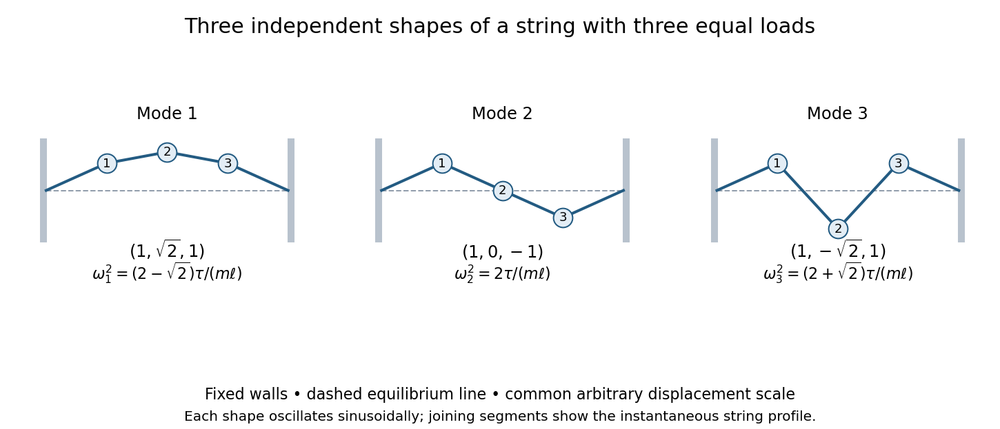

<h1 id="7/i/solution">Solution</h1>

↑ **Parent:** [I](../i.md)

The [kinetic energy](../../../../../kinetic-energy.md) is $T=m\sum_i\dot z_i^2/2$. Differentiating the quadratic [potential energy](../../../../../potential-energy.md) gives the equations for [small oscillations](../../../../../small-oscillation.md),

$$
m\ddot z+\frac\tau\ell Kz=0,\qquad K=\begin{pmatrix}2&-1&0\\-1&2&-1\\0&-1&2\end{pmatrix}.
$$

Put $z=v\cos(\omega t+\varphi)$ and $\lambda=m\ell\omega^2/\tau$. The [eigenvalue problem](../../../../../eigenvalue-problem.md) is $Kv=\lambda v$. Its characteristic polynomial is

$$
\det(K-\lambda I)=(2-\lambda)[(2-\lambda)^2-2].
$$

Thus a convenient set of [normal modes](../../../../../normal-mode.md) is

$$
\boxed{\begin{array}{c|c|c}
\text{mode}&\text{relative bead displacements}&\omega^2\\\hline
1&(1,\sqrt2,1)&\dfrac\tau{m\ell}(2-\sqrt2)\\[2pt]
2&(1,0,-1)&\dfrac{2\tau}{m\ell}\\[2pt]
3&(1,-\sqrt2,1)&\dfrac\tau{m\ell}(2+\sqrt2)
\end{array}.}
$$

Each shape can be multiplied by an arbitrary sinusoidal time amplitude. In the lowest mode all beads move in phase. In the middle mode the central bead is fixed and the outer beads move oppositely. In the highest mode the two outer beads move together against the centre. These vectors are mutually orthogonal and span the three displacement coordinates.

**[Figure 1](#7/i/image-the-three-transverse-string-modes-the-dashed-line-is-equilibrium-and-bead-displacements-share-one-arbitrary-scale). The three transverse string modes; the dashed line is equilibrium and bead displacements share one arbitrary scale**.

These are the three-mass case of the [normal modes of a uniformly loaded finite string](../../../../../normal-modes-of-a-uniformly-loaded-finite-string.md), with discrete sine shapes $v_i^{(j)}=\sin(ij\pi/4)$. The sketches use straight string segments between masses and fixed zero displacements at the walls. The small-slope and constant-tension assumptions justify the quadratic energy and linear equations.

## ↑ Ancestors (13)

1. [I](../i.md)
2. [7](../../7.md)
3. [Paper 2](../../../paper-2-split.md)
4. [2014](../../../split.md)
5. [Past exam of the mathematics course of the year 2 of the natural sciences course of the University of Cambridge](../../../../split.md)
6. [Mathematics course of the year 2 of the natural sciences course of the University of Cambridge](../../../../../mathematics-course-of-the-year-2-of-the-natural-sciences-course-of-the-university-of-cambridge.md)
7. [Year 2 of the natural sciences course of the University of Cambridge](../../../../../year-2-of-the-natural-sciences-course-of-the-university-of-cambridge.md)
8. [Year of the natural sciences course of the University of Cambridge](../../../../../year-of-the-natural-sciences-course-of-the-university-of-cambridge.md)
9. [Natural sciences course of the University of Cambridge](../../../../../natural-sciences-course-of-the-university-of-cambridge.md)
10. [Course of the University of Cambridge](../../../../../course-of-the-university-of-cambridge.md)
11. [University of Cambridge](../../../../../university-of-cambridge-split.md)
12. [List of universities](../../../../../list-of-universities.md)
13. [Codex Wiki](../../../../../split.md)
