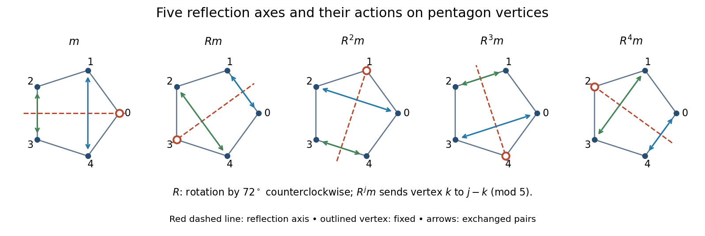

<h1 id="9/ii/a/solution">Solution</h1>

↑ **Parent:** [A](../a.md)

For a regular [pentagon](../../../../../../pentagon.md), take $R$ as rotation through $2\pi/5$ and $m$ as reflection in the horizontal axis through vertex zero. The distinct elements are

$$
\boxed{I,R,R^2,R^3,R^4,\qquad m,Rm,R^2m,R^3m,R^4m.}
$$

Every nonidentity rotation has order five. The reflections are the five order-two elements, since $(R^jm)^2=R^jR^{-j}=I$.

The reflection $R^jm$ has axis at angle $j\pi/5$ to the horizontal, understood modulo $\pi$. If vertices have angles $2k\pi/5$, it sends vertex $k$ to vertex $j-k\pmod5$. Each axis passes through one vertex and the midpoint of the opposite edge; that vertex stays fixed and the other four vertices exchange in two pairs.

**[Figure 2](#9/ii/a/image-the-five-order-two-pentagon-symmetries-each-dashed-reflection-axis-fixes-one-vertex-and-exchanges-the-two-indicated-pairs). The five order-two pentagon symmetries; each dashed reflection axis fixes one vertex and exchanges the two indicated pairs**.

## ↑ Ancestors (14)

1. [A](../a.md)
2. [Ii](../../ii.md)
3. [9](../../../9.md)
4. [Paper 2](../../../../paper-2-split.md)
5. [2014](../../../../split.md)
6. [Past exam of the mathematics course of the year 2 of the natural sciences course of the University of Cambridge](../../../../../split.md)
7. [Mathematics course of the year 2 of the natural sciences course of the University of Cambridge](../../../../../../mathematics-course-of-the-year-2-of-the-natural-sciences-course-of-the-university-of-cambridge.md)
8. [Year 2 of the natural sciences course of the University of Cambridge](../../../../../../year-2-of-the-natural-sciences-course-of-the-university-of-cambridge.md)
9. [Year of the natural sciences course of the University of Cambridge](../../../../../../year-of-the-natural-sciences-course-of-the-university-of-cambridge.md)
10. [Natural sciences course of the University of Cambridge](../../../../../../natural-sciences-course-of-the-university-of-cambridge.md)
11. [Course of the University of Cambridge](../../../../../../course-of-the-university-of-cambridge.md)
12. [University of Cambridge](../../../../../../university-of-cambridge-split.md)
13. [List of universities](../../../../../../list-of-universities.md)
14. [Codex Wiki](../../../../../../split.md)
