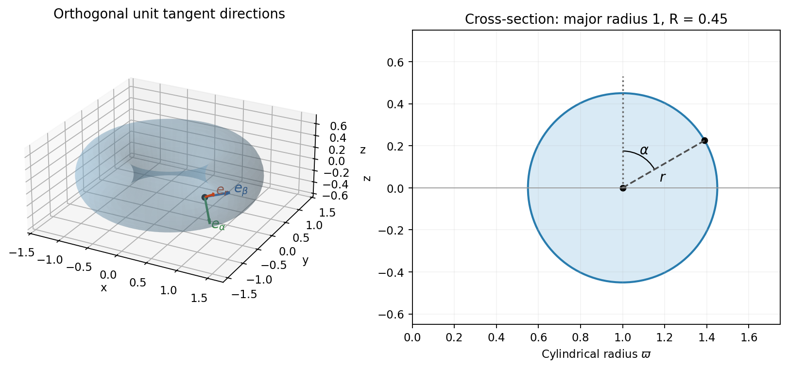
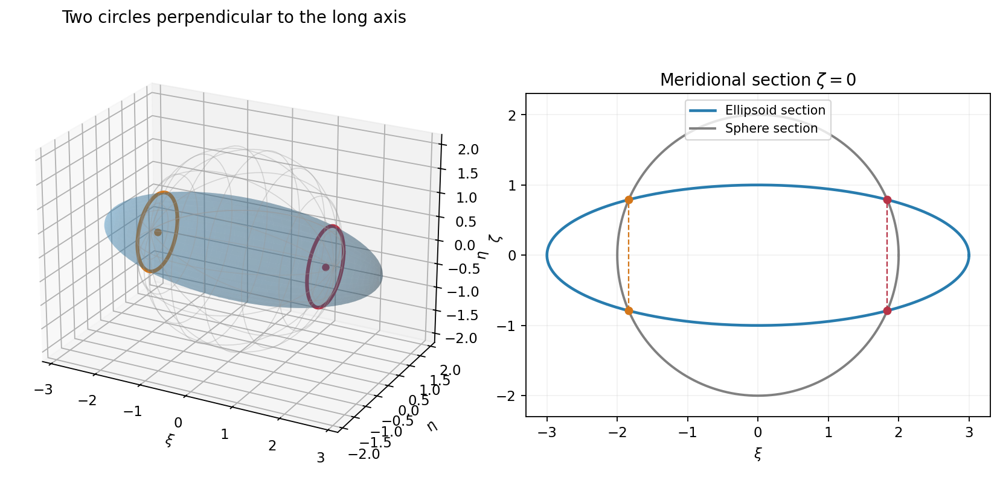

# Paper 1

↑ **Parent:** [2015](../2015.md)

[https://www.maths.cam.ac.uk/undergradnst/files/2015/PaperNST_IB_1.pdf](https://www.maths.cam.ac.uk/undergradnst/files/2015/PaperNST_IB_1.pdf)

**Table of contents**

- [1](#1)
  - [a](#1/a)
    - [Solution](#1/a/solution)
  - [b](#1/b)
    - [Solution](#1/b/solution)
  - [c](#1/c)
    - [Solution](#1/c/solution)
- [2](#2)
  - [a](#2/a)
    - [Solution](#2/a/solution)
  - [b](#2/b)
    - [Solution](#2/b/solution)
- [3](#3)
  - [a](#3/a)
    - [Solution](#3/a/solution)
  - [b](#3/b)
    - [i](#3/b/i)
      - [Solution](#3/b/i/solution)
    - [ii](#3/b/ii)
      - [Solution](#3/b/ii/solution)
- [4](#4)
  - [a](#4/a)
    - [Solution](#4/a/solution)
  - [b](#4/b)
    - [Solution](#4/b/solution)
  - [c](#4/c)
    - [Solution](#4/c/solution)
  - [d](#4/d)
    - [Solution](#4/d/solution)
- [5](#5)
  - [a](#5/a)
    - [Solution](#5/a/solution)
  - [b](#5/b)
    - [Solution](#5/b/solution)
  - [c](#5/c)
    - [Solution](#5/c/solution)
- [6](#6)
  - [a](#6/a)
    - [Solution](#6/a/solution)
  - [b](#6/b)
    - [Solution](#6/b/solution)
  - [c](#6/c)
    - [Solution](#6/c/solution)
- [7](#7)
  - [a](#7/a)
    - [Solution](#7/a/solution)
  - [b](#7/b)
    - [Solution](#7/b/solution)
  - [c](#7/c)
    - [Solution](#7/c/solution)
  - [d](#7/d)
    - [Solution](#7/d/solution)
- [8](#8)
  - [a](#8/a)
    - [Solution](#8/a/solution)
  - [b](#8/b)
    - [Solution](#8/b/solution)
  - [c](#8/c)
    - [Solution](#8/c/solution)
  - [d](#8/d)
    - [Solution](#8/d/solution)
- [9](#9)
  - [a](#9/a)
    - [Solution](#9/a/solution)
  - [b](#9/b)
    - [Solution](#9/b/solution)
- [10](#10)
  - [a](#10/a)
    - [Solution](#10/a/solution)
  - [b](#10/b)
    - [i](#10/b/i)
      - [Solution](#10/b/i/solution)
    - [ii](#10/b/ii)
      - [Solution](#10/b/ii/solution)
    - [iii](#10/b/iii)
      - [Solution](#10/b/iii/solution)

## 1

↑ **Parent:** [Paper 1](paper-1.md)

<h3 id="1/a">a</h3>

↑ **Parent:** [1](#1)

<h4 id="1/a/solution">Solution</h4>

↑ **Parent:** [A](#1/a)

The coordinate [tangent vectors](../../tangent-vector.md) are the partial [derivatives](../../calculus.md#derivative) of the position [vector](../../vector-space.md#vector):

$$
\boxed{\begin{aligned}
\mathbf h_r&=(\sin\alpha\cos\beta,\sin\alpha\sin\beta,\cos\alpha),\\
\mathbf h_\alpha&=(r\cos\alpha\cos\beta,r\cos\alpha\sin\beta,-r\sin\alpha),\\
\mathbf h_\beta&=(-(1+r\sin\alpha)\sin\beta,(1+r\sin\alpha)\cos\beta,0).
\end{aligned}}
$$

Their pairwise [dot products](../../inner-product.md#dot-product) vanish. Their lengths, the [scale factors of orthogonal coordinates](../../multivariable-calculus.md#scale-factors-of-orthogonal-coordinates), are $1,r,1+r\sin\alpha$. Since $R<1$, the last is positive throughout the body. Thus these [circular torus coordinates](../../multivariable-calculus.md#circular-torus-coordinates) are **orthogonal wherever $r>0$**; at $r=0$ the cross-section angle degenerates, as in ordinary [polar coordinates](../../multivariable-calculus.md#polar-coordinates).

The ordered [Jacobian determinant](../../multivariable-calculus.md#jacobian-determinant) is

$$
\boxed{J=\det\frac{\partial(x,y,z)}{\partial(r,\alpha,\beta)}=\mathbf h_r\cdot(\mathbf h_\alpha\times\mathbf h_\beta)=r(1+r\sin\alpha).}
$$

Its sign is positive for $r>0$, so the [volume](../../geometry-and-topology.md#volume) element is $dV=r(1+r\sin\alpha)\,dr\,d\alpha\,d\beta$. The coordinate degeneracy on the central [circle](../../topology.md#circle) has zero [volume](../../geometry-and-topology.md#volume) and does not obstruct [volume](../../geometry-and-topology.md#volume) [integration](../../integral.md).

**[Figure 1](#1/a/image-circular-torus-coordinates-and-their-orthogonal-tangent-directions). Circular torus coordinates and their orthogonal tangent directions**.

<h3 id="1/b">b</h3>

↑ **Parent:** [1](#1)

<h4 id="1/b/solution">Solution</h4>

↑ **Parent:** [B](#1/b)

Take the closed surface with its outward orientation. For sufficiently smooth fields defined throughout the solid, the [divergence theorem](../../multivariable-calculus.md#divergence-theorem) and the identity that the [divergence](../../multivariable-calculus.md#divergence) of a [curl](../../multivariable-calculus.md#curl) is zero give

$$
I=\iiint_V\nabla\cdot(\nabla\Omega+\nabla\times\mathbf U)\,dV=\boxed{\iiint_V\Delta\Omega\,dV.}
$$

Thus the [curl](../../multivariable-calculus.md#curl) term carries no net outward [flux](../../mathematical-physics.md#flux), and $I$ is independent of $\mathbf U$. The hole in the [solid torus](../../topological-surface.md#solid-torus) does not invalidate the [divergence theorem](../../multivariable-calculus.md#divergence-theorem); singularities of $\mathbf U$ _inside the [integration](../../integral.md) region_ would invalidate the smoothness argument and must be excluded.

<h3 id="1/c">c</h3>

↑ **Parent:** [1](#1)

<h4 id="1/c/solution">Solution</h4>

↑ **Parent:** [C](#1/c)

Only the quartic term contributes to the [Laplacian](../../multivariable-calculus.md#laplacian). The mixed cubic has zero second [derivative](../../calculus.md#derivative) in each coordinate, while the exponential–trigonometric pairs are harmonic:

$$
\Delta(z^4)=12z^2,\quad\Delta(xyz)=0,\quad\Delta(e^{-3y}\cos3x)=0,\quad\Delta(e^{2x}\sin2y)=0.
$$

Using $z=r\cos\alpha$ and the [Jacobian determinant](../../multivariable-calculus.md#jacobian-determinant) from part (a), the [divergence theorem](../../multivariable-calculus.md#divergence-theorem) gives

$$
\begin{aligned}
I&=12\int_0^{2\pi}\int_{-\pi}^{\pi}\int_0^R r^3\cos^2\alpha(1+r\sin\alpha)\,dr\,d\alpha\,d\beta\\
&=12(2\pi)\left(\int_{-\pi}^{\pi}\cos^2\alpha\,d\alpha\right)\frac{R^4}{4}=\boxed{6\pi^2R^4}.
\end{aligned}
$$

The term containing $\sin\alpha\cos^2\alpha$ integrates to zero. Equivalently, the [second vertical moment of a solid ring torus](../../differential-geometry.md#second-vertical-moment-of-a-solid-ring-torus) with major radius one is $\int_Vz^2dV=\pi^2R^4/2$.

## 2

↑ **Parent:** [Paper 1](paper-1.md)

<h3 id="2/a">a</h3>

↑ **Parent:** [2](#2)

<h4 id="2/a/solution">Solution</h4>

↑ **Parent:** [A](#2/a)

Remove the first spatial [derivative](../../calculus.md#derivative) by the [Dirichlet gauge transform for constant drift](../../diffusion-equation.md#dirichlet-gauge-transform-for-constant-drift):

$$
u(x,y,t)=e^{-\beta x/2}v(x,y,t),\qquad v_t=v_{xx}+v_{yy}-\frac{\beta^2}{4}v.
$$

The nonzero exponential factor preserves the zero side and top values; it also preserves $v_y=0$ on the bottom. A separated product $v=X(x)Y(y)T(t)$ has the spatial [eigenvalue problems](../../linear-operator-theory.md#eigenvalue-problem)

$$
X''+k_x^2X=0,\quad X(0)=X(1)=0;\qquad Y''+k_y^2Y=0,\quad Y'(0)=Y(1)=0.
$$

The nontrivial solutions are $X_m=\sin(m\pi x)$ for $m\geq1$ and $Y_n=\cos((n-1/2)\pi y)$ for $n\geq1$. There is no zero spatial mode in either direction. The temporal equation gives $T=e^{-\lambda_{mn}t}$, where

$$
\lambda_{mn}=m^2\pi^2+(n-1/2)^2\pi^2+\beta^2/4.
$$

Therefore the [mixed-boundary drift-diffusion eigenmodes on a rectangle](../../diffusion-equation.md#mixed-boundary-drift-diffusion-eigenmodes-on-a-rectangle) give

$$
\boxed{u(x,y,t)=e^{-\beta x/2}\sum_{m=1}^\infty\sum_{n=1}^\infty A_{mn}\sin(m\pi x)\cos((n-1/2)\pi y)e^{-\lambda_{mn}t}.}
$$

At $t=0$ the temporal factors are one, giving the required expansion. The sine and mixed-end cosine bases are complete and orthogonal for $v$. In particular,

$$
A_{mn}=4\int_0^1\int_0^1 e^{\beta x/2}u(x,y,0)\sin(m\pi x)\cos((n-1/2)\pi y)\,dy\,dx.
$$

The factor four comes from the product of the two squared basis norms, each $1/2$.

<h3 id="2/b">b</h3>

↑ **Parent:** [2](#2)

<h4 id="2/b/solution">Solution</h4>

↑ **Parent:** [B](#2/b)

After multiplying the initial field by $e^{\beta x/2}$, the $y$ dependence is exactly the $n=2$ cosine mode. Its [orthogonality](../../inner-product.md#orthogonal-vectors) therefore gives $A_{mn}=0$ when $n\neq2$. For $n=2$, the remaining [Fourier coefficient](../../fourier-series.md#fourier-coefficient) in the [Fourier sine series](../../fourier-series.md#fourier-sine-series) is

$$
A_{m2}=2\int_0^1x(1-x)\sin(m\pi x)\,dx=\frac{4[1-(-1)^m]}{m^3\pi^3}.
$$

Thus

$$
\boxed{A_{mn}=\begin{cases}8/(m^3\pi^3),&m\text{ odd and }n=2,\\0,&\text{otherwise}.\end{cases}}
$$

The coefficients are independent of $\beta$, because the initial exponential exactly cancels the drift-removing weight. Substitution into the preceding expansion gives the full subsequent solution, with decay rates $m^2\pi^2+9\pi^2/4+\beta^2/4$.

## 3

↑ **Parent:** [Paper 1](paper-1.md)

<h3 id="3/a">a</h3>

↑ **Parent:** [3](#3)

<h4 id="3/a/solution">Solution</h4>

↑ **Parent:** [A](#3/a)

For the [Green function](../../green-s-function.md) of $D_x^2-1$, the homogeneous solutions satisfying the left and right endpoint conditions are $u(x)=\sinh x$ and $v(x)=\sinh(1-x)$. Their [Wronskian](../../linear-ordinary-differential-equation.md#wronskian) is

$$
W=uv'-u'v=-\sinh1.
$$

Continuity of the kernel at $x=\xi$ and [integration](../../integral.md) of $G_{xx}-G=\delta(x-\xi)$ require $[G_x]_{\xi-}^{\xi+}=1$. Hence the [Dirichlet modified Helmholtz Green function on an interval](../../green-s-function.md#dirichlet-modified-helmholtz-green-function-on-an-interval) is

$$
\boxed{G(x,\xi)=-\frac{\sinh(x_<)\sinh(1-x_>)}{\sinh1}.}
$$

Here $x_<=\min(x,\xi)$ and $x_>=\max(x,\xi)$. The negative sign is essential for this operator convention. Integrating the forcing against the kernel gives

$$
\boxed{y(x)=-\frac1{\sinh1}\left[\sinh(1-x)\int_0^x\sinh\xi\,f(\xi)\,d\xi+\sinh x\int_x^1\sinh(1-\xi)f(\xi)\,d\xi\right].}
$$

This satisfies both endpoint conditions. It solves the equation classically for continuous $f$, and in the corresponding weak sense for integrable forcing. A homogeneous difference satisfying both endpoint conditions must vanish, so the solution is unique.

<h3 id="3/b">b</h3>

↑ **Parent:** [3](#3)

<h4 id="3/b/i">i</h4>

↑ **Parent:** [B](#3/b)

<h5 id="3/b/i/solution">Solution</h5>

↑ **Parent:** [I](#3/b/i)

Use the zero initial displacement and velocity given in the PDF. The characteristic roots of the homogeneous equation are $-1\pm i\mu$. Its [causal Green function of a damped oscillator](../../analysis.md#causal-green-function-of-a-damped-oscillator) is

$$
G(t)=H(t)\frac{e^{-t}\sin(\mu t)}{\mu},
$$

where $H$ is the [Heaviside step function](../../integral-transform.md#heaviside-step-function). The positive-time kernel has $G(0+)=0$ and $G'(0+)=1$, so its [derivative](../../calculus.md#derivative) jump generates a unit impulse. The zero-data forced solution is consequently the causal [convolution](../../fourier-analysis.md#convolution)

$$
\boxed{x(t)=\frac1\mu\int_0^te^{-(t-s)}\sin[\mu(t-s)]g(s)\,ds,\qquad t\geq0.}
$$

Differentiating once gives $x'(0)=0$; differentiating twice supplies the endpoint term $g(t)$ and verifies the differential equation. No homogeneous transient is required with these initial data.

<h4 id="3/b/ii">ii</h4>

↑ **Parent:** [B](#3/b)

<h5 id="3/b/ii/solution">Solution</h5>

↑ **Parent:** [Ii](#3/b/ii)

The PDF bounds the _absolute value_ of the forcing. Taking absolute values in the [Green function](../../green-s-function.md) [integral](../../integral.md) and using $|\sin|\leq1$ yields

$$
|x(t)|\leq\frac C\mu\int_0^te^{-(t-s)}e^{-as}\,ds.
$$

For $a\neq1$, this gives

$$
\boxed{|x(t)|\leq\frac C\mu\frac{e^{-at}-e^{-t}}{1-a}\longrightarrow0.}
$$

The ratio is nonnegative for either $a<1$ or $a>1$. The missing special case is $a=1$, for which

$$
\boxed{|x(t)|\leq\frac C\mu te^{-t}\longrightarrow0.}
$$

This proves [decay of a damped oscillator under exponentially decaying forcing](../../analysis.md#decay-of-a-damped-oscillator-under-exponentially-decaying-forcing). A one-sided upper bound on $g$ without an absolute value, as in the transcription, would not justify the conclusion.

## 4

↑ **Parent:** [Paper 1](paper-1.md)

<h3 id="4/a">a</h3>

↑ **Parent:** [4](#4)

<h4 id="4/a/solution">Solution</h4>

↑ **Parent:** [A](#4/a)

Use the [Fourier transform](../../fourier-transform.md) convention $\widetilde a(\omega)=\int_{-\infty}^{\infty}a(t)e^{-i\omega t}\,dt$, with inverse factor $1/(2\pi)$. Direct [integration](../../integral.md) over the pulse gives

$$
\boxed{\widetilde a(\omega)=\int_{-1}^1e^{-i\omega t}\,dt=\frac{2\sin\omega}{\omega},\qquad\widetilde a(0)=2.}
$$

The apparent singularity at zero is removable. Changing the values of the pulse at its two endpoints does not affect the transform.

<h3 id="4/b">b</h3>

↑ **Parent:** [4](#4)

<h4 id="4/b/solution">Solution</h4>

↑ **Parent:** [B](#4/b)

The filter is a real even [triangular function](../../fourier-analysis.md#triangular-function). Its [Fourier transform](../../fourier-transform.md) is

$$
\widetilde f(\omega)=2\int_0^1(1-t)\cos(\omega t)\,dt=\boxed{\frac{2(1-\cos\omega)}{\omega^2}=\left[\frac{\sin(\omega/2)}{\omega/2}\right]^2},
$$

with $\widetilde f(0)=1$. Since the transmitted pulse is the [convolution](../../fourier-analysis.md#convolution) $b=a*f$, the [convolution theorem](../../fourier-analysis.md#convolution-theorem) gives

$$
\boxed{\widetilde b(\omega)=\widetilde a(\omega)\widetilde f(\omega)=\frac{4\sin\omega(1-\cos\omega)}{\omega^3},\qquad\widetilde b(0)=2.}
$$

The normalized filter preserves the time [integral](../../integral.md) of the pulse, while its extra inverse-frequency factors suppress high-frequency content. It is a smoothing filter rather than an exact compact-bandwidth cutoff.

<h3 id="4/c">c</h3>

↑ **Parent:** [4](#4)

<h4 id="4/c/solution">Solution</h4>

↑ **Parent:** [C](#4/c)

By the [Fourier modulation and translation identity](../../fourier-transform.md#modulation-property-of-the-fourier-transform), delaying the pulse by $\tau$ multiplies its transform by $e^{-i\omega\tau}$. Hence

$$
\boxed{\widetilde r(\omega)=(1+\alpha e^{-i\omega\tau})\widetilde b(\omega)=(1+\alpha e^{-i\omega\tau})\frac{4\sin\omega(1-\cos\omega)}{\omega^3}.}
$$

The removable value at zero is $2(1+\alpha)$. For real $\alpha$, the squared spectral magnitude is multiplied by $1+\alpha^2+2\alpha\cos(\omega\tau)$, showing the interference between the direct and reflected signals.

<h3 id="4/d">d</h3>

↑ **Parent:** [4](#4)

<h4 id="4/d/solution">Solution</h4>

↑ **Parent:** [D](#4/d)

The [Fourier transform of a Gaussian](../../fourier-analysis.md#fourier-transform-of-a-gaussian) gives

$$
\mathcal F[e^{-t^2}]=\sqrt\pi e^{-\omega^2/4},\qquad\mathcal F^{-1}[2e^{-\omega^2/4}]=\frac2{\sqrt\pi}e^{-t^2}\equiv q(t).
$$

The [Fourier transform of a derivative](../../fourier-analysis.md#fourier-transform-of-a-derivative) obeys $\mathcal F[q'']=-\omega^2\widetilde q$, so multiplication of the spectrum by $1+\epsilon\omega^2$ corresponds to $q-\epsilon q''$. Since $q''=(2/\sqrt\pi)(4t^2-2)e^{-t^2}$,

$$
\boxed{s(t)=\frac2{\sqrt\pi}\left(1+2\epsilon-4\epsilon t^2\right)e^{-t^2}.}
$$

This is real and even, as required by the given spectrum. Its time [integral](../../integral.md) is two for every $\epsilon$, consistently with $\widetilde s(0)=2$.

## 5

↑ **Parent:** [Paper 1](paper-1.md)

<h3 id="5/a">a</h3>

↑ **Parent:** [5](#5)

<h4 id="5/a/solution">Solution</h4>

↑ **Parent:** [A](#5/a)

Let $Av_j=a_jv_j$. Commutation gives $A(Bv_j)=B(Av_j)=a_jBv_j$, so $B$ preserves each [eigenspace](../../linear-operator-theory.md#eigenspace) of $A$. Since the [eigenvalues](../../linear-operator-theory.md#eigenvalue) of $A$ are nondegenerate, each [eigenspace](../../linear-operator-theory.md#eigenspace) is one-dimensional and $Bv_j=b_jv_j$. The [spectral theorem](../../hilbert-space.md#spectral-theorem) for a [Hermitian matrix](../../hilbert-space.md#hermitian-operator) lets us choose these [vectors](../../vector-space.md#vector) as an [orthonormal eigenbasis](../../linear-operator-theory.md#orthonormal-eigenbasis). With $U=(v_1,\ldots,v_n)$,

$$
\boxed{A=U\Lambda_AU^\dagger,\qquad B=U\Lambda_BU^\dagger,\qquad U^\dagger U=I.}
$$

This is [simple spectrum gives simultaneous diagonalization](../../mathematics.md#simple-spectrum-gives-simultaneous-diagonalization). The common [eigenvectors](../../linear-operator-theory.md#eigenvector) can be chosen up to their phases and ordering. In fact degeneracy does not prevent a common eigenbasis for commuting [Hermitian matrices](../../hilbert-space.md#hermitian-operator), but the one-dimensional argument already suffices here.

The convergent [matrix exponential](../../linear-operator-theory.md#matrix-exponential) series respects similarity, so $e^A=Ue^{\Lambda_A}U^\dagger$ and likewise for $B$. Scalar exponentials multiply on each diagonal entry, giving

$$
\boxed{e^Ae^B=Ue^{\Lambda_A}e^{\Lambda_B}U^\dagger=Ue^{\Lambda_A+\Lambda_B}U^\dagger=e^{A+B}.}
$$

The essential hypothesis is commutation; Hermiticity supplies this convenient diagonalization proof.

<h3 id="5/b">b</h3>

↑ **Parent:** [5](#5)

<h4 id="5/b/solution">Solution</h4>

↑ **Parent:** [B](#5/b)

Expand both sides through second order as $\epsilon\to0$, holding $X,Y$ fixed. The product is

$$
e^{\epsilon X}e^{\epsilon Y}=I+\epsilon(X+Y)+\epsilon^2\left(\frac{X^2}{2}+XY+\frac{Y^2}{2}\right)+O(\epsilon^3).
$$

Put $Z=\epsilon(X+Y)+\epsilon^2[X,Y]/2$. Its exponential is

$$
\begin{aligned}
e^Z&=I+\epsilon(X+Y)+\frac{\epsilon^2}{2}\{[X,Y]+(X+Y)^2\}+O(\epsilon^3)\\
&=I+\epsilon(X+Y)+\epsilon^2\left(\frac{X^2}{2}+XY+\frac{Y^2}{2}\right)+O(\epsilon^3).
\end{aligned}
$$

Thus

$$
\boxed{e^{\epsilon X}e^{\epsilon Y}=e^{\epsilon X+\epsilon Y+\epsilon^2[X,Y]/2}+O(\epsilon^3).}
$$

This is the quadratic part of the [Baker--Campbell--Hausdorff formula](../../linear-operator-theory.md#baker-campbell-hausdorff-formula). The remainder estimate is in any fixed finite-dimensional [matrix](../../vector-space.md#matrix) [norm](../../normed-vector-space.md#norm), and is an asymptotic statement rather than an exact formula for arbitrary finite $\epsilon$.

<h3 id="5/c">c</h3>

↑ **Parent:** [5](#5)

<h4 id="5/c/solution">Solution</h4>

↑ **Parent:** [C](#5/c)

Use the lower antisymmetric block shown in the original PDF. Write $M=\operatorname{diag}(aK,bJ)$ with

$$
K=\begin{pmatrix}0&1\\1&0\end{pmatrix},\qquad J=\begin{pmatrix}0&1\\-1&0\end{pmatrix},\qquad K^2=I,\quad J^2=-I.
$$

Powers preserve the block structure. Splitting the [matrix exponential](../../linear-operator-theory.md#matrix-exponential) series into even and odd powers gives $e^{aK}=I\cosh a+K\sinh a$. For the other block, the [matrix exponential when the square is minus the identity](../../linear-operator-theory.md#matrix-exponential-when-the-square-is-minus-the-identity) gives $e^{bJ}=I\cos b+J\sin b$. Therefore

$$
\boxed{e^M=\begin{pmatrix}\cosh a&\sinh a&0&0\\\sinh a&\cosh a&0&0\\0&0&\cos b&\sin b\\0&0&-\sin b&\cos b\end{pmatrix}.}
$$

The upper block is hyperbolic and the lower block is a rotation. The transcription's altered last row and hyperbolic functions in the lower block would describe a different problem.

## 6

↑ **Parent:** [Paper 1](paper-1.md)

<h3 id="6/a">a</h3>

↑ **Parent:** [6](#6)

<h4 id="6/a/solution">Solution</h4>

↑ **Parent:** [A](#6/a)

The [spectral theorem](../../hilbert-space.md#spectral-theorem) for a real [symmetric matrix](../../linear-algebra.md#symmetric-matrix) gives real [eigenvalues](../../linear-operator-theory.md#eigenvalue) and an [orthonormal eigenbasis](../../linear-operator-theory.md#orthonormal-eigenbasis). Compute the roots of $\det(A-\lambda I)=0$, find a basis for each [eigenspace](../../linear-operator-theory.md#eigenspace), and orthonormalize within any repeated-eigenvalue [eigenspace](../../linear-operator-theory.md#eigenspace). [Eigenvectors](../../linear-operator-theory.md#eigenvector) belonging to distinct [eigenvalues](../../linear-operator-theory.md#eigenvalue) are already orthogonal: if $Av=\lambda v$ and $Aw=\mu w$, symmetry gives $(\lambda-\mu)v^Tw=0$.

Putting the normalized basis [vectors](../../vector-space.md#vector) in the columns of an [orthogonal matrix](../../linear-algebra.md#orthogonal-matrix) $Q$ yields

$$
\boxed{Q^TAQ=\operatorname{diag}(\lambda_1,\ldots,\lambda_n),\qquad A=Q\operatorname{diag}(\lambda_1,\ldots,\lambda_n)Q^T.}
$$

For repeated [eigenvalues](../../linear-operator-theory.md#eigenvalue), the choice of axes inside their [eigenspace](../../linear-operator-theory.md#eigenspace) is not unique.

<h3 id="6/b">b</h3>

↑ **Parent:** [6](#6)

<h4 id="6/b/solution">Solution</h4>

↑ **Parent:** [B](#6/b)

The quadratic-form [matrix](../../vector-space.md#matrix) has [eigenvectors](../../linear-operator-theory.md#eigenvector)

$$
e_+=\frac{(1,1,0)}{\sqrt2},\qquad e_-=\frac{(1,-1,0)}{\sqrt2},\qquad e_3=(0,0,1),
$$

with [eigenvalues](../../linear-operator-theory.md#eigenvalue) $1,9,9$. In the [principal axes](../../rigid-body-dynamics.md#principal-axis) coordinates $\xi=(x_1+x_2)/\sqrt2$, $\eta=(x_1-x_2)/\sqrt2$ and $\zeta=x_3$, the equation becomes

$$
\boxed{\frac{\xi^2}{9}+\eta^2+\zeta^2=1.}
$$

It is a [prolate spheroid](../../euclidean-geometry.md#prolate-spheroid), centred at the origin, with semiaxis **three along $e_+$ and one in every perpendicular direction**. The displayed $e_-,e_3$ are one choice of short [principal axes](../../rigid-body-dynamics.md#principal-axis).

The [sphere](../../euclidean-geometry.md#sphere) has equation $\xi^2+\eta^2+\zeta^2=4$. Combining it with the ellipsoid equation gives

$$
\boxed{\xi^2=\frac{27}{8},\qquad\eta^2+\zeta^2=\frac58.}
$$

The [intersection of a prolate spheroid and a concentric sphere](../../euclidean-geometry.md#intersection-of-a-prolate-spheroid-and-a-concentric-sphere) therefore consists of two [circles](../../topology.md#circle) in planes perpendicular to $e_+$. Each has radius $\boxed{\sqrt{5/8}=\sqrt{10}/4}$, and their centres are

$$
\boxed{c_\pm=\pm\sqrt{\frac{27}{8}}\,e_+=\pm\left(\frac{3\sqrt3}{4},\frac{3\sqrt3}{4},0\right).}
$$

Their plane equations in the original coordinates are $x_1+x_2=\pm3\sqrt3/2$.

**[Figure 2](#6/b/image-the-ellipsoid-radius-two-sphere-and-their-two-circular-intersections-in-principal-coordinates). The ellipsoid, radius-two sphere, and their two circular intersections in principal coordinates**.

<h3 id="6/c">c</h3>

↑ **Parent:** [6](#6)

<h4 id="6/c/solution">Solution</h4>

↑ **Parent:** [C](#6/c)

Minimize or maximize $D(x)=x^Tx$ subject to $x^TAx=1$. A [Lagrange multiplier](../../mathematical-optimization.md#lagrange-multiplier) $\Lambda$ gives

$$
2x-2\Lambda Ax=0.
$$

The constraint excludes $x=0$ and implies $Ax\neq0$, so it is a regular constraint surface. Multiplying the stationarity equation by $x^T$ gives $D=\Lambda>0$. Thus the [distance extrema on a real quadratic surface](../../euclidean-geometry.md#distance-extrema-on-a-real-quadratic-surface) satisfy

$$
\boxed{Ax=\frac1D x.}
$$

Every constrained extremum lies in a positive-eigenvalue [eigenspace](../../linear-operator-theory.md#eigenspace), with squared distance $D=1/\lambda$. If $A$ is positive definite, the global minimum is $1/\lambda_{\max}$ and the global maximum is $1/\lambda_{\min}$. For an indefinite or singular form the surface need not be bounded; [eigenvector](../../linear-operator-theory.md#eigenvector) directions give stationary candidates, which may be saddles and need not supply both global extrema. With a repeated positive [eigenvalue](../../linear-operator-theory.md#eigenvalue), there can be an entire family of equally distant stationary points.

## 7

↑ **Parent:** [Paper 1](paper-1.md)

<h3 id="7/a">a</h3>

↑ **Parent:** [7](#7)

<h4 id="7/a/solution">Solution</h4>

↑ **Parent:** [A](#7/a)

Complex differentiability requires the same limit for increments along the real and imaginary directions. Real increments give $f'=u_x+iv_x$. Imaginary increments give

$$
f'=\frac{u_y+iv_y}{i}=v_y-iu_y.
$$

Equating real and imaginary parts yields the [Cauchy-Riemann equations](../../analysis.md#cauchy-riemann-equations)

$$
\boxed{u_x=v_y,\qquad u_y=-v_x.}
$$

They hold throughout the open region where $f$ is [holomorphic](../../holomorphic-function.md). Conversely, continuous first real [partial derivatives](../../multivariable-calculus.md#partial-derivative) satisfying these equations on an open set ensure holomorphy there.

<h3 id="7/b">b</h3>

↑ **Parent:** [7](#7)

<h4 id="7/b/solution">Solution</h4>

↑ **Parent:** [B](#7/b)

For the real part specified in the PDF,

$$
u_x=(\cos x-x\sin x)\cosh y+y\cos x\sinh y.
$$

Integrating $v_y=u_x$ gives

$$
v=y\cos x\cosh y-x\sin x\sinh y+h(x).
$$

Substitution into $v_x=-u_y$ shows $h'(x)=0$. Thus

$$
\boxed{f(z)=z\cos z+iC,\qquad C\in\mathbb R.}
$$

Indeed $\cos(x+iy)=\cos x\cosh y-i\sin x\sinh y$, so the real part of $z\cos z$ is exactly the prescribed expression. The arbitrary imaginary constant is the only freedom on a connected domain.

<h3 id="7/c">c</h3>

↑ **Parent:** [7](#7)

<h4 id="7/c/solution">Solution</h4>

↑ **Parent:** [C](#7/c)

Write $g=u+iv$ and assume its domain is open and connected. If the constant modulus is zero then $g=0$. Otherwise let $u^2+v^2=c^2>0$. Differentiating this identity and using the [Cauchy-Riemann equations](../../analysis.md#cauchy-riemann-equations) gives

$$
u u_x+v v_x=0,\qquad u u_y+v v_y=-u v_x+v u_x=0.
$$

These are a linear system for $u_x,v_x$ with coefficient [matrix](../../vector-space.md#matrix) $\begin{pmatrix}u&v\\v&-u\end{pmatrix}$, whose [determinant](../../multilinear-algebra.md#determinant) is $-c^2\neq0$. Therefore $u_x=v_x=0$, and the [Cauchy-Riemann equations](../../analysis.md#cauchy-riemann-equations) also give $u_y=v_y=0$. It follows that

$$
\boxed{g\text{ is constant on its connected domain}.}
$$

This proves the [constant-modulus holomorphic function](../../holomorphic-function.md#constant-modulus-holomorphic-function) result directly. On a disconnected domain the same conclusion holds separately on each [connected component](../../geometry-and-topology.md#connected-component), but the constants can differ.

<h3 id="7/d">d</h3>

↑ **Parent:** [7](#7)

<h4 id="7/d/solution">Solution</h4>

↑ **Parent:** [D](#7/d)

[Partial fraction decomposition](../../isolated-singularity.md#partial-fraction-decomposition) give $h(z)=1/(z-i)+1/(z+i)$. Let $w=z-1$. Each fraction has a geometric expansion, so

$$
\boxed{h(z)=\sum_{j=0}^\infty(-1)^j\left[\frac1{(1-i)^{j+1}}+\frac1{(1+i)^{j+1}}\right](z-1)^j.}
$$

Equivalently, its coefficient is $(-1)^j2^{(1-j)/2}\cos((j+1)\pi/4)$. The first terms are

$$
h(z)=1-\frac12w^2+\frac12w^3-\frac14w^4+O(w^6).
$$

The linear and fifth-order coefficients vanish. Both [geometric series](../../sequence-and-series.md#geometric-series) converge for $|w|<\sqrt2$, and $h$ has genuine simple poles at $z=\pm i$, each distance $\sqrt2$ from the centre. Thus the [Taylor series](../../calculus.md#taylor-series) has

$$
\boxed{R=\sqrt2.}
$$

## 8

↑ **Parent:** [Paper 1](paper-1.md)

<h3 id="8/a">a</h3>

↑ **Parent:** [8](#8)

<h4 id="8/a/solution">Solution</h4>

↑ **Parent:** [A](#8/a)

In normalized form, the coefficients are $p(x)=-x/(1-x^2)$ and $q(x)=n^2/(1-x^2)$. They are analytic near zero, so $\boxed{x=0\text{ is an ordinary point}}$.

At each of $x=\pm1$, $p$ has a simple pole and $q$ at most a simple pole. The products $(x-x_0)p$ and $(x-x_0)^2q$ are analytic, so both are [regular singular points](../../complex-analysis.md#regular-singular-point). More precisely their limiting values are $1/2$ and zero, giving [indicial equation](../../linear-ordinary-differential-equation.md#indicial-equation) $\rho(\rho-1)+\rho/2=0$, with exponents $0,1/2$.

To classify infinity, set $t=1/x$ and $Y(t)=y(1/t)$. The transformed equation is

$$
t^2(t^2-1)Y''+(2t^3-t)Y'+n^2Y=0.
$$

After division, its coefficients satisfy

$$
tP(t)=\frac{2t^2-1}{t^2-1}\longrightarrow1,\qquad t^2Q(t)=\frac{n^2}{t^2-1}\longrightarrow-n^2.
$$

Both are analytic at $t=0$, while $P$ itself has a pole. Hence $\boxed{x=\infty\text{ is also a regular singular point}}$, with indicial exponents $\rho=\pm n$. These classifications remain valid at $n=0$, when the exponents at infinity coincide.

<h3 id="8/b">b</h3>

↑ **Parent:** [8](#8)

<h4 id="8/b/solution">Solution</h4>

↑ **Parent:** [B](#8/b)

Because zero is an [ordinary point](../../complex-analysis.md#ordinary-point-criterion-for-a-second-order-equation), substitute $y=\sum_{j\geq0}a_jx^j$. Matching powers gives

$$
(j+2)(j+1)a_{j+2}+(n^2-j^2)a_j=0,\qquad\boxed{a_{j+2}=\frac{j^2-n^2}{(j+2)(j+1)}a_j.}
$$

Even and odd coefficients evolve independently. Taking $(a_0,a_1)=(1,0)$ and $(0,1)$ constructs solutions

$$
\begin{aligned}
y_{\rm e}&=1-\frac{n^2x^2}{2!}+\frac{n^2(n^2-4)x^4}{4!}-\frac{n^2(n^2-4)(n^2-16)x^6}{6!}+\cdots,\\
y_{\rm o}&=x+\frac{(1-n^2)x^3}{3!}+\frac{(1-n^2)(9-n^2)x^5}{5!}+\cdots.
\end{aligned}
$$

Their initial values and [derivatives](../../calculus.md#derivative) give $W(y_{\rm e},y_{\rm o})(0)=1$, so they are [linearly independent](../../vector-space.md#linear-independence). These [power series of the Chebyshev differential equation](../../numerical-analysis.md#power-series-of-the-chebyshev-differential-equation) span the local solution space. A useful check is $y_{\rm e}=\cos(n\arcsin x)$ and $y_{\rm o}=\sin(n\arcsin x)/n$, with $y_{\rm o}=\arcsin x$ at $n=0$.

<h3 id="8/c">c</h3>

↑ **Parent:** [8](#8)

<h4 id="8/c/solution">Solution</h4>

↑ **Parent:** [C](#8/c)

For a nonterminating parity series, consecutive nonzero terms satisfy

$$
\left|\frac{a_{j+2}x^{j+2}}{a_jx^j}\right|=\left|\frac{j^2-n^2}{(j+2)(j+1)}\right||x|^2\longrightarrow|x|^2.
$$

The [ratio test](../../sequence-and-series.md#ratio-test) therefore gives $\boxed{R=1}$ for each nonterminating series. The nearest singular coefficient points are $x=\pm1$, both distance one from the expansion centre.

The polynomial exception is essential here. If $n$ is an integer, the series of the same parity as $|n|$ terminates and has $\boxed{R=\infty}$; the opposite-parity independent series remains nonterminating with radius one. For noninteger $n$, both have radius one. A [regular singular point](../../complex-analysis.md#regular-singular-point) can be removable for one particular solution, so its presence does not force every individual solution to have finite convergence radius.

<h3 id="8/d">d</h3>

↑ **Parent:** [8](#8)

<h4 id="8/d/solution">Solution</h4>

↑ **Parent:** [D](#8/d)

If $N=|n|$ is an integer, the recurrence has zero numerator at $j=N$. Choosing the parity containing $a_N$ therefore makes all later coefficients vanish. Conversely, for a nonzero polynomial of degree $N$, the coefficient of $x^N$ in the differential equation is $(n^2-N^2)a_N$, so $n^2=N^2$ is necessary.

Normalizing the terminating series by $y(1)=1$ gives the first [Chebyshev polynomials](../../numerical-analysis.md#chebyshev-polynomial):

$$
\boxed{T_0(x)=1,\qquad T_1(x)=x,\qquad T_2(x)=2x^2-1,\qquad T_3(x)=4x^3-3x.}
$$

Substitution verifies each differential equation and endpoint value. More generally, $T_N(x)=\cos(N\arccos x)$; its recurrence $T_{N+1}=2xT_N-T_{N-1}$ also establishes polynomiality and the normalization.

## 9

↑ **Parent:** [Paper 1](paper-1.md)

<h3 id="9/a">a</h3>

↑ **Parent:** [9](#9)

<h4 id="9/a/solution">Solution</h4>

↑ **Parent:** [A](#9/a)

For fixed endpoint values and smooth admissible variations, the [Euler-Lagrange equation](../../analysis.md#euler-lagrange-equation) is

$$
\boxed{\frac{d}{dx}\frac{\partial f}{\partial z'}-\frac{\partial f}{\partial z}=0.}
$$

The first variation follows by integrating $\int(f_z\eta+f_{z'}\eta')dx$ by parts and using $\eta=0$ at the endpoints.

For the claimed first [integral](../../integral.md), differentiate directly:

$$
\frac{d}{dx}(f-z'f_{z'})=f_x+z'\left(f_z-\frac{d}{dx}f_{z'}\right).
$$

Along an extremal the bracket vanishes. Thus when $f_x=0$, the [Beltrami identity](../../analysis.md#beltrami-identity) is

$$
\boxed{f-z'f_{z'}=\text{constant}.}
$$

For a further regular constraint $G[z]=G_0$, introduce a constant [Lagrange multiplier](../../mathematical-optimization.md#lagrange-multiplier) $\lambda$ and make $F-\lambda G$ stationary. Apply the [Euler-Lagrange equation](../../analysis.md#euler-lagrange-equation) to the combined integrand, then impose the endpoints and $G=G_0$ to determine the [integration](../../integral.md) constants and multiplier.

<h3 id="9/b">b</h3>

↑ **Parent:** [9](#9)

<h4 id="9/b/solution">Solution</h4>

↑ **Parent:** [B](#9/b)

A curve element has [arc length](../../riemannian-geometry.md#arc-length) $ds=\sqrt{1+z'^2}\,dx$ and mass $dm=\mu ds$. Adding its gravitational energies gives

$$
\boxed{V[z]=\mu\int_{-a/\sqrt2}^{a/\sqrt2}\Phi(z)\sqrt{1+z'^2}\,dx.}
$$

For the fixed-length constraint, use the augmented integrand $(\mu\Phi(z)-\lambda)\sqrt{1+z'^2}$. It has no explicit $x$ dependence, so the [Beltrami identity](../../analysis.md#beltrami-identity) gives

$$
\boxed{\frac{\mu\Phi(z)-\lambda}{\sqrt{1+z'^2}}=C.}
$$

The desired lower circular arc is

$$
z(x)=h-\sqrt{a^2-x^2},\qquad h=\frac a{\sqrt2}.
$$

It joins the required endpoints, subtends angle $\pi/2$, and has length $\pi a/2$. Its slope gives $\sqrt{1+z'^2}=a/(h-z)$. Therefore a [gravitational potential producing a circular hanging chain](../../analysis.md#gravitational-potential-producing-a-circular-hanging-chain) is

$$
\boxed{\Phi(z)=\Phi_0+\frac{\kappa}{a/\sqrt2-z},\qquad\kappa>0,\quad z<a/\sqrt2.}
$$

Choosing $\lambda=\mu\Phi_0$ makes the first [integral](../../integral.md) constant, $C=\mu\kappa/a$. Its [gravitational acceleration](../../newton-s-law-of-universal-gravitation.md#gravitational-acceleration) is $-\Phi'(z)=-\kappa/(h-z)^2$, which points downward. An arbitrary additive potential constant changes no force.

This construction really gives a minimum. With $w=h-z>0$, the variable part of $V$ is $\mu\kappa\int ds/w$; the $\Phi_0$ term is fixed by the length. The [calibration for semicircular hyperbolic geodesics](../../hyperbolic-geometry.md#calibration-for-semicircular-hyperbolic-geodesics) uses $S(x,w)=\operatorname{arsinh}(x/w)$, whose [gradient](../../multivariable-calculus.md#gradient) has [norm](../../normed-vector-space.md#norm) $1/w$. The [Cauchy-Schwarz inequality](../../probability-and-statistics.md#cauchy-schwarz-inequality) gives $\int ds/w\geq S(B)-S(A)$, with equality on $x^2+w^2=a^2$ traversed left to right. Thus the circular arc minimizes the energy among competitors of the same length and endpoints in the stated potential domain, rather than merely satisfying a necessary stationarity condition.

**[Figure 3](#9/b/image-a-circular-hanging-chain-and-the-inverse-height-gravitational-potential-that-supports-it). A circular hanging chain and the inverse-height gravitational potential that supports it**.

## 10

↑ **Parent:** [Paper 1](paper-1.md)

<h3 id="10/a">a</h3>

↑ **Parent:** [10](#10)

<h4 id="10/a/solution">Solution</h4>

↑ **Parent:** [A](#10/a)

Let $R[y]=F[y]/G[y]$, where $G[y]>0$ for a nonzero admissible real function. Writing $\lambda=R[y]$, its first variation is

$$
\delta R=\frac2G\left\{[py'\delta y]_\alpha^\beta+\int_\alpha^\beta[-(py')'+qy-\lambda wy]\delta y\,dx\right\}.
$$

Choose [boundary conditions](../../differential-equation.md#boundary-condition) making the boundary term vanish, for example homogeneous [Dirichlet boundary conditions](../../differential-equation.md#dirichlet-boundary-condition), homogeneous [Neumann boundary conditions](../../differential-equation.md#neumann-boundary-condition), or a corresponding mixed pair. Arbitrary interior variations then give the [Sturm-Liouville problem](../../sturm-liouville-theory.md#sturm-liouville-problem)

$$
\boxed{-(py')'+qy=\lambda wy.}
$$

Multiplying this equation by $y$ and integrating by parts, with $[pyy']_\alpha^\beta=0$, yields

$$
\boxed{\lambda=\frac{\int_\alpha^\beta[p(y')^2+qy^2]dx}{\int_\alpha^\beta wy^2dx}=R[y].}
$$

Thus [eigenfunctions](../../linear-operator-theory.md#eigenfunction) are stationary directions of the quotient. The lowest [eigenvalue](../../linear-operator-theory.md#eigenvalue) is its global minimum; higher [eigenfunctions](../../linear-operator-theory.md#eigenfunction) need not be unrestricted maxima or minima. General Robin [boundary conditions](../../differential-equation.md#boundary-condition) require including their boundary energy in the quotient unless the displayed endpoint products also vanish.

The [Rayleigh-Ritz method](../../finite-element-method.md#rayleigh-ritz-method) chooses admissible trial functions depending on finitely many coefficients and minimizes this quotient over them. Expansion in a complete orthonormal basis with weight $w$ shows $R[y]\geq\lambda_0$, so the trial minimum is an upper bound on the true lowest [eigenvalue](../../linear-operator-theory.md#eigenvalue). In a finite basis, the minimization becomes a [generalized eigenvalue problem](../../linear-operator-theory.md#generalized-eigenvalue-problem) for the stiffness and weighted mass [matrices](../../vector-space.md#matrix). Enlarging the trial space can only lower or preserve this upper bound.

<h3 id="10/b">b</h3>

↑ **Parent:** [10](#10)

<h4 id="10/b/i">i</h4>

↑ **Parent:** [B](#10/b)

<h5 id="10/b/i/solution">Solution</h5>

↑ **Parent:** [I](#10/b/i)

For a spherically symmetric function, the [Laplacian in spherical coordinates](../../partial-differential-equation.md#laplacian-in-spherical-coordinates) reduces to

$$
\nabla^2\psi=\frac1{r^2}\frac{d}{dr}\left(r^2\frac{d\psi}{dr}\right).
$$

Multiplying the [Helmholtz equation](../../partial-differential-equation.md#helmholtz-equation) by $r^2$ gives

$$
\boxed{-\frac{d}{dr}(r^2\psi')=k^2r^2\psi,\qquad p(r)=r^2,\quad q(r)=0,\quad w(r)=r^2.}
$$

The endpoint at $r=0$ is singular in Sturm-Liouville terminology; bounded regular radial fields select the physical solution and eliminate the $1/r$ branch. At $r=a$ the field has the imposed zero Dirichlet value. For regular solutions and admissible trial functions, the endpoint term $r^2\psi\psi'$ vanishes at the origin and at the wall.

<h4 id="10/b/ii">ii</h4>

↑ **Parent:** [B](#10/b)

<h5 id="10/b/ii/solution">Solution</h5>

↑ **Parent:** [Ii](#10/b/ii)

The radial [Rayleigh quotient](../../linear-operator-theory.md#rayleigh-quotient) is

$$
k_{\rm trial}^2=\frac{\int_0^ar^2(\psi'_{\rm trial})^2dr}{\int_0^ar^2\psi_{\rm trial}^2dr}.
$$

For the given trial profile, the numerator is $4a^{-4}\int_0^ar^4dr=4a/5$. The denominator is

$$
\int_0^ar^2(1-r^2/a^2)^2dr=a^3\left(\frac13-\frac25+\frac17\right)=\frac{8a^3}{105}.
$$

Therefore

$$
\boxed{k_0^2\leq k_{\rm trial}^2=\frac{21}{2a^2}=\frac{10.5}{a^2}.}
$$

The profile is regular at the origin and vanishes at the wall, so it belongs to the admissible trial space. This is the variational estimate for the [radial Dirichlet modes of a spherical cavity](../../partial-differential-equation.md#radial-dirichlet-modes-of-a-spherical-cavity).

<h4 id="10/b/iii">iii</h4>

↑ **Parent:** [B](#10/b)

<h5 id="10/b/iii/solution">Solution</h5>

↑ **Parent:** [Iii](#10/b/iii)

Set $\psi(r)=u(r)/r$ for $r>0$. Direct differentiation gives $(r^2\psi')'=ru''$, so the radial equation reduces to

$$
u''+k^2u=0.
$$

Boundedness of $\psi$ requires $u(0)=0$, and the wall condition requires $u(a)=0$. The nontrivial solutions are consequently

$$
\boxed{k_j=\frac{j\pi}{a},\qquad\psi_j(r)=C_j\frac{\sin(j\pi r/a)}r,\qquad j=1,2,\ldots.}
$$

Their origin values are the removable limits $C_jj\pi/a$. At $k=0$, the only bounded radial solution is constant and the wall forces it to vanish, so there is no zero mode. The lowest [eigenvalue](../../linear-operator-theory.md#eigenvalue) is

$$
\boxed{k_0^2=\frac{\pi^2}{a^2}\simeq\frac{9.86960}{a^2}.}
$$

It is below $10.5/a^2$, as required by the [Rayleigh-Ritz variational principle](../../linear-operator-theory.md#rayleigh-ritz-variational-principle). The trial value overestimates $k_0^2$ by approximately $\boxed{6.39\%}$.

## ↑ Ancestors (10)

1. [2015](../2015.md)
2. [Past exam of the mathematics course of the year 2 of the natural sciences course of the University of Cambridge](../../past-exam-of-the-mathematics-course-of-the-year-2-of-the-natural-sciences-course-of-the-university-of-cambridge.md)
3. [Mathematics course of the year 2 of the natural sciences course of the University of Cambridge](../../university-of-cambridge.md#mathematics-course-of-the-year-2-of-the-natural-sciences-course-of-the-university-of-cambridge)
4. [Year 2 of the natural sciences course of the University of Cambridge](../../university-of-cambridge.md#year-2-of-the-natural-sciences-course-of-the-university-of-cambridge)
5. [Year of the natural sciences course of the University of Cambridge](../../university-of-cambridge.md#year-of-the-natural-sciences-course-of-the-university-of-cambridge)
6. [Natural sciences course of the University of Cambridge](../../university-of-cambridge.md#natural-sciences-course-of-the-university-of-cambridge)
7. [Course of the University of Cambridge](../../university-of-cambridge.md#course-of-the-university-of-cambridge)
8. [University of Cambridge](../../university-of-cambridge.md)
9. [List of universities](../../README.md#list-of-universities)
10. [Codex Wiki](../../README.md)
