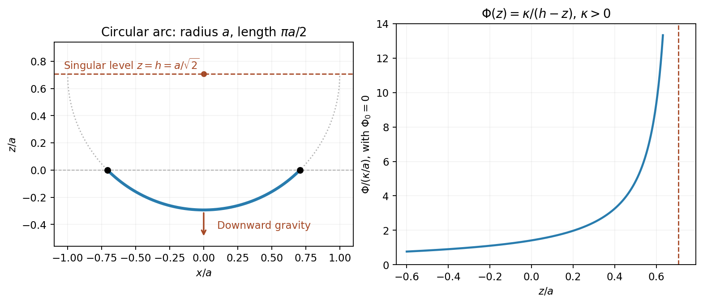

<h1 id="9/b/solution">Solution</h1>

↑ **Parent:** [B](../b.md)

A curve element has [arc length](../../../../../arc-length.md) $ds=\sqrt{1+z'^2}\,dx$ and mass $dm=\mu ds$. Adding its gravitational energies gives

$$
\boxed{V[z]=\mu\int_{-a/\sqrt2}^{a/\sqrt2}\Phi(z)\sqrt{1+z'^2}\,dx.}
$$

For the fixed-length constraint, use the augmented integrand $(\mu\Phi(z)-\lambda)\sqrt{1+z'^2}$. It has no explicit $x$ dependence, so the [Beltrami identity](../../../../../beltrami-identity.md) gives

$$
\boxed{\frac{\mu\Phi(z)-\lambda}{\sqrt{1+z'^2}}=C.}
$$

The desired lower circular arc is

$$
z(x)=h-\sqrt{a^2-x^2},\qquad h=\frac a{\sqrt2}.
$$

It joins the required endpoints, subtends angle $\pi/2$, and has length $\pi a/2$. Its slope gives $\sqrt{1+z'^2}=a/(h-z)$. Therefore a [gravitational potential producing a circular hanging chain](../../../../../gravitational-potential-producing-a-circular-hanging-chain.md) is

$$
\boxed{\Phi(z)=\Phi_0+\frac{\kappa}{a/\sqrt2-z},\qquad\kappa>0,\quad z<a/\sqrt2.}
$$

Choosing $\lambda=\mu\Phi_0$ makes the first [integral](../../../../../integral-split.md) constant, $C=\mu\kappa/a$. Its [gravitational acceleration](../../../../../gravitational-acceleration.md) is $-\Phi'(z)=-\kappa/(h-z)^2$, which points downward. An arbitrary additive potential constant changes no force.

This construction really gives a minimum. With $w=h-z>0$, the variable part of $V$ is $\mu\kappa\int ds/w$; the $\Phi_0$ term is fixed by the length. The [calibration for semicircular hyperbolic geodesics](../../../../../calibration-for-semicircular-hyperbolic-geodesics.md) uses $S(x,w)=\operatorname{arsinh}(x/w)$, whose [gradient](../../../../../gradient.md) has [norm](../../../../../norm.md) $1/w$. The [Cauchy-Schwarz inequality](../../../../../cauchy-schwarz-inequality.md) gives $\int ds/w\geq S(B)-S(A)$, with equality on $x^2+w^2=a^2$ traversed left to right. Thus the circular arc minimizes the energy among competitors of the same length and endpoints in the stated potential domain, rather than merely satisfying a necessary stationarity condition.

**[Figure 3](#9/b/image-a-circular-hanging-chain-and-the-inverse-height-gravitational-potential-that-supports-it). A circular hanging chain and the inverse-height gravitational potential that supports it**.

## ↑ Ancestors (13)

1. [B](../b.md)
2. [9](../../9.md)
3. [Paper 1](../../../paper-1-split.md)
4. [2015](../../../split.md)
5. [Past exam of the mathematics course of the year 2 of the natural sciences course of the University of Cambridge](../../../../split.md)
6. [Mathematics course of the year 2 of the natural sciences course of the University of Cambridge](../../../../../mathematics-course-of-the-year-2-of-the-natural-sciences-course-of-the-university-of-cambridge.md)
7. [Year 2 of the natural sciences course of the University of Cambridge](../../../../../year-2-of-the-natural-sciences-course-of-the-university-of-cambridge.md)
8. [Year of the natural sciences course of the University of Cambridge](../../../../../year-of-the-natural-sciences-course-of-the-university-of-cambridge.md)
9. [Natural sciences course of the University of Cambridge](../../../../../natural-sciences-course-of-the-university-of-cambridge.md)
10. [Course of the University of Cambridge](../../../../../course-of-the-university-of-cambridge.md)
11. [University of Cambridge](../../../../../university-of-cambridge-split.md)
12. [List of universities](../../../../../list-of-universities.md)
13. [Codex Wiki](../../../../../split.md)
