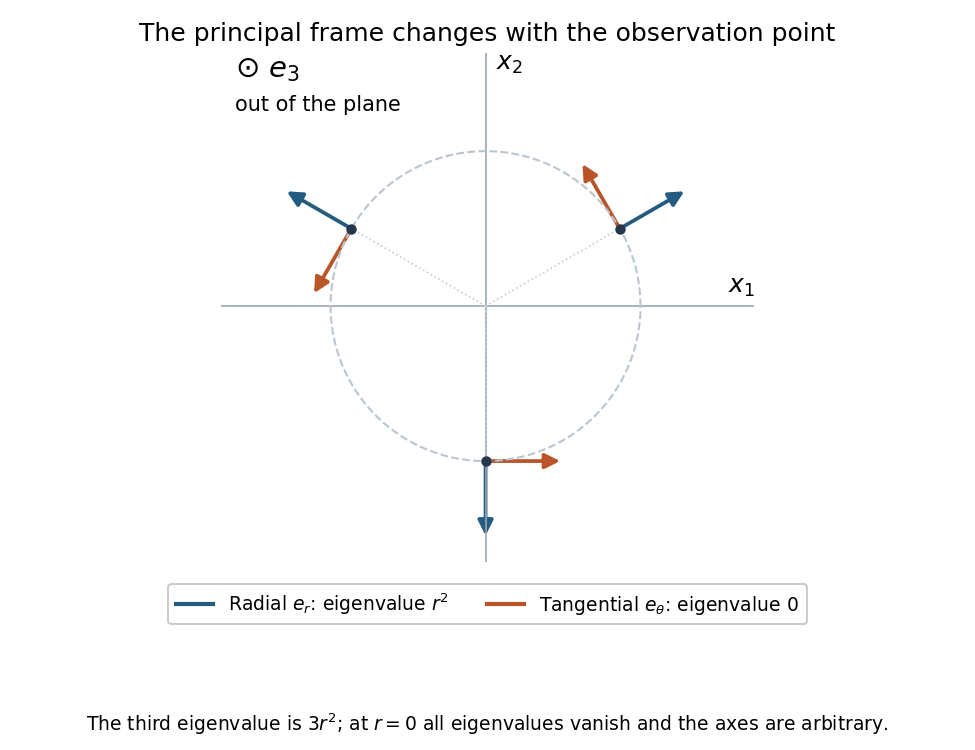

<h1 id="6/c/solution">Solution</h1>

↑ **Parent:** [C](../c.md)

Let $r=\sqrt{x_1^2+x_2^2}$. Averaging each pair of transposed entries gives the [symmetric tensor](../../../../../symmetric-tensor.md)

$$
\boxed{S=\frac12(F+F^T)=\begin{pmatrix}x_1^2&x_1x_2&0\\x_1x_2&x_2^2&0\\0&0&3r^2\end{pmatrix}.}
$$

For $r>0$, the upper block is the [outer product](../../../../../outer-product.md) of $(x_1,x_2)$ with itself. It sends that vector to $r^2$ times itself and annihilates its perpendicular. Thus its orthonormal [principal axes](../../../../../principal-axis.md) and corresponding [eigenvalues](../../../../../eigenvalue.md) are

$$
\boxed{\begin{array}{c|c|l}
\text{axis}&\text{principal value}&\text{geometric direction}\\\hline
 e_r=(x_1,x_2,0)/r&r^2&\text{radially outward from the }x_3\text{-axis}\\
 e_\theta=(-x_2,x_1,0)/r&0&\text{tangent to a circle about the }x_3\text{-axis}\\
 e_3=(0,0,1)&3r^2&\text{parallel to the }x_3\text{-axis}
\end{array}.}
$$

Taking these vectors as the rows of the change-of-components matrix gives

$$
\boxed{M(x)=\begin{pmatrix}x_1/r&x_2/r&0\\-x_2/r&x_1/r&0\\0&0&1\end{pmatrix},\qquad MSM^T=\operatorname{diag}(r^2,0,3r^2).}
$$

This matrix is orthogonal with determinant one. These are the [principal axes of a planar rank-one tensor block](../../../../../principal-axes-of-a-planar-rank-one-tensor-block.md).

**[Figure 1](#6/c/image-the-radial-and-tangential-principal-directions-rotate-with-position-the-third-principal-axis-is-perpendicular-to-this-plane). The radial and tangential principal directions rotate with position; the third principal axis is perpendicular to this plane**.

The matrix is a pointwise frame transformation: because its angle varies with position, it does not represent one fixed Cartesian rotation diagonalizing the entire field everywhere. On the axis $r=0$, the symmetric tensor is zero; all principal values coincide and any orthonormal axes may be chosen. The displayed formula for $M$ is therefore used only off that axis.

## ↑ Ancestors (13)

1. [C](../c.md)
2. [6](../../6.md)
3. [Paper 2](../../../paper-2-split.md)
4. [2015](../../../split.md)
5. [Past exam of the mathematics course of the year 2 of the natural sciences course of the University of Cambridge](../../../../split.md)
6. [Mathematics course of the year 2 of the natural sciences course of the University of Cambridge](../../../../../mathematics-course-of-the-year-2-of-the-natural-sciences-course-of-the-university-of-cambridge.md)
7. [Year 2 of the natural sciences course of the University of Cambridge](../../../../../year-2-of-the-natural-sciences-course-of-the-university-of-cambridge.md)
8. [Year of the natural sciences course of the University of Cambridge](../../../../../year-of-the-natural-sciences-course-of-the-university-of-cambridge.md)
9. [Natural sciences course of the University of Cambridge](../../../../../natural-sciences-course-of-the-university-of-cambridge.md)
10. [Course of the University of Cambridge](../../../../../course-of-the-university-of-cambridge.md)
11. [University of Cambridge](../../../../../university-of-cambridge-split.md)
12. [List of universities](../../../../../list-of-universities.md)
13. [Codex Wiki](../../../../../split.md)
