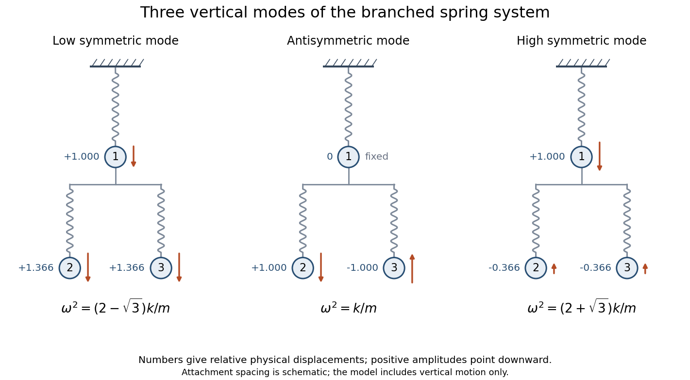

<h1 id="7/d/solution">Solution</h1>

↑ **Parent:** [D](../d.md)

For equal masses, write $M=mB$ with $B=\left(\begin{smallmatrix}3&1&1\\1&1&0\\1&0&1\end{smallmatrix}\right)$. The [generalized eigenvalue problem for small oscillations](../../../../../generalized-eigenvalue-problem-for-small-oscillations.md) is $kv=\omega^2mBv$.

Exchange symmetry of climbers 2 and 3 gives $v_a=(0,1,-1)^T$, for which $Bv_a=v_a$. Hence

$$
\boxed{\omega_a=\sqrt{k/m},\qquad y(t)=A(t)(0,1,-1)^T.}
$$

The physical displacements are $(y_1,y_1+y_2,y_1+y_3)$, so climber 1 is stationary and the other two move vertically with equal amplitudes in opposite directions. Their changes in force on climber 1 cancel.

For the remaining symmetric modes, put $v=(a,b,b)^T$ and let $\mu=k/(m\omega^2)$. The eigenproblem becomes $3a+2b=\mu a$, $a+b=\mu b$. Eliminating $a,b$ gives $(3-\mu)(1-\mu)-2=\mu^2-4\mu+1=0$. Therefore $\mu=2\pm\sqrt3$. Since $(2+\sqrt3)(2-\sqrt3)=1$,

$$
\boxed{\omega_-^2=\frac km(2-\sqrt3),\qquad\omega_+^2=\frac km(2+\sqrt3).}
$$

For clarity, their relative physical climber displacements, rather than rope-length amplitudes, are

$$
q_-\propto\left(1,\frac{1+\sqrt3}{2},\frac{1+\sqrt3}{2}\right),\qquad q_+\propto\left(1,\frac{1-\sqrt3}{2},\frac{1-\sqrt3}{2}\right).
$$

The lower mode moves all climbers in phase; the higher mode moves the lower pair against the top climber. These are the [normal modes of three vertically suspended masses with a branched spring connection](../../../../../normal-modes-of-three-vertically-suspended-masses-with-a-branched-spring-connection.md).

**[Figure 2](#7/d/image-relative-physical-climber-displacements-in-the-three-vertical-normal-modes-branch-spacing-is-schematic). Relative physical climber displacements in the three vertical normal modes; branch spacing is schematic**.

## ↑ Ancestors (13)

1. [D](../d.md)
2. [7](../../7.md)
3. [Paper 2](../../../paper-2-split.md)
4. [2015](../../../split.md)
5. [Past exam of the mathematics course of the year 2 of the natural sciences course of the University of Cambridge](../../../../split.md)
6. [Mathematics course of the year 2 of the natural sciences course of the University of Cambridge](../../../../../mathematics-course-of-the-year-2-of-the-natural-sciences-course-of-the-university-of-cambridge.md)
7. [Year 2 of the natural sciences course of the University of Cambridge](../../../../../year-2-of-the-natural-sciences-course-of-the-university-of-cambridge.md)
8. [Year of the natural sciences course of the University of Cambridge](../../../../../year-of-the-natural-sciences-course-of-the-university-of-cambridge.md)
9. [Natural sciences course of the University of Cambridge](../../../../../natural-sciences-course-of-the-university-of-cambridge.md)
10. [Course of the University of Cambridge](../../../../../course-of-the-university-of-cambridge.md)
11. [University of Cambridge](../../../../../university-of-cambridge-split.md)
12. [List of universities](../../../../../list-of-universities.md)
13. [Codex Wiki](../../../../../split.md)
