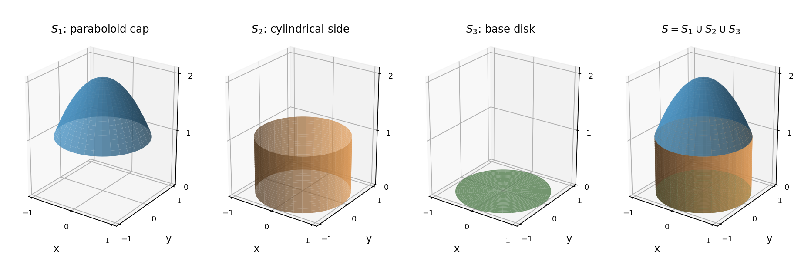

<h1 id="1/b/solution">Solution</h1>

↑ **Parent:** [B](../b.md)

The upper piece is a downward-opening circular [elliptic paraboloid](../../../../../elliptic-paraboloid.md) cap, running from the circle $r=1,z=1$ to the apex $r=0,z=2$. The middle piece is the side of a circular [cylinder](../../../../../cylinder-geometry.md) of radius one and height one. The lower piece is the unit [disk](../../../../../disk-mathematics.md) in the horizontal plane. Their union is the closed boundary of

$$
V=\{(x,y,z):0\leq z\leq1,\ x^2+y^2\leq1\}\ \cup\ \{(x,y,z):1\leq z\leq2,\ x^2+y^2\leq2-z\}.
$$

The four panels show the three separate pieces and their union; there is no additional fourth component. In a meridional section, the boundary consists of the base segment, two vertical sides, and the parabolic cap. The outward normals point downward on the base, radially outward on the cylindrical side, and upward/outward on the cap.

**[Figure 1](#1/b/image-three-boundary-pieces-and-their-closed-union-shown-as-original-surfaces-of-revolution). Three boundary pieces and their closed union, shown as original surfaces of revolution**.

## ↑ Ancestors (13)

1. [B](../b.md)
2. [1](../../1.md)
3. [Paper 1](../../../paper-1-split.md)
4. [2016](../../../split.md)
5. [Past exam of the mathematics course of the year 2 of the natural sciences course of the University of Cambridge](../../../../split.md)
6. [Mathematics course of the year 2 of the natural sciences course of the University of Cambridge](../../../../../mathematics-course-of-the-year-2-of-the-natural-sciences-course-of-the-university-of-cambridge.md)
7. [Year 2 of the natural sciences course of the University of Cambridge](../../../../../year-2-of-the-natural-sciences-course-of-the-university-of-cambridge.md)
8. [Year of the natural sciences course of the University of Cambridge](../../../../../year-of-the-natural-sciences-course-of-the-university-of-cambridge.md)
9. [Natural sciences course of the University of Cambridge](../../../../../natural-sciences-course-of-the-university-of-cambridge.md)
10. [Course of the University of Cambridge](../../../../../course-of-the-university-of-cambridge.md)
11. [University of Cambridge](../../../../../university-of-cambridge-split.md)
12. [List of universities](../../../../../list-of-universities.md)
13. [Codex Wiki](../../../../../split.md)
