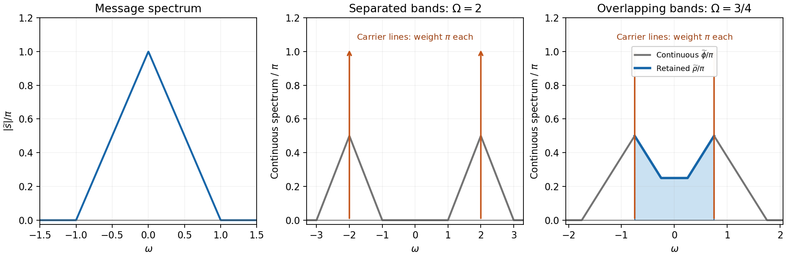

<h1 id="4/b/solution">Solution</h1>

↑ **Parent:** [B](../b.md)

A direct way to avoid the singular transform of $1/t^2$ is to invert a [triangular function](../../../../../triangular-function.md). Evenness gives

$$
\frac1{2\pi}\int_{-1}^1\pi(1-|\omega|)e^{i\omega t}\,d\omega=\int_0^1(1-\omega)\cos(\omega t)\,d\omega=\frac{1-\cos t}{t^2}.
$$

At $t=0$ the limit is $1/2$, so there is no singularity in the original signal. Thus

$$
\boxed{\widetilde s(\omega)=\pi(1-|\omega|)_+,\qquad (r)_+=\max(r,0).}
$$

Alternatively, the hint uses the [Hadamard finite-part reciprocal-power distribution](../../../../../hadamard-finite-part-reciprocal-power-distribution.md), whose [distributional Fourier transform](../../../../../fourier-transform-of-a-tempered-distribution.md) is $\mathcal F[\operatorname{fp}(1/t^2)]=-\pi|\omega|$; combining its three translates gives $\pi(|\omega-1|+|\omega+1|-2|\omega|)/2$, the same triangle. Treating $1/t^2$ as an ordinary integrable function would be invalid.

The message spectrum has height $\pi$ at zero, vanishing at $\omega=\pm1$. For $\Omega>1$, the modulated continuous spectrum consists of disjoint triangles of height $\pi/2$, centred at $\pm\Omega$, each with half-width one. In addition there is a [Dirac delta](../../../../../dirac-delta-function.md) carrier line of weight $\pi$ at each centre. These lines have specified area, not a finite height; arrows mark them schematically.

**[Figure 2](#4/b/image-triangular-message-spectrum-separated-sidebands-and-overlapping-sidebands-with-the-prescribed-carrier-rejecting-filter). Triangular message spectrum, separated sidebands, and overlapping sidebands with the prescribed carrier-rejecting filter**.

## ↑ Ancestors (13)

1. [B](../b.md)
2. [4](../../4.md)
3. [Paper 1](../../../paper-1-split.md)
4. [2016](../../../split.md)
5. [Past exam of the mathematics course of the year 2 of the natural sciences course of the University of Cambridge](../../../../split.md)
6. [Mathematics course of the year 2 of the natural sciences course of the University of Cambridge](../../../../../mathematics-course-of-the-year-2-of-the-natural-sciences-course-of-the-university-of-cambridge.md)
7. [Year 2 of the natural sciences course of the University of Cambridge](../../../../../year-2-of-the-natural-sciences-course-of-the-university-of-cambridge.md)
8. [Year of the natural sciences course of the University of Cambridge](../../../../../year-of-the-natural-sciences-course-of-the-university-of-cambridge.md)
9. [Natural sciences course of the University of Cambridge](../../../../../natural-sciences-course-of-the-university-of-cambridge.md)
10. [Course of the University of Cambridge](../../../../../course-of-the-university-of-cambridge.md)
11. [University of Cambridge](../../../../../university-of-cambridge-split.md)
12. [List of universities](../../../../../list-of-universities.md)
13. [Codex Wiki](../../../../../split.md)
