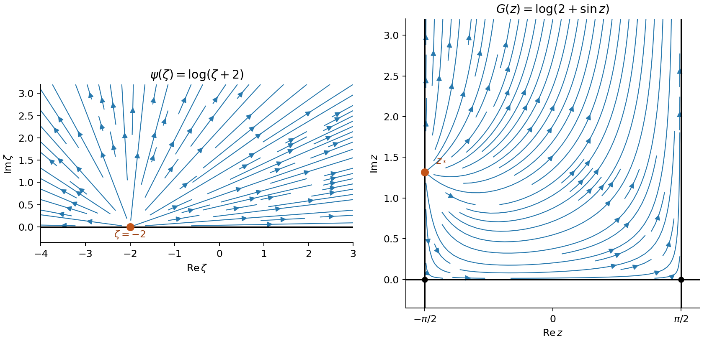

<h1 id="7/b/iii/solution">Solution</h1>

↑ **Parent:** [Iii](../iii.md)

The [chain rule](../../../../../../chain-rule.md) gives

$$
\boxed{U-iV=\frac{dG}{dz}=\frac{d\psi/d\zeta}{df/d\zeta}=\frac{\cos z}{2+\sin z}.}
$$

To make the directions explicit, set $z=x+iy$ and $D=(2+\sin x\cosh y)^2+\cos^2x\sinh^2y$. Multiplying by the [complex conjugate](../../../../../../complex-conjugate.md) of the denominator gives the [logarithmic flow in a sine-mapped half-strip](../../../../../../logarithmic-flow-in-a-sine-mapped-half-strip.md):

$$
\boxed{U=\frac{\cos x(2\cosh y+\sin x)}D,\qquad V=\frac{\sinh y(\cosh y+2\sin x)}D.}
$$

In the open strip $U>0$. The vertical component is negative near the lower left wall where $\cosh y+2\sin x<0$, and positive above that curve. On the bottom the flow is rightward. On the right wall it is upward, whereas on the left wall it points downward below $z_*$ and upward above $z_*$. The field is tangent to the boundaries except at the source and vanishes at the two bottom corners. At large $y$, $U-iV\to-i$, so it tends to a uniform upward field $(0,1)$.

Near $z_*$, $G'(z)\sim1/(z-z_*)$, showing a radial boundary source. The [streamlines](../../../../../../streamline.md) are the curves $\operatorname{Im}G=\arg(2+\sin z)=\text{constant}$; the figure shows their orientation without reusing the exam's graphics.

**[Figure 3](#7/b/iii/image-radial-flow-in-the-upper-half-plane-and-its-image-in-a-vertical-half-strip). Radial flow in the upper half-plane and its image in a vertical half-strip**.

## ↑ Ancestors (14)

1. [Iii](../iii.md)
2. [B](../../b.md)
3. [7](../../../7.md)
4. [Paper 1](../../../../paper-1-split.md)
5. [2016](../../../../split.md)
6. [Past exam of the mathematics course of the year 2 of the natural sciences course of the University of Cambridge](../../../../../split.md)
7. [Mathematics course of the year 2 of the natural sciences course of the University of Cambridge](../../../../../../mathematics-course-of-the-year-2-of-the-natural-sciences-course-of-the-university-of-cambridge.md)
8. [Year 2 of the natural sciences course of the University of Cambridge](../../../../../../year-2-of-the-natural-sciences-course-of-the-university-of-cambridge.md)
9. [Year of the natural sciences course of the University of Cambridge](../../../../../../year-of-the-natural-sciences-course-of-the-university-of-cambridge.md)
10. [Natural sciences course of the University of Cambridge](../../../../../../natural-sciences-course-of-the-university-of-cambridge.md)
11. [Course of the University of Cambridge](../../../../../../course-of-the-university-of-cambridge.md)
12. [University of Cambridge](../../../../../../university-of-cambridge-split.md)
13. [List of universities](../../../../../../list-of-universities.md)
14. [Codex Wiki](../../../../../../split.md)
