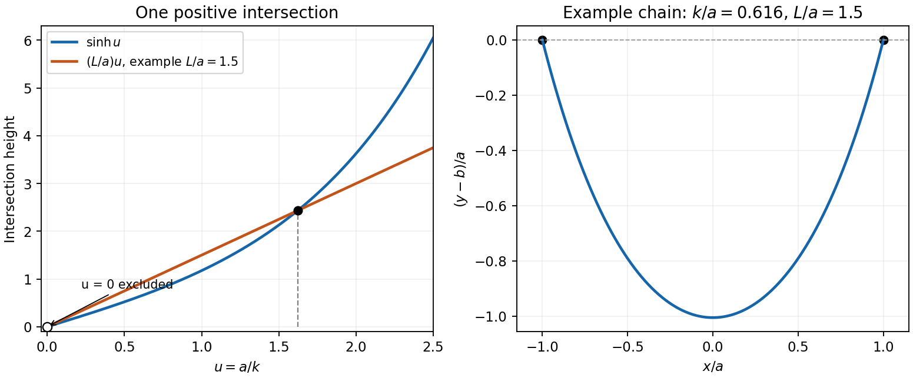

<h1 id="9/b/ii/solution">Solution</h1>

↑ **Parent:** [Ii](../ii.md)

Equal endpoint heights imply

$$
\cosh\frac{a-x_0}{k}=\cosh\frac{a+x_0}{k},
$$

so $x_0=0$. The height condition then gives $y_0=b-k\cosh(a/k)$ and the hanging [catenary](../../../../../../catenary.md) is

$$
y(x)=b+k\left[\cosh(x/k)-\cosh(a/k)\right].
$$

Since $\sqrt{1+y'^2}=\cosh(x/k)$, its length fixes $k$ through

$$
2L=\int_{-a}^a\cosh(x/k)\,dx=2k\sinh(a/k),\qquad\boxed{L=k\sinh(a/k).}
$$

For the requested graphical argument, put $u=a/k>0$ and $q=L/a>1$. Intersections of $Y=\sinh u$ with $Y=qu$ determine the solution. Near zero the line has larger slope, while the hyperbolic sine eventually grows faster. Its slope $\cosh u$ increases strictly, so after turning upwards relative to the line it can cross it only once. The intersection at $u=0$ is excluded: it corresponds to infinite $k$ and the limiting length $L=a$.

**[Figure 4](#9/b/ii/image-unique-positive-catenary-parameter-from-a-hyperbolic-sine-intersection-with-an-example-hanging-chain). Unique positive catenary parameter from a hyperbolic-sine intersection, with an example hanging chain**.

More explicitly, $h(u)=\sinh u/u$ has [derivative](../../../../../../derivative.md) $(u\cosh u-\sinh u)/u^2>0$, because the numerator vanishes at zero and has [derivative](../../../../../../derivative.md) $u\sinh u>0$. Since $h(0+)=1$ and $h(u)\to\infty$, every $q>1$ yields **exactly one positive $u$, hence exactly one positive $k$**.

## ↑ Ancestors (14)

1. [Ii](../ii.md)
2. [B](../../b.md)
3. [9](../../../9.md)
4. [Paper 1](../../../../paper-1-split.md)
5. [2016](../../../../split.md)
6. [Past exam of the mathematics course of the year 2 of the natural sciences course of the University of Cambridge](../../../../../split.md)
7. [Mathematics course of the year 2 of the natural sciences course of the University of Cambridge](../../../../../../mathematics-course-of-the-year-2-of-the-natural-sciences-course-of-the-university-of-cambridge.md)
8. [Year 2 of the natural sciences course of the University of Cambridge](../../../../../../year-2-of-the-natural-sciences-course-of-the-university-of-cambridge.md)
9. [Year of the natural sciences course of the University of Cambridge](../../../../../../year-of-the-natural-sciences-course-of-the-university-of-cambridge.md)
10. [Natural sciences course of the University of Cambridge](../../../../../../natural-sciences-course-of-the-university-of-cambridge.md)
11. [Course of the University of Cambridge](../../../../../../course-of-the-university-of-cambridge.md)
12. [University of Cambridge](../../../../../../university-of-cambridge-split.md)
13. [List of universities](../../../../../../list-of-universities.md)
14. [Codex Wiki](../../../../../../split.md)
