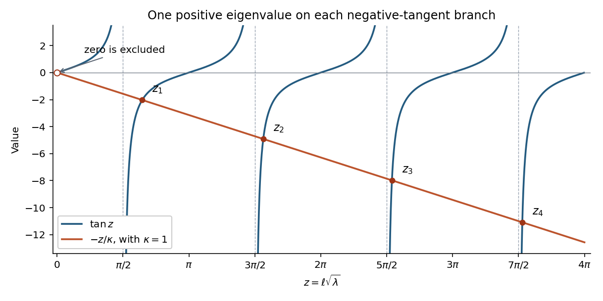
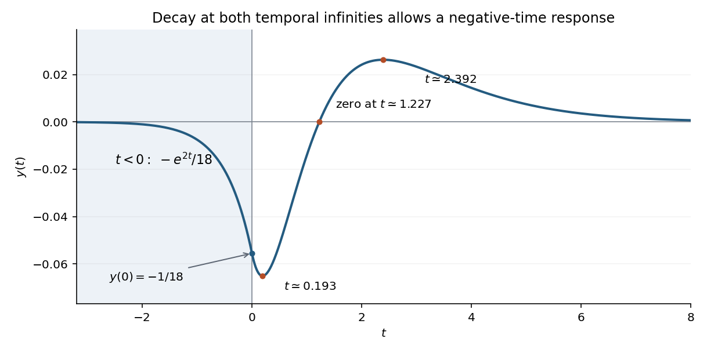

# Paper 2

↑ **Parent:** [2016](../2016.md)

[https://www.maths.cam.ac.uk/undergradnst/files/2016/papernst_ib_2.pdf](https://www.maths.cam.ac.uk/undergradnst/files/2016/papernst_ib_2.pdf)

**Table of contents**

- [1](#1)
  - [a](#1/a)
    - [Solution](#1/a/solution)
  - [b](#1/b)
    - [Solution](#1/b/solution)
  - [c](#1/c)
    - [Solution](#1/c/solution)
  - [d](#1/d)
    - [Solution](#1/d/solution)
  - [e](#1/e)
    - [Solution](#1/e/solution)
- [2](#2)
  - [a](#2/a)
    - [Solution](#2/a/solution)
  - [b](#2/b)
    - [Solution](#2/b/solution)
- [3](#3)
  - [a](#3/a)
    - [Solution](#3/a/solution)
  - [b](#3/b)
    - [i](#3/b/i)
      - [Solution](#3/b/i/solution)
    - [ii](#3/b/ii)
      - [Solution](#3/b/ii/solution)
    - [iii](#3/b/iii)
      - [Solution](#3/b/iii/solution)
- [4](#4)
  - [a](#4/a)
    - [i](#4/a/i)
      - [Solution](#4/a/i/solution)
    - [ii](#4/a/ii)
      - [Solution](#4/a/ii/solution)
  - [b](#4/b)
    - [i](#4/b/i)
      - [Solution](#4/b/i/solution)
    - [ii](#4/b/ii)
      - [Solution](#4/b/ii/solution)
- [5](#5)
  - [a](#5/a)
    - [Solution](#5/a/solution)
  - [b](#5/b)
    - [Solution](#5/b/solution)
  - [c](#5/c)
    - [Solution](#5/c/solution)
- [6](#6)
  - [a](#6/a)
    - [Solution](#6/a/solution)
  - [b](#6/b)
    - [Solution](#6/b/solution)
  - [c](#6/c)
    - [Solution](#6/c/solution)
  - [d](#6/d)
    - [Solution](#6/d/solution)
- [7](#7)
  - [a](#7/a)
    - [Solution](#7/a/solution)
  - [b](#7/b)
    - [Solution](#7/b/solution)
  - [c](#7/c)
    - [Solution](#7/c/solution)
- [8](#8)
  - [a](#8/a)
    - [Solution](#8/a/solution)
  - [b](#8/b)
    - [Solution](#8/b/solution)
  - [c](#8/c)
    - [Solution](#8/c/solution)
- [9](#9)
  - [a](#9/a)
    - [Solution](#9/a/solution)
  - [b](#9/b)
    - [Solution](#9/b/solution)
  - [c](#9/c)
    - [Solution](#9/c/solution)
- [10](#10)
  - [a](#10/a)
    - [Solution](#10/a/solution)
  - [b](#10/b)
    - [Solution](#10/b/solution)
  - [c](#10/c)
    - [Solution](#10/c/solution)

## 1

↑ **Parent:** [Paper 2](paper-2.md)

<h3 id="1/a">a</h3>

↑ **Parent:** [1](#1)

<h4 id="1/a/solution">Solution</h4>

↑ **Parent:** [A](#1/a)

Use the ordinary real [inner product](../../inner-product.md) $\langle u,v\rangle=\int_a^buv\,dx$ on the domain of functions obeying the two separated boundary conditions. [Integration by parts](../../calculus.md#integration-by-parts) gives the [Lagrange identity for a Sturm-Liouville operator](../../sturm-liouville-theory.md#lagrange-identity-for-a-sturm-liouville-operator)

$$
\langle u,Lv\rangle-\langle Lu,v\rangle=\big[p(vu'-uv')\big]_a^b.
$$

At $a$, the two boundary-value vectors $(u(a),u'(a))$ and $(v(a),v'(a))$ satisfy the same homogeneous linear relation. If $A_2=0$, both function values vanish; if $A_2\ne0$, their derivatives are the same constant multiple $-A_1/A_2$ of their values. Either way $vu'-uv'=0$. The same argument applies at $b$. Hence

$$
\boxed{\langle u,Lv\rangle=\langle Lu,v\rangle.}
$$

This proves symmetry, and the regular separated [Sturm-Liouville problem](../../sturm-liouville-theory.md#sturm-liouville-problem) has the same adjoint domain, so $L$ is [self-adjoint](../../linear-operator-theory.md#self-adjoint-operator). To see the domain point, require the boundary form to vanish against every admissible $u$: the independently variable endpoint data force an adjoint-domain function to obey those same endpoint relations.

As usual, each endpoint pair $(A_1,A_2)$ and $(B_1,B_2)$ must be nonzero, and the coefficients must have the regularity needed for these operations. An identically zero pair would impose no condition at that endpoint and would not give the claimed [self-adjoint operator](../../linear-operator-theory.md#self-adjoint-operator). The related operator $\omega^{-1}L$ is self-adjoint in the [weighted inner product](../../inner-product.md#weighted-inner-product) $\int_a^b\omega uv\,dx$.

<h3 id="1/b">b</h3>

↑ **Parent:** [1](#1)

<h4 id="1/b/solution">Solution</h4>

↑ **Parent:** [B](#1/b)

Multiply the [eigenvalue equation](../../linear-operator-theory.md#eigenvalue-equation) of the [Sturm-Liouville problem](../../sturm-liouville-theory.md#sturm-liouville-problem) by $y$ and integrate. [Integration by parts](../../calculus.md#integration-by-parts) gives

$$
\lambda\int_a^b\omega y^2\,dx=\int_a^byLy\,dx=-[pyy']_a^b+\int_a^b\big[p(y')^2+qy^2\big]dx.
$$

Since $y$ is a nonzero [eigenfunction](../../linear-operator-theory.md#eigenfunction) and $\omega>0$, the denominator is strictly positive. Thus the [Rayleigh quotient](../../linear-operator-theory.md#rayleigh-quotient) is

$$
\boxed{\lambda=\frac{\displaystyle\int_a^b[p(y')^2+qy^2]dx-[pyy']_a^b}{\displaystyle\int_a^b\omega y^2\,dx}.}
$$

The endpoint term must be retained for a general [Robin boundary condition](../../differential-equation.md#robin-boundary-condition); it vanishes for homogeneous [Dirichlet boundary conditions](../../differential-equation.md#dirichlet-boundary-condition) but need not vanish in the present general problem.

<h3 id="1/c">c</h3>

↑ **Parent:** [1](#1)

<h4 id="1/c/solution">Solution</h4>

↑ **Parent:** [C](#1/c)

The left boundary condition is $y(0)=0$, while the right one is $y'(\ell)=-ky(\ell)$. Hence $[yy']_0^\ell=-ky(\ell)^2$. The [Rayleigh quotient](../../linear-operator-theory.md#rayleigh-quotient) becomes

$$
\lambda\int_0^\ell y^2\,dx=\int_0^\ell\big[(y')^2+qy^2\big]dx+ky(\ell)^2.
$$

Every term on the right is nonnegative. If the whole expression were zero, in particular $\int_0^\ell(y')^2dx=0$, so $y$ would be constant. Its zero value at the left endpoint would force $y\equiv0$, contrary to its being an [eigenfunction](../../linear-operator-theory.md#eigenfunction). Therefore

$$
\boxed{\lambda>0.}
$$

This is the positivity mechanism for [Dirichlet-Robin eigenvalues on a finite interval](../../sturm-liouville-theory.md#dirichlet-robin-eigenvalues-on-a-finite-interval). The sign of the boundary contribution is positive for the convention $y'+ky=0$ with $k>0$.

<h3 id="1/d">d</h3>

↑ **Parent:** [1](#1)

<h4 id="1/d/solution">Solution</h4>

↑ **Parent:** [D](#1/d)

By part (c), write $\lambda=\mu^2$ with $\mu>0$. The equation is $y''+\mu^2y=0$, and the left [Dirichlet boundary condition](../../differential-equation.md#dirichlet-boundary-condition) eliminates the cosine term. Thus $y=A\sin(\mu x)$, with $A\ne0$. The right [Robin boundary condition](../../differential-equation.md#robin-boundary-condition) becomes

$$
\mu\cos(\mu\ell)+k\sin(\mu\ell)=0.
$$

Put $z=\mu\ell$ and $\kappa=k\ell>0$. A root cannot have $\cos z=0$, so this is equivalent to $\tan z=-z/\kappa$.

On each interval $((n-1/2)\pi,n\pi)$, $n\geq1$, the function $\tan z+z/\kappa$ rises from $-\infty$ to a positive value and has derivative $\sec^2z+1/\kappa>0$. The [intermediate value theorem](../../calculus.md#intermediate-value-theorem) and strict [monotonicity](../../calculus.md#monotonic-function) therefore give exactly one root $z_n$ there. On the intervening positive-tangent intervals both terms are positive, so there are no further positive roots. Consequently

$$
\boxed{\lambda_n=\frac{z_n^2}{\ell^2},\qquad y_n(x)=A_n\sin\frac{z_nx}{\ell},\qquad(n-\tfrac12)\pi<z_n<n\pi,\quad n=1,2,\ldots.}
$$

These intervals establish $\lambda_1<\lambda_2<\cdots$ and an infinite sequence of [eigenvalues](../../linear-operator-theory.md#eigenvalue). The apparent algebraic root $z=0$ of the sine equation is excluded: it gives a zero sine function, and the direct zero-eigenvalue solution $y=Ax$ would require $A(1+k\ell)=0$.

**[Figure 1](#1/d/image-one-intersection-of-tan-z-with-z-kappa-on-each-negative-tangent-branch-the-illustration-uses-kappa-1). One intersection of $\tan z$ with $-z/\kappa$ on each negative-tangent branch; the illustration uses $\kappa=1$**.

For [vector normalization](../../vector-space.md#vector-normalization) to unit [norm](../../normed-vector-space.md#norm), the [Dirichlet-Robin eigenvalues on a finite interval](../../sturm-liouville-theory.md#dirichlet-robin-eigenvalues-on-a-finite-interval) give

$$
A_n=\left[\frac\ell2+\frac{k}{2(k^2+\lambda_n)}\right]^{-1/2}.
$$

The eigenfunctions can otherwise be scaled by any nonzero real constant.

<h3 id="1/e">e</h3>

↑ **Parent:** [1](#1)

<h4 id="1/e/solution">Solution</h4>

↑ **Parent:** [E](#1/e)

For fixed $k$ and $\ell$, the line $-z/\kappa$ becomes increasingly negative, so each intersection approaches its branch’s left-hand vertical asymptote. Write $z_n=a_n+\varepsilon_n$, where $a_n=(n-1/2)\pi$ and $\varepsilon_n>0$. The eigenvalue equation gives

$$
\kappa\cot\varepsilon_n=a_n+\varepsilon_n.
$$

Since $\cot\varepsilon=\varepsilon^{-1}-\varepsilon/3+O(\varepsilon^3)$, it follows that $\varepsilon_n=\kappa/a_n+O(a_n^{-3})$. Thus

$$
\boxed{\lambda_n=\frac{(n-1/2)^2\pi^2}{\ell^2}+\frac{2k}{\ell}+O(n^{-2}),\qquad\lambda_n\sim\frac{n^2\pi^2}{\ell^2}.}
$$

The half-integer phase identifies the sharper high-frequency behaviour of these [Dirichlet-Robin eigenvalues on a finite interval](../../sturm-liouville-theory.md#dirichlet-robin-eigenvalues-on-a-finite-interval). The expansion holds with the Robin coefficient fixed; it is not a uniform expansion in $k\to\infty$.

## 2

↑ **Parent:** [Paper 2](paper-2.md)

<h3 id="2/a">a</h3>

↑ **Parent:** [2](#2)

<h4 id="2/a/solution">Solution</h4>

↑ **Parent:** [A](#2/a)

For [separation of variables](../../partial-differential-equation.md#separation-of-variables), let $\Phi=S(\sigma)T(\tau)$. The [Laplace equation](../../partial-differential-equation.md#laplace-equation) gives

$$
-\frac{S''}{S}=\frac{T''}{T}=\lambda.
$$

A nonzero $2\pi$-periodic angular solution requires $\lambda=n^2$, $n=0,1,\ldots$. For $n\geq1$, $S$ is a linear combination of $\cos(n\sigma)$ and $\sin(n\sigma)$, while $T''-n^2T=0$ gives hyperbolic sine and cosine. For $n=0$, periodicity makes $S$ constant, and $T=A_0+B_0\tau$. Negative separation constants would give nonperiodic real exponentials in $\sigma$.

Superposition yields

$$
\boxed{\begin{aligned}
\Phi(\sigma,\tau)={}&A_0+B_0\tau\\
&+\sum_{n=1}^\infty\Big\{[A_n\cosh(n\tau)+B_n\sinh(n\tau)]\cos(n\sigma)\\
&\hspace{40mm}+[C_n\cosh(n\tau)+D_n\sinh(n\tau)]\sin(n\sigma)\Big\}.
\end{aligned}}
$$

Completeness follows by expanding a [harmonic function](../../partial-differential-equation.md#harmonic-function) in a [Fourier series](../../fourier-series.md) in the periodic coordinate: its [Fourier coefficients](../../fourier-series.md#fourier-coefficient) must satisfy exactly these radial equations. As usual, the coefficients are restricted by the convergence required of the series on compact subregions. The [bipolar coordinates](../../multivariable-calculus.md#bipolar-coordinates) domain imposes no boundary condition at $\tau=0$ or $\tau=\infty$, so both hyperbolic branches remain available.

<h3 id="2/b">b</h3>

↑ **Parent:** [2](#2)

<h4 id="2/b/solution">Solution</h4>

↑ **Parent:** [B](#2/b)

The only nonzero angular [Fourier mode](../../fourier-analysis.md#fourier-mode) is $\cos(2\sigma)$. Its radial equation is $T''-4T=0$. A solution vanishing at $\tau=a$ is proportional to $\sinh[2(\tau-a)]$; making its value one at $b$ fixes the constant. The [Dirichlet problem between bipolar coordinate circles](../../multivariable-calculus.md#dirichlet-problem-between-bipolar-coordinate-circles) therefore gives

$$
\boxed{\Phi(\sigma,\tau)=\frac{\sinh[2(\tau-a)]}{\sinh[2(b-a)]}\cos(2\sigma).}
$$

Its second derivatives in $\sigma$ and $\tau$ cancel, and the endpoint values are respectively zero and $\cos(2\sigma)$. The difference of any two solutions would be a [harmonic function](../../partial-differential-equation.md#harmonic-function) with zero [Dirichlet boundary conditions](../../differential-equation.md#dirichlet-boundary-condition), so the [maximum principle](../../partial-differential-equation.md#maximum-principle) proves [uniqueness](../../mathematical-logic.md#uniqueness).

**Geometric wording.** In the printed [bipolar coordinates](../../multivariable-calculus.md#bipolar-coordinates), the circle radius $1/\sinh\tau$ decreases with $\tau$. For $0<a<b$, the $b$ circle is contained inside the $a$ circle. Thus the source’s “inner” and “outer” labels are interchanged geometrically. The solution above follows the explicit coordinate boundary values, which unambiguously specify the problem.

## 3

↑ **Parent:** [Paper 2](paper-2.md)

<h3 id="3/a">a</h3>

↑ **Parent:** [3](#3)

<h4 id="3/a/solution">Solution</h4>

↑ **Parent:** [A](#3/a)

Apply the [product rule](../../calculus.md#product-rule) to the [vector field](../../multivariable-calculus.md#vector-field) $F=\phi\nabla\psi-\psi\nabla\phi$:

$$
\nabla\cdot F=\nabla\phi\cdot\nabla\psi+\phi\nabla^2\psi-\nabla\psi\cdot\nabla\phi-\psi\nabla^2\phi=\phi\nabla^2\psi-\psi\nabla^2\phi.
$$

The two mixed [dot products](../../inner-product.md#dot-product) cancel. The [divergence theorem](../../multivariable-calculus.md#divergence-theorem), using the outward [unit normal](../../differential-geometry.md#unit-normal), then gives [Green's second identity](../../partial-differential-equation.md#green-second-identity):

$$
\boxed{\int_V(\phi\nabla^2\psi-\psi\nabla^2\phi)\,dV=\int_S(\phi\,n\cdot\nabla\psi-\psi\,n\cdot\nabla\phi)\,dS.}
$$

The usual assumptions are a sufficiently regular boundary and fields with the derivatives and integrability needed for the theorem; singular sources can instead be treated by excising small balls or using [distributions](../../distribution-theory.md#distribution-mathematical-analysis).

<h3 id="3/b">b</h3>

↑ **Parent:** [3](#3)

<h4 id="3/b/i">i</h4>

↑ **Parent:** [B](#3/b)

<h5 id="3/b/i/solution">Solution</h5>

↑ **Parent:** [I](#3/b/i)

Define the candidate potential by convolving the decaying [Green function](../../green-s-function.md) with the source. Acting with the [Laplacian](../../multivariable-calculus.md#laplacian) in the observation variable gives, in the sense of [distributions](../../distribution-theory.md#distribution-mathematical-analysis),

$$
\begin{aligned}
\nabla_{\mathbf r}^2\int_{\mathbb R^3}G(\mathbf r,\mathbf r')\rho(\mathbf r')\,d^3r'
&=-\int_{\mathbb R^3}\delta^{(3)}(\mathbf r-\mathbf r')\rho(\mathbf r')\,d^3r'\\
&=-\rho(\mathbf r).
\end{aligned}
$$

The final equality is the sifting property of the [Dirac delta](../../distribution-theory.md#dirac-delta-function). The kernel found in part (ii) is locally [integrable](../../measure-theory.md#integrability), and its convolution with a sufficiently regular rapidly decaying source also vanishes at spatial infinity. Thus it satisfies the [Poisson equation](../../partial-differential-equation.md#poisson-s-equation) and the required condition at infinity.

The difference from any other regular decaying solution is a [harmonic function](../../partial-differential-equation.md#harmonic-function) on all of space vanishing at infinity, hence is zero by the [maximum principle](../../partial-differential-equation.md#maximum-principle). Therefore

$$
\boxed{\phi(\mathbf r)=\int_{\mathbb R^3}G(\mathbf r,\mathbf r')\rho(\mathbf r')\,d^3r'.}
$$

One can also obtain this expression from [Green's second identity](../../partial-differential-equation.md#green-second-identity) on larger and larger balls, with the singularity of the kernel treated distributionally. The surface term at infinity vanishes for the usual $1/r$ potential decay and $1/r^2$ gradient decay.

<h4 id="3/b/ii">ii</h4>

↑ **Parent:** [B](#3/b)

<h5 id="3/b/ii/solution">Solution</h5>

↑ **Parent:** [Ii](#3/b/ii)

Translation and rotation invariance allow a radial [Green function](../../green-s-function.md) $G(R)$, with $R=|\mathbf r-\mathbf r'|$. Outside the source, $G''+2G'/R=0$, so $G=A/R+B$. Decay at infinity gives $B=0$.

Integrate the defining equation over a small ball centred on the source. The [divergence theorem](../../multivariable-calculus.md#divergence-theorem) fixes its flux:

$$
\int_{R<\varepsilon}\nabla^2G\,dV=4\pi\varepsilon^2G'(\varepsilon)=-4\pi A=-1.
$$

Consequently

$$
\boxed{G(\mathbf r,\mathbf r')=\frac1{4\pi|\mathbf r-\mathbf r'|}.}
$$

This is the [Green function of the Laplacian](../../partial-differential-equation.md#green-function-of-the-laplacian) with the stated negative-delta sign. A homogeneous $1/R$ addition would change the delta normalization, so the singular coefficient is fixed, not an arbitrary integration constant.

<h4 id="3/b/iii">iii</h4>

↑ **Parent:** [B](#3/b)

<h5 id="3/b/iii/solution">Solution</h5>

↑ **Parent:** [Iii](#3/b/iii)

Write $r=|\mathbf r|$, $s=|\mathbf r'|$. For a spherical source, the angular integral needed for the [Green function of the Laplacian](../../partial-differential-equation.md#green-function-of-the-laplacian) is

$$
\int\frac{d\Omega'}{|\mathbf r-\mathbf r'|}=2\pi\int_{-1}^1\frac{du}{\sqrt{r^2+s^2-2rsu}}=\frac{4\pi}{\max(r,s)}.
$$

This is the angular form of the [spherical shell theorem](../../mathematical-physics.md#spherical-shell-theorem). Substituting the source into the [Green function](../../green-s-function.md) integral therefore yields

$$
\phi(r)=-\frac1r\int_0^rs e^{-\beta s}\,ds-\int_r^\infty e^{-\beta s}\,ds.
$$

The elementary integrals are

$$
\int_0^rs e^{-\beta s}\,ds=\frac{1-(1+\beta r)e^{-\beta r}}{\beta^2},\qquad\int_r^\infty e^{-\beta s}\,ds=\frac{e^{-\beta r}}\beta.
$$

The terms proportional to $e^{-\beta r}/\beta$ cancel, leaving

$$
\boxed{\phi(r)=\frac{e^{-\beta r}-1}{\beta^2r},\qquad\phi(0)=-\frac1\beta.}
$$

The value at the origin is the continuous limit. At large radius $\phi\sim-1/(\beta^2r)$, consistent with the integrated source $\int\rho\,dV=-4\pi/\beta^2$ and the factor $1/(4\pi r)$ in the far-field potential.

For a direct check, set $u=r\phi$. Then $u''=e^{-\beta r}$, so $\nabla^2\phi=u''/r=e^{-\beta r}/r=-\rho$ for $r>0$. Boundedness of $\phi$ at zero cancels the singular $1/r$ terms and excludes an extra point source. The original density is itself singular but locally [integrable](../../measure-theory.md#integrability); the equation at the origin is understood in the sense of [distributions](../../distribution-theory.md#distribution-mathematical-analysis). This is the [Poisson potential of an exponential-over-radius source](../../partial-differential-equation.md#poisson-potential-of-an-exponential-over-radius-source) with amplitude $A=-1$.

## 4

↑ **Parent:** [Paper 2](paper-2.md)

<h3 id="4/a">a</h3>

↑ **Parent:** [4](#4)

<h4 id="4/a/i">i</h4>

↑ **Parent:** [A](#4/a)

<h5 id="4/a/i/solution">Solution</h5>

↑ **Parent:** [I](#4/a/i)

Choose $0<\arg z<2\pi$, so $\sqrt z=\sqrt R\,e^{i\theta/2}$ on the arc. Its clockwise orientation gives

$$
I(R)=i\sqrt R\int_{3\pi/2}^{\pi/2}f(Re^{i\theta})e^{i\theta/2}\,d\theta.
$$

Because $f$ is an [analytic function](../../holomorphic-function.md) at zero, $f(Re^{i\theta})=f(0)+O(R)$ uniformly on the small arc. Integration then gives

$$
I(R)=2\sqrt R f(0)\big(e^{i\pi/4}-e^{3i\pi/4}\big)+O(R^{3/2})=2\sqrt{2R}\,f(0)+O(R^{3/2}).
$$

Therefore

$$
\boxed{\lim_{R\to0}I(R)=0.}
$$

The [estimation lemma](../../complex-analysis.md#estimation-lemma) also gives $|I(R)|\leq\pi\sqrt R\max_C|f|$. Hence a sufficient large-arc condition is

$$
\boxed{\max_C|f(z)|=o(R^{-1/2})\quad(R\to\infty).}
$$

For example $f(z)=O(|z|^{-1/2-\eta})$ uniformly on the arc, with $\eta>0$, suffices. Under the stronger literal assumption that $f$ is analytic at infinity, its Laurent expansion is $f(z)=f(\infty)+O(1/z)$; the necessary and sufficient condition is then $f(\infty)=0$. A nonzero constant term would instead give the growing contribution $2\sqrt{2R}f(\infty)$.

<h4 id="4/a/ii">ii</h4>

↑ **Parent:** [A](#4/a)

<h5 id="4/a/ii/solution">Solution</h5>

↑ **Parent:** [Ii](#4/a/ii)

For $x>0$, the upper-bank argument tends to zero, whereas the lower-bank argument tends to $2\pi$. Thus

$$
\sqrt{x+i0}=\sqrt x,\qquad\sqrt{x-i0}=e^{i\pi}\sqrt x=-\sqrt x.
$$

The [analytic function](../../holomorphic-function.md) $f$ has identical boundary values across this part of the real axis. Hence the [branch cut](../../analysis.md#branch-cut) introduces a sign change:

$$
\boxed{\left.\frac{f(z)}{\sqrt z}\right|_{z=x-i0}=-\left.\frac{f(z)}{\sqrt z}\right|_{z=x+i0}.}
$$

This compares integrand values. When two contour segments traverse opposite banks in opposite directions, their orientation supplies an additional minus sign.

<h3 id="4/b">b</h3>

↑ **Parent:** [4](#4)

<h4 id="4/b/i">i</h4>

↑ **Parent:** [B](#4/b)

<h5 id="4/b/i/solution">Solution</h5>

↑ **Parent:** [I](#4/b/i)

The rational factors give four [simple poles](../../isolated-singularity.md#simple-pole) at $z=\pm i,\pm2i$; none is canceled by the numerator. The square root has [branch points](../../complex-analysis.md#branch-point) at $z=\pm1$, with local behaviour proportional to $(z\mp1)^{-1/2}$ in the integrand.

For this part, choose $h(z)=\sqrt{z^2-1}$ analytic off $[-1,1]$ and satisfying $h(z)\sim z$ at infinity. Its values are $h(x)=\sqrt{x^2-1}$ for $x>1$, $h(x)=-\sqrt{x^2-1}$ for $x<-1$, and

$$
h(x+i0)=i\sqrt{1-x^2},\qquad h(x-i0)=-i\sqrt{1-x^2}\quad(-1<x<1).
$$

Thus the chosen [branch cut](../../analysis.md#branch-cut) is $[-1,1]$, and the function is analytic elsewhere apart from the four poles. Infinity is not an intrinsic branch point: $g(z)=O(z^{-2})$ on this branch.

Another legitimate convention applies the positive-axis square root of part (a) to $w=z^2-1$; it places the cuts on $(-\infty,-1]$ and $[1,\infty)$. Its upper-half-plane values agree with the branch used here, so the contour calculation below and the positive real square root in the required integral are unchanged. The branch choice must be stated because a square root alone does not specify a single-valued complex function.

<h4 id="4/b/ii">ii</h4>

↑ **Parent:** [B](#4/b)

<h5 id="4/b/ii/solution">Solution</h5>

↑ **Parent:** [Ii](#4/b/ii)

Use the branch from part (i) and close the real-axis path with a large upper [semicircle](../../topology.md#semicircle), indenting clockwise around $-1$ and $1$. On the segment between them, take the upper-bank value of the [branch cut](../../analysis.md#branch-cut). This is an instance of [square-root endpoint integrals by an upper-half-plane contour](../../complex-analysis.md#square-root-endpoint-integrals-by-an-upper-half-plane-contour).

**[Figure 2](#4/b/ii/image-upper-half-plane-contour-clockwise-endpoint-indentations-and-the-two-enclosed-poles-indentation-sizes-are-exaggerated). Upper-half-plane contour, clockwise endpoint indentations, and the two enclosed poles; indentation sizes are exaggerated**.

The contributions can be controlled separately. Since $g(z)=O(z^{-2})$, the large arc contributes $O(R^{-1})\to0$. Near either [branch point](../../complex-analysis.md#branch-point), $g=O(\varepsilon^{-1/2})$, so an arc of length $O(\varepsilon)$ contributes $O(\sqrt\varepsilon)\to0$. On the upper bank of $(-1,1)$,

$$
g(x+i0)=\frac{x(x^2+3)}{i(x^2+1)(x^2+4)\sqrt{1-x^2}},
$$

which is odd in $x$, so its integral is zero. On the exterior real intervals $h(-x)=-h(x)$, while the rational numerator is odd. Hence $g(-x)=g(x)$ and the two exterior contributions sum to $2J$.

The enclosed [residues](../../analysis.md#residue) use $h(i)=i\sqrt2$ and $h(2i)=i\sqrt5$:

$$
\operatorname{Res}_{z=i}g=\frac{i(i^2+3)}{(2i)(i^2+4)h(i)}=-\frac{i}{3\sqrt2},\qquad
\operatorname{Res}_{z=2i}g=\frac{2i((2i)^2+3)}{((2i)^2+1)(4i)h(2i)}=-\frac{i}{6\sqrt5}.
$$

The [residue theorem](../../analysis.md#residue-theorem) gives $2J=2\pi i[-i/(3\sqrt2)-i/(6\sqrt5)]$. Therefore

$$
\boxed{J=\frac\pi{3\sqrt2}+\frac\pi{6\sqrt5}.}
$$

As an independent check, $u=\sqrt{x^2-1}$ converts the integral to

$$
\int_0^\infty\frac{u^2+4}{(u^2+2)(u^2+5)}\,du=\int_0^\infty\left[\frac{2/3}{u^2+2}+\frac{1/3}{u^2+5}\right]du,
$$

which yields the same value. This check also confirms the branch signs and the factor of two in the contour argument.

## 5

↑ **Parent:** [Paper 2](paper-2.md)

<h3 id="5/a">a</h3>

↑ **Parent:** [5](#5)

<h4 id="5/a/solution">Solution</h4>

↑ **Parent:** [A](#5/a)

Take the [Fourier transform](../../fourier-transform.md) convention $\widetilde y(\omega)=\int_{\mathbb R}y(t)e^{-i\omega t}\,dt$, with inverse factor $e^{i\omega t}/(2\pi)$. Then $\widetilde{y^{(n)}}=(i\omega)^n\widetilde y$, classically when the boundary terms vanish or in the sense of [tempered distributions](../../fourier-analysis.md#tempered-distribution).

Multiply the given frequency relation by its denominator and then by $-i$:

$$
(-i\omega^3-\omega^2-4i\omega-4)\widetilde y=i\omega\widetilde f.
$$

Recognizing the four derivative multipliers gives

$$
\boxed{y'''+y''-4y'-4y=f',\qquad(D+1)(D-2)(D+2)y=f',\quad D=\frac d{dt}.}
$$

The convention is stated explicitly because reversing the Fourier exponential changes intermediate frequency signs. The distributional form will matter at the jump of $f$ in part (b).

<h3 id="5/b">b</h3>

↑ **Parent:** [5](#5)

<h4 id="5/b/solution">Solution</h4>

↑ **Parent:** [B](#5/b)

The inverse [Fourier transform](../../fourier-transform.md) is

$$
f(t)=\frac1{2\pi}\int_{\mathbb R}\frac{-i\,e^{i\omega t}}{\omega-i}\,d\omega.
$$

For $t>0$, close in the upper half-plane, where $e^{i\omega t}$ decays. The single enclosed [pole](../../isolated-singularity.md#pole) has [residue](../../analysis.md#residue) $-ie^{-t}$, so counterclockwise integration gives $f=e^{-t}$. For $t<0$, close clockwise in the lower half-plane; there is no enclosed pole and the result is zero. Thus

$$
\boxed{f(t)=e^{-t}H(t),\qquad f(t)=0\ (t<0),\quad f(t)=e^{-t}\ (t>0).}
$$

Here $H$ is the [Heaviside step function](../../integral-transform.md#heaviside-step-function). At the jump, symmetric [Fourier inversion](../../fourier-analysis.md#fourier-inversion-theorem) gives $f(0)=1/2$, the average of the one-sided limits. The transform itself cannot fix a function’s value at a single point, so this is the conventional representative rather than extra frequency information.

A direct check is $\int_0^\infty e^{-(1+i\omega)t}dt=(1+i\omega)^{-1}=-i/(\omega-i)$. Distributionally, $f'=\delta(t)-e^{-t}H(t)$.

<h3 id="5/c">c</h3>

↑ **Parent:** [5](#5)

<h4 id="5/c/solution">Solution</h4>

↑ **Parent:** [C](#5/c)

Factor the cubic denominator as $(\omega-i)(\omega^2+4)$. Substitution gives

$$
\widetilde y(\omega)=\frac{i\omega}{(\omega-i)^2(\omega^2+4)}.
$$

There is a double [pole](../../isolated-singularity.md#pole) at $i$ and simple poles at $2i,-2i$. For $t>0$, close the inverse-transform contour counterclockwise in the upper half-plane. The [residue](../../analysis.md#residue) at the double pole is

$$
\begin{aligned}
\operatorname{Res}_{\omega=i}\big(\widetilde y e^{i\omega t}\big)
&=\left.\frac d{d\omega}\left(\frac{i\omega e^{i\omega t}}{\omega^2+4}\right)\right|_{\omega=i}\\
&=i\left(\frac59-\frac t3\right)e^{-t},
\end{aligned}
$$

and the residue at $2i$ is $-ie^{-2t}/2$. Multiplication by $i$ from the [residue theorem](../../analysis.md#residue-theorem) therefore gives $y(t)=(t/3-5/9)e^{-t}+e^{-2t}/2$.

For $t<0$, the clockwise lower closure encloses only $-2i$, with residue $-ie^{2t}/18$. The orientation supplies $-i$, giving $y(t)=-e^{2t}/18$. Hence the continuous solution is

$$
\boxed{y(t)=\begin{cases}-\dfrac1{18}e^{2t},&t<0,\\[2pt]-\dfrac1{18},&t=0,\\[2pt]\left(\dfrac t3-\dfrac59\right)e^{-t}+\dfrac12e^{-2t},&t>0.\end{cases}}
$$

The large inverse-transform arcs vanish: the rational factor is $O(\omega^{-3})$, while the exponential is bounded on the appropriate closure.

**[Figure 3](#5/c/image-the-two-sided-decaying-fourier-solution-it-and-its-first-derivative-are-continuous-at-zero). The two-sided decaying Fourier solution; it and its first derivative are continuous at zero**.

The graph tends to zero from below as $t\to-\infty$, passes through $y(0)=-1/18$ with slope $-1/9$, reaches a small negative minimum after zero, then crosses the axis, reaches a positive maximum and tends to zero from above. The positive-time stationary points solve $8/9-t/3=e^{-t}$, and the crossing solves $t/3-5/9+e^{-t}/2=0$; these equations determine the sketch without guessing signs.

For a distributional check, $y$ and $y'$ are continuous, while $y''(0^+)-y''(0^-)=1$. The [jump conditions for a third-order Green function](../../green-s-function.md#jump-conditions-for-a-third-order-green-function) therefore produce the delta in $f'=\delta-e^{-t}H(t)$, and each smooth branch satisfies the remaining equation. The nonzero solution for $t<0$ is consistent with the stipulated decay at both temporal infinities. Those are two-sided conditions, not a causality assumption: this is the setting of a [decaying two-sided Green function of a constant-coefficient ordinary differential equation](../../green-s-function.md#decaying-two-sided-green-function-of-a-constant-coefficient-ordinary-differential-equation) and [causality versus stability of a Green function](../../green-s-function.md#causality-versus-stability-of-a-green-function).

## 6

↑ **Parent:** [Paper 2](paper-2.md)

<h3 id="6/a">a</h3>

↑ **Parent:** [6](#6)

<h4 id="6/a/solution">Solution</h4>

↑ **Parent:** [A](#6/a)

A second-order Cartesian [tensor](../../multilinear-algebra.md#tensor) assigns components in each orthonormal coordinate system according to

$$
\boxed{T'_{ij}=R_{ik}R_{j\ell}T_{k\ell},\qquad T'=RTR^T,\qquad R^TR=I.}
$$

Here $R$ is the matrix taking old [vector](../../vector-space.md#vector) components to new ones, and repeated indices are summed. This is the [tensor component transformation law](../../general-relativity.md#tensor-component-transformation-law); an arbitrary array of nine numbers is not a tensor unless its components in different frames obey this rule. No symmetry $T_{ij}=T_{ji}$ is implied by being a second-order tensor.

<h3 id="6/b">b</h3>

↑ **Parent:** [6](#6)

<h4 id="6/b/solution">Solution</h4>

↑ **Parent:** [B](#6/b)

Let $R$ be an orthogonal change of axes. Since $A$ is a second-order [tensor](../../multilinear-algebra.md#tensor), $A'_{ij}=R_{ik}R_{j\ell}A_{k\ell}$. The scalar-contraction assumption gives

$$
C'_{ij}R_{ik}R_{j\ell}A_{k\ell}=C_{k\ell}A_{k\ell}
$$

for every tensor $A$. In one fixed frame its components can be any array: in particular, choose one component at a time to be one, all others zero. Equality of the coefficients then forces

$$
C'_{ij}R_{ik}R_{j\ell}=C_{k\ell},\qquad R^TC'R=C.
$$

Multiplying by $R$ and $R^T$ yields

$$
\boxed{C'=RCR^T,\qquad C'_{ij}=R_{ik}R_{j\ell}C_{k\ell}.}
$$

This is exactly the [tensor component transformation law](../../general-relativity.md#tensor-component-transformation-law). It is the full-contraction version of the [quotient theorem for Cartesian tensors](../../multilinear-algebra.md#quotient-theorem-for-cartesian-tensors). The words “for every” are essential: testing a single $A$, such as the zero tensor or the identity, would not determine all components.

<h3 id="6/c">c</h3>

↑ **Parent:** [6](#6)

<h4 id="6/c/solution">Solution</h4>

↑ **Parent:** [C](#6/c)

Use the quarter-turn [rotation matrix](../../linear-algebra.md#rotation-matrix)

$$
R=\begin{pmatrix}0&-1&0\\1&0&0\\0&0&1\end{pmatrix}.
$$

For a general second-order [tensor](../../multilinear-algebra.md#tensor), direct multiplication gives

$$
RTR^T=\begin{pmatrix}T_{22}&-T_{21}&-T_{23}\\-T_{12}&T_{11}&T_{13}\\-T_{32}&T_{31}&T_{33}\end{pmatrix}.
$$

Requiring $RTR^T=T$ gives $T_{11}=T_{22}$, $T_{12}=-T_{21}$, $T_{13}=-T_{23}$ together with $T_{23}=T_{13}$, and $T_{31}=-T_{32}$ together with $T_{32}=T_{31}$. Thus all mixed axial-transverse entries vanish and

$$
\boxed{T=\begin{pmatrix}\alpha&\omega&0\\-\omega&\alpha&0\\0&0&\beta\end{pmatrix}.}
$$

For an arbitrary rotation angle $\theta$, the transverse rotation is $Q_\theta=\cos\theta\,I+\sin\theta\,J$, where $J=\begin{pmatrix}0&-1\\1&0\end{pmatrix}$. The transverse block of $T$ is $\alpha I-\omega J$, so it commutes with $Q_\theta$. Therefore $Q_\theta(\alpha I-\omega J)Q_\theta^T=\alpha I-\omega J$, while the axial component $\beta$ is unchanged.

Hence **invariance holds under every rotation about the axis**, not just the quarter-turn. This is the general [axisymmetric second-order tensor](../../multilinear-algebra.md#axisymmetric-second-order-tensor); a [symmetric tensor](../../multilinear-algebra.md#symmetric-tensor) would additionally require $\omega=0$, but that restriction was not assumed.

<h3 id="6/d">d</h3>

↑ **Parent:** [6](#6)

<h4 id="6/d/solution">Solution</h4>

↑ **Parent:** [D](#6/d)

For $i\ne j$, the [inertia tensor](../../rigid-body-dynamics.md#inertia-tensor) component is $I_{ij}=-\rho\int_Vx_ix_j\,dV$. Reflect either coordinate appearing once: the cylindrical domain and density are unchanged, while the integrand changes sign. Thus every off-diagonal component vanishes. Rotational symmetry also implies $I_{11}=I_{22}$.

Use [cylindrical coordinates](../../multivariable-calculus.md#cylindrical-coordinate-system) $x_1=r\cos\theta$, $x_2=r\sin\theta$, $x_3=z$, with volume element $r\,dr\,d\theta\,dz$. The axial [moment of inertia](../../rigid-body-dynamics.md#moment-of-inertia) is

$$
I_{33}=\rho\int_{-2}^{2}dz\int_0^{2\pi}d\theta\int_0^1r^3\,dr=2\pi\rho.
$$

The two contributions to a transverse component are

$$
\int_Vx_2^2\,dV=4\left(\int_0^1r^3dr\right)\left(\int_0^{2\pi}\sin^2\theta\,d\theta\right)=\pi,
\qquad\int_Vz^2\,dV=\pi\int_{-2}^{2}z^2dz=\frac{16\pi}{3}.
$$

Therefore

$$
\boxed{I=\pi\rho\,\operatorname{diag}\left(\frac{19}{3},\frac{19}{3},2\right)=M\operatorname{diag}\left(\frac{19}{12},\frac{19}{12},\frac12\right),\qquad M=4\pi\rho.}
$$

The axial value $MR^2/2$ and transverse value $M(3R^2+h^2)/12$ for $R=1$, $h=4$ give an independent check on both diagonal entries.

## 7

↑ **Parent:** [Paper 2](paper-2.md)

<h3 id="7/a">a</h3>

↑ **Parent:** [7](#7)

<h4 id="7/a/solution">Solution</h4>

↑ **Parent:** [A](#7/a)

For a [zero-natural-length spring](../../elasticity-physics.md#zero-natural-length-spring), extension is the full distance between its endpoints, so the squared spring lengths are quadratic functions of the Cartesian coordinates. The [Lagrangian](../../calculus-of-variations.md#lagrangian) is

$$
\boxed{\begin{aligned}
L={}&\frac{m_1}{2}(\dot X_1^2+\dot Y_1^2)+\frac{m_2}{2}(\dot X_2^2+\dot Y_2^2)\\
&-\frac{k_1}{2}(X_1^2+Y_1^2)-\frac{k_2}{2}\big[(X_2-X_1)^2+(Y_2-Y_1)^2\big]\\
&-g(m_1Y_1+m_2Y_2).
\end{aligned}}
$$

The gravitational [potential energy](../../energy.md#potential-energy) has positive derivative in the upward coordinate, giving downward forces. Applying the [Euler-Lagrange equations](../../analysis.md#euler-lagrange-equation) to all four coordinates gives

$$
\boxed{\begin{aligned}
m_1\ddot X_1+(k_1+k_2)X_1-k_2X_2&=0,\\
m_2\ddot X_2+k_2X_2-k_2X_1&=0,\\
m_1\ddot Y_1+(k_1+k_2)Y_1-k_2Y_2&=-m_1g,\\
m_2\ddot Y_2+k_2Y_2-k_2Y_1&=-m_2g.
\end{aligned}}
$$

The two spring forces are equal and opposite on the two masses for the connecting spring, as required by [Newton's third law](../../force.md#newton-s-third-law).

<h3 id="7/b">b</h3>

↑ **Parent:** [7](#7)

<h4 id="7/b/solution">Solution</h4>

↑ **Parent:** [B](#7/b)

At [equilibrium](../../dynamical-systems.md#equilibrium-point-of-a-dynamical-system), the two horizontal equations imply $\hat X_2=\hat X_1$ and then $k_1\hat X_1=0$, so both vanish. Adding the two vertical equations gives $k_1\hat Y_1=-(m_1+m_2)g$; the second separately gives $k_2(\hat Y_2-\hat Y_1)=-m_2g$. Hence

$$
\boxed{\hat X_1=\hat X_2=0,\qquad\hat Y_1=-\frac{(m_1+m_2)g}{k_1},\qquad\hat Y_2=-\frac{(m_1+m_2)g}{k_1}-\frac{m_2g}{k_2}.}
$$

Retain the imposed [constraint](../../classical-mechanics.md#constraint-mechanics) $X_2=0$ and set $X_1=x_1$, $Y_1=\hat Y_1+y_1$, $Y_2=\hat Y_2+y_2$. Subtracting the equilibrium equations cancels all constant gravitational terms. For $q=(x_1,y_1,y_2)^T$, the [small-oscillation mass and stiffness matrices](../../lagrangian-mechanics.md#small-oscillation-mass-and-stiffness-matrices) are

$$
\boxed{M\ddot q+Kq=0,\quad M=\begin{pmatrix}m_1&0&0\\0&m_1&0\\0&0&m_2\end{pmatrix},\quad K=\begin{pmatrix}k_1+k_2&0&0\\0&k_1+k_2&-k_2\\0&-k_2&k_2\end{pmatrix}.}
$$

The horizontal reaction enforcing the constraint replaces the removed $X_2$ equation; it is not necessary to demand that the original unconstrained horizontal force on mass 2 vanish during motion. Because the [zero-natural-length spring](../../elasticity-physics.md#zero-natural-length-spring) potentials are exactly quadratic, these displacement equations are actually exact within the ideal spring model, not merely first-order approximations.

<h3 id="7/c">c</h3>

↑ **Parent:** [7](#7)

<h4 id="7/c/solution">Solution</h4>

↑ **Parent:** [C](#7/c)

Keep the constraint from part (b). For equal masses and spring constants, the [generalized eigenvalue problem for small oscillations](../../lagrangian-mechanics.md#generalized-eigenvalue-problem-for-small-oscillations) reduces to

$$
\frac km\begin{pmatrix}2&0&0\\0&2&-1\\0&-1&1\end{pmatrix}v=\omega^2v.
$$

The horizontal coordinate decouples, giving

$$
\boxed{\omega_x=\sqrt{\frac{2k}{m}},\qquad v_x=(1,0,0)^T.}
$$

In this [normal mode](../../wave-equation.md#normal-mode), mass 1 oscillates horizontally, mass 2 has its horizontal coordinate fixed, and neither mass has a vertical displacement.

For the vertical block, write $\lambda=m\omega^2/k$. Its [characteristic polynomial](../../linear-operator-theory.md#characteristic-polynomial) is $(2-\lambda)(1-\lambda)-1=\lambda^2-3\lambda+1$. Thus $\lambda_\pm=(3\pm\sqrt5)/2$, and the first vertical equation gives $y_2/y_1=2-\lambda_\pm$. If $\varphi=(1+\sqrt5)/2$ is the [golden ratio](../../algebra.md#golden-ratio), the two vertical modes are

$$
\boxed{\begin{aligned}
\omega_-&=\sqrt{\frac{k}{m}\frac{3-\sqrt5}{2}}=\frac1\varphi\sqrt{\frac km},&v_-&=(0,1,\varphi)^T,\\
\omega_+&=\sqrt{\frac{k}{m}\frac{3+\sqrt5}{2}}=\varphi\sqrt{\frac km},&v_+&=(0,1,-1/\varphi)^T.
\end{aligned}}
$$

In the lower-frequency mode, the masses move vertically in phase, with the lower mass having the larger amplitude. In the higher-frequency mode they move oppositely, with lower-to-upper amplitude ratio $1/\varphi$. Their [Euclidean inner product](../../inner-product.md#dot-product) is zero because $1+\varphi(-1/\varphi)=0$; since $M=mI$, this is also [mass-matrix orthogonality of normal modes](../../lagrangian-mechanics.md#mass-matrix-orthogonality-of-normal-modes).

The three frequencies satisfy $\omega_-<\omega_x<\omega_+$. Each mode has a scalar coordinate $A\cos\omega t+B\sin\omega t$, and their superposition gives the general constrained motion. No zero-frequency mode remains because the first spring anchors the system. Gravity fixes the equilibrium extensions but drops out of these frequencies for zero-natural-length springs.

## 8

↑ **Parent:** [Paper 2](paper-2.md)

<h3 id="8/a">a</h3>

↑ **Parent:** [8](#8)

<h4 id="8/a/solution">Solution</h4>

↑ **Parent:** [A](#8/a)

The [quotient group](../../group-theory.md#quotient-group) $G/N$ consists of the [cosets](../../group-theory.md#coset) $gN$, with multiplication

$$
\boxed{(gN)(hN)=(gh)N.}
$$

For well-definedness, replacing representatives by $gn_1$ and $hn_2$ changes their product to $gh(h^{-1}n_1h)n_2$. Since $N$ is a [normal subgroup](../../group-theory.md#normal-subgroup), the final two factors lie in $N$, so the product coset does not change.

[Associativity](../../algebraic-operation.md#associative-property) follows from that in $G$; the [identity element](../../algebraic-operation.md#identity-element) is the coset $N$, and $(gN)^{-1}=g^{-1}N$. Hence these cosets form a [group](../../group.md). By [Lagrange's theorem](../../group-theory.md#lagrange-s-theorem), every subgroup $H\leq G$ has order dividing $|G|$, and its [subgroup index](../../group.md#index-of-a-subgroup) is $[G:H]=|G|/|H|$. In particular

$$
\boxed{|G/N|=\frac{|G|}{|N|}.}
$$

Normality is needed for the quotient multiplication, whereas Lagrange’s counting formula holds for every subgroup.

<h3 id="8/b">b</h3>

↑ **Parent:** [8](#8)

<h4 id="8/b/solution">Solution</h4>

↑ **Parent:** [B](#8/b)

The four displayed matrices fail [closure](../../topology.md#closure-topology): for example $\sigma_x\sigma_y=i\sigma_z$ is not one of them. Thus they do not form a [group](../../group.md) by themselves.

Let $\sigma_0=I$ and $\mu_4=\{1,-1,i,-i\}$. The enlarged set is the single-qubit [Pauli group](../../quantum-circuit.md#pauli-group)

$$
\boxed{\mathcal P_1=\{\eta\sigma_a:\eta\in\mu_4,\ a\in\{0,x,y,z\}\}.}
$$

There are 16 distinct matrices: $I,\sigma_x,\sigma_y,\sigma_z$ are linearly independent, so two different ones cannot be scalar multiples, and the four phases are distinct for each nonzero matrix.

The [Pauli matrices](../../algebra.md#pauli-matrices) satisfy

$$
\sigma_a\sigma_b=\delta_{ab}I+i\epsilon_{abc}\sigma_c\quad(a,b\in\{x,y,z\}),\qquad\sigma_a^2=I.
$$

Here $\delta$ is the [Kronecker delta](../../multilinear-algebra.md#kronecker-delta) and $\epsilon$ the [Levi-Civita symbol](../../multivariable-calculus.md#levi-civita-symbol). Thus any product of two Pauli matrices is another Pauli matrix or the identity times a phase in $\mu_4$. Multiplying by the two original phases preserves membership in $\mu_4$, proving [closure](../../topology.md#closure-topology) of all 16 matrices.

[Associativity](../../algebraic-operation.md#associative-property) is inherited from [matrix multiplication](../../vector-space.md#matrix-multiplication), the identity is $I$, and

$$
(\eta\sigma_a)^{-1}=\eta^{-1}\sigma_a\in\mathcal P_1.
$$

This proves every group axiom. The resulting group is non-Abelian, since reversing $\sigma_x\sigma_y$ changes its sign.

<h3 id="8/c">c</h3>

↑ **Parent:** [8](#8)

<h4 id="8/c/solution">Solution</h4>

↑ **Parent:** [C](#8/c)

For every positive integer $m$, the group laws give $(g^{-1})^m=(g^m)^{-1}$. Consequently

$$
g^m=e\quad\Longleftrightarrow\quad(g^{-1})^m=e.
$$

The sets of positive exponents returning the two elements to the [identity element](../../algebraic-operation.md#identity-element) are identical. If this set is nonempty, its least member is the [order of a group element](../../group-theory.md#order-of-a-group-element) in both cases. If it is empty, neither element has finite order. Therefore, including the infinite-order case,

$$
\boxed{\operatorname{ord}(g^{-1})=\operatorname{ord}(g).}
$$

For a direct divisibility argument in the finite case, if $g$ has order $n$, then $(g^{-1})^n=e$, so its inverse’s order divides $n$. Reversing the roles shows $n$ divides that order, forcing equality. This is the general fact that [an element and its inverse have the same order](../../group-theory.md#an-element-and-its-inverse-have-the-same-order); it also reflects $\langle g\rangle=\langle g^{-1}\rangle$ as [cyclic subgroups](../../group.md#cyclic-subgroup).

## 9

↑ **Parent:** [Paper 2](paper-2.md)

<h3 id="9/a">a</h3>

↑ **Parent:** [9](#9)

<h4 id="9/a/solution">Solution</h4>

↑ **Parent:** [A](#9/a)

Write $H=\{e,h\}$ with $h\ne e$. For any $g\in G$, the [normal subgroup](../../group-theory.md#normal-subgroup) property implies $ghg^{-1}\in H$. This conjugate cannot be $e$, since multiplication by $g^{-1}$ and $g$ would then give $h=e$. There is only one remaining choice, so

$$
ghg^{-1}=h,\qquad gh=hg.
$$

Thus $h$ commutes with every element of $G$; the identity does too. Hence

$$
\boxed{H\subseteq Z(G).}
$$

This proves that a [normal subgroup of order two is central](../../group-theory.md#normal-subgroup-of-order-two-is-central). The proof does not require $G$ to be finite: conjugation permutes $H$ and fixes its identity, so it must fix its only other element.

<h3 id="9/b">b</h3>

↑ **Parent:** [9](#9)

<h4 id="9/b/solution">Solution</h4>

↑ **Parent:** [B](#9/b)

A [group homomorphism](../../group-theory.md#group-homomorphism) $\phi:H\to G$ is a map preserving multiplication:

$$
\boxed{\phi(h_1h_2)=\phi(h_1)\phi(h_2)\quad\text{for all }h_1,h_2\in H.}
$$

It necessarily sends $e_H$ to $e_G$ and sends inverses to inverses, by applying this relation to $e_H^2$ and $hh^{-1}$. Its [kernel of a group homomorphism](../../group-theory.md#kernel-of-a-group-homomorphism) is

$$
\boxed{\ker\phi=\{h\in H:\phi(h)=e_G\}.}
$$

The kernel is a [normal subgroup](../../group-theory.md#normal-subgroup) of the domain: if $k\in\ker\phi$ and $h\in H$, then $\phi(hkh^{-1})=\phi(h)e_G\phi(h)^{-1}=e_G$. The kernel’s identity condition refers to the identity in the target group.

<h3 id="9/c">c</h3>

↑ **Parent:** [9](#9)

<h4 id="9/c/solution">Solution</h4>

↑ **Parent:** [C](#9/c)

Let $H$ be a proper [subgroup](../../group.md#subgroup). By [Lagrange's theorem](../../group-theory.md#lagrange-s-theorem), $|H|$ divides $21=3\cdot7$. Since $H\ne G$, its possibilities are

$$
|H|\in\{1,3,7\}.
$$

The subgroup of order one is generated by the identity and is cyclic. For either prime order $p=3$ or $7$, choose $h\in H$ other than the identity. Its [order of a group element](../../group-theory.md#order-of-a-group-element) divides $p$ and is not one, so it is $p$. Thus its powers exhaust $H$, proving $H=\langle h\rangle$.

Therefore

$$
\boxed{\text{Every proper subgroup of }G\text{ is cyclic, of order }1,3\text{ or }7.}
$$

This uses the fact that [a group of prime order is cyclic](../../group.md#a-group-of-prime-order-is-cyclic). It does not require the order-21 group itself to be Abelian or cyclic.

## 10

↑ **Parent:** [Paper 2](paper-2.md)

<h3 id="10/a">a</h3>

↑ **Parent:** [10](#10)

<h4 id="10/a/solution">Solution</h4>

↑ **Parent:** [A](#10/a)

Since $a^2=I$, a [representation](../../representation-theory.md#group-representation) satisfies $D(a)^2=I_2$. Orthogonality gives $D(a)^{-1}=D(a)^T$, while the involution relation gives $D(a)^{-1}=D(a)$. Hence $D(a)$ is a [symmetric matrix](../../linear-algebra.md#symmetric-matrix), so $\gamma=\delta$.

Its entries obey

$$
\alpha^2+\gamma^2=1,\qquad\beta^2+\gamma^2=1,\qquad\gamma(\alpha+\beta)=0.
$$

If $\gamma\ne0$, then $\beta=-\alpha$; putting $\alpha=\cos\theta$ and $\gamma=\sin\theta$ gives a reflection. If $\gamma=0$, the diagonal entries are independently $\pm1$: the opposite-sign cases are already included among these reflections, while equal signs give $I_2$ or $-I_2$. Faithfulness excludes $I_2$, since $a\ne I$. Therefore the [orthogonal involutions of the plane](../../linear-algebra.md#orthogonal-involutions-of-the-plane) give

$$
\boxed{D(a)=-I_2\quad\text{or}\quad D(a)=\begin{pmatrix}\cos\theta&\sin\theta\\\sin\theta&-\cos\theta\end{pmatrix}.}
$$

The first is rotation by $\pi$. The second is reflection in the line making angle $\theta/2$ with the first axis: the unit vector along that line is fixed, and its perpendicular is negated. These are all the nonidentity orthogonal transformations of order two in the plane.

<h3 id="10/b">b</h3>

↑ **Parent:** [10](#10)

<h4 id="10/b/solution">Solution</h4>

↑ **Parent:** [B](#10/b)

A [cyclic group](../../group.md#cyclic-group) of order $p$ contains an element of order two if and only if $2$ divides $p$. Necessity follows from [Lagrange's theorem](../../group-theory.md#lagrange-s-theorem); for even $p$, the unique such element is $c=g_1^{p/2}$. Hence

$$
\boxed{p\text{ is even},\qquad C=\{I,g_1^{p/2}\}.}
$$

Because $g_1$ has order $p>2$ and the representation is faithful, $D(g_1)$ cannot be a reflection, which has order two. It is therefore a rotation through a primitive angle $\vartheta=2\pi q/p$, with $\gcd(q,p)=1$. The condition on the greatest common divisor is exactly what makes its order $p$ rather than a proper divisor. Since $p$ is even, $q$ is odd, so $D(c)$ is the half-turn:

$$
\boxed{D(c)=-I_2,\qquad D(g_i)=\begin{pmatrix}\cos(i\vartheta)&-\sin(i\vartheta)\\\sin(i\vartheta)&\cos(i\vartheta)\end{pmatrix},\quad\vartheta=\frac{2\pi q}{p},\quad\gcd(q,p)=1.}
$$

The [character](../../representation-theory.md#character-of-a-representation) is the trace:

$$
\boxed{\chi(g_i)=2\cos\frac{2\pi qi}{p},\qquad\chi(I)=2.}
$$

Choosing the primitive generator with $q=1$ gives the customary rotation representation. The general coprime value is included because faithfulness alone does not select that generator. These are the two-dimensional cases in the [irreducible real representations of a finite cyclic group](../../representation-theory.md#irreducible-real-representations-of-a-finite-cyclic-group).

<h3 id="10/c">c</h3>

↑ **Parent:** [10](#10)

<h4 id="10/c/solution">Solution</h4>

↑ **Parent:** [C](#10/c)

Write $r=g_1$. The matrix $D(s)$ is a reflection by part (a). Reflection reverses a rotation angle, giving $D(s)D(r)D(s)=D(r)^{-1}$. Faithfulness lifts this matrix identity back to the group:

$$
srs=r^{-1},\qquad r^p=s^2=I.
$$

Moving each $s$ past a rotation reduces every word to $r^i$ or $r^is$, $0\leq i<p$. These $2p$ elements are distinct: the rotations are distinct by the order of $r$, and reflections have determinant $-1$, so cannot equal a rotation. Therefore

$$
\boxed{|G|=2p,\qquad G\cong D_{2p}.}
$$

Here the subscript denotes group order. This is the reflection case of [finite subgroups of the plane orthogonal group](../../linear-algebra.md#finite-subgroups-of-the-plane-orthogonal-group).

Every $r^is$ has square $r^isr^is=r^ir^{-i}=I$, so there are $p$ reflection subgroups of order two. Within the rotations, the even-$p$ assumption from part (b) supplies the additional half-turn $r^{p/2}$. Distinct involutions generate distinct two-element subgroups. Thus

$$
\boxed{\text{Number of order-two cyclic subgroups}=p+1\quad(p\text{ even}).}
$$

For comparison, without the evenness requirement the corresponding odd-$p$ count would be $p$. The even case agrees with [involutions in an even dihedral group](../../finite-group-theory.md#involutions-in-an-even-dihedral-group).

For $p=4$, take

$$
R=D(r)=\begin{pmatrix}0&-1\\1&0\end{pmatrix},\qquad S=D(s)=\begin{pmatrix}1&0\\0&-1\end{pmatrix}.
$$

Direct multiplication gives $SRS=\begin{pmatrix}0&1\\-1&0\end{pmatrix}=R^3$, so $srs=r^3=g_3$. The product rules are

$$
r^ir^j=r^{i+j},\quad r^i(r^js)=r^{i+j}s,\quad(r^is)r^j=r^{i-j}s,\quad(r^is)(r^js)=r^{i-j},
$$

with exponents modulo four. They yield the complete [multiplication table](../../arithmetic.md#multiplication-table), where the row element multiplies the column element on the left:

$$
\begin{array}{c|rrrrrrrr}
&I&r&r^2&r^3&s&rs&r^2s&r^3s\\\hline
I&I&r&r^2&r^3&s&rs&r^2s&r^3s\\
r&r&r^2&r^3&I&rs&r^2s&r^3s&s\\
r^2&r^2&r^3&I&r&r^2s&r^3s&s&rs\\
r^3&r^3&I&r&r^2&r^3s&s&rs&r^2s\\
s&s&r^3s&r^2s&rs&I&r^3&r^2&r\\
rs&rs&s&r^3s&r^2s&r&I&r^3&r^2\\
r^2s&r^2s&rs&s&r^3s&r^2&r&I&r^3\\
r^3s&r^3s&r^2s&rs&s&r^3&r^2&r&I\\
\end{array}
$$

This is **the symmetry group of a square**, the [dihedral group](../../finite-group-theory.md#dihedral-group) of order eight, often written $D_4$ when its subscript counts vertices instead. Its five order-two subgroups are generated by $r^2,s,rs,r^2s,r^3s$.

## ↑ Ancestors (10)

1. [2016](../2016.md)
2. [Past exam of the mathematics course of the year 2 of the natural sciences course of the University of Cambridge](../../past-exam-of-the-mathematics-course-of-the-year-2-of-the-natural-sciences-course-of-the-university-of-cambridge.md)
3. [Mathematics course of the year 2 of the natural sciences course of the University of Cambridge](../../university-of-cambridge.md#mathematics-course-of-the-year-2-of-the-natural-sciences-course-of-the-university-of-cambridge)
4. [Year 2 of the natural sciences course of the University of Cambridge](../../university-of-cambridge.md#year-2-of-the-natural-sciences-course-of-the-university-of-cambridge)
5. [Year of the natural sciences course of the University of Cambridge](../../university-of-cambridge.md#year-of-the-natural-sciences-course-of-the-university-of-cambridge)
6. [Natural sciences course of the University of Cambridge](../../university-of-cambridge.md#natural-sciences-course-of-the-university-of-cambridge)
7. [Course of the University of Cambridge](../../university-of-cambridge.md#course-of-the-university-of-cambridge)
8. [University of Cambridge](../../university-of-cambridge.md)
9. [List of universities](../../README.md#list-of-universities)
10. [Codex Wiki](../../README.md)
