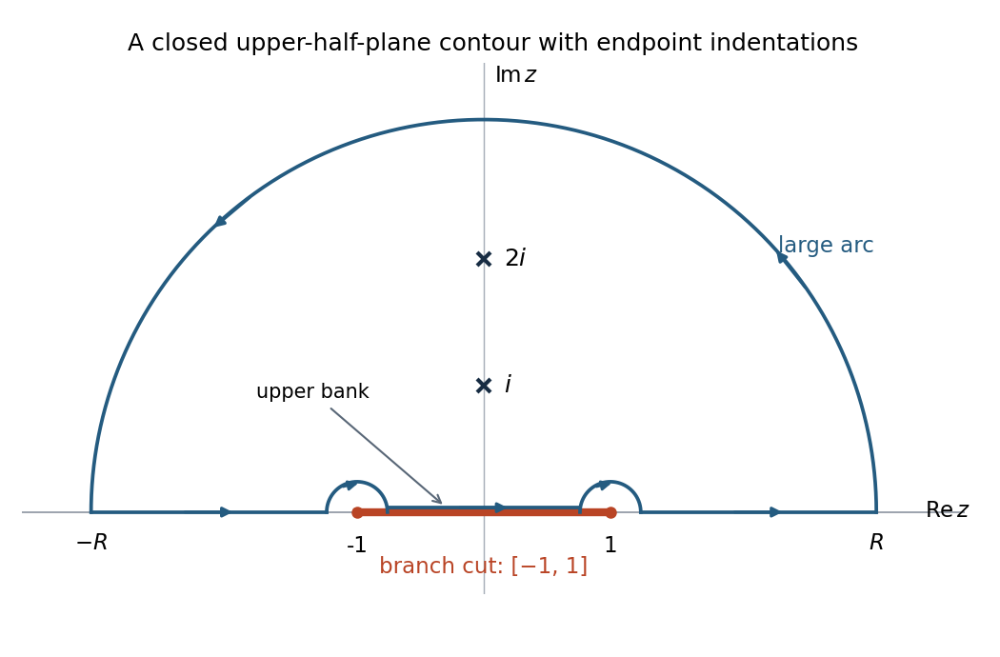

<h1 id="4/b/ii/solution">Solution</h1>

↑ **Parent:** [Ii](../ii.md)

Use the branch from part (i) and close the real-axis path with a large upper [semicircle](../../../../../../semicircle.md), indenting clockwise around $-1$ and $1$. On the segment between them, take the upper-bank value of the [branch cut](../../../../../../branch-cut.md). This is an instance of [square-root endpoint integrals by an upper-half-plane contour](../../../../../../square-root-endpoint-integrals-by-an-upper-half-plane-contour.md).

**[Figure 2](#4/b/ii/image-upper-half-plane-contour-clockwise-endpoint-indentations-and-the-two-enclosed-poles-indentation-sizes-are-exaggerated). Upper-half-plane contour, clockwise endpoint indentations, and the two enclosed poles; indentation sizes are exaggerated**.

The contributions can be controlled separately. Since $g(z)=O(z^{-2})$, the large arc contributes $O(R^{-1})\to0$. Near either [branch point](../../../../../../branch-point.md), $g=O(\varepsilon^{-1/2})$, so an arc of length $O(\varepsilon)$ contributes $O(\sqrt\varepsilon)\to0$. On the upper bank of $(-1,1)$,

$$
g(x+i0)=\frac{x(x^2+3)}{i(x^2+1)(x^2+4)\sqrt{1-x^2}},
$$

which is odd in $x$, so its integral is zero. On the exterior real intervals $h(-x)=-h(x)$, while the rational numerator is odd. Hence $g(-x)=g(x)$ and the two exterior contributions sum to $2J$.

The enclosed [residues](../../../../../../residue.md) use $h(i)=i\sqrt2$ and $h(2i)=i\sqrt5$:

$$
\operatorname{Res}_{z=i}g=\frac{i(i^2+3)}{(2i)(i^2+4)h(i)}=-\frac{i}{3\sqrt2},\qquad
\operatorname{Res}_{z=2i}g=\frac{2i((2i)^2+3)}{((2i)^2+1)(4i)h(2i)}=-\frac{i}{6\sqrt5}.
$$

The [residue theorem](../../../../../../residue-theorem.md) gives $2J=2\pi i[-i/(3\sqrt2)-i/(6\sqrt5)]$. Therefore

$$
\boxed{J=\frac\pi{3\sqrt2}+\frac\pi{6\sqrt5}.}
$$

As an independent check, $u=\sqrt{x^2-1}$ converts the integral to

$$
\int_0^\infty\frac{u^2+4}{(u^2+2)(u^2+5)}\,du=\int_0^\infty\left[\frac{2/3}{u^2+2}+\frac{1/3}{u^2+5}\right]du,
$$

which yields the same value. This check also confirms the branch signs and the factor of two in the contour argument.

## ↑ Ancestors (14)

1. [Ii](../ii.md)
2. [B](../../b.md)
3. [4](../../../4.md)
4. [Paper 2](../../../../paper-2-split.md)
5. [2016](../../../../split.md)
6. [Past exam of the mathematics course of the year 2 of the natural sciences course of the University of Cambridge](../../../../../split.md)
7. [Mathematics course of the year 2 of the natural sciences course of the University of Cambridge](../../../../../../mathematics-course-of-the-year-2-of-the-natural-sciences-course-of-the-university-of-cambridge.md)
8. [Year 2 of the natural sciences course of the University of Cambridge](../../../../../../year-2-of-the-natural-sciences-course-of-the-university-of-cambridge.md)
9. [Year of the natural sciences course of the University of Cambridge](../../../../../../year-of-the-natural-sciences-course-of-the-university-of-cambridge.md)
10. [Natural sciences course of the University of Cambridge](../../../../../../natural-sciences-course-of-the-university-of-cambridge.md)
11. [Course of the University of Cambridge](../../../../../../course-of-the-university-of-cambridge.md)
12. [University of Cambridge](../../../../../../university-of-cambridge-split.md)
13. [List of universities](../../../../../../list-of-universities.md)
14. [Codex Wiki](../../../../../../split.md)
