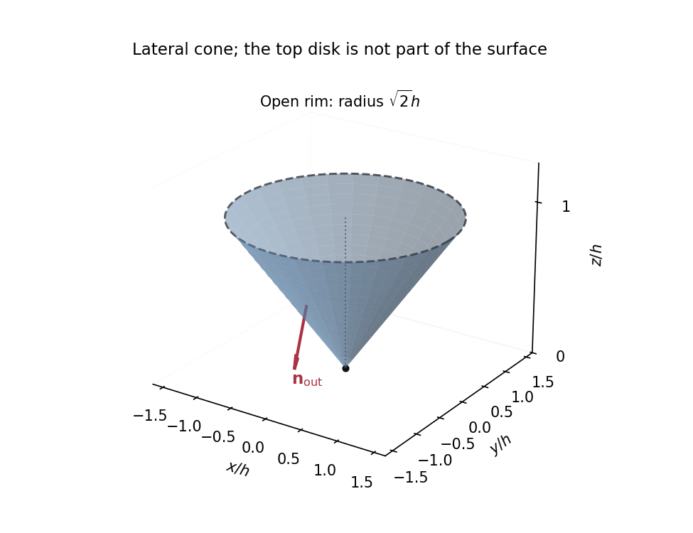

<h1 id="1/b/solution">Solution</h1>

↑ **Parent:** [B](../b.md)

In [cylindrical coordinates](../../../../../cylindrical-coordinate-system.md), the surface has radius $r=\sqrt2z$. It is the lateral surface of a [right circular cone](../../../../../right-circular-cone.md), with vertex at the origin and axis along positive $z$. Its height is $h$ and the limiting upper rim has radius $\sqrt2h$; the horizontal disk at that rim is absent. The half-angle from the vertical satisfies

$$
\boxed{\tan\alpha=\sqrt2,\qquad \alpha\simeq54.7^\circ.}
$$

The upper rim is excluded by $z<h$, which does not affect any convergent [surface integral](../../../../../surface-integral.md). The vertex likewise contributes no area.

**[Figure 1](#1/b/image-the-open-lateral-cone-and-its-auxiliary-closing-cap). The open lateral cone and its auxiliary closing cap**. Original sketch in units of $h$. The dashed upper rim bounds an auxiliary disk used only to apply the divergence theorem. The arrow shows the outward lateral normal, which has a downward component.

## ↑ Ancestors (13)

1. [B](../b.md)
2. [1](../../1.md)
3. [Paper 1](../../../paper-1-split.md)
4. [2017](../../../split.md)
5. [Past exam of the mathematics course of the year 2 of the natural sciences course of the University of Cambridge](../../../../split.md)
6. [Mathematics course of the year 2 of the natural sciences course of the University of Cambridge](../../../../../mathematics-course-of-the-year-2-of-the-natural-sciences-course-of-the-university-of-cambridge.md)
7. [Year 2 of the natural sciences course of the University of Cambridge](../../../../../year-2-of-the-natural-sciences-course-of-the-university-of-cambridge.md)
8. [Year of the natural sciences course of the University of Cambridge](../../../../../year-of-the-natural-sciences-course-of-the-university-of-cambridge.md)
9. [Natural sciences course of the University of Cambridge](../../../../../natural-sciences-course-of-the-university-of-cambridge.md)
10. [Course of the University of Cambridge](../../../../../course-of-the-university-of-cambridge.md)
11. [University of Cambridge](../../../../../university-of-cambridge-split.md)
12. [List of universities](../../../../../list-of-universities.md)
13. [Codex Wiki](../../../../../split.md)
