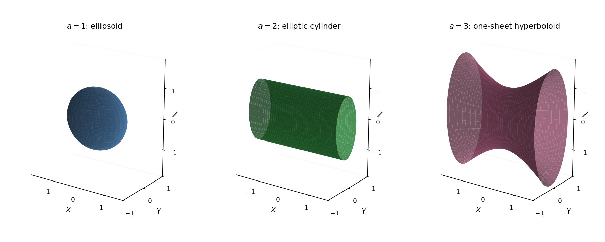

<h1 id="5/b/solution">Solution</h1>

↑ **Parent:** [B](../b.md)

The $xy$ block has characteristic [polynomial](../../../../../polynomial-split.md) $(2-\lambda)^2-a^2$. A convenient [orthonormal eigenbasis](../../../../../orthonormal-eigenbasis.md) for the full real [symmetric matrix](../../../../../symmetric-matrix.md) is

$$
e_+=\frac1{\sqrt2}(1,1,0)^T,\qquad e_-=\frac1{\sqrt2}(1,-1,0)^T,\qquad e_z=(0,0,1)^T,
$$

with [eigenvalues](../../../../../eigenvalue.md) $2-a$, $2+a$, and $c$, respectively. Hence its [orthogonal diagonalization](../../../../../orthogonal-diagonalization-of-a-real-symmetric-matrix.md) is

$$
\boxed{P^TAP=\operatorname{diag}(2-a,2+a,c),\qquad
P=\begin{pmatrix}1/\sqrt2&1/\sqrt2&0\\1/\sqrt2&-1/\sqrt2&0\\0&0&1\end{pmatrix}.}
$$

For repeated [eigenvalues](../../../../../eigenvalue.md), every nonzero combination within the corresponding [eigenspace](../../../../../eigenspace.md) is also an [eigenvector](../../../../../eigenvector.md); the displayed basis remains valid. Introduce [principal axes](../../../../../principal-axis.md) coordinates

$$
X=\frac{x+y}{\sqrt2},\qquad Y=\frac{x-y}{\sqrt2},\qquad Z=z.
$$

The [quadratic form](../../../../../quadratic-form-split.md) becomes

$$
(2-a)X^2+(2+a)Y^2+cZ^2=1.
$$

The [principal-axis reduction of a quadric](../../../../../principal-axis-reduction-of-a-quadric.md) therefore has three regimes.

For $0<a<2$, all coefficients are positive: the surface is an [ellipsoid](../../../../../ellipsoid.md) centred at the origin, with

$$
\boxed{\text{semiaxes }\frac1{\sqrt{2-a}},\quad\frac1{\sqrt{2+a}},\quad\frac1{\sqrt c}
\quad\text{along }e_+,e_-,e_z.}
$$

For $a=2$, the $X$ term disappears. The surface is an [elliptic cylinder](../../../../../elliptic-cylinder.md), unbounded along $e_+$, whose cross-section is $4Y^2+cZ^2=1$:

$$
\boxed{\text{cylinder axis }e_+,\qquad\text{cross-section semiaxes }\frac12,\ \frac1{\sqrt c}.}
$$

For $a>2$, there is one negative coefficient, so the surface is a one-sheet [hyperboloid](../../../../../hyperboloid.md):

$$
\boxed{(a+2)Y^2+cZ^2-(a-2)X^2=1,\qquad\text{axis }e_+.}
$$

Its waist at $X=0$ is an ellipse with semiaxes $(a+2)^{-1/2}$ and $c^{-1/2}$. At other $X$, both waist radii are multiplied by $\sqrt{1+(a-2)X^2}$. There is no intercept on its longitudinal axis. Its asymptotic cone is $(a+2)Y^2+cZ^2=(a-2)X^2$. If positive [eigenvalues](../../../../../eigenvalue.md) coincide, the corresponding choice of [principal axes](../../../../../principal-axis.md) is not unique, reflecting a rotational symmetry of the surface.

**[Figure 2](#5/b/image-ellipsoid-elliptic-cylinder-and-one-sheet-hyperboloid-in-principal-coordinates). Ellipsoid, elliptic cylinder, and one-sheet hyperboloid in principal coordinates**. Original calculated examples with $c=1$ and $a=1,2,3$. The horizontal longitudinal coordinate $X$ is directed along $(1,1,0)/\sqrt2$ in the original coordinates. Cylinder and hyperboloid plots show finite portions of unbounded surfaces.

## ↑ Ancestors (13)

1. [B](../b.md)
2. [5](../../5.md)
3. [Paper 1](../../../paper-1-split.md)
4. [2017](../../../split.md)
5. [Past exam of the mathematics course of the year 2 of the natural sciences course of the University of Cambridge](../../../../split.md)
6. [Mathematics course of the year 2 of the natural sciences course of the University of Cambridge](../../../../../mathematics-course-of-the-year-2-of-the-natural-sciences-course-of-the-university-of-cambridge.md)
7. [Year 2 of the natural sciences course of the University of Cambridge](../../../../../year-2-of-the-natural-sciences-course-of-the-university-of-cambridge.md)
8. [Year of the natural sciences course of the University of Cambridge](../../../../../year-of-the-natural-sciences-course-of-the-university-of-cambridge.md)
9. [Natural sciences course of the University of Cambridge](../../../../../natural-sciences-course-of-the-university-of-cambridge.md)
10. [Course of the University of Cambridge](../../../../../course-of-the-university-of-cambridge.md)
11. [University of Cambridge](../../../../../university-of-cambridge-split.md)
12. [List of universities](../../../../../list-of-universities.md)
13. [Codex Wiki](../../../../../split.md)
