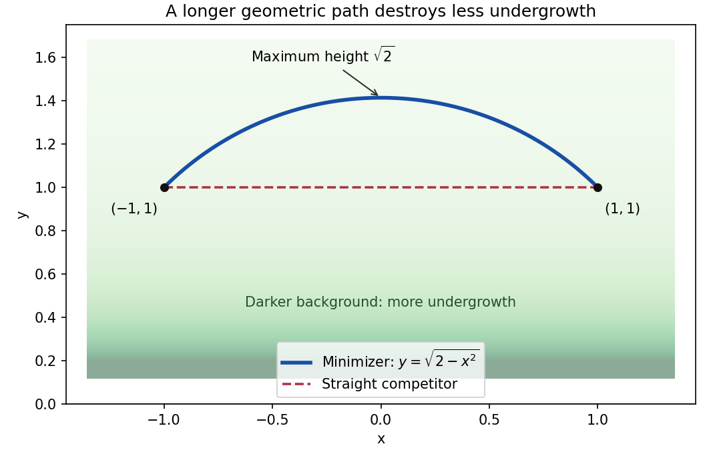

<h1 id="9/b/iii/solution">Solution</h1>

↑ **Parent:** [Iii](../iii.md)

The path rises from $(-1,1)$ to its maximum height $\sqrt2$ at $x=0$, then falls symmetrically to $(1,1)$. Its radius is $\sqrt2$, and its endpoint polar angles are $3\pi/4$ and $\pi/4$, giving angular span $\pi/2$. Hence its ordinary [arc length](../../../../../../arc-length.md) is

$$
\boxed{L=\sqrt2\,\frac\pi2=\frac\pi{\sqrt2}\simeq2.22144.}
$$

Equivalently, $\sqrt{1+y'^2}=\sqrt2/\sqrt{2-x^2}$ and integrating over $[-1,1]$ gives the same value. This Euclidean length differs from the weighted destruction integral $D_{\min}\simeq1.76275$: the slightly longer route saves undergrowth by travelling at greater height.

**[Figure 3](#9/b/iii/image-the-least-destruction-path-bends-towards-lower-density). The least-destruction path bends towards lower density**. Original exact semicircular minimizer and its horizontal competitor. The shaded background indicates the density $1/y$ in the upper half-plane. The minimizer has Euclidean length $\pi/\sqrt2$ but weighted cost $2\ln(1+\sqrt2)$, smaller than the straight path's cost two.

## ↑ Ancestors (14)

1. [Iii](../iii.md)
2. [B](../../b.md)
3. [9](../../../9.md)
4. [Paper 1](../../../../paper-1-split.md)
5. [2017](../../../../split.md)
6. [Past exam of the mathematics course of the year 2 of the natural sciences course of the University of Cambridge](../../../../../split.md)
7. [Mathematics course of the year 2 of the natural sciences course of the University of Cambridge](../../../../../../mathematics-course-of-the-year-2-of-the-natural-sciences-course-of-the-university-of-cambridge.md)
8. [Year 2 of the natural sciences course of the University of Cambridge](../../../../../../year-2-of-the-natural-sciences-course-of-the-university-of-cambridge.md)
9. [Year of the natural sciences course of the University of Cambridge](../../../../../../year-of-the-natural-sciences-course-of-the-university-of-cambridge.md)
10. [Natural sciences course of the University of Cambridge](../../../../../../natural-sciences-course-of-the-university-of-cambridge.md)
11. [Course of the University of Cambridge](../../../../../../course-of-the-university-of-cambridge.md)
12. [University of Cambridge](../../../../../../university-of-cambridge-split.md)
13. [List of universities](../../../../../../list-of-universities.md)
14. [Codex Wiki](../../../../../../split.md)
