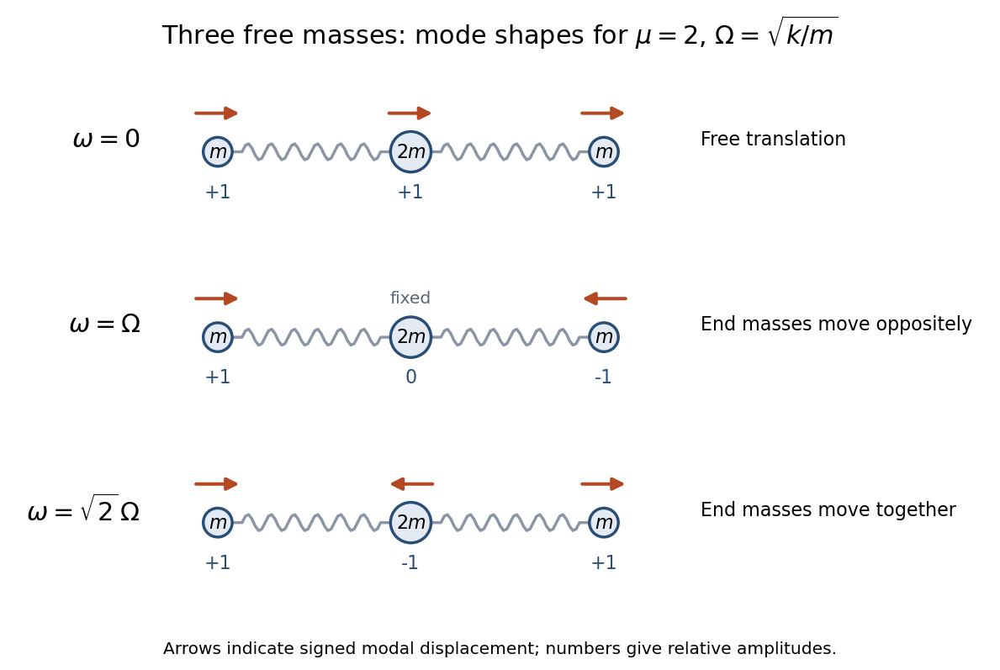

<h1 id="7/b/solution">Solution</h1>

↑ **Parent:** [B](../b.md)

Substitution of $\mu=2$ into the [normal modes of three masses connected by two equal springs](../../../../../normal-modes-of-three-masses-connected-by-two-equal-springs.md) gives

$$
\boxed{\Omega=\sqrt{\frac km},\qquad\omega_0=0,\quad\omega_1=\Omega,\quad\omega_2=\sqrt2\,\Omega.}
$$

The corresponding shapes are $v_0=(1,1,1)^T$, $v_1=(1,0,-1)^T$, $v_2=(1,-1,1)^T$. For example, $Kv_2=k(2,-4,2)^T=2(k/m)Mv_2$, verifying the third [eigenvalue](../../../../../eigenvalue.md) directly.

Their relevant [orthogonality](../../../../../orthogonal-vectors.md) uses the kinetic matrix $M=m\operatorname{diag}(1,2,1)$:

$$
\boxed{v_i^TMv_j=0\quad(i\ne j),\qquad\begin{pmatrix}v_0&v_1&v_2\end{pmatrix}^{\!T}M\begin{pmatrix}v_0&v_1&v_2\end{pmatrix}=m\operatorname{diag}(4,2,4).}
$$

This is [mass-matrix orthogonality of normal modes](../../../../../mass-matrix-orthogonality-of-normal-modes.md). It also follows by subtracting $v_i^TKv_j=\omega_j^2v_i^TMv_j$ from its transpose and using the symmetry of $K,M$. Ordinary [Euclidean inner products](../../../../../dot-product.md) need not vanish: in fact $v_0^Tv_2=1$.

**[Figure 1](#7/b/image-the-three-normal-modes-for-a-free-spring-chain-with-middle-mass-2m-amplitudes-are-relative-and-the-zero-mode-is-translation). The three normal modes for a free spring chain with middle mass $2m$; amplitudes are relative and the zero mode is translation**.

## ↑ Ancestors (13)

1. [B](../b.md)
2. [7](../../7.md)
3. [Paper 2](../../../paper-2-split.md)
4. [2017](../../../split.md)
5. [Past exam of the mathematics course of the year 2 of the natural sciences course of the University of Cambridge](../../../../split.md)
6. [Mathematics course of the year 2 of the natural sciences course of the University of Cambridge](../../../../../mathematics-course-of-the-year-2-of-the-natural-sciences-course-of-the-university-of-cambridge.md)
7. [Year 2 of the natural sciences course of the University of Cambridge](../../../../../year-2-of-the-natural-sciences-course-of-the-university-of-cambridge.md)
8. [Year of the natural sciences course of the University of Cambridge](../../../../../year-of-the-natural-sciences-course-of-the-university-of-cambridge.md)
9. [Natural sciences course of the University of Cambridge](../../../../../natural-sciences-course-of-the-university-of-cambridge.md)
10. [Course of the University of Cambridge](../../../../../course-of-the-university-of-cambridge.md)
11. [University of Cambridge](../../../../../university-of-cambridge-split.md)
12. [List of universities](../../../../../list-of-universities.md)
13. [Codex Wiki](../../../../../split.md)
