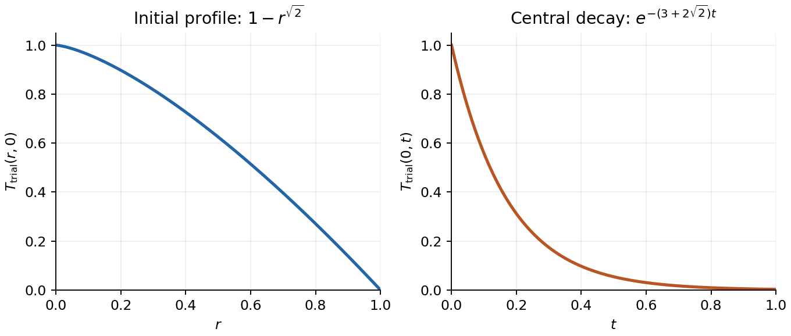

<h1 id="10/d/ii/solution">Solution</h1>

↑ **Parent:** [Ii](../ii.md)

For constant diffusivity, the trial [Rayleigh quotient](../../../../../../rayleigh-quotient.md) simplifies to

$$
\nu_{\mathrm{trial}}(q,0)=\frac{(q+1)(q+2)}q=q+3+\frac2q.
$$

Its [derivative](../../../../../../derivative.md) is $1-2/q^2$, so its only positive critical point is $q=\sqrt2$. The second [derivative](../../../../../../derivative.md) is $4/q^3>0$; also the quotient diverges as $q\downarrow0$ or $q\to\infty$. Therefore this is the global optimum within the trial family:

$$
\boxed{q_{\mathrm{opt}}=\sqrt2,\qquad \nu_0\leq\nu_{\mathrm{trial,min}}=3+2\sqrt2\approx5.82843}.
$$

The two requested profiles are

$$
\boxed{T_{\mathrm{trial}}(r,0)=1-r^{\sqrt2},\qquad
T_{\mathrm{trial}}(0,t)=e^{-(3+2\sqrt2)t}}.
$$

The initial radial graph decreases from one at the centre to zero at the rim, has horizontal tangent at the centre, and is concave downward for $0<r<1$. The central temperature decreases exponentially from one to zero, with initial time [derivative](../../../../../../derivative.md) $-(3+2\sqrt2)$. These are trial profiles, not exact solutions of the full [heat equation](../../../../../../heat-equation.md). Although the radial trial function is not twice differentiable at the centre, it has finite weighted [energy](../../../../../../energy-split.md) and belongs to the variational trial class used by the [Rayleigh-Ritz variational principle](../../../../../../rayleigh-ritz-variational-principle.md).

**[Figure 3](#10/d/ii/image-optimal-trial-radial-profile-and-its-assumed-exponential-decay-at-the-centre). Optimal trial radial profile and its assumed exponential decay at the centre**.

## ↑ Ancestors (14)

1. [Ii](../ii.md)
2. [D](../../d.md)
3. [10](../../../10.md)
4. [Paper 1](../../../../paper-1-split.md)
5. [2018](../../../../split.md)
6. [Past exam of the mathematics course of the year 2 of the natural sciences course of the University of Cambridge](../../../../../split.md)
7. [Mathematics course of the year 2 of the natural sciences course of the University of Cambridge](../../../../../../mathematics-course-of-the-year-2-of-the-natural-sciences-course-of-the-university-of-cambridge.md)
8. [Year 2 of the natural sciences course of the University of Cambridge](../../../../../../year-2-of-the-natural-sciences-course-of-the-university-of-cambridge.md)
9. [Year of the natural sciences course of the University of Cambridge](../../../../../../year-of-the-natural-sciences-course-of-the-university-of-cambridge.md)
10. [Natural sciences course of the University of Cambridge](../../../../../../natural-sciences-course-of-the-university-of-cambridge.md)
11. [Course of the University of Cambridge](../../../../../../course-of-the-university-of-cambridge.md)
12. [University of Cambridge](../../../../../../university-of-cambridge-split.md)
13. [List of universities](../../../../../../list-of-universities.md)
14. [Codex Wiki](../../../../../../split.md)
