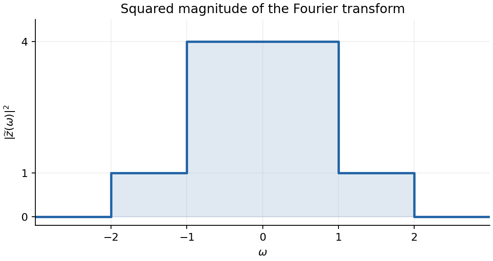

<h1 id="4/g/solution">Solution</h1>

↑ **Parent:** [G](../g.md)

By [Fourier inversion](../../../../../fourier-inversion-theorem.md), the [sinc function](../../../../../sinc-function.md) $\sin(At)/(\pi t)$ has [Fourier transform](../../../../../fourier-transform-split.md) equal to one for $|\omega|<A$ and zero for $|\omega|>A$. Thus the two bandwidths add to give

$$
\widetilde z(\omega)=\begin{cases}
2,&|\omega|<1,\\
1,&1<|\omega|<2,\\
0,&|\omega|>2.
\end{cases}
$$

The requested squared-magnitude [spectrum](../../../../../spectrum-functional-analysis.md) therefore has heights four and one:

$$
\boxed{|\widetilde z(\omega)|^2=\begin{cases}
4,&|\omega|<1,\\
1,&1<|\omega|<2,\\
0,&|\omega|>2.
\end{cases}}
$$

Values at the jump points depend on the chosen Fourier convergence convention and do not affect any integral. The graph is shown below.

**[Figure 1](#4/g/image-squared-fourier-magnitude-of-the-sum-of-two-sinc-signals). Squared Fourier magnitude of the sum of two sinc signals**.

The [Parseval identity](../../../../../parseval-identity.md) with this [Fourier transform](../../../../../fourier-transform-split.md) normalization gives

$$
\boxed{E=\frac1{2\pi}\int_{-\infty}^{\infty}|\widetilde z(\omega)|^2\,d\omega
=\frac1{2\pi}(4\cdot2+1\cdot2)=\frac5\pi}.
$$

## ↑ Ancestors (13)

1. [G](../g.md)
2. [4](../../4.md)
3. [Paper 1](../../../paper-1-split.md)
4. [2018](../../../split.md)
5. [Past exam of the mathematics course of the year 2 of the natural sciences course of the University of Cambridge](../../../../split.md)
6. [Mathematics course of the year 2 of the natural sciences course of the University of Cambridge](../../../../../mathematics-course-of-the-year-2-of-the-natural-sciences-course-of-the-university-of-cambridge.md)
7. [Year 2 of the natural sciences course of the University of Cambridge](../../../../../year-2-of-the-natural-sciences-course-of-the-university-of-cambridge.md)
8. [Year of the natural sciences course of the University of Cambridge](../../../../../year-of-the-natural-sciences-course-of-the-university-of-cambridge.md)
9. [Natural sciences course of the University of Cambridge](../../../../../natural-sciences-course-of-the-university-of-cambridge.md)
10. [Course of the University of Cambridge](../../../../../course-of-the-university-of-cambridge.md)
11. [University of Cambridge](../../../../../university-of-cambridge-split.md)
12. [List of universities](../../../../../list-of-universities.md)
13. [Codex Wiki](../../../../../split.md)
