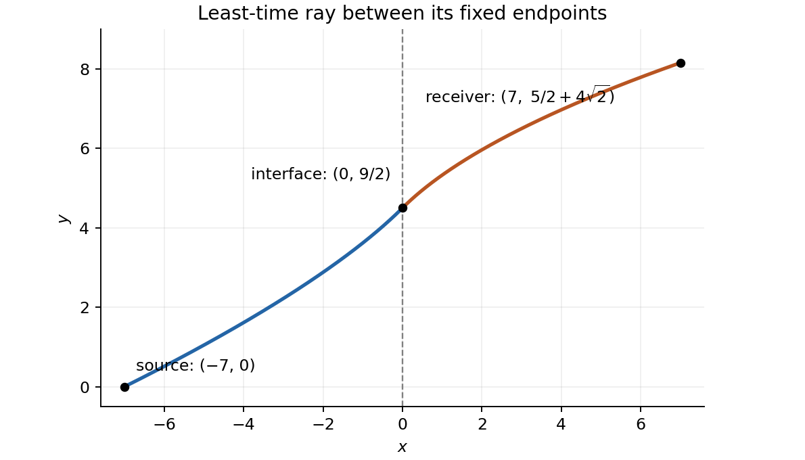

<h1 id="9/b/iv/solution">Solution</h1>

↑ **Parent:** [Iv](../iv.md)

Retain the question's common crossing condition $y'(0)=1$, and replace the slope-ratio condition of part (iii) by the specified initial slope. Then part (i) gives

$$
(1+\alpha)^{-1/3}=\frac12,
$$

so $\alpha=7$. Substitution in part (ii) gives the ray

$$
\boxed{y(x)=\begin{cases}
\displaystyle6-\frac32(1-x)^{2/3},&-7\leq x<0,\\[5pt]
\displaystyle\frac52+2\sqrt{1+x},&0\leq x\leq7.
\end{cases}}
$$

It starts at $(-7,0)$ with slope $1/2$, passes through $(0,9/2)$ with slope one, and reaches the receiver with slope $1/\sqrt8$. The final height is

$$
\boxed{y(7)=\frac52+4\sqrt2\approx8.15685}.
$$

The left-hand curvature is $y''=\frac13(1-x)^{-4/3}>0$; the right-hand curvature is $y''=-\frac12(1+x)^{-3/2}<0$. Thus the graph is increasing throughout, with a change from upward to downward curvature at the interface.

**[Figure 2](#9/b/iv/image-optical-ray-with-initial-slope-one-half-and-unit-slope-at-the-interface). Optical ray with initial slope one half and unit slope at the interface**.

If the word “instead” were also taken to remove the common crossing condition, the initial slope alone would leave $\alpha$ undetermined: it would give $p=\mu(-\alpha)/\sqrt5$ for any selected source position. The numerical answer above uses the crossing condition stated before all four subparts.

## ↑ Ancestors (14)

1. [Iv](../iv.md)
2. [B](../../b.md)
3. [9](../../../9.md)
4. [Paper 1](../../../../paper-1-split.md)
5. [2018](../../../../split.md)
6. [Past exam of the mathematics course of the year 2 of the natural sciences course of the University of Cambridge](../../../../../split.md)
7. [Mathematics course of the year 2 of the natural sciences course of the University of Cambridge](../../../../../../mathematics-course-of-the-year-2-of-the-natural-sciences-course-of-the-university-of-cambridge.md)
8. [Year 2 of the natural sciences course of the University of Cambridge](../../../../../../year-2-of-the-natural-sciences-course-of-the-university-of-cambridge.md)
9. [Year of the natural sciences course of the University of Cambridge](../../../../../../year-of-the-natural-sciences-course-of-the-university-of-cambridge.md)
10. [Natural sciences course of the University of Cambridge](../../../../../../natural-sciences-course-of-the-university-of-cambridge.md)
11. [Course of the University of Cambridge](../../../../../../course-of-the-university-of-cambridge.md)
12. [University of Cambridge](../../../../../../university-of-cambridge-split.md)
13. [List of universities](../../../../../../list-of-universities.md)
14. [Codex Wiki](../../../../../../split.md)
