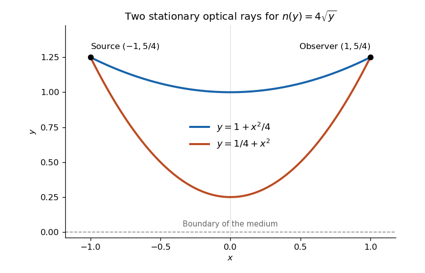

<h1 id="9/c/solution">Solution</h1>

↑ **Parent:** [C](../c.md)

The original PDF places both endpoints at height $5/4$; the vertically stacked fraction can be misread in extracted text. The coefficient in the index is $4$, multiplying $\sqrt y$.

For the optical-length integrand $F=4\sqrt y\sqrt{1+y'^2}$, the [Beltrami identity](../../../../../beltrami-identity.md) applies because there is no explicit $x$ dependence. It gives

$$
F-y'F_{y'}=\frac{4\sqrt y}{\sqrt{1+y'^2}}=4\sqrt h,
$$

where $h>0$ is constant. Therefore $y'^2=y/h-1$. The full [Euler-Lagrange equation](../../../../../euler-lagrange-equation.md) is $2yy''=1+y'^2$, and combining these gives $y''=1/(2h)$. This also excludes a constant curve, which would satisfy the squared first integral but not the full variational equation. Integration yields

$$
y(x)=h+\frac{(x-x_0)^2}{4h}.
$$

Equal endpoint heights at $x=-1,1$ require $x_0=0$. The height condition then becomes $h+1/(4h)=5/4$, or $4h^2-5h+1=0$. Its two positive roots are $h=1$ and $h=1/4$. Hence the two possible stationary rays are

$$
\boxed{y(x)=1+\frac{x^2}{4}\qquad\text{or}\qquad y(x)=\frac14+x^2,\qquad-1\leq x\leq1.}
$$

Both stay in $y>0$, have the required endpoints and satisfy the variational equation. These are the [two optical rays in a square-root refractive-index profile](../../../../../two-optical-rays-in-a-square-root-refractive-index-profile.md). Fermat stationarity supplies two rays; it does not assert that both globally minimize travel time.

**[Figure 1](#9/c/image-the-two-stationary-optical-rays-from-fermat-principle-in-a-medium-with-refractive-index-4-sqrt-y). The two stationary optical rays from Fermat principle in a medium with refractive index $4\sqrt y$**.

## ↑ Ancestors (13)

1. [C](../c.md)
2. [9](../../9.md)
3. [Paper 1](../../../paper-1-split.md)
4. [2019](../../../split.md)
5. [Past exam of the mathematics course of the year 2 of the natural sciences course of the University of Cambridge](../../../../split.md)
6. [Mathematics course of the year 2 of the natural sciences course of the University of Cambridge](../../../../../mathematics-course-of-the-year-2-of-the-natural-sciences-course-of-the-university-of-cambridge.md)
7. [Year 2 of the natural sciences course of the University of Cambridge](../../../../../year-2-of-the-natural-sciences-course-of-the-university-of-cambridge.md)
8. [Year of the natural sciences course of the University of Cambridge](../../../../../year-of-the-natural-sciences-course-of-the-university-of-cambridge.md)
9. [Natural sciences course of the University of Cambridge](../../../../../natural-sciences-course-of-the-university-of-cambridge.md)
10. [Course of the University of Cambridge](../../../../../course-of-the-university-of-cambridge.md)
11. [University of Cambridge](../../../../../university-of-cambridge-split.md)
12. [List of universities](../../../../../list-of-universities.md)
13. [Codex Wiki](../../../../../split.md)
