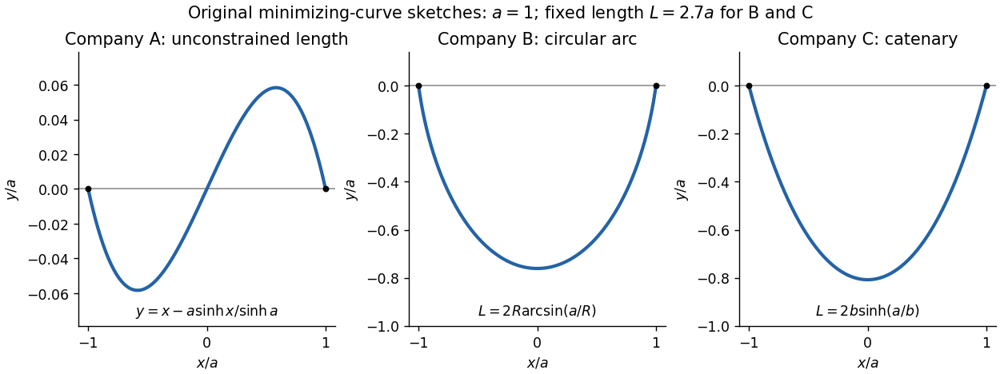

<h1 id="5/solution">Solution</h1>

↑ **Parent:** [5](../5.md)

The endpoint constraints are $y(-a)=y(a)=0$. The constants in the three costs contribute only $2aK$, $2aK'$ and $2aK''$ respectively, so they do not affect the minimizing shapes. For companies B and C, the fixed [arc length](../../../../arc-length.md) is

$$
\mathcal L[y]=\int_{-a}^a\sqrt{1+y'^2}\,dx=L.
$$

The original PDF has $(y')^2$ as company A's first variable term. The local TeX transcription has lost that [derivative](../../../../derivative.md) dot and incorrectly repeats $y^2$; the calculation below follows the PDF.

**Company A.** The relevant [functional](../../../../functional.md) is $J_A=\int(y'^2+y^2-2xy)\,dx$. The [Euler-Lagrange equation](../../../../euler-lagrange-equation.md) gives

$$
2(y-x)-2y''=0,\qquad y''-y=-x.
$$

Its [general solution](../../../../general-solution.md) is $y=x+c_1\cosh x+c_2\sinh x$. Adding and subtracting the endpoint equations gives $c_1=0$ and $c_2=-a/\sinh a$. Thus

$$
\boxed{y_A(x)=x-a\frac{\sinh x}{\sinh a}.}
$$

This [curve](../../../../curve.md) is odd, negative on the left half and positive on the right half; company A has no lower-half-plane restriction. It is the unique global minimum. Indeed, for any endpoint-zero [variation](../../../../variation.md) $\eta$, [integration by parts](../../../../integration-by-parts.md) and the [differential equation](../../../../differential-equation-split.md) cancel all linear terms, leaving

$$
J_A[y_A+\eta]-J_A[y_A]=\int_{-a}^a(\eta'^2+\eta^2)\,dx>0
$$

unless $\eta=0$.

**Company B.** Minimize $\int y\,dx$ under the length constraint. Introduce a constant [Lagrange multiplier](../../../../lagrange-multiplier.md) $\lambda$ and apply the [Euler-Lagrange equation](../../../../euler-lagrange-equation.md) to $y+\lambda\sqrt{1+y'^2}$:

$$
1-\lambda\frac{y''}{(1+y'^2)^{3/2}}=0.
$$

The [curvature](../../../../curvature.md) is constant, so the required lower arc is a [circular arc](../../../../circular-arc.md). Writing its radius as $R\geq a$ and imposing the endpoints gives

$$
\boxed{y_B(x)=\sqrt{R^2-a^2}-\sqrt{R^2-x^2}.}
$$

Since $\sqrt{1+y_B'^2}=R/\sqrt{R^2-x^2}$, its length determines the radius:

$$
\boxed{L=2R\arcsin(a/R).}
$$

Equivalently, introduce $0<\theta\leq\pi/2$ with $a=R\sin\theta$. Then $L/(2a)=\theta/\sin\theta$, which increases strictly from $1$ to $\pi/2$. The stipulated range of $L$ therefore selects one minor arc. At $L=\pi a$ it becomes the lower [semicircle](../../../../semicircle.md), with vertical endpoint tangents; it is still a single-valued finite-length graph.

Global minimality follows from the [convexity](../../../../convex-function.md) of the augmented slope cost with $\lambda=R$. For a competitor $y=y_B+\eta$,

$$
R\left(\sqrt{1+y'^2}-\sqrt{1+y_B'^2}\right)
\geq\frac{Ry_B'}{\sqrt{1+y_B'^2}}\eta'=x\eta'.
$$

Consequently the augmented cost difference is at least $\int(\eta+x\eta')dx=[x\eta]_{-a}^a=0$. Competitors have the same length, so the multiplier contribution cancels and the original cost is minimized. This proves that a [circular arc maximizes area below a fixed chord](../../../../circular-arc-maximizes-area-below-a-fixed-chord.md): minimizing negative signed height maximizes the area between the fence and the chord.

**Company C.** The variable cost is $J_C=\int y\,ds=\int y\sqrt{1+y'^2}\,dx$. The augmented integrand is $(y+\lambda)\sqrt{1+y'^2}$. Since it has no explicit $x$ dependence, the [Beltrami identity](../../../../beltrami-identity.md) gives

$$
\frac{y+\lambda}{\sqrt{1+y'^2}}=b.
$$

The hanging branch with $b>0$ integrates to $y+\lambda=b\cosh[(x-x_0)/b]$. Equal endpoint heights [force](../../../../force-split.md) $x_0=0$, and the endpoint value fixes $\lambda=b\cosh(a/b)$. Thus

$$
\boxed{y_C(x)=b\left[\cosh(x/b)-\cosh(a/b)\right],\qquad b>0.}
$$

Its length is

$$
\boxed{L=\int_{-a}^a\cosh(x/b)\,dx=2b\sinh(a/b).}
$$

Writing $q=a/b$, the equation $L/(2a)=\sinh q/q$ has one positive solution for every $L>2a$: its [derivative](../../../../derivative.md) has numerator $q\cosh q-\sinh q>0$. The [curve](../../../../curve.md) is a [catenary](../../../../catenary.md), is even, and lies strictly below the chord except at the endpoints.

A direct argument proves this is a global minimum, rather than merely an extremum of an augmented [functional](../../../../functional.md). Parametrize any competitor by [arc length](../../../../arc-length.md) $s\in[-L/2,L/2]$, from its left endpoint to its right endpoint. Then $x'^2+y'^2=1$, $\int x' ds=2a$, and [integration by parts](../../../../integration-by-parts.md) gives

$$
J_C=-\int sy'\,ds=2ab-\int(bx'+sy')\,ds
\geq2ab-\int_{-L/2}^{L/2}\sqrt{b^2+s^2}\,ds.
$$

The [Cauchy-Schwarz inequality](../../../../cauchy-schwarz-inequality.md) gives the last step. Equality requires $x'=b/\sqrt{b^2+s^2}$ and $y'=s/\sqrt{b^2+s^2}$, whose [integrals](../../../../integral-split.md) are precisely the displayed [catenary](../../../../catenary.md) with the stated length. Thus it attains a lower bound valid for every competitor. This proves that a [catenary minimizes the integral of height along a fixed-length curve](../../../../catenary-minimizes-the-integral-of-height-along-a-fixed-length-curve.md).

**[Figure 1](#5/image-the-three-minimizing-fence-shapes-with-fixed-length-examples-for-companies-b-and-c). The three minimizing fence shapes, with fixed-length examples for companies B and C**.

The sketch uses $a=1$ and $L=2.7$ for the two fixed-length cases. The vertical scale in the company A panel is enlarged to show its small odd deflection. No comparison between the three companies' absolute prices is required or possible from the shapes alone, since their additive cost constants are independent.

## ↑ Ancestors (12)

1. [5](../5.md)
2. [Paper 1](../../paper-1-split.md)
3. [2020](../../split.md)
4. [Past exam of the mathematics course of the year 2 of the natural sciences course of the University of Cambridge](../../../split.md)
5. [Mathematics course of the year 2 of the natural sciences course of the University of Cambridge](../../../../mathematics-course-of-the-year-2-of-the-natural-sciences-course-of-the-university-of-cambridge.md)
6. [Year 2 of the natural sciences course of the University of Cambridge](../../../../year-2-of-the-natural-sciences-course-of-the-university-of-cambridge.md)
7. [Year of the natural sciences course of the University of Cambridge](../../../../year-of-the-natural-sciences-course-of-the-university-of-cambridge.md)
8. [Natural sciences course of the University of Cambridge](../../../../natural-sciences-course-of-the-university-of-cambridge.md)
9. [Course of the University of Cambridge](../../../../course-of-the-university-of-cambridge.md)
10. [University of Cambridge](../../../../university-of-cambridge-split.md)
11. [List of universities](../../../../list-of-universities.md)
12. [Codex Wiki](../../../../split.md)
