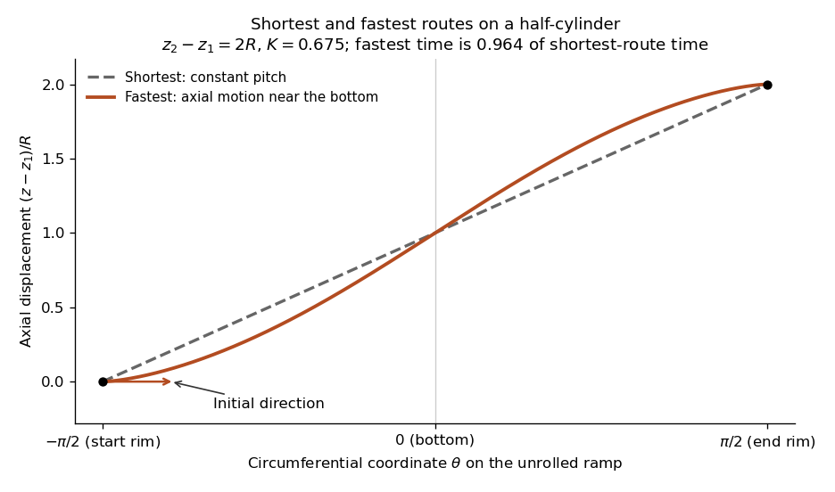

# Paper 1

↑ **Parent:** [2021](../2021.md)

[https://www.maths.cam.ac.uk/undergradnst/files/2021/papernst_ib_1_2021.pdf](https://www.maths.cam.ac.uk/undergradnst/files/2021/papernst_ib_1_2021.pdf)

**Table of contents**

- [1](#1)
  - [a](#1/a)
    - [Solution](#1/a/solution)
  - [b](#1/b)
    - [Solution](#1/b/solution)
  - [c](#1/c)
    - [Solution](#1/c/solution)
  - [d](#1/d)
    - [Solution](#1/d/solution)
  - [e](#1/e)
    - [Solution](#1/e/solution)
- [2](#2)
  - [a](#2/a)
    - [Solution](#2/a/solution)
  - [b](#2/b)
    - [Solution](#2/b/solution)
- [3](#3)
  - [a](#3/a)
    - [Solution](#3/a/solution)
  - [b](#3/b)
    - [i](#3/b/i)
      - [Solution](#3/b/i/solution)
    - [ii](#3/b/ii)
      - [Solution](#3/b/ii/solution)
  - [c](#3/c)
    - [Solution](#3/c/solution)
  - [d](#3/d)
    - [Solution](#3/d/solution)
- [4](#4)
  - [a](#4/a)
    - [Solution](#4/a/solution)
  - [b](#4/b)
    - [Solution](#4/b/solution)
  - [c](#4/c)
    - [Solution](#4/c/solution)
- [5](#5)
  - [a](#5/a)
    - [Solution](#5/a/solution)
  - [b](#5/b)
    - [Solution](#5/b/solution)
  - [c](#5/c)
    - [Solution](#5/c/solution)
  - [d](#5/d)
    - [i](#5/d/i)
      - [Solution](#5/d/i/solution)
    - [ii](#5/d/ii)
      - [Solution](#5/d/ii/solution)
    - [iii](#5/d/iii)
      - [Solution](#5/d/iii/solution)
  - [e](#5/e)
    - [Solution](#5/e/solution)
  - [f](#5/f)
    - [Solution](#5/f/solution)
  - [g](#5/g)
    - [Solution](#5/g/solution)
- [6](#6)
  - [a](#6/a)
    - [Solution](#6/a/solution)
  - [b](#6/b)
    - [Solution](#6/b/solution)
  - [c](#6/c)
    - [Solution](#6/c/solution)
  - [d](#6/d)
    - [Solution](#6/d/solution)
- [7](#7)
  - [a](#7/a)
    - [Solution](#7/a/solution)
  - [b](#7/b)
    - [Solution](#7/b/solution)
  - [c](#7/c)
    - [Solution](#7/c/solution)
  - [d](#7/d)
    - [i](#7/d/i)
      - [Solution](#7/d/i/solution)
    - [ii](#7/d/ii)
      - [Solution](#7/d/ii/solution)
- [8](#8)
  - [a](#8/a)
    - [Solution](#8/a/solution)
  - [b](#8/b)
    - [Solution](#8/b/solution)
  - [c](#8/c)
    - [Solution](#8/c/solution)
  - [d](#8/d)
    - [Solution](#8/d/solution)
  - [e](#8/e)
    - [Solution](#8/e/solution)
  - [f](#8/f)
    - [Solution](#8/f/solution)
- [9](#9)
  - [a](#9/a)
    - [Solution](#9/a/solution)
  - [b](#9/b)
    - [Solution](#9/b/solution)
  - [c](#9/c)
    - [i](#9/c/i)
      - [Solution](#9/c/i/solution)
    - [ii](#9/c/ii)
      - [Solution](#9/c/ii/solution)
- [10](#10)
  - [a](#10/a)
    - [Solution](#10/a/solution)
  - [b](#10/b)
    - [Solution](#10/b/solution)
  - [c](#10/c)
    - [Solution](#10/c/solution)
  - [d](#10/d)
    - [i](#10/d/i)
      - [Solution](#10/d/i/solution)
    - [ii](#10/d/ii)
      - [Solution](#10/d/ii/solution)

## 1

↑ **Parent:** [Paper 1](paper-1.md)

<h3 id="1/a">a</h3>

↑ **Parent:** [1](#1)

<h4 id="1/a/solution">Solution</h4>

↑ **Parent:** [A](#1/a)

In [Cartesian coordinates](../../linear-algebra.md#cartesian-coordinate-system), write $\partial_i=\partial/\partial x_i$ and use the [Levi-Civita symbol](../../multivariable-calculus.md#levi-civita-symbol). The [contraction of two Levi-Civita symbols](../../multivariable-calculus.md#contraction-of-two-levi-civita-symbols) gives

$$
\begin{aligned}
[\nabla\times(\nabla\times\mathbf A)]_i
&=\epsilon_{ijk}\epsilon_{klm}\partial_j\partial_l A_m\\
&=(\delta_{il}\delta_{jm}-\delta_{im}\delta_{jl})\partial_j\partial_l A_m\\
&=\partial_i\partial_jA_j-\partial_j\partial_jA_i.
\end{aligned}
$$

Here the [Kronecker delta](../../multilinear-algebra.md#kronecker-delta) selects the indicated indices, and continuous second [partial derivatives](../../multivariable-calculus.md#partial-derivative) allow their order to be interchanged. Identifying the [gradient](../../multivariable-calculus.md#gradient), [divergence](../../multivariable-calculus.md#divergence) and componentwise [Laplacian](../../multivariable-calculus.md#laplacian) proves the [curl of the curl identity](../../multivariable-calculus.md#curl-of-the-curl-identity):

$$
\boxed{\nabla\times(\nabla\times\mathbf A)=\nabla(\nabla\cdot\mathbf A)-\nabla^2\mathbf A.}
$$

<h3 id="1/b">b</h3>

↑ **Parent:** [1](#1)

<h4 id="1/b/solution">Solution</h4>

↑ **Parent:** [B](#1/b)

Let $V\subset\mathbb R^3$ be a bounded region with piecewise smooth closed boundary $\partial V$, let $\mathbf n$ be its outward [unit normal vector](../../differential-geometry.md#unit-normal), and let $\mathbf A$ be a continuously differentiable [vector field](../../multivariable-calculus.md#vector-field) on a neighbourhood of its closure. The [divergence theorem](../../multivariable-calculus.md#divergence-theorem) states

$$
\boxed{\int_V\nabla\cdot\mathbf A\,dV=\int_{\partial V}\mathbf A\cdot\mathbf n\,dS.}
$$

Here $dV$ is the positive volume measure, $dS$ is the surface area measure, $\nabla\cdot\mathbf A=\partial_xA_x+\partial_yA_y+\partial_zA_z$, and the right side is the total outward [flux](../../mathematical-physics.md#flux). All boundary components must be included, with their normals pointing away from $V$.

<h3 id="1/c">c</h3>

↑ **Parent:** [1](#1)

<h4 id="1/c/solution">Solution</h4>

↑ **Parent:** [C](#1/c)

Differentiate the position vector with respect to the three coordinates:

$$
\begin{aligned}
\mathbf r_\rho&=(\sinh\rho\cos u\cos v,\sinh\rho\cos u\sin v,\cosh\rho\sin u),\\
\mathbf r_u&=(-\cosh\rho\sin u\cos v,-\cosh\rho\sin u\sin v,\sinh\rho\cos u),\\
\mathbf r_v&=(-\cosh\rho\cos u\sin v,\cosh\rho\cos u\cos v,0).
\end{aligned}
$$

Their pairwise [dot products](../../inner-product.md#dot-product) vanish. For example, $\mathbf r_\rho\cdot\mathbf r_u=-\sinh\rho\cosh\rho\sin u\cos u+\sinh\rho\cosh\rho\sin u\cos u=0$. Thus these are [orthogonal coordinates](../../multivariable-calculus.md#orthogonal-coordinates) wherever the coordinate tangents are nonzero. Their [scale factors of orthogonal coordinates](../../multivariable-calculus.md#scale-factors-of-orthogonal-coordinates) are

$$
h_\rho^2=h_u^2=\sinh^2\rho\cos^2u+\cosh^2\rho\sin^2u=\sinh^2\rho+\sin^2u,\qquad h_v=\cosh\rho\cos u.
$$

The absolute [Jacobian determinant](../../multivariable-calculus.md#jacobian-determinant) is their product, giving

$$
\boxed{dV=\cosh\rho\cos u(\sinh^2\rho+\sin^2u)\,d\rho\,du\,dv.}
$$

The ordered coordinate system is left handed: $\mathbf r_\rho\cdot(\mathbf r_u\times\mathbf r_v)=-h_\rho h_uh_v$. The volume measure uses the absolute value. The axis and the focal circle contain coordinate degeneracies, as expected for [oblate spheroidal coordinates](../../general-relativity.md#oblate-spheroidal-coordinates). This is the [hyperbolic parametrization of oblate spheroidal coordinates](../../general-relativity.md#hyperbolic-parametrization-of-oblate-spheroidal-coordinates). The local TeX has an OCR substitution $\sinh^2u$ in the volume formula; the original PDF correctly prints $\sin^2u$.

<h3 id="1/d">d</h3>

↑ **Parent:** [1](#1)

<h4 id="1/d/solution">Solution</h4>

↑ **Parent:** [D](#1/d)

Put $s^2=x^2+y^2$. For $\rho>0$, elimination of $u$ gives

$$
\boxed{\frac{s^2}{\cosh^2\rho}+\frac{z^2}{\sinh^2\rho}=1.}
$$

These are [oblate spheroids](../../galaxy.md#oblate-spheroid) with equatorial radius $\cosh\rho$ and polar radius $\sinh\rho$, flattened along the $z$ axis. At $\rho=0$ the limiting surface is the disk $z=0$, $s\leq1$.

For $0<|u|<\pi/2$, elimination of $\rho$ instead gives

$$
\boxed{\frac{s^2}{\cos^2u}-\frac{z^2}{\sin^2u}=1.}
$$

These are [one-sheet hyperboloids](../../differential-geometry.md#one-sheet-hyperboloid) of revolution, restricted to their upper half for $u>0$ and lower half for $u<0$. The restriction matters because $\rho\geq0$. At $u=0$, the surface degenerates to the exterior equatorial plane $z=0$, $s\geq1$; at $u=\pm\pi/2$ it degenerates to the corresponding half of the $z$ axis.

Finally, fixed $v$ specifies a vertical half-plane through the $z$ axis, with horizontal direction $(\cos v,\sin v)$. The two values $v$ and $v+\pi$ together give a full plane. These surfaces form the mutually orthogonal families of the [hyperbolic parametrization of oblate spheroidal coordinates](../../general-relativity.md#hyperbolic-parametrization-of-oblate-spheroidal-coordinates).

<h3 id="1/e">e</h3>

↑ **Parent:** [1](#1)

<h4 id="1/e/solution">Solution</h4>

↑ **Parent:** [E](#1/e)

For a nondegenerate surface take $R>0$, and abbreviate $C=\cosh R$, $H=\sinh R$. Close the upper [oblate spheroid](../../galaxy.md#oblate-spheroid) by its equatorial disk $D$, obtaining a half-ellipsoid $V$. The [divergence](../../multivariable-calculus.md#divergence) is

$$
\nabla\cdot\mathbf A=y^2+2y.
$$

The integral of $2y$ vanishes by reflection symmetry. At height $z$, the cross-section is a disk of radius $q=C\sqrt{1-z^2/H^2}$. Using planar [polar coordinates](../../multivariable-calculus.md#polar-coordinates),

$$
\int_{x^2+y^2\leq q^2}y^2\,dx\,dy=\int_0^{2\pi}\sin^2\vartheta\,d\vartheta\int_0^q r^3dr=\frac{\pi q^4}{4}.
$$

Consequently

$$
\int_Vy^2\,dV=\frac{\pi C^4}{4}\int_0^H\left(1-\frac{z^2}{H^2}\right)^2dz=\frac{2\pi}{15}C^4H.
$$

The outward [unit normal vector](../../differential-geometry.md#unit-normal) on $D$ is $-\mathbf e_z$, so its [flux](../../mathematical-physics.md#flux) is $-2\pi C^2$. Applying the [divergence theorem](../../multivariable-calculus.md#divergence-theorem) to the closed surface and subtracting this disk contribution gives

$$
\boxed{\int_S\mathbf A\cdot\mathbf n\,dS=2\pi\cosh^2R+\frac{2\pi}{15}\cosh^4R\sinh R.}
$$

This is a special case of [polynomial flux through a half-ellipsoid](../../multivariable-calculus.md#polynomial-flux-through-a-half-ellipsoid). Including the closing disk is essential: the constant vertical component has zero [divergence](../../multivariable-calculus.md#divergence) but nonzero flux through the open curved surface.

## 2

↑ **Parent:** [Paper 1](paper-1.md)

<h3 id="2/a">a</h3>

↑ **Parent:** [2](#2)

<h4 id="2/a/solution">Solution</h4>

↑ **Parent:** [A](#2/a)

Seek a nonzero separated solution $\psi=T(t)R(r)\Theta(\theta)$. Substitution into the [heat equation](../../diffusion-equation.md#heat-equation) and division by the product gives

$$
\frac{T'}{\kappa T}=\frac{(r^2R')'}{r^2R}+\frac{1}{r^2\Theta\sin\theta}(\sin\theta\,\Theta')'.
$$

The left side depends only on time, so set it to $-k^2$. Multiplication by $r^2$ then separates the angular dependence, with separation constant $\ell(\ell+1)$. The three [ordinary differential equations](../../differential-equation.md#ordinary-differential-equation) are

$$
\boxed{T'+\kappa k^2T=0,}
$$

$$
\boxed{\frac1{\sin\theta}(\sin\theta\,\Theta')'+\ell(\ell+1)\Theta=0,}
$$

$$
\boxed{(r^2R')'+[k^2r^2-\ell(\ell+1)]R=0.}
$$

The temporal solution is $T=T_0e^{-\kappa k^2t}$. With $q=\cos\theta$, the angular equation is the [Legendre differential equation](../../linear-ordinary-differential-equation.md#legendre-differential-equation); regularity at both angular endpoints selects $\ell=0,1,2,\ldots$ and $\Theta\propto P_\ell(q)$, the [Legendre polynomial](../../linear-ordinary-differential-equation.md#legendre-polynomial). The radial equation has the [Spherical Bessel functions](../../bessel-function.md#spherical-bessel-function) $j_\ell(kr)$ and $y_\ell(kr)$ for $k>0$. Regularity at $r=0$, if imposed, excludes the singular second solution. For $k=0$ the radial powers are $r^\ell$ and $r^{-\ell-1}$. Without specified radial [boundary conditions](../../differential-equation.md#boundary-condition), no discrete set of $k$ is selected; $-k^2$ is a convention for the temporal separation constant.

<h3 id="2/b">b</h3>

↑ **Parent:** [2](#2)

<h4 id="2/b/solution">Solution</h4>

↑ **Parent:** [B](#2/b)

For spherical symmetry the angular mode is $\ell=0$. Put $u(t,r)=r\psi(t,r)$. Direct differentiation gives

$$
\frac1{r^2}(r^2\psi_r)_r=\frac{u_{rr}}r,\qquad\psi_t=\frac{u_t}r,
$$

so the [radial heat equation in three dimensions](../../diffusion-equation.md#radial-heat-equation-in-three-dimensions) becomes the ordinary one-dimensional [heat equation](../../diffusion-equation.md#heat-equation) $u_t=\kappa u_{rr}$. Since $r_\pm>0$, the zero endpoint temperatures become $u(t,r_\pm)=0$.

Write $L=r_+-r_-$. The two initial sine modes already satisfy these [Dirichlet boundary conditions](../../differential-equation.md#dirichlet-boundary-condition); their squared [wave numbers](../../wave-equation.md#wavenumber) are $(\pi/L)^2$ and $(2\pi/L)^2$. Each therefore evolves independently with its corresponding [exponential decay](../../analysis.md#exponential-decay). Dividing back by $r$ gives

$$
\boxed{\psi(t,r)=\frac1r\left[e^{-\kappa\pi^2t/L^2}\sin\frac{\pi(r_+-r)}L+e^{-4\kappa\pi^2t/L^2}\sin\frac{2\pi(r_+-r)}L\right].}
$$

At $t=0$ the initial profile is recovered, and each sine is zero at both endpoints. The first mode decays four times more slowly in its exponential rate than the second. This is the two-mode instance of the [spherical-shell heat equation via radial rescaling](../../diffusion-equation.md#spherical-shell-heat-equation-via-radial-rescaling); uniqueness follows, for example, by applying the [heat equation energy identity](../../diffusion-equation.md#heat-equation-energy-identity) to the difference of two solutions.

## 3

↑ **Parent:** [Paper 1](paper-1.md)

<h3 id="3/a">a</h3>

↑ **Parent:** [3](#3)

<h4 id="3/a/solution">Solution</h4>

↑ **Parent:** [A](#3/a)

For a fixed source point $\xi\in(a,b)$, the [Green function](../../green-s-function.md) is defined by

$$
\boxed{L_xG(x;\xi)=\delta(x-\xi),\qquad G(a;\xi)=G(b;\xi)=0,}
$$

where $\delta$ is the [Dirac delta distribution](../../distribution-theory.md#dirac-delta-function) and the operator acts on $x$. The corresponding solution is

$$
\boxed{y(x)=\int_a^bG(x;\xi)f(\xi)\,d\xi.}
$$

Applying $L_x$ under the integral gives $f(x)$ by the defining delta identity, while the endpoint values vanish. With the stated continuous coefficients, one may define the normalized distributional equation $G_{xx}+(\beta/\alpha)G_x+(\gamma/\alpha)G=\delta(x-\xi)/\alpha(\xi)$; this avoids multiplying a general distributional second [derivative](../../calculus.md#derivative) by a merely continuous coefficient.

Existence of this inverse [Green function](../../green-s-function.md) additionally requires that the homogeneous two-point [boundary value problem](../../boundary-value-problem.md) have only the zero solution. The assumptions printed in the question alone do not ensure this: $y''+y$ on $[0,\pi]$ has the nonzero zero-endpoint solution $\sin x$. At such resonance there are [solvability conditions](../../linear-operator-theory.md#solvability-condition) and no ordinary inverse kernel for arbitrary $f$. The construction below is nonresonant.

<h3 id="3/b">b</h3>

↑ **Parent:** [3](#3)

<h4 id="3/b/i">i</h4>

↑ **Parent:** [B](#3/b)

<h5 id="3/b/i/solution">Solution</h5>

↑ **Parent:** [I](#3/b/i)

Suppose the piecewise smooth [Green function](../../green-s-function.md) has jump $[G]_\xi=G(\xi^+;\xi)-G(\xi^-;\xi)$. Its first distributional [derivative](../../calculus.md#derivative) then contains $[G]_\xi\delta(x-\xi)$, and its second contains $[G]_\xi\delta'(x-\xi)$. In the normalized equation from part (a), the first-derivative term can supply a delta but no delta [derivative](../../calculus.md#derivative). The right side has only a delta. Thus its delta-derivative coefficient must vanish:

$$
\boxed{[G]_\xi=0.}
$$

Equivalently, the two homogeneous branches must join continuously. This is the continuity part of the [jump condition](../../differential-equation.md#jump-condition) for a second-order [Green function](../../green-s-function.md).

<h4 id="3/b/ii">ii</h4>

↑ **Parent:** [B](#3/b)

<h5 id="3/b/ii/solution">Solution</h5>

↑ **Parent:** [Ii](#3/b/ii)

Now $G$ is continuous, so $G_x$ has no delta contribution. Integrate its normalized differential equation over $(\xi-\epsilon,\xi+\epsilon)$. The bounded lower-order terms have integrals tending to zero, while the integral of $G_{xx}$ is the difference of the two one-sided first [derivatives](../../calculus.md#derivative). Hence the [jump condition](../../differential-equation.md#jump-condition) is

$$
\boxed{G_x(\xi^+;\xi)-G_x(\xi^-;\xi)=\frac1{\alpha(\xi)}.}
$$

The denominator is evaluated at the source point; it is not a variable $x$ left over after taking the limits. The positivity or negativity of this jump follows the sign convention used for the leading coefficient of $L$.

<h3 id="3/c">c</h3>

↑ **Parent:** [3](#3)

<h4 id="3/c/solution">Solution</h4>

↑ **Parent:** [C](#3/c)

The homogeneous [characteristic equation](../../linear-ordinary-differential-equation.md#characteristic-equation-of-a-constant-coefficient-differential-equation) is $r^2-2r+2=0$, with roots $1\pm i$. Choose the endpoint-adapted homogeneous solutions

$$
u(x)=e^x\sin x,\qquad v(x)=e^x\cos x,
$$

so that $u(0)=0$ and $v(\pi/2)=0$. Their [Wronskian](../../linear-ordinary-differential-equation.md#wronskian) is

$$
W(x)=u(x)v'(x)-u'(x)v(x)=-e^{2x},
$$

which never vanishes. A continuous [Green function](../../green-s-function.md) with the required endpoints has the form $C(\xi)u(x_<)v(x_>)$, where $x_<=\min(x,\xi)$ and $x_>=\max(x,\xi)$. Its [derivative](../../calculus.md#derivative) jump is $C(\xi)W(\xi)$. Because the leading coefficient is one, part (b) requires this to equal one. Therefore

$$
\boxed{G(x;\xi)=-e^{x-\xi}\sin x_<\cos x_>.}
$$

In particular, the branches are $-e^{x-\xi}\sin x\cos\xi$ for $x\leq\xi$ and $-e^{x-\xi}\sin\xi\cos x$ for $x\geq\xi$. This is the [Dirichlet Green function for a conjugated harmonic oscillator](../../green-s-function.md#dirichlet-green-function-for-a-conjugated-harmonic-oscillator) with interval length $\pi/2$, drift parameter one and oscillator wave number one.

<h3 id="3/d">d</h3>

↑ **Parent:** [3](#3)

<h4 id="3/d/solution">Solution</h4>

↑ **Parent:** [D](#3/d)

Insert the source into the [Green-function representation](../../green-s-function.md#green-function-representation) and split the integral at its source discontinuity in [derivative](../../calculus.md#derivative):

$$
\begin{aligned}
y(x)&=-e^x\cos x\int_0^x\sin\xi\,d\xi-e^x\sin x\int_x^{\pi/2}\cos\xi\,d\xi\\
&=-e^x[\cos x(1-\cos x)+\sin x(1-\sin x)].
\end{aligned}
$$

Using $\sin^2x+\cos^2x=1$, the answer is

$$
\boxed{y(x)=e^x(1-\cos x-\sin x).}
$$

Both endpoint values are zero. As a direct check, conjugating by $e^x$ sends $y''-2y'+2y$ to $e^x(v''+v)$, and $v=1-\cos x-\sin x$ gives $v''+v=1$. Thus the differential equation and both [boundary conditions](../../differential-equation.md#boundary-condition) are satisfied.

## 4

↑ **Parent:** [Paper 1](paper-1.md)

<h3 id="4/a">a</h3>

↑ **Parent:** [4](#4)

<h4 id="4/a/solution">Solution</h4>

↑ **Parent:** [A](#4/a)

First take a [Schwartz function](../../fourier-analysis.md#schwartz-function), so that [Fourier inversion](../../fourier-analysis.md#fourier-inversion-theorem) and the exchange of integrals are justified. Inserting the inverse transform of the [complex conjugate](../../complex-analysis.md#complex-conjugate) gives

$$
\begin{aligned}
\int_{\mathbb R}|f(x)|^2dx
&=\frac1{2\pi}\int_{\mathbb R}\!\int_{\mathbb R} f(x)\overline{\widetilde f(k)}e^{-ikx}\,dk\,dx\\
&=\frac1{2\pi}\int_{\mathbb R}\overline{\widetilde f(k)}\left[\int_{\mathbb R}f(x)e^{-ikx}dx\right]dk\\
&=\boxed{\frac1{2\pi}\int_{\mathbb R}|\widetilde f(k)|^2dk.}
\end{aligned}
$$

For $f\in L^1\cap L^2$, approximate it by [Schwartz functions](../../fourier-analysis.md#schwartz-function) in both [norms](../../normed-vector-space.md#norm). The identity just proved makes their transforms a [Cauchy sequence](../../sequence-and-series.md#cauchy-sequence) in [L2 space](../../measure-theory.md#l2-space-is-a-hilbert-space), while convergence in [L1 space](../../measure-theory.md#l1-space) makes the transforms converge uniformly to the defining transform of $f$. Thus the two transform limits agree, and passing to the $L^2$ [norms](../../normed-vector-space.md#norm) proves the finite [Parseval identity](../../fourier-analysis.md#parseval-identity). This is the normalization of the [Plancherel theorem](../../fourier-analysis.md#plancherel-theorem) appropriate to the paper.

There is a qualification to the printed hypothesis: absolute integrability alone does not guarantee a finite square integral. For instance $f(x)=x^{-3/4}$ on $(0,1)$ and zero elsewhere belongs to $L^1$ but not $L^2$. For an $L^1$ function of this kind the transform is not in $L^2$ either, by [L2 density from a square-integrable Fourier transform](../../fourier-analysis.md#l2-density-from-a-square-integrable-fourier-transform), so both sides are infinite if the identity is interpreted in that extended sense. The finite equality requires square integrability as well.

<h3 id="4/b">b</h3>

↑ **Parent:** [4](#4)

<h4 id="4/b/solution">Solution</h4>

↑ **Parent:** [B](#4/b)

Use the [trigonometric identity](../../geometry-and-topology.md#trigonometric-identity) $2\cos^2(ax)=1+\cos(2ax)$ and express the cosine as a sum of two [complex exponentials](../../calculus.md#complex-exponential-function). The [Fourier transform](../../fourier-transform.md) of each exponential is a shifted [Dirac delta distribution](../../distribution-theory.md#dirac-delta-function):

$$
\mathcal F[1]=2\pi\delta(k),\qquad\mathcal F[e^{\pm2iax}]=2\pi\delta(k\mp2a).
$$

By [linearity](../../vector-space.md#linearity),

$$
\boxed{\widetilde f(k)=2\pi\delta(k)+\pi\delta(k-2a)+\pi\delta(k+2a).}
$$

The original function does not decay and is not absolutely integrable on the real line, so this answer is a [tempered distribution](../../fourier-analysis.md#tempered-distribution), rather than an ordinary convergent Fourier integral. Its three lines represent the constant part and the two opposite spatial [frequencies](../../wave.md#frequency).

<h3 id="4/c">c</h3>

↑ **Parent:** [4](#4)

<h4 id="4/c/solution">Solution</h4>

↑ **Parent:** [C](#4/c)

The input is even, so its [Fourier transform](../../fourier-transform.md) is real and even. Decomposing the cosine into [complex exponentials](../../calculus.md#complex-exponential-function) and integrating over its support gives

$$
\widetilde f(k)=\frac{\sin[(k-1)a]}{k-1}+\frac{\sin[(k+1)a]}{k+1}.
$$

Combining the fractions and using the angle addition formula yields

$$
\boxed{\widetilde f(k)=\frac{2k\cos a\sin(ak)-2\sin a\cos(ak)}{k^2-1},\qquad\lambda=2,\quad\mu=-2.}
$$

The apparent [poles](../../isolated-singularity.md#pole) at $k=\pm1$ are [removable singularities](../../isolated-singularity.md#removable-singularity); either the integral or the sine-quotient limit gives $\widetilde f(\pm1)=a+\sin(2a)/2$.

If $\cos a\ne0$, expansion of the denominator gives

$$
\widetilde f(k)=\frac{2\cos a\sin(ak)}k-\frac{2\sin a\cos(ak)}{k^2}+O(|k|^{-3}).
$$

The oscillatory envelope is therefore $O(|k|^{-1})$. At $a=\pi/2+n\pi$, $n=0,1,2,\ldots$, the endpoint values vanish and the first term cancels:

$$
\boxed{\cos a=0:\quad\widetilde f(k)=-\frac{2\sin a\cos(ak)}{k^2}+O(|k|^{-4}).}
$$

This gives an $O(|k|^{-2})$ envelope. At general $a$ the truncation creates jumps in the function; at these special values it leaves the function continuous but creates jumps in its first [derivative](../../calculus.md#derivative). Each additional degree of endpoint smoothness gives another inverse power, as explained by [Fourier decay from a derivative jump](../../fourier-transform.md#fourier-decay-from-a-derivative-jump). The exact example is the [Fourier transform of a truncated cosine](../../fourier-transform.md#fourier-transform-of-a-truncated-cosine); isolated zeros of its oscillatory factors do not change the envelope order.

## 5

↑ **Parent:** [Paper 1](paper-1.md)

<h3 id="5/a">a</h3>

↑ **Parent:** [5](#5)

<h4 id="5/a/solution">Solution</h4>

↑ **Parent:** [A](#5/a)

The columns of $R_z$ are an [orthonormal basis](../../inner-product.md#orthonormal-basis), since $\cos^2\phi+\sin^2\phi=1$ and the first two columns have zero [dot product](../../inner-product.md#dot-product). Thus $R_z^TR_z=I$: it is an [orthogonal matrix](../../linear-algebra.md#orthogonal-matrix). Consequently

$$
|\mathbf v'|^2=(R_z\mathbf v)^T(R_z\mathbf v)=\mathbf v^TR_z^TR_z\mathbf v=\mathbf v^T\mathbf v,
$$

and hence $\boxed{|\mathbf v'|=|\mathbf v|}$. This is the preservation of the [Euclidean norm](../../normed-vector-space.md#euclidean-norm) by a [rotation matrix](../../linear-algebra.md#rotation-matrix).

<h3 id="5/b">b</h3>

↑ **Parent:** [5](#5)

<h4 id="5/b/solution">Solution</h4>

↑ **Parent:** [B](#5/b)

The $z$ direction is fixed, giving the [eigenvalue](../../linear-operator-theory.md#eigenvalue) one. The planar block has [characteristic polynomial](../../linear-operator-theory.md#characteristic-polynomial)

$$
(\cos\phi-\lambda)^2+\sin^2\phi=\lambda^2-2\lambda\cos\phi+1.
$$

Thus the full list of [eigenvalues](../../linear-operator-theory.md#eigenvalue) is

$$
\boxed{1,\quad e^{i\phi},\quad e^{-i\phi}.}
$$

The last two are real precisely when $\sin\phi=0$, so all three are real exactly for $\boxed{\phi\in\pi\mathbb Z}$. At even multiples of $\pi$ the matrix is the identity and every vector is fixed. At odd multiples it is a half-turn: the axial [eigenvalue](../../linear-operator-theory.md#eigenvalue) remains $+1$, while the whole perpendicular plane has [eigenvalue](../../linear-operator-theory.md#eigenvalue) $-1$.

For other angles, the only real [eigenvector](../../linear-operator-theory.md#eigenvector) direction is the rotation axis; the perpendicular plane is rotated rather than preserving an individual real direction. Its complex [eigenvectors](../../linear-operator-theory.md#eigenvector) can be taken as $(1,-i,0)^T$ and $(1,i,0)^T$ for $e^{i\phi}$ and $e^{-i\phi}$, respectively. These represent the two [complex conjugate](../../complex-analysis.md#complex-conjugate) planar eigenvalues.

<h3 id="5/c">c</h3>

↑ **Parent:** [5](#5)

<h4 id="5/c/solution">Solution</h4>

↑ **Parent:** [C](#5/c)

With the same right-handed active [rotation](../../riemannian-geometry.md#rotation-mathematics) convention as $R_z$, the $y$ direction is fixed, $\mathbf e_z$ rotates towards $\mathbf e_x$, and $\mathbf e_x$ towards $-\mathbf e_z$. Therefore

$$
\boxed{R_y(\theta)=\begin{pmatrix}\cos\theta&0&\sin\theta\\0&1&0\\-\sin\theta&0&\cos\theta\end{pmatrix}.}
$$

Its columns give the images of the three Cartesian unit vectors, which also makes the signs of this [rotation matrix](../../linear-algebra.md#rotation-matrix) explicit.

<h3 id="5/d">d</h3>

↑ **Parent:** [5](#5)

<h4 id="5/d/i">i</h4>

↑ **Parent:** [D](#5/d)

<h5 id="5/d/i/solution">Solution</h5>

↑ **Parent:** [I](#5/d/i)

A product of [orthogonal matrices](../../linear-algebra.md#orthogonal-matrix) is orthogonal. In fact,

$$
R_1^TR_1=R_y^TR_z^TR_zR_y=R_y^TR_y=I.
$$

Thus $\boxed{R_1\text{ is orthogonal for every }\theta,\phi.}$ Its [determinant](../../multilinear-algebra.md#determinant) is also one, since each factor has [determinant](../../multilinear-algebra.md#determinant) one, so it remains a proper [rotation matrix](../../linear-algebra.md#rotation-matrix).

<h4 id="5/d/ii">ii</h4>

↑ **Parent:** [D](#5/d)

<h5 id="5/d/ii/solution">Solution</h5>

↑ **Parent:** [Ii](#5/d/ii)

Both factors and their product are real, so the [Hermitian conjugate](../../hilbert-space.md#hermitian-conjugation) equals the [transpose](../../vector-space.md#transpose). Part (i) therefore gives

$$
R_1^\dagger R_1=R_1^TR_1=I.
$$

Hence $\boxed{R_1\text{ is unitary for every }\theta,\phi.}$ A real [orthogonal matrix](../../linear-algebra.md#orthogonal-matrix) is always a [unitary matrix](../../linear-operator-theory.md#unitary-matrix).

<h4 id="5/d/iii">iii</h4>

↑ **Parent:** [D](#5/d)

<h5 id="5/d/iii/solution">Solution</h5>

↑ **Parent:** [Iii](#5/d/iii)

A real [matrix](../../vector-space.md#matrix) is a [Hermitian matrix](../../hilbert-space.md#hermitian-operator) exactly when it is a [symmetric matrix](../../linear-algebra.md#symmetric-matrix). Since $R_1$ is orthogonal, this is equivalent to $R_1=R_1^{-1}$, or $R_1^2=I$. A generic rotation does not satisfy this; for example $\theta=0$, $\phi=\pi/2$ gives a nonsymmetric quarter-turn. Thus $\boxed{R_1\text{ is not Hermitian in general.}}$

The exceptions are the identity and half-turns, as characterized by [real rotation matrices that are Hermitian](../../linear-algebra.md#real-rotation-matrices-that-are-hermitian). For this product, a half-turn occurs when either $\theta$ or $\phi$ is an odd multiple of $\pi$; the identity occurs when both are even multiples. For example, the half-turn condition follows from $\operatorname{tr}R_1=(1+\cos\theta)(1+\cos\phi)-1=-1$.

<h3 id="5/e">e</h3>

↑ **Parent:** [5](#5)

<h4 id="5/e/solution">Solution</h4>

↑ **Parent:** [E](#5/e)

The [Hermitian conjugate](../../hilbert-space.md#hermitian-conjugation) of a real matrix is its [transpose](../../vector-space.md#transpose), so

$$
M^\dagger=(R_1-R_1^T)^T=R_1^T-R_1=-M.
$$

Therefore $\boxed{M\text{ is anti-Hermitian for all }\theta,\phi.}$ It is also a real [skew-symmetric matrix](../../linear-algebra.md#skew-symmetric-matrix). It is Hermitian as well only in the exceptional case $M=0$, precisely when $R_1$ is symmetric. This includes the identity and half-turn cases from part (d), so the zero-matrix overlap should not be excluded.

<h3 id="5/f">f</h3>

↑ **Parent:** [5](#5)

<h4 id="5/f/solution">Solution</h4>

↑ **Parent:** [F](#5/f)

Applying the rightmost [rotation matrix](../../linear-algebra.md#rotation-matrix) first gives

$$
R_1\mathbf e_z=(\sin\theta\cos\phi,\sin\theta\sin\phi,\cos\theta)^T.
$$

Equality with $\mathbf e_y$ requires $\cos\theta=0$, so $\theta=\pi/2$ in the specified range. Then $\sin\phi=1$ and $\cos\phi=0$ give

$$
\boxed{\theta=\frac\pi2,\qquad\phi=\frac\pi2.}
$$

In the reverse order, $R_z$ first fixes $\mathbf e_z$, so $R_2\mathbf e_z=R_y(\pi/2)\mathbf e_z=\mathbf e_x$. Therefore $\boxed{R_2\mathbf v\ne\mathbf v'}$. This explicitly demonstrates that [rotations](../../riemannian-geometry.md#rotation-mathematics) about different axes do not generally commute.

<h3 id="5/g">g</h3>

↑ **Parent:** [5](#5)

<h4 id="5/g/solution">Solution</h4>

↑ **Parent:** [G](#5/g)

At the angles in part (f),

$$
R_1=\begin{pmatrix}0&-1&0\\0&0&1\\-1&0&0\end{pmatrix}.
$$

Let the two [diagonal matrices](../../linear-algebra.md#diagonal-matrix) be $D=\operatorname{diag}(d_1,d_2,d_3)$ and $D'=\operatorname{diag}(e_1,e_2,e_3)$. Multiplication gives

$$
D'R_1D=\begin{pmatrix}0&-e_1d_2&0\\0&0&e_2d_3\\-e_3d_1&0&0\end{pmatrix}.
$$

The vector condition is exactly $ce_2d_3=b$. For $c\ne0$, the general form is therefore

$$
\boxed{\widetilde R=\begin{pmatrix}0&p&0\\0&0&b/c\\q&0&0\end{pmatrix},\qquad p,q\in\mathbb R.}
$$

Every pair $p,q$ is attainable, for example with $D=I$ and $D'=\operatorname{diag}(-p,b/c,-q)$. The transformation need not be orthogonal or invertible; the question asks only for diagonal rescalings with this one vector image. If $c=0$ and $b\ne0$, no linear map can satisfy the condition. If $c=b=0$, the $(2,3)$ entry is arbitrary as well.

## 6

↑ **Parent:** [Paper 1](paper-1.md)

<h3 id="6/a">a</h3>

↑ **Parent:** [6](#6)

<h4 id="6/a/solution">Solution</h4>

↑ **Parent:** [A](#6/a)

Let $A=A^\dagger$ be a [Hermitian matrix](../../hilbert-space.md#hermitian-operator) and $Av=\lambda v$ with $v\ne0$. The scalar $v^\dagger Av$ equals its own [complex conjugate](../../complex-analysis.md#complex-conjugate), because

$$
(v^\dagger Av)^*=v^\dagger A^\dagger v=v^\dagger Av.
$$

Since $v^\dagger Av=\lambda v^\dagger v$ and the squared [norm](../../normed-vector-space.md#norm) $v^\dagger v$ is positive, $\boxed{\lambda\in\mathbb R}$.

Now take $Au=\lambda u$ and $Av=\mu v$. The [inner product](../../inner-product.md) satisfies

$$
u^\dagger Av=\mu u^\dagger v,\qquad u^\dagger Av=(Au)^\dagger v=\overline\lambda\,u^\dagger v=\lambda u^\dagger v.
$$

Subtracting gives $(\mu-\lambda)u^\dagger v=0$. Thus distinct [eigenvalues](../../linear-operator-theory.md#eigenvalue) imply $\boxed{u^\dagger v=0}$, proving [orthogonality](../../inner-product.md#orthogonal-vectors) of the corresponding [eigenvectors](../../linear-operator-theory.md#eigenvector). Within a degenerate [eigenspace](../../linear-operator-theory.md#eigenspace), an orthonormal basis may be chosen, but arbitrary distinct vectors in that same [eigenspace](../../linear-operator-theory.md#eigenspace) need not be orthogonal.

<h3 id="6/b">b</h3>

↑ **Parent:** [6](#6)

<h4 id="6/b/solution">Solution</h4>

↑ **Parent:** [B](#6/b)

A complex square matrix $U$ is a [unitary matrix](../../linear-operator-theory.md#unitary-matrix) if $\boxed{U^\dagger U=UU^\dagger=I}$. Equivalently, it preserves the complex [inner product](../../inner-product.md) and hence the [norm](../../normed-vector-space.md#norm). If $Uv=\mu v$ with $v\ne0$, then

$$
v^\dagger v=(Uv)^\dagger(Uv)=|\mu|^2v^\dagger v.
$$

Division by the positive squared [norm](../../normed-vector-space.md#norm) gives $\boxed{|\mu|=1}$. Thus every [eigenvalue](../../linear-operator-theory.md#eigenvalue) lies on the [unit circle](../../complex-analysis.md#complex-unit-circle).

<h3 id="6/c">c</h3>

↑ **Parent:** [6](#6)

<h4 id="6/c/solution">Solution</h4>

↑ **Parent:** [C](#6/c)

Part (a) makes each $\lambda_j$ real. In the [eigenvector](../../linear-operator-theory.md#eigenvector) basis,

$$
(A+iaI)e_j=(\lambda_j+ia)e_j,
$$

and $|\lambda_j+ia|^2=\lambda_j^2+a^2>0$. Hence $\boxed{A+iaI\text{ is invertible}}$.

All factors that are rational functions of $A$ commute. Taking the [Hermitian conjugate](../../hilbert-space.md#hermitian-conjugation) reverses product order and gives

$$
V^\dagger=(A-iaI)^{-1}(A+iaI).
$$

Therefore

$$
V^\dagger V=(A-iaI)^{-1}(A+iaI)(A-iaI)(A+iaI)^{-1}=I,
$$

so $\boxed{V\text{ is unitary}}$. This is a [Cayley transform of a Hermitian matrix](../../linear-operator-theory.md#cayley-transform-of-a-hermitian-matrix), with scale $a$ and the convention that an infinite real eigenvalue maps to one.

Applying it to each [eigenvector](../../linear-operator-theory.md#eigenvector) yields

$$
\boxed{Ve_j=\nu_je_j,\qquad\nu_j=\frac{\lambda_j-ia}{\lambda_j+ia}.}
$$

The [eigenvectors](../../linear-operator-theory.md#eigenvector) are unchanged, and $|\nu_j|=1$ because numerator and denominator are [complex conjugates](../../complex-analysis.md#complex-conjugate). No $\nu_j$ equals one when $a>0$. The scalar map is injective on real $\lambda$, so the [eigenspaces](../../linear-operator-theory.md#eigenspace), including any degeneracies, are preserved exactly.

<h3 id="6/d">d</h3>

↑ **Parent:** [6](#6)

<h4 id="6/d/solution">Solution</h4>

↑ **Parent:** [D](#6/d)

Use $U^\dagger=U^{-1}$ and take the [Hermitian conjugate](../../hilbert-space.md#hermitian-conjugation) in the reverse product order:

$$
B^\dagger=-i(I-U^{-1})^{-1}(I+U^{-1}).
$$

The factorization $I-U^{-1}=-U^{-1}(I-U)$ gives $(I-U^{-1})^{-1}=-(I-U)^{-1}U$, while $I+U^{-1}=U^{-1}(I+U)$. Consequently

$$
B^\dagger=i(I-U)^{-1}(I+U)=i(I+U)(I-U)^{-1}=\boxed{B}.
$$

The last equality uses the fact that $I+U$ commutes with $I-U$ and its inverse. Thus $B$ is a [Hermitian matrix](../../hilbert-space.md#hermitian-operator). The exclusion of the [eigenvalue](../../linear-operator-theory.md#eigenvalue) one is essential to define the inverse. Spectrally, an [eigenvalue](../../linear-operator-theory.md#eigenvalue) $e^{i\vartheta}\ne1$ is sent to $-\cot(\vartheta/2)$, a real number. This is the [inverse Cayley transform of a unitary matrix without eigenvalue one](../../linear-operator-theory.md#inverse-cayley-transform-of-a-unitary-matrix-without-eigenvalue-one).

## 7

↑ **Parent:** [Paper 1](paper-1.md)

<h3 id="7/a">a</h3>

↑ **Parent:** [7](#7)

<h4 id="7/a/solution">Solution</h4>

↑ **Parent:** [A](#7/a)

For a [holomorphic function](../../holomorphic-function.md) with $z=re^{i\theta}$, the [chain rule](../../calculus.md#chain-rule) gives

$$
f_r=e^{i\theta}f'(z),\qquad f_\theta=ire^{i\theta}f'(z)=irf_r.
$$

Writing $f=u+iv$ and equating [real parts](../../complex-analysis.md#real-part) and [imaginary parts](../../complex-analysis.md#imaginary-part),

$$
u_\theta=-rv_r,\qquad v_\theta=ru_r.
$$

For $r>0$, division by $r$ gives the [Cauchy-Riemann equations](../../analysis.md#cauchy-riemann-equations) in [polar coordinates](../../multivariable-calculus.md#polar-coordinates):

$$
\boxed{\frac1r u_\theta=-v_r,\qquad u_r=\frac1r v_\theta.}
$$

The restriction $r>0$ reflects the coordinate singularity at the origin; the Cartesian equations have no such restriction.

<h3 id="7/b">b</h3>

↑ **Parent:** [7](#7)

<h4 id="7/b/solution">Solution</h4>

↑ **Parent:** [B](#7/b)

Insert the specified real part into the polar [Cauchy-Riemann equations](../../analysis.md#cauchy-riemann-equations). The first gives $v_r=nr^{n-1}\sin(n\theta)$, and integration with respect to $r$ gives

$$
v(r,\theta)=r^n\sin(n\theta)+C(\theta).
$$

The second equation then requires $v_\theta=nr^n\cos(n\theta)$, so $C'(\theta)=0$. The remaining imaginary additive constant is fixed by $f(0)=0$. Thus

$$
\boxed{v(r,\theta)=r^n\sin(n\theta),\qquad f(z)=r^ne^{in\theta}=z^n.}
$$

The resulting [polynomial](../../polynomial.md) is holomorphic at the origin too, consistently extending the calculation made in polar coordinates with $r>0$.

<h3 id="7/c">c</h3>

↑ **Parent:** [7](#7)

<h4 id="7/c/solution">Solution</h4>

↑ **Parent:** [C](#7/c)

Using the exponential form of the complex cosine, $\cos z=0$ is equivalent to $e^{2iz}=-1$. Thus the [zeros](../../polynomial.md#zero-of-a-function) are exactly

$$
\boxed{z_n=\frac\pi2+n\pi,\qquad n\in\mathbb Z.}
$$

At each point $\cos'(z_n)=-\sin z_n\ne0$, so the cosine has a simple zero. Cubing it gives

$$
\cos^3z=[-\sin z_n]^3(z-z_n)^3+O((z-z_n)^4).
$$

The [order of a zero of a holomorphic function](../../holomorphic-function.md#order-of-a-zero-of-a-holomorphic-function) is therefore three at every zero. There are no finite singularities because this is an [entire function](../../holomorphic-function.md#entire-function).

To classify infinity, examine $\cos^3(1/w)$ at $w=0$. The identity $\cos^3z=(3\cos z+\cos3z)/4$ shows that its [Laurent series](../../analysis.md#laurent-series) contains the nonzero negative-power coefficients

$$
\frac{(-1)^m(3+3^{2m})}{4(2m)!}\,w^{-2m},\qquad m\geq1.
$$

There are infinitely many terms in the [principal part](../../complex-geometry.md#principal-part-of-a-meromorphic-function), the criterion for an [essential singularity](../../isolated-singularity.md#essential-singularity). Therefore $\boxed{\infty\text{ is an essential singularity, not a pole.}}$ This is also the general characterization of a nonpolynomial [entire function](../../holomorphic-function.md#entire-function) at infinity.

<h3 id="7/d">d</h3>

↑ **Parent:** [7](#7)

<h4 id="7/d/i">i</h4>

↑ **Parent:** [D](#7/d)

<h5 id="7/d/i/solution">Solution</h5>

↑ **Parent:** [I](#7/d/i)

If $z_0\ne0$, factor out $z_0$ and use the [geometric series](../../sequence-and-series.md#geometric-series):

$$
\frac1{z_0+z}=\frac1{z_0}\frac1{1+z/z_0}=\sum_{n=0}^\infty\frac{(-1)^n}{z_0^{n+1}}z^n,\qquad |z|<|z_0|.
$$

Thus

$$
\boxed{a_n=\frac{(-1)^n}{z_0^{n+1}},\qquad R=|z_0|.}
$$

The [radius of convergence](../../sequence-and-series.md#radius-of-convergence) is the distance to the nearest singularity, the [simple pole](../../isolated-singularity.md#simple-pole) at $z=-z_0$. The case $z_0=0$ must be treated separately: the function is $1/z$, has no [Taylor series](../../calculus.md#taylor-series) about zero and is already its own [Laurent series](../../analysis.md#laurent-series) on $0<|z|<\infty$.

<h4 id="7/d/ii">ii</h4>

↑ **Parent:** [D](#7/d)

<h5 id="7/d/ii/solution">Solution</h5>

↑ **Parent:** [Ii](#7/d/ii)

For $|z|<1$, multiply the absolutely convergent [Taylor series](../../calculus.md#taylor-series) of the sine by the [geometric series](../../sequence-and-series.md#geometric-series):

$$
\frac{\sin z}{1-z^2}=\left[\sum_{j=0}^\infty\frac{(-1)^jz^{2j+1}}{(2j+1)!}\right]\left[\sum_{k=0}^\infty z^{2k}\right].
$$

The product is odd, so all even coefficients vanish. Collecting the coefficient of $z^{2m+1}$ gives

$$
\boxed{a_{2m}=0,\qquad a_{2m+1}=\sum_{j=0}^m\frac{(-1)^j}{(2j+1)!},\qquad m=0,1,2,\ldots.}
$$

For example, the first terms are $z+5z^3/6+101z^5/120+\cdots$. The denominator vanishes at $z=\pm1$, and the numerator is nonzero there, so these are genuine [simple poles](../../isolated-singularity.md#simple-pole). Therefore $\boxed{R=1}$ is the [radius of convergence](../../sequence-and-series.md#radius-of-convergence).

## 8

↑ **Parent:** [Paper 1](paper-1.md)

<h3 id="8/a">a</h3>

↑ **Parent:** [8](#8)

<h4 id="8/a/solution">Solution</h4>

↑ **Parent:** [A](#8/a)

After division by the leading coefficient, write $y''+P(x)y'+Q(x)y=0$, where

$$
P(x)=-\frac1{x(1+x)},\qquad Q(x)=\frac{x+3}{4x^2(1+x)}.
$$

The only finite [singular points of a differential equation](../../differential-equation.md#singular-point-of-a-differential-equation) are $\boxed{x=0\text{ and }x=-1}$. At zero, $xP=-1/(1+x)$ and $x^2Q=(x+3)/[4(1+x)]$ are analytic. At $-1$, $(x+1)P=-1/x$ and $(x+1)^2Q=(x+1)(x+3)/(4x^2)$ are analytic. The [regular singular point criterion for a second-order equation](../../complex-analysis.md#regular-singular-point-criterion-for-a-second-order-equation) therefore makes both points regular.

If infinity is included, it is a [regular singular point at infinity](../../complex-analysis.md#regular-singular-point-at-infinity) as well: $P(x)=O(x^{-2})$ and $Q(x)=1/(4x^2)+O(x^{-3})$. Equivalently, with $t=1/x$ the transformed coefficients are $\widetilde P=2/t+1/(1+t)$ and $\widetilde Q=(1+3t)/[4t^2(1+t)]$, which satisfy the same regular-singular criterion at $t=0$.

<h3 id="8/b">b</h3>

↑ **Parent:** [8](#8)

<h4 id="8/b/solution">Solution</h4>

↑ **Parent:** [B](#8/b)

For the [Frobenius solution](../../complex-analysis.md#frobenius-solution), differentiate term by term:

$$
y'=\sum_{n\geq0}(n+\sigma)a_nx^{n+\sigma-1},\qquad y''=\sum_{n\geq0}(n+\sigma)(n+\sigma-1)a_nx^{n+\sigma-2}.
$$

The unshifted terms in the equation have coefficient $[4(n+\sigma)(n+\sigma-1)-4(n+\sigma)+3]a_n$. The extra factors of $x$ give the shifted contribution $[4(n+\sigma)(n+\sigma-1)+1]a_nx^{n+\sigma+1}$. Equating the coefficient of $x^{k+\sigma}$ for $k\geq1$ gives the [linear recurrence relation](../../algebra.md#linear-recurrence-relation)

$$
\boxed{[4(k+\sigma)^2-8(k+\sigma)+3]a_k+[4(k+\sigma-1)(k+\sigma-2)+1]a_{k-1}=0.}
$$

Factoring both coefficients is especially useful:

$$
\boxed{(2k+2\sigma-3)\big[(2k+2\sigma-1)a_k+(2k+2\sigma-3)a_{k-1}\big]=0.}
$$

The separate lowest-power equation is $(4\sigma^2-8\sigma+3)a_0=0$. Do not cancel $2k+2\sigma-3$ when it vanishes: that is the possible [undetermined coefficient at Frobenius resonance](../../complex-analysis.md#undetermined-coefficient-at-frobenius-resonance).

<h3 id="8/c">c</h3>

↑ **Parent:** [8](#8)

<h4 id="8/c/solution">Solution</h4>

↑ **Parent:** [C](#8/c)

Because $a_0\ne0$, the lowest-power equation from part (b) requires the [indicial equation](../../linear-ordinary-differential-equation.md#indicial-equation)

$$
4\sigma^2-8\sigma+3=(2\sigma-1)(2\sigma-3)=0.
$$

The two candidate [indicial roots](../../linear-ordinary-differential-equation.md#indicial-root) are therefore

$$
\boxed{\sigma=\frac12\quad\text{and}\quad\sigma=\frac32.}
$$

Their difference is the integer one, so the smaller-root coefficient equation at $k=1$ needs examination rather than automatic division.

<h3 id="8/d">d</h3>

↑ **Parent:** [8](#8)

<h4 id="8/d/solution">Solution</h4>

↑ **Parent:** [D](#8/d)

For the larger [indicial root](../../linear-ordinary-differential-equation.md#indicial-root) $\sigma=3/2$, the recurrence in part (b) becomes

$$
2k[(2k+2)a_k+2ka_{k-1}]=0,\qquad k\geq1.
$$

No factor being cancelled is zero in this range, so

$$
\boxed{a_k=-\frac{k}{k+1}a_{k-1}=\frac{(-1)^k}{k+1}a_0.}
$$

Thus the resulting [Frobenius solution](../../complex-analysis.md#frobenius-solution) is

$$
\boxed{y(x)=a_0x^{3/2}\sum_{k=0}^\infty\frac{(-x)^k}{k+1}=a_0x^{3/2}\left(1-\frac x2+\frac{x^2}3-\cdots\right).}
$$

There is exactly **one free parameter**, $a_0$, setting the overall scale. The analytic series factor has [radius of convergence](../../sequence-and-series.md#radius-of-convergence) one. For a real-valued expression take $x>0$; a complex version requires a local square-root branch.

<h3 id="8/e">e</h3>

↑ **Parent:** [8](#8)

<h4 id="8/e/solution">Solution</h4>

↑ **Parent:** [E](#8/e)

The [Taylor series](../../calculus.md#taylor-series) of the logarithm gives

$$
\log(1+x)=\sum_{j=1}^\infty\frac{(-1)^{j+1}}j x^j=x\sum_{k=0}^\infty\frac{(-x)^k}{k+1}.
$$

Therefore the closed form of the larger-root [Frobenius solution](../../complex-analysis.md#frobenius-solution) is

$$
\boxed{y(x)=a_0\sqrt{x}\log(1+x).}
$$

The series derivation holds initially for $0<x<1$; the closed form extends as a real solution to all $x>0$. To check it without series, put $y=\sqrt{x}\,v(x)$ in the original equation. All undifferentiated $v$ terms cancel and the remaining expression is $4x^{5/2}[(1+x)v''+v']$. Hence $[(1+x)v']'=0$, and $v=\log(1+x)$ indeed solves it. Its logarithm is analytic near zero, so this is not a forced $\log x$ companion term at the Frobenius point.

<h3 id="8/f">f</h3>

↑ **Parent:** [8](#8)

<h4 id="8/f/solution">Solution</h4>

↑ **Parent:** [F](#8/f)

At the smaller [indicial root](../../linear-ordinary-differential-equation.md#indicial-root) $\sigma=1/2$, the $k=1$ equation is $0=0$: it leaves $a_1$ free. For $k\geq2$, the valid recurrence is

$$
a_k=-\frac{k-1}{k}a_{k-1}.
$$

Choosing $a_1=0$ makes every later coefficient zero. The resulting [terminating Frobenius series](../../complex-analysis.md#terminating-frobenius-series) is therefore

$$
\boxed{y(x)=a_0\sqrt{x}.}
$$

Substitution gives $y'=a_0/(2\sqrt{x})$ and $y''=-a_0/(4x^{3/2})$; the three terms in the equation sum to $a_0\sqrt{x}[-(1+x)-2+(x+3)]=0$.

Termination is a permitted choice, not a condition forced on every smaller-root solution. Retaining the free $a_1$ adds the solution in part (e), so the general real solution on $x>0$ is $\boxed{y=\sqrt{x}[C_1+C_2\log(1+x)]}$. This is exactly the freedom explained by [undetermined coefficient at Frobenius resonance](../../complex-analysis.md#undetermined-coefficient-at-frobenius-resonance). On either negative interval avoiding $-1$ and $0$, analogous real formulas use $\sqrt{|x|}$ and $\log|1+x|$.

## 9

↑ **Parent:** [Paper 1](paper-1.md)

<h3 id="9/a">a</h3>

↑ **Parent:** [9](#9)

<h4 id="9/a/solution">Solution</h4>

↑ **Parent:** [A](#9/a)

For fixed endpoint values, a stationary differentiable path obeys the [Euler-Lagrange equation](../../analysis.md#euler-lagrange-equation)

$$
\boxed{\frac{\partial f}{\partial y}-\frac d{dx}\left(\frac{\partial f}{\partial y'}\right)=0.}
$$

It follows by taking the [first variation](../../calculus-of-variations.md#first-variation) of the functional and integrating the term in $\delta y'$ by parts; $\delta y$ vanishes at the endpoints.

<h3 id="9/b">b</h3>

↑ **Parent:** [9](#9)

<h4 id="9/b/solution">Solution</h4>

↑ **Parent:** [B](#9/b)

If $f$ has no explicit $x$ dependence, the [chain rule](../../calculus.md#chain-rule) gives

$$
\frac{df}{dx}=f_y y'+f_{y'}y''.
$$

Consequently

$$
\frac d{dx}(f-y'f_{y'})=y'\left(f_y-\frac d{dx}f_{y'}\right)=0
$$

on an [Euler-Lagrange equation](../../analysis.md#euler-lagrange-equation) solution. Thus the [Beltrami identity](../../analysis.md#beltrami-identity) supplies the [first integral](../../differential-equation.md#first-integral)

$$
\boxed{h=f-y'\frac{\partial f}{\partial y'}=\text{constant}.}
$$

The opposite sign is an equally valid convention. The conserved value can be zero for particular integrands or paths; absence of explicit $x$ alone does not guarantee a nonzero numerical value. The useful statement is that this expression is constant along an extremal.

<h3 id="9/c">c</h3>

↑ **Parent:** [9](#9)

<h4 id="9/c/i">i</h4>

↑ **Parent:** [C](#9/c)

<h5 id="9/c/i/solution">Solution</h5>

↑ **Parent:** [I](#9/c/i)

On the cylindrical surface $r=R$, the [line element](../../riemannian-metric.md#line-element) is $ds^2=R^2d\theta^2+dz^2$. For a single-valued path parametrized by increasing $\theta$,

$$
\boxed{L[z]=\int_{\theta_1}^{\theta_2}\sqrt{R^2+z'^2}\,d\theta.}
$$

The integrand has no explicit $z$, so its [Euler-Lagrange equation](../../analysis.md#euler-lagrange-equation) gives the constant conjugate quantity $z'/\sqrt{R^2+z'^2}$. Its [derivative](../../calculus.md#derivative) with respect to $z'$ is strictly positive, hence $z'$ itself is constant. The two endpoints determine

$$
\boxed{z(\theta)=z_1+\frac{z_2-z_1}{\pi}\left(\theta+\frac\pi2\right),\qquad-\frac\pi2\leq\theta\leq\frac\pi2.}
$$

This is a constant-pitch [helix](../../topology.md#helix) on the cylinder. To verify global minimality, unroll the cylinder with planar coordinates $(R\theta,z)$. The path becomes a straight line between points separated by $\pi R$ and $z_2-z_1$, so the [triangle inequality](../../topological-analysis.md#triangle-inequality) for arc length gives

$$
\boxed{L_{\min}=\sqrt{\pi^2R^2+(z_2-z_1)^2}.}
$$

This is the standard description of [geodesics on a circular cylinder](../../differential-geometry.md#geodesics-on-a-circular-cylinder).

<h4 id="9/c/ii">ii</h4>

↑ **Parent:** [C](#9/c)

<h5 id="9/c/ii/solution">Solution</h5>

↑ **Parent:** [Ii](#9/c/ii)

The downward drop from the starting rim to angle $\theta$ is $R\cos\theta$. With no dissipative forces, [conservation of energy](../../mathematical-physics.md#conservation-of-energy) gives $mv^2/2=mgR\cos\theta$, so $v=\sqrt{2gR\cos\theta}$. Dividing the [line element](../../riemannian-metric.md#line-element) by this speed yields

$$
\boxed{T[z]=\frac1{\sqrt{2gR}}\int_{-\pi/2}^{\pi/2}\sqrt{\frac{R^2+z'^2}{\cos\theta}}\,d\theta.}
$$

The endpoint singularities are integrable for the minimizing path. The integrand is independent of $z$; its [Euler-Lagrange equation](../../analysis.md#euler-lagrange-equation) gives a constant $K$, after absorbing the overall prefactor:

$$
\frac{z'}{\sqrt{\cos\theta}\sqrt{R^2+z'^2}}=K.
$$

Solving for $z'$ and taking the positive branch required by $z_2>z_1$ gives

$$
\boxed{\frac{dz}{d\theta}=\frac{RK\sqrt{\cos\theta}}{\sqrt{1-K^2\cos\theta}},\qquad0<K<1.}
$$

The constant is fixed implicitly by

$$
z_2-z_1=RK\int_{-\pi/2}^{\pi/2}\frac{\sqrt{\cos\theta}}{\sqrt{1-K^2\cos\theta}}\,d\theta.
$$

This integral is strictly increasing from zero to infinity as $K$ increases from zero to one, so every finite positive separation selects a unique $K$. The time integrand has second [derivative](../../calculus.md#derivative) $R^2/[\sqrt{\cos\theta}(R^2+z'^2)^{3/2}]>0$ with respect to $z'$. Its supporting-line inequality, integrated between fixed endpoints with constant first [derivative](../../calculus.md#derivative) with respect to $z'$, proves this stationary path is the unique [global minimum](../../analysis.md#global-minimum) within the stated single-valued class.

As $\theta\downarrow-\pi/2$, $z'\to0$. Therefore the skater should initially head **directly down the curved ramp, perpendicular to the cylinder axis**, and gain axial motion later. The path differs from the constant-pitch shortest route because extra distance is cheaper in time near the faster, lower part of the ramp. This is the [brachistochrone on a horizontal half-cylinder](../../calculus-of-variations.md#brachistochrone-on-a-horizontal-half-cylinder).

**[Figure 1](#9/c/ii/image-shortest-and-fastest-routes-on-the-unrolled-half-cylinder-for-z-2-z-1-2r). Shortest and fastest routes on the unrolled half-cylinder for $z_2-z_1=2R$**.

## 10

↑ **Parent:** [Paper 1](paper-1.md)

<h3 id="10/a">a</h3>

↑ **Parent:** [10](#10)

<h4 id="10/a/solution">Solution</h4>

↑ **Parent:** [A](#10/a)

Expand the two operators before comparing coefficients:

$$
\widetilde L y=-\widetilde a\,y''-(\widetilde a'+\widetilde b)y'-\widetilde c\,y,\qquad Ly=-aw\,y''-(aw)'y'-wc\,y.
$$

Equality $L=w\widetilde L$ requires $a=\widetilde a$, $c=\widetilde c$, and $(aw)'=w(a'+\widetilde b)$. Thus $aw'=\widetilde b w$, giving the positive [integrating factor](../../linear-ordinary-differential-equation.md#integrating-factor)

$$
\boxed{a=\widetilde a,\qquad c=\widetilde c,\qquad w(x)=C\exp\left[\int_{x_0}^x\frac{\widetilde b(s)}{\widetilde a(s)}\,ds\right],\quad C>0.}
$$

With $p=aw>0$, the result is the [Sturm-Liouville form](../../sturm-liouville-theory.md#sturm-liouville-form) $L=-(p\,d/dx)'-wc$. The arbitrary positive multiplier $C$ rescales both sides of the [eigenvalue](../../linear-operator-theory.md#eigenvalue) problem and does not change its [eigenvalues](../../linear-operator-theory.md#eigenvalue). The coefficient $\widetilde a'$ is already present in the [divergence](../../multivariable-calculus.md#divergence) term of $\widetilde L$; it must not be counted a second time in the exponential.

<h3 id="10/b">b</h3>

↑ **Parent:** [10](#10)

<h4 id="10/b/solution">Solution</h4>

↑ **Parent:** [B](#10/b)

Fix one [self-adjoint](../../linear-operator-theory.md#self-adjoint-operator) choice of separated homogeneous [Dirichlet boundary conditions](../../differential-equation.md#dirichlet-boundary-condition) or [Neumann boundary conditions](../../differential-equation.md#neumann-boundary-condition) at each endpoint. The stated product condition then makes the boundary term $[awy y']_\alpha^\beta$ vanish. Multiplication of $Ly=\lambda wy$ by $y$ and [integration by parts](../../calculus.md#integration-by-parts) give

$$
\lambda\int_\alpha^\beta wy^2dx=\int_\alpha^\beta yLy\,dx=\int_\alpha^\beta[aw(y')^2-wcy^2]dx.
$$

Hence define the [quadratic functionals](../../calculus-of-variations.md#quadratic-functional)

$$
\boxed{F[y]=\int_\alpha^\beta yLy\,dx=\int_\alpha^\beta[aw(y')^2-wcy^2]dx,\qquad G[y]=\int_\alpha^\beta wy^2dx,}
$$

and $\Lambda[y]=F[y]/G[y]$ for nonzero admissible $y$. The first expression for $F$ is linear in the operator $L$, and $G$ is linear in the weight $w$.

To prove the [minimum](../../set.md#minimum-of-a-subset-of-a-total-order) statement, expand an admissible function in a complete weighted orthonormal system of [eigenfunctions](../../linear-operator-theory.md#eigenfunction) of the [Sturm-Liouville problem](../../sturm-liouville-theory.md#sturm-liouville-problem), $y=\sum_n c_ny_n$, with ordered [eigenvalues](../../linear-operator-theory.md#eigenvalue) $\lambda_0\leq\lambda_1\leq\cdots$. Self-adjointness and [orthogonality of Sturm-Liouville eigenfunctions](../../sturm-liouville-theory.md#orthogonality-of-sturm-liouville-eigenfunctions) give

$$
\Lambda[y]=\frac{\sum_n\lambda_n c_n^2}{\sum_n c_n^2}\geq\lambda_0.
$$

Equality is attained by a lowest [eigenfunction](../../linear-operator-theory.md#eigenfunction), so

$$
\boxed{\lambda_{\min}=\min_{y\ne0}\Lambda[y].}
$$

This is the [Rayleigh-Ritz variational principle](../../linear-operator-theory.md#rayleigh-ritz-variational-principle). The endpoint product condition is shorthand for fixed choices of boundary type: allowing each trial function to choose different endpoint types would not define one fixed [self-adjoint](../../linear-operator-theory.md#self-adjoint-operator) [eigenvalue](../../linear-operator-theory.md#eigenvalue) problem.

<h3 id="10/c">c</h3>

↑ **Parent:** [10](#10)

<h4 id="10/c/solution">Solution</h4>

↑ **Parent:** [C](#10/c)

Move the differential terms to the left in the sign convention of part (a). Then $\widetilde a=1+x$, $\widetilde c=0$, and $\widetilde b=(3+2x)-\widetilde a'=2(1+x)$. The [integrating factor](../../linear-ordinary-differential-equation.md#integrating-factor) is therefore $w=e^{2x}$, up to a positive constant. The [Sturm-Liouville problem](../../sturm-liouville-theory.md#sturm-liouville-problem) is

$$
\boxed{-\frac d{dx}\left[(1+x)e^{2x}y'\right]=\lambda e^{2x}y,\qquad y(0)=0,\quad y'(1)=0.}
$$

The trial $y=xe^{-x}$ is admissible because $y(0)=0$ and $y'=e^{-x}(1-x)$ vanishes at one. Its [Rayleigh quotient](../../linear-operator-theory.md#rayleigh-quotient) has numerator

$$
F[y]=\int_0^1(1+x)(1-x)^2dx=\int_0^1(1-x-x^2+x^3)dx=\frac5{12}
$$

and denominator

$$
G[y]=\int_0^1x^2dx=\frac13.
$$

Consequently the [Rayleigh-Ritz variational principle](../../linear-operator-theory.md#rayleigh-ritz-variational-principle) gives

$$
\boxed{\lambda_{\min}\leq\frac54.}
$$

The numerator is positive for every nonzero admissible function, so the lowest [eigenvalue](../../linear-operator-theory.md#eigenvalue) is positive. The trial is not an exact [eigenfunction](../../linear-operator-theory.md#eigenfunction): substituting it would require $x^2+2x-1=\lambda x$ for every $x$. Thus the upper inequality is actually strict. This example underlies the [exponential-polynomial trial space for a mixed Sturm-Liouville problem](../../finite-element-method.md#exponential-polynomial-trial-space-for-a-mixed-sturm-liouville-problem).

<h3 id="10/d">d</h3>

↑ **Parent:** [10](#10)

<h4 id="10/d/i">i</h4>

↑ **Parent:** [D](#10/d)

<h5 id="10/d/i/solution">Solution</h5>

↑ **Parent:** [I](#10/d/i)

For the added trial term $q_n=x^ne^{-Ax}$, the left [Dirichlet boundary condition](../../differential-equation.md#dirichlet-boundary-condition) is automatic for a positive integer $n$. At the right endpoint,

$$
q_n'(1)=e^{-A}(n-A).
$$

To preserve $y'(1)=0$ for an arbitrary variational coefficient $C$, choose $\boxed{A=n}$. Then minimize the [Rayleigh quotient](../../linear-operator-theory.md#rayleigh-quotient) of $xe^{-x}+Cx^ne^{-nx}$ over $C$.

Since $C=0$ remains available, this optimization cannot worsen the original upper bound. For $n=1$, the added function is a multiple of the first trial, so the quotient does not change: an independent choice $n\geq2$ is needed for extra freedom. More generally, several such functions form the [exponential-polynomial trial space for a mixed Sturm-Liouville problem](../../finite-element-method.md#exponential-polynomial-trial-space-for-a-mixed-sturm-liouville-problem), and the [Rayleigh-Ritz method](../../finite-element-method.md#rayleigh-ritz-method) reduces minimization to a small [generalized eigenvalue problem](../../linear-operator-theory.md#generalized-eigenvalue-problem).

<h4 id="10/d/ii">ii</h4>

↑ **Parent:** [D](#10/d)

<h5 id="10/d/ii/solution">Solution</h5>

↑ **Parent:** [Ii](#10/d/ii)

The added sine vanishes at zero. Its [derivative](../../calculus.md#derivative) at one is $B\cos B$, so nontrivial admissible choices are

$$
\boxed{B=\left(m+\frac12\right)\pi,\qquad m=0,1,2,\ldots.}
$$

Negative values give the same trial directions after changing the sign of $C$; $B=0$ adds nothing. For each choice, minimize the [Rayleigh quotient](../../linear-operator-theory.md#rayleigh-quotient) of $xe^{-x}+C\sin(Bx)$ over $C$, or optimize over several coefficients simultaneously. The original trial is included, so the best bound is no larger than $5/4$. Enlarging the trial subspace successively is the [Rayleigh-Ritz method](../../finite-element-method.md#rayleigh-ritz-method); the boundary-compatible half-integer sines provide additional independent shapes.

## ↑ Ancestors (10)

1. [2021](../2021.md)
2. [Past exam of the mathematics course of the year 2 of the natural sciences course of the University of Cambridge](../../past-exam-of-the-mathematics-course-of-the-year-2-of-the-natural-sciences-course-of-the-university-of-cambridge.md)
3. [Mathematics course of the year 2 of the natural sciences course of the University of Cambridge](../../university-of-cambridge.md#mathematics-course-of-the-year-2-of-the-natural-sciences-course-of-the-university-of-cambridge)
4. [Year 2 of the natural sciences course of the University of Cambridge](../../university-of-cambridge.md#year-2-of-the-natural-sciences-course-of-the-university-of-cambridge)
5. [Year of the natural sciences course of the University of Cambridge](../../university-of-cambridge.md#year-of-the-natural-sciences-course-of-the-university-of-cambridge)
6. [Natural sciences course of the University of Cambridge](../../university-of-cambridge.md#natural-sciences-course-of-the-university-of-cambridge)
7. [Course of the University of Cambridge](../../university-of-cambridge.md#course-of-the-university-of-cambridge)
8. [University of Cambridge](../../university-of-cambridge.md)
9. [List of universities](../../README.md#list-of-universities)
10. [Codex Wiki](../../README.md)
