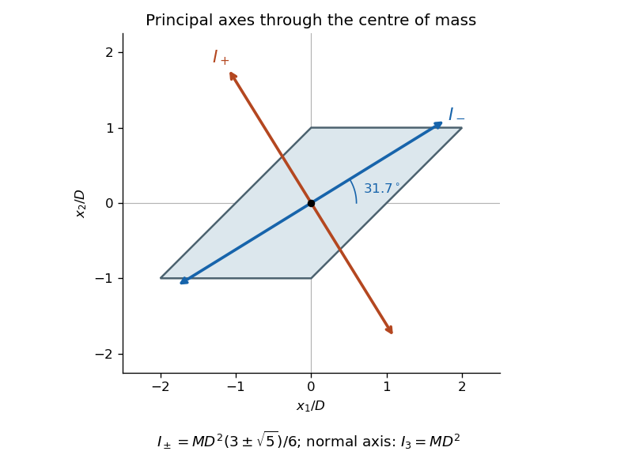

<h1 id="6/b/ii/solution">Solution</h1>

↑ **Parent:** [Ii](../ii.md)

Put $J_0=4\sigma D^4/3=MD^2/3$. The normal to the lamina is already an [eigenvector](../../../../../../eigenvector.md), with moment $3J_0$. The planar block has [characteristic polynomial](../../../../../../characteristic-polynomial.md)

$$
\det\begin{pmatrix}1-\lambda&-1\\-1&2-\lambda\end{pmatrix}=\lambda^2-3\lambda+1,
$$

so the [principal moments of inertia](../../../../../../principal-moment-of-inertia.md) are

$$
\boxed{I_-=\frac{J_0}{2}(3-\sqrt5),\qquad I_+=\frac{J_0}{2}(3+\sqrt5),\qquad I_3=3J_0.}
$$

A corresponding orthonormal set of [principal axes](../../../../../../principal-axis.md) is

$$
\boxed{\mathbf n_-=\frac{(2,\sqrt5-1,0)}{\sqrt{10-2\sqrt5}},\qquad\mathbf n_+=\frac{(2,-1-\sqrt5,0)}{\sqrt{10+2\sqrt5}},\qquad\mathbf n_3=(0,0,1).}
$$

The sign of each axis vector is immaterial. The smaller-moment axis makes angle $\tfrac12\arctan(2)$ with the positive $x_1$ direction, approximately $31.7^\circ$; the other planar axis is perpendicular. As a check, $I_-+I_+=3J_0=I_3$, the [perpendicular axis theorem](../../../../../../perpendicular-axis-theorem.md) for a planar lamina.

**[Figure 1](#6/b/ii/image-the-two-planar-principal-axes-of-the-sheared-square-lamina-with-the-third-axis-normal-to-the-page). The two planar principal axes of the sheared square lamina, with the third axis normal to the page**.

## ↑ Ancestors (14)

1. [Ii](../ii.md)
2. [B](../../b.md)
3. [6](../../../6.md)
4. [Paper 2](../../../../paper-2-split.md)
5. [2021](../../../../split.md)
6. [Past exam of the mathematics course of the year 2 of the natural sciences course of the University of Cambridge](../../../../../split.md)
7. [Mathematics course of the year 2 of the natural sciences course of the University of Cambridge](../../../../../../mathematics-course-of-the-year-2-of-the-natural-sciences-course-of-the-university-of-cambridge.md)
8. [Year 2 of the natural sciences course of the University of Cambridge](../../../../../../year-2-of-the-natural-sciences-course-of-the-university-of-cambridge.md)
9. [Year of the natural sciences course of the University of Cambridge](../../../../../../year-of-the-natural-sciences-course-of-the-university-of-cambridge.md)
10. [Natural sciences course of the University of Cambridge](../../../../../../natural-sciences-course-of-the-university-of-cambridge.md)
11. [Course of the University of Cambridge](../../../../../../course-of-the-university-of-cambridge.md)
12. [University of Cambridge](../../../../../../university-of-cambridge-split.md)
13. [List of universities](../../../../../../list-of-universities.md)
14. [Codex Wiki](../../../../../../split.md)
