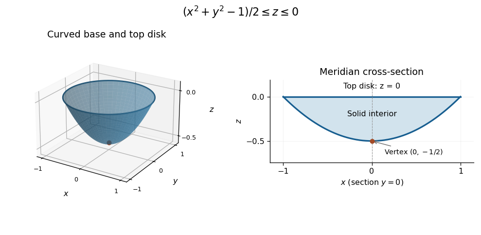

<h1 id="1/a/solution">Solution</h1>

↑ **Parent:** [A](../a.md)

Let $\rho=\sqrt{x^2+y^2}=uv$. The condition $u\leq v$ gives $z\leq0$. On the outer coordinate surface $v=1$, elimination of $u$ gives $z=(\rho^2-1)/2$. On $u=v$, the surface is the plane $z=0$, with $\rho=u^2\leq1$. Thus the closure of the body is

$$
\boxed{0\leq\rho\leq1,\qquad\frac{\rho^2-1}{2}\leq z\leq0.}
$$

It is a solid circular cap bounded below by an [elliptic paraboloid](../../../../../elliptic-paraboloid.md) of revolution and above by the unit disk in $z=0$. Its vertex is $\boxed{(0,0,-1/2)}$, its height is $\boxed{1/2}$, and its rim is the [circle](../../../../../circle.md) $\boxed{x^2+y^2=1,\ z=0}$. The symmetry axis is the $z$ axis. The coordinate surface $u=0$ maps to that axis rather than to an additional two-dimensional boundary. These are [parabolic coordinates](../../../../../parabolic-coordinates.md).

**[Figure 1](#1/a/image-the-solid-cap-bounded-by-an-elliptic-paraboloid-and-the-disk-z-0-with-a-filled-meridian-cross-section). The solid cap bounded by an elliptic paraboloid and the disk $z=0$, with a filled meridian cross-section**.

## ↑ Ancestors (13)

1. [A](../a.md)
2. [1](../../1.md)
3. [Paper 1](../../../paper-1-split.md)
4. [2022](../../../split.md)
5. [Past exam of the mathematics course of the year 2 of the natural sciences course of the University of Cambridge](../../../../split.md)
6. [Mathematics course of the year 2 of the natural sciences course of the University of Cambridge](../../../../../mathematics-course-of-the-year-2-of-the-natural-sciences-course-of-the-university-of-cambridge.md)
7. [Year 2 of the natural sciences course of the University of Cambridge](../../../../../year-2-of-the-natural-sciences-course-of-the-university-of-cambridge.md)
8. [Year of the natural sciences course of the University of Cambridge](../../../../../year-of-the-natural-sciences-course-of-the-university-of-cambridge.md)
9. [Natural sciences course of the University of Cambridge](../../../../../natural-sciences-course-of-the-university-of-cambridge.md)
10. [Course of the University of Cambridge](../../../../../course-of-the-university-of-cambridge.md)
11. [University of Cambridge](../../../../../university-of-cambridge-split.md)
12. [List of universities](../../../../../list-of-universities.md)
13. [Codex Wiki](../../../../../split.md)
