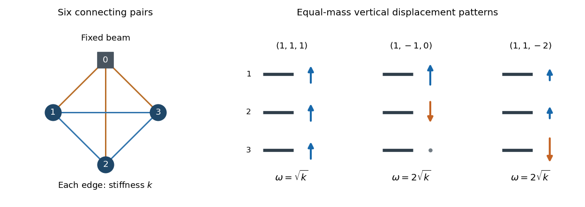

<h1 id="7/a/solution">Solution</h1>

↑ **Parent:** [A](../a.md)

The diagram has a connection between every pair of indices $0\leq i<j\leq n$, including the fixed beam $0$. Two parallel strings, each with [spring constant](../../../../../spring-constant.md) $k/2$, together have energy $k(X_i-X_j)^2/2$. Thus the printed $E_{ij}$ is the energy of a connecting pair; calling it the energy of one string would introduce a factor-of-two discrepancy.

Take vertical coordinates positive upwards, with $X_0$ fixed. Each bar has [gravitational potential energy](../../../../../gravitational-energy.md) $m_igX_i$ and [kinetic energy](../../../../../kinetic-energy.md) $m_i\dot X_i^2/2$. The [Lagrangian](../../../../../lagrangian.md) is

$$
\boxed{L=\frac12\sum_{i=1}^nm_i\dot X_i^2-\sum_{i=1}^nm_igX_i
-\frac k2\sum_{0\leq i<j\leq n}(X_i-X_j)^2.}
$$

Differentiating gives the [Euler-Lagrange equations](../../../../../euler-lagrange-equation.md)

$$
\boxed{m_i\ddot X_i+m_ig+k\sum_{\substack{0\leq j\leq n\\j\ne i}}(X_i-X_j)=0,\qquad i=1,\ldots,n.}
$$

Equivalently, with $S=\sum_{j=1}^nX_j$, the [spring](../../../../../spring.md) term is $k[(n+1)X_i-S-X_0]$. Gravity changes the [equilibrium](../../../../../equilibrium-point-of-a-dynamical-system.md) but not the [stiffness matrix](../../../../../stiffness-matrix.md). Subtracting a static [equilibrium](../../../../../equilibrium-point-of-a-dynamical-system.md) and writing $\eta_i=X_i-X_i^{\rm eq}$ gives the [normal mode](../../../../../normal-mode.md) system

$$
M\ddot{\boldsymbol\eta}+K\boldsymbol\eta=0,\qquad
M=\operatorname{diag}(m_1,\ldots,m_n),\qquad
\boxed{K=k\left[(n+1)I-\mathbf1\mathbf1^T\right].}
$$

This is the [spring](../../../../../spring.md) system underlying [normal modes of an anchored complete spring graph](../../../../../normal-modes-of-an-anchored-complete-spring-graph.md).

**[Figure 1](#7/a/image-all-six-couplings-and-the-three-modes-for-equal-bar-masses). All six couplings and the three modes for equal bar masses**. The graph on the left records every connecting pair in the $n=3$ installation, with the beam fixed. Each edge represents the two physical strings acting together with stiffness $k$. The arrows on the right show vertical displacement patterns: one uniform mode and two independent sum-zero modes.

## ↑ Ancestors (13)

1. [A](../a.md)
2. [7](../../7.md)
3. [Paper 2](../../../paper-2-split.md)
4. [2022](../../../split.md)
5. [Past exam of the mathematics course of the year 2 of the natural sciences course of the University of Cambridge](../../../../split.md)
6. [Mathematics course of the year 2 of the natural sciences course of the University of Cambridge](../../../../../mathematics-course-of-the-year-2-of-the-natural-sciences-course-of-the-university-of-cambridge.md)
7. [Year 2 of the natural sciences course of the University of Cambridge](../../../../../year-2-of-the-natural-sciences-course-of-the-university-of-cambridge.md)
8. [Year of the natural sciences course of the University of Cambridge](../../../../../year-of-the-natural-sciences-course-of-the-university-of-cambridge.md)
9. [Natural sciences course of the University of Cambridge](../../../../../natural-sciences-course-of-the-university-of-cambridge.md)
10. [Course of the University of Cambridge](../../../../../course-of-the-university-of-cambridge.md)
11. [University of Cambridge](../../../../../university-of-cambridge-split.md)
12. [List of universities](../../../../../list-of-universities.md)
13. [Codex Wiki](../../../../../split.md)
