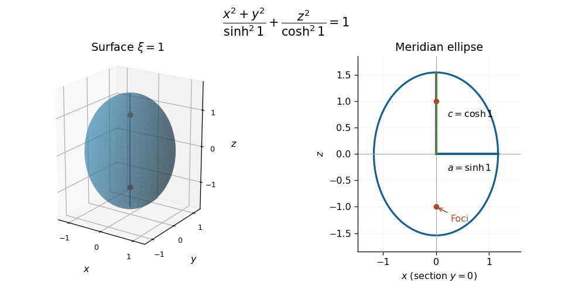

# Paper 1

↑ **Parent:** [2023](../2023.md)

[https://www.maths.cam.ac.uk/undergradnst/files/2023/papernst_ib_1_2023.pdf](https://www.maths.cam.ac.uk/undergradnst/files/2023/papernst_ib_1_2023.pdf)

**Table of contents**

- [1](#1)
  - [a](#1/a)
    - [Solution](#1/a/solution)
  - [b](#1/b)
    - [Solution](#1/b/solution)
  - [c](#1/c)
    - [Solution](#1/c/solution)
- [2](#2)
  - [a](#2/a)
    - [Solution](#2/a/solution)
  - [b](#2/b)
    - [Solution](#2/b/solution)
- [3](#3)
  - [a](#3/a)
    - [Solution](#3/a/solution)
  - [b](#3/b)
    - [i](#3/b/i)
      - [Solution](#3/b/i/solution)
    - [ii](#3/b/ii)
      - [Solution](#3/b/ii/solution)
    - [iii](#3/b/iii)
      - [Solution](#3/b/iii/solution)
- [4](#4)
  - [a](#4/a)
    - [Solution](#4/a/solution)
  - [b](#4/b)
    - [Solution](#4/b/solution)
  - [c](#4/c)
    - [Solution](#4/c/solution)
  - [d](#4/d)
    - [Solution](#4/d/solution)
- [5](#5)
  - [a](#5/a)
    - [Solution](#5/a/solution)
  - [b](#5/b)
    - [Solution](#5/b/solution)
  - [c](#5/c)
    - [Solution](#5/c/solution)
  - [d](#5/d)
    - [Solution](#5/d/solution)
- [6](#6)
  - [a](#6/a)
    - [Solution](#6/a/solution)
  - [b](#6/b)
    - [Solution](#6/b/solution)
  - [c](#6/c)
    - [Solution](#6/c/solution)
- [7](#7)
  - [a](#7/a)
    - [Solution](#7/a/solution)
  - [b](#7/b)
    - [Solution](#7/b/solution)
  - [c](#7/c)
    - [Solution](#7/c/solution)
  - [d](#7/d)
    - [i](#7/d/i)
      - [Solution](#7/d/i/solution)
    - [ii](#7/d/ii)
      - [Solution](#7/d/ii/solution)
- [8](#8)
  - [a](#8/a)
    - [Solution](#8/a/solution)
  - [b](#8/b)
    - [Solution](#8/b/solution)
  - [c](#8/c)
    - [Solution](#8/c/solution)
- [9](#9)
  - [a](#9/a)
    - [i](#9/a/i)
      - [Solution](#9/a/i/solution)
    - [ii](#9/a/ii)
      - [Solution](#9/a/ii/solution)
  - [b](#9/b)
    - [Solution](#9/b/solution)
- [10](#10)
  - [a](#10/a)
    - [Solution](#10/a/solution)
  - [b](#10/b)
    - [Solution](#10/b/solution)
  - [c](#10/c)
    - [Solution](#10/c/solution)

## 1

↑ **Parent:** [Paper 1](paper-1.md)

<h3 id="1/a">a</h3>

↑ **Parent:** [1](#1)

<h4 id="1/a/solution">Solution</h4>

↑ **Parent:** [A](#1/a)

The three [coordinate basis](../../tangent-vector.md#coordinate-basis) vectors are the partial [derivatives](../../calculus.md#derivative) of the position [vector](../../vector-space.md#vector) with respect to the three coordinates. Direct differentiation gives

$$
\boxed{\mathbf h_\xi=\frac{\partial\mathbf x}{\partial\xi}=\begin{pmatrix}\cosh\xi\sin\theta\cos\phi\\\cosh\xi\sin\theta\sin\phi\\g'(\xi)\cos\theta\end{pmatrix},\qquad\mathbf h_\theta=\frac{\partial\mathbf x}{\partial\theta}=\begin{pmatrix}\sinh\xi\cos\theta\cos\phi\\\sinh\xi\cos\theta\sin\phi\\-g(\xi)\sin\theta\end{pmatrix},}
$$

$$
\boxed{\mathbf h_\phi=\frac{\partial\mathbf x}{\partial\phi}=\begin{pmatrix}-\sinh\xi\sin\theta\sin\phi\\\sinh\xi\sin\theta\cos\phi\\0\end{pmatrix}.}
$$

The multivariable [chain rule](../../calculus.md#chain-rule) then gives $d\mathbf x=\mathbf h_\xi d\xi+\mathbf h_\theta d\theta+\mathbf h_\phi d\phi$. These are coordinate [tangent vectors](../../tangent-vector.md), not necessarily unit [vectors](../../vector-space.md#vector).

<h3 id="1/b">b</h3>

↑ **Parent:** [1](#1)

<h4 id="1/b/solution">Solution</h4>

↑ **Parent:** [B](#1/b)

The azimuthal vector $\mathbf h_\phi$ is automatically orthogonal to the other two. Their remaining [dot product](../../inner-product.md#dot-product) is

$$
\mathbf h_\xi\cdot\mathbf h_\theta=[\sinh\xi\cosh\xi-g(\xi)g'(\xi)]\sin\theta\cos\theta.
$$

Thus [orthogonal coordinates](../../multivariable-calculus.md#orthogonal-coordinates) require $gg'=\sinh\xi\cosh\xi$, which integrates to $g^2=\sinh^2\xi+C$. The initial value gives $C=1$, and the smooth branch with $g(0)=1$ is

$$
\boxed{g(\xi)=\cosh\xi.}
$$

The corresponding coordinate-vector [norms](../../normed-vector-space.md#norm) are $|\mathbf h_\xi|=|\mathbf h_\theta|=\sqrt{\sinh^2\xi+\sin^2\theta}$ and $|\mathbf h_\phi|=\sinh\xi\sin\theta$, as in the [hyperbolic parametrization of prolate spheroidal coordinates](../../general-relativity.md#hyperbolic-parametrization-of-prolate-spheroidal-coordinates). Coordinate degeneracies on the axis and focal segment are understood.

Eliminating the angular coordinates on the requested surface gives

$$
\boxed{\frac{x^2+y^2}{\sinh^21}+\frac{z^2}{\cosh^21}=1.}
$$

It is a [prolate spheroid](../../euclidean-geometry.md#prolate-spheroid) with long axis $z$, equatorial radius $\sinh1$, polar semiaxis $\cosh1$, and foci $(0,0,\pm1)$.

**[Figure 1](#1/b/image-the-prolate-spheroid-xi-1-and-its-meridian-ellipse-with-equatorial-and-polar-semiaxes-and-the-two-foci). The prolate spheroid $\xi=1$ and its meridian ellipse, with equatorial and polar semiaxes and the two foci**.

<h3 id="1/c">c</h3>

↑ **Parent:** [1](#1)

<h4 id="1/c/solution">Solution</h4>

↑ **Parent:** [C](#1/c)

Let $a=\sinh1$ and $c=\cosh1$. The region is the first-octant portion of the [ellipsoid](../../euclidean-geometry.md#ellipsoid) $(x^2+y^2)/a^2+z^2/c^2\leq1$. In [cylindrical coordinates](../../multivariable-calculus.md#cylindrical-coordinate-system), write $\rho=\sqrt{x^2+y^2}$ and $0\leq\phi\leq\pi/2$. Away from the axis, the [divergence](../../multivariable-calculus.md#divergence) is

$$
\nabla\cdot\mathbf F=\frac{2x+2y}{x^2+y^2}+\frac1\rho=\frac{2\cos\phi+2\sin\phi+1}{\rho}.
$$

The field is singular on the axis, so applying the classical [divergence theorem](../../multivariable-calculus.md#divergence-theorem) there without qualification would be invalid. Instead remove $\rho<\varepsilon$ and apply it to the remaining region. On the added cylindrical boundary the [unit normal](../../differential-geometry.md#unit-normal) is $-\mathbf e_\rho$, and

$$
\mathbf F\cdot(-\mathbf e_\rho)=-\log(\varepsilon^2)(\cos\phi+\sin\phi).
$$

Its area element is $\varepsilon\,d\phi\,dz$, so its [flux](../../mathematical-physics.md#flux) is $O(\varepsilon|\log\varepsilon|)\to0$. The axial component of the field has zero [dot product](../../inner-product.md#dot-product) with this normal. The [volume integral](../../multivariable-calculus.md#volume-integral) of the [divergence](../../multivariable-calculus.md#divergence) is locally integrable, because its $1/\rho$ factor cancels the cylindrical measure. Thus [removing a singular axis in a flux integral](../../multivariable-calculus.md#removing-a-singular-axis-in-a-flux-integral) gives the desired improper [surface integral](../../multivariable-calculus.md#surface-integral) with no extra axial term.

The [divergence theorem](../../multivariable-calculus.md#divergence-theorem) now reduces the calculation to

$$
\begin{aligned}
I&=\int_0^{\pi/2}(2\cos\phi+2\sin\phi+1)\,d\phi\int_0^c\int_0^{a\sqrt{1-z^2/c^2}}d\rho\,dz\\
&=\left(4+\frac\pi2\right)ac\int_0^1\sqrt{1-s^2}\,ds\\
&=\left(4+\frac\pi2\right)\frac{\pi ac}{4}
=\boxed{\frac{\pi(8+\pi)}8\sinh1\cosh1=\frac{\pi(8+\pi)}{16}\sinh2.}
\end{aligned}
$$

The integral over $s$ is the area of a quarter unit disk. All boundary [fluxes](../../mathematical-physics.md#flux) are interpreted as convergent [improper integrals](../../real-analysis.md#improper-integral) at the axis.

## 2

↑ **Parent:** [Paper 1](paper-1.md)

<h3 id="2/a">a</h3>

↑ **Parent:** [2](#2)

<h4 id="2/a/solution">Solution</h4>

↑ **Parent:** [A](#2/a)

Use [separation of variables](../../partial-differential-equation.md#separation-of-variables), $u=X(x)Y(y)$, and divide by $XY$ where nonzero. A real separation constant $\kappa$ gives

$$
\frac{X''}{X}=\frac{Y'}Y+1+\sin y=\kappa,
$$

so $X''=\kappa X$ and $Y'=(\kappa-1-\sin y)Y$. Normalizing the second factor to one at zero gives

$$
\boxed{Y_\kappa(y)=\exp[(\kappa-1)y+\cos y-1].}
$$

The spatial [ordinary differential equation](../../differential-equation.md#ordinary-differential-equation) has three types of real solution:

$$
\boxed{X(x)=\begin{cases}A\cos(kx)+B\sin(kx),&\kappa=-k^2<0,\\A+Bx,&\kappa=0,\\A\cosh(kx)+B\sinh(kx),&\kappa=k^2>0.\end{cases}}
$$

Products $X Y_\kappa$ are the separated [eigenfunctions](../../linear-operator-theory.md#eigenfunction). The negative, zero and positive separation constants give trigonometric, linear and [hyperbolic function](../../calculus.md#hyperbolic-function) forms respectively. There is no discrete quantization until [boundary conditions](../../differential-equation.md#boundary-condition) on $x$ are supplied. Since $\cos y-1$ is bounded, the envelope of $Y_\kappa$ decays for $\kappa<1$, grows for $\kappa>1$, and is bounded and periodic for $\kappa=1$. The scalar prefactor can also be derived by [removing a variable scalar reaction rate by an integrating factor](../../diffusion-equation.md#removing-a-variable-scalar-reaction-rate-by-an-integrating-factor).

<h3 id="2/b">b</h3>

↑ **Parent:** [2](#2)

<h4 id="2/b/solution">Solution</h4>

↑ **Parent:** [B](#2/b)

The two homogeneous [Dirichlet boundary conditions](../../differential-equation.md#dirichlet-boundary-condition) on $x$ force negative separation constants. The initial profile is an [even function](../../calculus.md#even-function), so only the even sine-family [eigenfunctions](../../linear-operator-theory.md#eigenfunction) are needed:

$$
X_m(x)=\cos(k_mx),\qquad k_m=\left(m+\frac12\right)\pi,\qquad m=0,1,\ldots.
$$

They obey $X_m(\pm1)=0$ and $\int_{-1}^1X_mX_n\,dx=\delta_{mn}$. Odd [eigenfunctions](../../linear-operator-theory.md#eigenfunction) have zero projection onto the even initial data. Hence the initial coefficients are

$$
\begin{aligned}
a_m&=\int_{-1}^1(1-x^2)\cos(k_mx)\,dx\\
&=2\left[-\frac{2x\cos(k_mx)}{k_m^2}+\frac{2\sin(k_mx)}{k_m^3}\right]_0^1
=\frac{4(-1)^m}{k_m^3}.
\end{aligned}
$$

The desired [eigenfunction expansion](../../algebra.md#eigenfunction-expansion) is therefore

$$
\boxed{u(x,y)=4\sum_{m=0}^{\infty}\frac{(-1)^m}{k_m^3}\cos(k_mx)\exp[-(k_m^2+1)y+\cos y-1],\qquad k_m=(m+\tfrac12)\pi.}
$$

At $y=0$ this is the [Fourier series](../../fourier-series.md) of $1-x^2$ on the interval; its coefficients are absolutely summable. Each term satisfies the [partial differential equation](../../partial-differential-equation.md) and side conditions. For $y>0$ the additional Gaussian decay in $m$ justifies termwise [differentiation](../../calculus.md#differentiation). Since $k_m^2+1>0$ and $e^{\cos y-1}\leq1$, the whole series decays uniformly as $y\to\infty$.

## 3

↑ **Parent:** [Paper 1](paper-1.md)

<h3 id="3/a">a</h3>

↑ **Parent:** [3](#3)

<h4 id="3/a/solution">Solution</h4>

↑ **Parent:** [A](#3/a)

Set $L=d^2/dt^2-4$ and choose $L_tG(t,t')=\delta(t-t')$, with the [Green's function](../../green-s-function.md) decaying at both ends. Away from the source, its homogeneous solutions are $e^{\pm2t}$. Decay at each end and continuity at $t=t'$ therefore give $G=C e^{-2|t-t'|}$. Integrating its equation across the source gives a unit jump in its first [derivative](../../calculus.md#derivative):

$$
\partial_tG(t'^+,t')-\partial_tG(t'^-,t')=-2C-2C=1.
$$

Thus

$$
\boxed{A=-2,\qquad C=-\frac14,\qquad G(t,t')=-\frac14e^{-2|t-t'|}.}
$$

The solution of the [boundary value problem](../../boundary-value-problem.md) is the [convolution](../../fourier-analysis.md#convolution)

$$
\boxed{x(t)=-\frac14\int_{-\infty}^{\infty}e^{-2|t-\tau|}f(\tau)\,d\tau.}
$$

There is no extra homogeneous term: no nonzero combination of $e^{2t},e^{-2t}$ decays at both infinities. The forcing must of course permit the imposed decay; integrable $f$, including part (b), is sufficient. Literally arbitrary forcing need not do so: constant nonzero forcing admits no solution vanishing at both ends.

<h3 id="3/b">b</h3>

↑ **Parent:** [3](#3)

<h4 id="3/b/i">i</h4>

↑ **Parent:** [B](#3/b)

<h5 id="3/b/i/solution">Solution</h5>

↑ **Parent:** [I](#3/b/i)

For $t<0$, all forcing points satisfy $\tau>t$, so the [Green's function](../../green-s-function.md) formula becomes

$$
x(t)=-\frac14e^{2t}\int_0^1\tau e^{-2\tau}\,d\tau.
$$

An [integration by parts](../../calculus.md#integration-by-parts) gives $\int\tau e^{-2\tau}d\tau=-(\tau/2+1/4)e^{-2\tau}$. Consequently

$$
\boxed{x(t)=-\frac{1-3e^{-2}}{16}e^{2t},\qquad t<0.}
$$

The exponential has the required decay as $t\to-\infty$.

<h4 id="3/b/ii">ii</h4>

↑ **Parent:** [B](#3/b)

<h5 id="3/b/ii/solution">Solution</h5>

↑ **Parent:** [Ii](#3/b/ii)

For $t>1$, every forcing point has $\tau<t$. Hence the [Green's function](../../green-s-function.md) gives

$$
x(t)=-\frac14e^{-2t}\int_0^1\tau e^{2\tau}\,d\tau.
$$

Since $\int\tau e^{2\tau}d\tau=(\tau/2-1/4)e^{2\tau}$, the remaining [integral](../../integral.md) is $(e^2+1)/4$. Therefore

$$
\boxed{x(t)=-\frac{e^2+1}{16}e^{-2t},\qquad t>1.}
$$

This decays at positive infinity.

<h4 id="3/b/iii">iii</h4>

↑ **Parent:** [B](#3/b)

<h5 id="3/b/iii/solution">Solution</h5>

↑ **Parent:** [Iii](#3/b/iii)

For $0<t<1$, split the [Green's function](../../green-s-function.md) integral where the absolute value changes sign:

$$
x(t)=-\frac14\left[e^{-2t}\int_0^t\tau e^{2\tau}\,d\tau+e^{2t}\int_t^1\tau e^{-2\tau}\,d\tau\right].
$$

The two terms inside the bracket are respectively

$$
\frac t2-\frac14+\frac14e^{-2t},\qquad\frac t2+\frac14-\frac34e^{2t-2}.
$$

Adding them yields

$$
\boxed{x(t)=-\frac t4-\frac1{16}e^{-2t}+\frac3{16}e^{2t-2},\qquad0<t<1.}
$$

The affine term gives $x''-4x=t$, while both exponential terms are homogeneous solutions. The values at the joins are $x(0)=(3e^{-2}-1)/16$ and $x(1)=-(1+e^{-2})/16$, agreeing with parts (i) and (ii). Their first [derivatives](../../calculus.md#derivative) also match: $x'(0)=(3e^{-2}-1)/8$ and $x'(1)=(1+e^{-2})/8$. Thus the pieces introduce no unwanted [Dirac delta distributions](../../distribution-theory.md#dirac-delta-function).

## 4

↑ **Parent:** [Paper 1](paper-1.md)

<h3 id="4/a">a</h3>

↑ **Parent:** [4](#4)

<h4 id="4/a/solution">Solution</h4>

↑ **Parent:** [A](#4/a)

Let $G(k)=\widetilde g(k)$. Since $g'=-xg$, [differentiation](../../calculus.md#differentiation) under the [Fourier transform](../../fourier-transform.md) integral and [integration by parts](../../calculus.md#integration-by-parts) give

$$
G'(k)=-i\,\widetilde{xg}(k)=i\,\widetilde{g'}(k)=i(ik)G(k)=-kG(k).
$$

Thus $G(k)=G(0)e^{-k^2/2}$. The [Gaussian integral](../../integral.md#gaussian-integral) gives $G(0)=\sqrt{2\pi}$, proving the [Fourier transform of a Gaussian](../../fourier-analysis.md#fourier-transform-of-a-gaussian) formula

$$
\boxed{\widetilde g(k)=\sqrt{2\pi}\,e^{-k^2/2},\qquad c=\sqrt{2\pi}.}
$$

For the higher [derivatives](../../calculus.md#derivative), start with $r_0=1$. If $g^{(m)}=r_mg$, the [product rule](../../calculus.md#product-rule) gives

$$
g^{(m+1)}=(r_m'-xr_m)g,\qquad\boxed{r_{m+1}=r_m'-xr_m.}
$$

If $r_m$ has degree $m$ and leading coefficient $(-1)^m$, the recurrence gives degree $m+1$ and leading coefficient $(-1)^{m+1}$. Induction proves the assertion for every $m$. These polynomials are $r_m=(-1)^m\operatorname{He}_m$, where $\operatorname{He}_m$ is the [Probabilists' Hermite polynomial](../../orthogonal-polynomial.md#probabilists-hermite-polynomial).

<h3 id="4/b">b</h3>

↑ **Parent:** [4](#4)

<h4 id="4/b/solution">Solution</h4>

↑ **Parent:** [B](#4/b)

Assume the necessary [derivatives](../../calculus.md#derivative) decay enough for all boundary terms to vanish. One [integration by parts](../../calculus.md#integration-by-parts) gives

$$
\widetilde{f'}(k)=\int_{\mathbb R}f'(x)e^{-ikx}\,dx=ik\widetilde f(k).
$$

Repeating proves the [Fourier transform of a derivative](../../fourier-analysis.md#fourier-transform-of-a-derivative) rule $\boxed{\widetilde{f^{(m)}}=(ik)^m\widetilde f}$. On the other hand, differentiation under the [integral](../../integral.md) gives

$$
\frac{d^m\widetilde f}{dk^m}=\int_{\mathbb R}(-ix)^mf(x)e^{-ikx}\,dx,
$$

and therefore $\boxed{\widetilde{x^mf}=i^m\widetilde f^{(m)}}$.

Write $p_n(x)=\sum_{j=0}^na_jx^j$, with $a_n\ne0$. Applying the second rule and part (a) gives

$$
\mathcal F[p_n(x)g(x)](k)=\sqrt{2\pi}\sum_{j=0}^na_ji^jg^{(j)}(k)=q_n(k)e^{-k^2/2},
$$

where

$$
\boxed{q_n(k)=\sqrt{2\pi}\sum_{j=0}^na_ji^jr_j(k).}
$$

Only the $j=n$ term can contribute degree $n$. Its leading coefficient is $\sqrt{2\pi}a_n(-i)^n\ne0$, so $q_n$ has exactly the same degree $n$, with no possible leading-term cancellation. The coefficients of this transformed [polynomial](../../polynomial.md) can be complex even when those of $p_n$ are real.

<h3 id="4/c">c</h3>

↑ **Parent:** [4](#4)

<h4 id="4/c/solution">Solution</h4>

↑ **Parent:** [C](#4/c)

By the two [Fourier transform](../../fourier-transform.md) rules in part (b),

$$
\mathcal F[f'']=-k^2\widetilde f,\qquad\mathcal F[x^2f]=i^2\widetilde f''=-\widetilde f''.
$$

Consequently transforming the [differential equation](../../differential-equation.md) gives

$$
-k^2\widetilde f+\widetilde f''=\mu\widetilde f,
$$

or

$$
\boxed{\widetilde f''(k)-k^2\widetilde f(k)=\mu\widetilde f(k).}
$$

The inverse [Fourier transform](../../fourier-transform.md) gives the reverse implication under the same regularity hypotheses. This expresses the Fourier symmetry of the [quantum harmonic oscillator](../../quantum-harmonic-oscillator.md) operator.

<h3 id="4/d">d</h3>

↑ **Parent:** [4](#4)

<h4 id="4/d/solution">Solution</h4>

↑ **Parent:** [D](#4/d)

Part (b) shows that the transform of $g_n$ is $q_n(k)e^{-k^2/2}$ with $q_n$ of degree $n$. Part (c) shows that it solves the same [eigenvalue](../../linear-operator-theory.md#eigenvalue) equation as $g_n$, with the same $\mu_n$. The assumed uniqueness of the polynomial solution of each degree therefore forces $q_n=c_np_n$; hence $\widetilde g_n=c_ng_n$.

The constants can also be determined. Substituting $g_n=p_ne^{-x^2/2}$ into the equation gives the [Hermite differential equation](../../analysis.md#hermite-differential-equation)

$$
p_n''-2xp_n'-(1+\mu_n)p_n=0.
$$

Comparison of the leading coefficient yields $\mu_n=-(2n+1)$. If the leading coefficient of $p_n$ is $a_n$, part (b) gives leading coefficient $\sqrt{2\pi}(-i)^na_n$ for $q_n$. Thus

$$
\boxed{\widetilde g_n(k)=\sqrt{2\pi}(-i)^ng_n(k),\qquad c_n=\sqrt{2\pi}(-i)^n.}
$$

Thus [Hermite functions are Fourier eigenfunctions](../../orthogonal-polynomial.md#hermite-functions-are-fourier-eigenfunctions) with the paper's unnormalized [Fourier transform](../../fourier-transform.md); dividing that transform by $\sqrt{2\pi}$ gives the unitary eigenvalues $(-i)^n$.

## 5

↑ **Parent:** [Paper 1](paper-1.md)

<h3 id="5/a">a</h3>

↑ **Parent:** [5](#5)

<h4 id="5/a/solution">Solution</h4>

↑ **Parent:** [A](#5/a)

Since $M^T=-M$, $(M^2)^T=(M^T)^2=M^2$, so $M^2$ is a real [symmetric matrix](../../linear-algebra.md#symmetric-matrix). Moreover,

$$
\boxed{x^TM^2x=-x^TM^TMx=-\|Mx\|^2\leq0,}
$$

proving that it is a [negative semidefinite matrix](../../multivariable-calculus.md#negative-semidefinite-matrix).

For odd $n$, [determinant](../../multilinear-algebra.md#determinant) invariance under transpose gives

$$
\det M=\det M^T=\det(-M)=(-1)^n\det M=-\det M,
$$

so $\det M=0$. Hence $M$ and $M^2$ have a zero [eigenvalue](../../linear-operator-theory.md#eigenvalue). Finally, if $M^2w=0$, then $0=w^TM^2w=-\|Mw\|^2$, so $Mw=0$. Thus

$$
\boxed{\ker M^2=\ker M,}
$$

where equality of these [kernels](../../kernel-of-a-linear-map.md) includes the reverse implication, which is immediate.

<h3 id="5/b">b</h3>

↑ **Parent:** [5](#5)

<h4 id="5/b/solution">Solution</h4>

↑ **Parent:** [B](#5/b)

Because $M$ [commutes](../../algebraic-operation.md#commuting-elements) with $M^2$,

$$
M^2v_1=\frac1{\mu_1}M(M^2u_1)=-\mu_1^2v_1.
$$

Its squared [Euclidean norm](../../normed-vector-space.md#euclidean-norm) is

$$
\|v_1\|^2=\frac1{\mu_1^2}u_1^TM^TMu_1=-\frac1{\mu_1^2}u_1^TM^2u_1=1.
$$

A scalar equals its transpose, while $M^T=-M$, so $u_1^TMu_1=-u_1^TMu_1=0$. Consequently

$$
\boxed{M^2v_1=-\mu_1^2v_1,\qquad\|v_1\|=1,\qquad u_1^Tv_1=0.}
$$

Thus each negative [eigenvalue](../../linear-operator-theory.md#eigenvalue) has at least this pair of orthonormal [eigenvectors](../../linear-operator-theory.md#eigenvector).

<h3 id="5/c">c</h3>

↑ **Parent:** [5](#5)

<h4 id="5/c/solution">Solution</h4>

↑ **Parent:** [C](#5/c)

The plane spanned by $u_1,v_1$ is an [invariant subspace](../../representation-theory.md#invariant-subspace) for $M$, since

$$
Mu_1=\mu_1v_1,\qquad Mv_1=\frac1{\mu_1}M^2u_1=-\mu_1u_1.
$$

Its [orthogonal complement](../../hilbert-space.md#orthogonal-complement) is also invariant: for $w$ orthogonal to both, $u_1^TMw=-(Mu_1)^Tw=0$ and $v_1^TMw=-(Mv_1)^Tw=0$. The restriction of the real [symmetric matrix](../../linear-algebra.md#symmetric-matrix) $M^2$ to this nonempty complement therefore has a unit [eigenvector](../../linear-operator-theory.md#eigenvector) $u_2$, by the [spectral theorem for real symmetric matrices](../../linear-algebra.md#spectral-theorem-for-real-symmetric-matrices).

If its [eigenvalue](../../linear-operator-theory.md#eigenvalue) is $-\mu_2^2<0$, the argument in part (b) shows that $v_2=Mu_2/\mu_2$ is a unit [eigenvector](../../linear-operator-theory.md#eigenvector) orthogonal to $u_2$. It also lies in the same complement; explicitly,

$$
u_1^Tv_2=-\frac{\mu_1}{\mu_2}v_1^Tu_2=0,\qquad v_1^Tv_2=\frac{\mu_1}{\mu_2}u_1^Tu_2=0.
$$

Repeating the construction decomposes every negative [eigenspace](../../linear-operator-theory.md#eigenspace) into orthogonal pairs. The zero [eigenspace](../../linear-operator-theory.md#eigenspace) has dimension $n-2r$ for some number $r$ of pairs, and therefore has the same parity as $n$. This is the [paired eigenspaces of the square of a real skew-symmetric matrix](../../linear-algebra.md#paired-eigenspaces-of-the-square-of-a-real-skew-symmetric-matrix) property.

For $n=2m$, there can be $m$ distinct negative [eigenvalues](../../linear-operator-theory.md#eigenvalue) and no zero, or at most $m-1$ negative ones plus zero, because a nonempty zero [eigenspace](../../linear-operator-theory.md#eigenspace) has dimension at least two. For $n=2m+1$, there are at most $m$ distinct negative ones plus the mandatory zero. Hence

$$
\boxed{\text{maximum number of distinct eigenvalues of }M^2=\left\lceil\frac n2\right\rceil.}
$$

The bound is attained by skew two-by-two blocks with distinct positive parameters, adding one zero direction when $n$ is odd.

<h3 id="5/d">d</h3>

↑ **Parent:** [5](#5)

<h4 id="5/d/solution">Solution</h4>

↑ **Parent:** [D](#5/d)

The required actions have already been identified:

$$
\boxed{Mu_1=\mu_1v_1,\qquad Mv_1=-\mu_1u_1.}
$$

In three dimensions choose a unit [vector](../../vector-space.md#vector) $w$ perpendicular to both. Its one-dimensional [orthogonal complement](../../hilbert-space.md#orthogonal-complement) to the pair is invariant under $M$. On a one-dimensional real space, a [skew-symmetric matrix](../../linear-algebra.md#skew-symmetric-matrix) must act as zero: $Mw=\eta w$ would imply $\eta=w^TMw=0$. Thus $Mw=0$.

The columns of $W=(u_1\ v_1\ w)$ form an [orthonormal basis](../../inner-product.md#orthonormal-basis), so $W$ is an [orthogonal matrix](../../linear-algebra.md#orthogonal-matrix). The displayed actions give

$$
W^TMW=\begin{pmatrix}0&-\mu_1&0\\\mu_1&0&0\\0&0&0\end{pmatrix}=B,
$$

and therefore

$$
\boxed{M=WBW^T.}
$$

If $M=0$, take $\mu_1=0$ and any [orthogonal matrix](../../linear-algebra.md#orthogonal-matrix) $W$. Otherwise its nonzero two-dimensional block supplies the pair used above.

## 6

↑ **Parent:** [Paper 1](paper-1.md)

<h3 id="6/a">a</h3>

↑ **Parent:** [6](#6)

<h4 id="6/a/solution">Solution</h4>

↑ **Parent:** [A](#6/a)

For a real [symmetric matrix](../../linear-algebra.md#symmetric-matrix) $A$, find its real [eigenvalues](../../linear-operator-theory.md#eigenvalue) from $\det(A-\lambda I)=0$, then solve $(A-\lambda I)v=0$ for the corresponding [eigenspaces](../../linear-operator-theory.md#eigenspace). Distinct [eigenspaces](../../linear-operator-theory.md#eigenspace) are orthogonal. Within each repeated [eigenspace](../../linear-operator-theory.md#eigenspace), apply the [Gram-Schmidt process](../../inner-product.md#gram-schmidt-process) and normalize to obtain an [orthonormal basis](../../inner-product.md#orthonormal-basis) of [eigenvectors](../../linear-operator-theory.md#eigenvector).

Put these vectors in the columns of $O$. The [spectral theorem for real symmetric matrices](../../linear-algebra.md#spectral-theorem-for-real-symmetric-matrices) guarantees a full basis, so $O^TO=I$ and

$$
\boxed{O^TAO=\operatorname{diag}(\lambda_1,\ldots,\lambda_n),\qquad A=O\operatorname{diag}(\lambda_1,\ldots,\lambda_n)O^T.}
$$

This is the [orthogonal diagonalization](../../linear-algebra.md#orthogonal-diagonalization-of-a-real-symmetric-matrix) of $A$ and the associated [orthogonal change of coordinates](../../linear-algebra.md#orthogonal-change-of-coordinates).

<h3 id="6/b">b</h3>

↑ **Parent:** [6](#6)

<h4 id="6/b/solution">Solution</h4>

↑ **Parent:** [B](#6/b)

The [quadratic form](../../quadratic-form.md) has real [symmetric matrix](../../linear-algebra.md#symmetric-matrix)

$$
A=\begin{pmatrix}5&-4&0\\-4&5&0\\0&0&9\end{pmatrix}.
$$

Its unit [eigenvectors](../../linear-operator-theory.md#eigenvector) can be chosen as $e_u=(1,1,0)/\sqrt2$ with [eigenvalue](../../linear-operator-theory.md#eigenvalue) $1$, and $e_v=(1,-1,0)/\sqrt2$, $e_w=(0,0,1)$ with [eigenvalue](../../linear-operator-theory.md#eigenvalue) $9$. Set

$$
u=\frac{x_1+x_2}{\sqrt2},\qquad v=\frac{x_1-x_2}{\sqrt2},\qquad w=x_3.
$$

The [orthogonal diagonalization](../../linear-algebra.md#orthogonal-diagonalization-of-a-real-symmetric-matrix) turns the surface equation into

$$
u^2+9v^2+9w^2=9,\qquad\boxed{\frac{u^2}{9}+v^2+w^2=1.}
$$

It is an [ellipsoid](../../euclidean-geometry.md#ellipsoid), specifically a [prolate spheroid](../../euclidean-geometry.md#prolate-spheroid) centered at the origin. Its long principal axis is the line in direction $\boxed{(1,1,0)/\sqrt2}$, with semiaxis length $\boxed{3}$. Each direction in the plane perpendicular to that line has semiaxis length $\boxed{1}$; the displayed $e_v,e_w$ give one orthonormal choice of the two short principal axes. Their nonuniqueness reflects the repeated [eigenvalue](../../linear-operator-theory.md#eigenvalue) $9$ and rotational symmetry about the long axis.

<h3 id="6/c">c</h3>

↑ **Parent:** [6](#6)

<h4 id="6/c/solution">Solution</h4>

↑ **Parent:** [C](#6/c)

The [orthogonal change of coordinates](../../linear-algebra.md#orthogonal-change-of-coordinates) preserves the sphere equation, giving $u^2+v^2+w^2=4$. Subtract it from the spheroid equation in part (b):

$$
8(v^2+w^2)=5,\qquad v^2+w^2=\frac58,\qquad u^2=4-\frac58=\frac{27}{8}.
$$

Thus the intersection consists of the two [circles](../../topology.md#circle)

$$
\boxed{u=\pm\frac{3\sqrt6}{4},\qquad v^2+w^2=\frac58.}
$$

Their common radius is $\boxed{\sqrt{5/8}=\sqrt{10}/4}$. Transforming their centers back to the original coordinates gives

$$
\boxed{\mathbf c_\pm=\pm\left(\frac{3\sqrt3}{4},\frac{3\sqrt3}{4},0\right).}
$$

Their planes have equations $x_1+x_2=\pm3\sqrt3/2$, each with [normal vector](../../differential-geometry.md#normal-vector) $(1,1,0)$. The difference $\mathbf c_+-\mathbf c_-$ is parallel to this normal, proving that the line joining the centers is perpendicular to both planes. This is the [intersection of a prolate spheroid and a concentric sphere](../../euclidean-geometry.md#intersection-of-a-prolate-spheroid-and-a-concentric-sphere) in the regime between the short and long semiaxes.

## 7

↑ **Parent:** [Paper 1](paper-1.md)

<h3 id="7/a">a</h3>

↑ **Parent:** [7](#7)

<h4 id="7/a/solution">Solution</h4>

↑ **Parent:** [A](#7/a)

For an [analytic function](../../holomorphic-function.md), the [complex differentiability](../../holomorphic-function.md#complex-differentiability) limit is independent of the direction of approach. A real increment gives $f'(z)=u_x+iv_x$, whereas an imaginary increment gives

$$
f'(z)=\frac{u_y+iv_y}{i}=v_y-iu_y.
$$

Equality of real and imaginary parts proves the [Cauchy-Riemann equations](../../analysis.md#cauchy-riemann-equations):

$$
\boxed{u_x=v_y,\qquad u_y=-v_x.}
$$

Conversely, if $u,v$ have continuous first partial [derivatives](../../calculus.md#derivative) near a point and obey these equations, their real differentiability gives, for a complex increment $h$,

$$
f(z+h)-f(z)=(u_x+iv_x)\operatorname{Re}h+(u_y+iv_y)\operatorname{Im}h+o(|h|)=(u_x+iv_x)h+o(|h|).
$$

Dividing by $h$ proves the [complex differentiability](../../holomorphic-function.md#complex-differentiability) there. Continuous first partial [derivatives](../../calculus.md#derivative) are a sufficient regularity hypothesis for this converse; agreement along the two coordinate directions alone is only a necessary condition.

<h3 id="7/b">b</h3>

↑ **Parent:** [7](#7)

<h4 id="7/b/solution">Solution</h4>

↑ **Parent:** [B](#7/b)

Using the complex cosine identity,

$$
\cos(x+iy)=\cos x\cosh y-i\sin x\sinh y,
$$

we find

$$
(x+iy)\cos(x+iy)=x\cos x\cosh y+y\sin x\sinh y+i[y\cos x\cosh y-x\sin x\sinh y].
$$

Its [real part](../../complex-analysis.md#real-part) is exactly the prescribed function. Thus a [harmonic conjugate](../../partial-differential-equation.md#harmonic-conjugate) is $v=y\cos x\cosh y-x\sin x\sinh y$, and the general answer is

$$
\boxed{f(z)=z\cos z+iC,\qquad C\in\mathbb R.}
$$

To check the only freedom, two [analytic functions](../../holomorphic-function.md) with this [real part](../../complex-analysis.md#real-part) differ by a function with zero real part. The [Cauchy-Riemann equations](../../analysis.md#cauchy-riemann-equations) then force both partial [derivatives](../../calculus.md#derivative) of its imaginary part to vanish, so it is constant on the connected domain. No normalization was supplied to fix $C$.

<h3 id="7/c">c</h3>

↑ **Parent:** [7](#7)

<h4 id="7/c/solution">Solution</h4>

↑ **Parent:** [C](#7/c)

Multiply the exponential [power series](../../sequence-and-series.md#power-series) by the two prefactors:

$$
f(z)=\sum_{n=0}^{\infty}\frac{z^{1-n}}{n!}+\sum_{n=0}^{\infty}\frac{z^{-1-n}}{n!}.
$$

Collecting powers yields the [Laurent series](../../analysis.md#laurent-series)

$$
\boxed{f(z)=z+1+\sum_{m=1}^{\infty}\left(\frac1{(m+1)!}+\frac1{(m-1)!}\right)z^{-m},\qquad0<|z|<\infty.}
$$

Its first terms are $z+1+3/(2z)+7/(6z^2)+13/(24z^3)+\cdots$. Infinitely many negative-power coefficients are nonzero, so $\boxed{z=0\text{ is an essential singularity}}$. The [residue](../../analysis.md#residue) is the coefficient of $z^{-1}$:

$$
\boxed{\operatorname{Res}_{z=0}f=\frac1{2!}+\frac1{0!}=\frac32.}
$$

The phrase "power series" here refers to a [Laurent series](../../analysis.md#laurent-series); no ordinary [Taylor series](../../calculus.md#taylor-series) about an [essential singularity](../../isolated-singularity.md#essential-singularity) exists.

<h3 id="7/d">d</h3>

↑ **Parent:** [7](#7)

<h4 id="7/d/i">i</h4>

↑ **Parent:** [D](#7/d)

<h5 id="7/d/i/solution">Solution</h5>

↑ **Parent:** [I](#7/d/i)

The denominator vanishes at $z=\pm i\sqrt2$, giving two [simple poles](../../isolated-singularity.md#simple-pole). Their distances from the center are both $|1\mp i\sqrt2|=\sqrt3$. There are no nearer singularities, so the [Taylor series](../../calculus.md#taylor-series) has [radius of convergence](../../sequence-and-series.md#radius-of-convergence)

$$
\boxed{R=\sqrt3.}
$$

<h4 id="7/d/ii">ii</h4>

↑ **Parent:** [D](#7/d)

<h5 id="7/d/ii/solution">Solution</h5>

↑ **Parent:** [Ii](#7/d/ii)

Apply the [Cauchy-Hadamard theorem](../../sequence-and-series.md#cauchy-hadamard-theorem) to the [power series](../../sequence-and-series.md#power-series) coefficients $a_n=[n/(n+\alpha)]^{n^2}$ for $n\geq1$:

$$
|a_n|^{1/n}=\left(1+\frac\alpha n\right)^{-n}\longrightarrow e^{-\alpha}.
$$

For example, taking logarithms gives $-n\log(1+\alpha/n)\to-\alpha$. Therefore

$$
\boxed{R=e^\alpha.}
$$

Any convention for the isolated $n=0$ coefficient has no effect on the [radius of convergence](../../sequence-and-series.md#radius-of-convergence).

## 8

↑ **Parent:** [Paper 1](paper-1.md)

<h3 id="8/a">a</h3>

↑ **Parent:** [8](#8)

<h4 id="8/a/solution">Solution</h4>

↑ **Parent:** [A](#8/a)

Away from zeros of the leading coefficient, the normal-form [differential equation](../../differential-equation.md) is

$$
y''+P(z)y'+Q(z)y=0,\qquad P(z)=\frac3{z(1+z^2)^2},\qquad Q(z)=\frac1{z^2(1+z^2)^2}.
$$

The only finite singular points are $z=0,i,-i$. At zero, $zP(z)=3/(1+z^2)^2$ and $z^2Q(z)=1/(1+z^2)^2$ are analytic, so zero is a [regular singular point](../../complex-analysis.md#regular-singular-point). At $z=\pm i$, the coefficient $P$ has a genuine double [pole](../../isolated-singularity.md#pole), so $(z\mp i)P$ is not analytic; these are [irregular singular points](../../complex-analysis.md#irregular-singular-point). Thus

$$
\boxed{z=0\text{ regular singular};\qquad z=\pm i\text{ irregular singular}.}
$$

If infinity is included, set $t=1/z$ and $Y(t)=y(1/t)$. The transformed coefficients are $\widetilde P=2/t-3t^3/(1+t^2)^2$ and $\widetilde Q=t^2/(1+t^2)^2$. They satisfy the [regular singular point at infinity](../../complex-analysis.md#regular-singular-point-at-infinity) criterion, so $\boxed{\infty\text{ is regular singular}}$ as well.

<h3 id="8/b">b</h3>

↑ **Parent:** [8](#8)

<h4 id="8/b/solution">Solution</h4>

↑ **Parent:** [B](#8/b)

Seek a [Frobenius solution](../../complex-analysis.md#frobenius-solution) $y=z^r\sum_{n\geq0}a_nz^n$ with $a_0\ne0$. Since $(z+z^3)^2=z^2+2z^4+z^6$, its lowest coefficient gives the [indicial equation](../../linear-ordinary-differential-equation.md#indicial-equation)

$$
[r(r-1)+3r+1]a_0=(r+1)^2a_0=0.
$$

Thus the repeated [indicial root](../../linear-ordinary-differential-equation.md#indicial-root) is $\boxed{r=-1}$. Equating the coefficient of $z^{n+r}$ before setting $r=-1$ gives

$$
(n+r+1)^2a_n+2(n+r-2)(n+r-3)a_{n-2}+(n+r-4)(n+r-5)a_{n-4}=0.
$$

For $n\geq1$ this becomes the [linear recurrence relation](../../algebra.md#linear-recurrence-relation)

$$
\boxed{a_n=-\frac{2(n-3)(n-4)a_{n-2}+(n-5)(n-6)a_{n-4}}{n^2},\qquad a_j=0\text{ for }j<0.}
$$

Every coefficient is fixed by $a_0$, since the denominator never vanishes for $n\geq1$. In particular $a_1=0$ and then every odd coefficient is zero. Therefore there is $\boxed{\text{exactly one independent pure Frobenius series}}$, not two merely because the indicial root repeats. If "power series" means an ordinary [Taylor series](../../calculus.md#taylor-series) with nonnegative integer powers, the only such solution is zero: its coefficient equation starts with $a_0=0$ and inductively forces all coefficients to vanish.

A second independent local solution is a [logarithmic solution from a repeated Frobenius exponent](../../complex-analysis.md#logarithmic-solution-from-a-repeated-frobenius-exponent). Indeed, [Abel's identity](../../linear-ordinary-differential-equation.md#abel-s-identity) gives $W=Cz^{-3}[1+O(z^2)]$. For the normalized first solution $y_1=z^{-1}[1+O(z^2)]$, [reduction of order](../../linear-ordinary-differential-equation.md#reduction-of-order) gives

$$
y_2=y_1\int^z\frac{\exp[-\int^sP(v)dv]}{y_1(s)^2}\,ds.
$$

After choosing the harmless multiplicative constant in the numerator, its integrand is $1/s+O(s)$, so $y_2=y_1\log z+z^{-1}\times\text{an analytic series}$. The nonzero logarithmic coefficient proves that this second solution is not another pure [Frobenius solution](../../complex-analysis.md#frobenius-solution).

<h3 id="8/c">c</h3>

↑ **Parent:** [8](#8)

<h4 id="8/c/solution">Solution</h4>

↑ **Parent:** [C](#8/c)

Normalize the free leading coefficient to $a_0=1$. The [linear recurrence relation](../../algebra.md#linear-recurrence-relation) from part (b) gives

$$
4a_2+4a_0=0,\qquad16a_4+2a_0=0,\qquad36a_6+12a_4=0.
$$

Consequently the first four nonzero coefficients are

$$
\boxed{a_0=1,\qquad a_2=-1,\qquad a_4=-\frac18,\qquad a_6=\frac1{24},}
$$

and the single pure [Frobenius solution](../../complex-analysis.md#frobenius-solution) is

$$
\boxed{y_1(z)=\frac1z\left(1-z^2-\frac18z^4+\frac1{24}z^6+O(z^8)\right).}
$$

For clarity about the second independent solution, a choice with no added multiple of $y_1$ is

$$
y_2=y_1\log z+\frac52z+\frac38z^3-\frac{11}{144}z^5+\frac{131}{9216}z^7+O(z^9).
$$

These companion coefficients follow by [reduction of order](../../linear-ordinary-differential-equation.md#reduction-of-order) with the normalized [Wronskian](../../linear-ordinary-differential-equation.md#wronskian) $W=z^{-3}(1+z^2)^{3/2}\exp[3z^2/(2(1+z^2))]$. The logarithm requires a local branch; it does not supply a second ordinary [power series](../../sequence-and-series.md#power-series) solution.

## 9

↑ **Parent:** [Paper 1](paper-1.md)

<h3 id="9/a">a</h3>

↑ **Parent:** [9](#9)

<h4 id="9/a/i">i</h4>

↑ **Parent:** [A](#9/a)

<h5 id="9/a/i/solution">Solution</h5>

↑ **Parent:** [I](#9/a/i)

The [Fermat principle](../../mathematical-physics.md#fermat-principle) states that the actual path of a [light ray](../../geometrical-optics.md#light-ray) makes its travel time stationary under small admissible [variations](../../calculus-of-variations.md#variation) with fixed endpoints. Equivalently, its [optical path length](../../physical-optics.md#optical-path-length) is stationary:

$$
\boxed{\delta T=\delta\int\frac{ds}{v(\mathbf x)}=0,\qquad\delta\int n(\mathbf x)\,ds=0,}
$$

where $v$ is the local light speed, $n$ is the [refractive index](../../electromagnetic-wave.md#refractive-index), and the two integrals differ by the constant vacuum light speed. In a uniform medium this reduces to stationarity of geometric path length. The principle is a stationarity statement; for the planar reflection considered next the stationary path is also the unique minimum.

<h4 id="9/a/ii">ii</h4>

↑ **Parent:** [A](#9/a)

<h5 id="9/a/ii/solution">Solution</h5>

↑ **Parent:** [Ii](#9/a/ii)

Take the fixed source and receiver to be $A=(a,h_A)$ and $B=(b,h_B)$ on the same side of the mirror, with $h_A,h_B>0$. In the uniform medium, the [Fermat principle](../../mathematical-physics.md#fermat-principle) minimizes the length through a reflection point $P=(s,0)$:

$$
L(s)=\sqrt{(s-a)^2+h_A^2}+\sqrt{(s-b)^2+h_B^2}.
$$

Its stationary equation is

$$
L'(s)=\frac{s-a}{\sqrt{(s-a)^2+h_A^2}}+\frac{s-b}{\sqrt{(s-b)^2+h_B^2}}=0.
$$

The two fractions are the signed tangential components of the ray directions. Equality of their magnitudes gives $\sin\theta_i=\sin\theta_r$, where both angles are measured from the [normal vector](../../differential-geometry.md#normal-vector) to the mirror and lie in $[0,\pi/2)$. Hence the [law of reflection](../../geometrical-optics.md#law-of-reflection) is

$$
\boxed{\theta_i=\theta_r.}
$$

For uniqueness, differentiate once more:

$$
L''(s)=\frac{h_A^2}{[(s-a)^2+h_A^2]^{3/2}}+\frac{h_B^2}{[(s-b)^2+h_B^2]^{3/2}}>0.
$$

Thus $L$ is a [strictly convex function](../../real-analysis.md#strictly-convex-function), its [derivative](../../calculus.md#derivative) increases from $-2$ to $2$, and it has exactly one stationary point, its [global minimum](../../analysis.md#global-minimum). Explicitly,

$$
\boxed{s_* =\frac{h_Ba+h_Ab}{h_A+h_B}.}
$$

Substitution gives $(s_*-a)/h_A=(b-s_*)/h_B$, verifying the reflection angles and the existence of that unique solution. Equivalently it is the point where the line from $A$ to the mirror image $(b,-h_B)$ crosses the mirror.

<h3 id="9/b">b</h3>

↑ **Parent:** [9](#9)

<h4 id="9/b/solution">Solution</h4>

↑ **Parent:** [B](#9/b)

First expand the variational integrand:

$$
\mathcal L=f'^2+(3f-x)f'+2f^2-2x^2.
$$

Its needed partial [derivatives](../../calculus.md#derivative) are $\mathcal L_f=3f'+4f$ and $\mathcal L_{f'}=2f'+3f-x$. The [Euler-Lagrange equation](../../analysis.md#euler-lagrange-equation) is therefore

$$
\frac d{dx}(2f'+3f-x)-(3f'+4f)=0,\qquad\boxed{f''-2f=\frac12.}
$$

The general solution is $f=A\cosh(\sqrt2x)+B\sinh(\sqrt2x)-1/4$. Subtracting the two endpoint equations gives $B=0$; adding them gives $A=1/[4\cosh\sqrt2]$. Hence

$$
\boxed{f(x)=\frac14\left[\frac{\cosh(\sqrt2x)}{\cosh\sqrt2}-1\right].}
$$

This is the unique stationary solution. It is also the unique [global minimizer](../../analysis.md#global-minimizer): after discarding the fixed [boundary terms](../../calculus.md#boundary-term), [integration by parts](../../calculus.md#integration-by-parts) rewrites $I$ as $\int_{-1}^1[f'^2+2f^2+f-2x^2]dx$. For an endpoint-zero [variation](../../calculus-of-variations.md#variation) $\eta$, the linear part vanishes at the displayed solution and

$$
I[f+\eta]-I[f]=\int_{-1}^1[\eta'^2+2\eta^2]dx\geq0,
$$

with equality only for $\eta=0$.

## 10

↑ **Parent:** [Paper 1](paper-1.md)

<h3 id="10/a">a</h3>

↑ **Parent:** [10](#10)

<h4 id="10/a/solution">Solution</h4>

↑ **Parent:** [A](#10/a)

The original PDF has a typographical omission: its displayed equation has $\lambda w(x)$ rather than $\lambda w(x)y(x)$ on the right. Taken literally, it is an inhomogeneous [boundary value problem](../../boundary-value-problem.md), not the stated [Sturm-Liouville problem](../../sturm-liouville-theory.md#sturm-liouville-problem). The quotient and the later [eigenfunction expansion](../../algebra.md#eigenfunction-expansion) identify the intended equation, which the following derivation produces explicitly.

Choose homogeneous [Dirichlet boundary conditions](../../differential-equation.md#dirichlet-boundary-condition) $y(a)=y(b)=0$ and a nonzero real admissible $y$. Then $G[y]>0$ because $w>0$. For an endpoint-zero [variation](../../calculus-of-variations.md#variation) $\eta$, [integration by parts](../../calculus.md#integration-by-parts) gives

$$
\delta F=2\int_a^b[py'\eta'+qy\eta]dx=2\int_a^b[-(py')'+qy]\eta\,dx,\qquad\delta G=2\int_a^bwy\eta\,dx.
$$

The [first variation](../../calculus-of-variations.md#first-variation) of the [Rayleigh quotient](../../linear-operator-theory.md#rayleigh-quotient) is thus

$$
\delta\Lambda=\frac2{G[y]}\int_a^b[-(py')'+qy-\Lambda[y]wy]\eta\,dx.
$$

By the [fundamental lemma of the calculus of variations](../../calculus-of-variations.md#fundamental-lemma-of-the-calculus-of-variations), stationarity is equivalent to

$$
\boxed{-(py')'+qy=\lambda wy,\qquad\lambda=\Lambda[y],\qquad y(a)=y(b)=0.}
$$

Conversely, multiply this corrected [eigenvalue](../../linear-operator-theory.md#eigenvalue) equation by $y$ and integrate. The same boundary cancellation gives $F[y]=\lambda G[y]$, so the [first variation](../../calculus-of-variations.md#first-variation) vanishes. This proves the requested equivalence for the intended equation. Homogeneous [Neumann boundary conditions](../../differential-equation.md#neumann-boundary-condition), or a Dirichlet condition at one end and a Neumann condition at the other, also eliminate the boundary term. General [Robin boundary conditions](../../differential-equation.md#robin-boundary-condition) would require the corresponding boundary contribution in the numerator.

<h3 id="10/b">b</h3>

↑ **Parent:** [10](#10)

<h4 id="10/b/solution">Solution</h4>

↑ **Parent:** [B](#10/b)

Use the normalized [eigenfunctions](../../linear-operator-theory.md#eigenfunction) with the stated [weighted inner product](../../inner-product.md#weighted-inner-product). [Orthogonality](../../inner-product.md#orthogonal-vectors) gives $G[\hat y]=\sum_n|c_n|^2$. The corrected [Sturm-Liouville problem](../../sturm-liouville-theory.md#sturm-liouville-problem) and the vanishing boundary term give

$$
F[\hat y]=\int_a^b\overline{\hat y}\,\mathcal L\hat y\,dx=\sum_n\lambda_n|c_n|^2.
$$

For a complex trial the numerator means $\int(p|\hat y'|^2+q|\hat y|^2)dx$, agreeing with the given formula for real trials. Therefore

$$
\boxed{\Lambda[\hat y]=\frac{\sum_n\lambda_n|c_n|^2}{\sum_n|c_n|^2}\geq\lambda_0.}
$$

It is a [convex combination](../../convex-set.md#convex-combination) of the [eigenvalues](../../linear-operator-theory.md#eigenvalue), with equality only for a trial proportional to the lowest [eigenfunction](../../linear-operator-theory.md#eigenfunction). The [Rayleigh-Ritz variational principle](../../linear-operator-theory.md#rayleigh-ritz-variational-principle) consequently estimates $\lambda_0$ by choosing a nonzero admissible trial family and minimizing this quotient over its parameters:

$$
\boxed{\lambda_0\leq\min_{\text{trial parameters}}\Lambda[\hat y].}
$$

The result is an upper bound. A more flexible trial space can lower it, while equality requires that the exact lowest [eigenfunction](../../linear-operator-theory.md#eigenfunction) belong to the trial space. One need not know the expansion coefficients to calculate the quotient directly from the trial function.

<h3 id="10/c">c</h3>

↑ **Parent:** [10](#10)

<h4 id="10/c/solution">Solution</h4>

↑ **Parent:** [C](#10/c)

Take $\gamma>0$ and set $A=\pi/2$. The [Rayleigh quotient](../../linear-operator-theory.md#rayleigh-quotient) of the trial for the [quantum harmonic oscillator](../../quantum-harmonic-oscillator.md) is

$$
R(\gamma)=\frac{\int_{-A/\gamma}^{A/\gamma}[\gamma^2\sin^2(\gamma x)+x^2\cos^2(\gamma x)]dx}{\int_{-A/\gamma}^{A/\gamma}\cos^2(\gamma x)dx}.
$$

Its denominator is $\pi/(2\gamma)$. The kinetic numerator is $\gamma^2$ times that denominator. For the remaining [integral](../../integral.md), put $t=\gamma x$ and use

$$
\int_{-\pi/2}^{\pi/2}t^2\cos^2t\,dt=\frac{\pi^3}{24}-\frac\pi4=\frac{\pi(\pi^2-6)}{24},
$$

obtained from $\cos^2t=(1+\cos2t)/2$ and [integration by parts](../../calculus.md#integration-by-parts). Thus the [compact cosine trial bound for the quantum harmonic oscillator](../../linear-operator-theory.md#compact-cosine-trial-bound-for-the-quantum-harmonic-oscillator) is

$$
\boxed{R(\gamma)=\gamma^2+\frac{\pi^2-6}{12\gamma^2}.}
$$

Differentiation gives $R'=2\gamma-(\pi^2-6)/(6\gamma^3)$, so the minimizing parameter satisfies

$$
\boxed{\gamma_{\mathrm{opt}}^4=\frac{\pi^2-6}{12}.}
$$

The quotient tends to infinity at either end of $\gamma>0$, and the two positive terms are equal at this stationary point, proving it is the global minimum. Therefore

$$
\boxed{\lambda_0\leq\sqrt{\frac{\pi^2-6}{3}}\approx1.13572.}
$$

For comparison, the exact [ground state](../../quantum-mechanics.md#ground-state) has value $1$. The trial is admissible for the energy [quadratic form](../../quadratic-form.md): it is continuous, has compact support, and its [weak derivative](../../distribution-theory.md#weak-derivative) is square-integrable. Its first [derivative](../../calculus.md#derivative) jumps at the support endpoints, so it need not belong to the smaller twice-differentiable [operator domain](../../vector-space.md#operator-domain); this does not invalidate the [Rayleigh-Ritz variational principle](../../linear-operator-theory.md#rayleigh-ritz-variational-principle) bound.

## ↑ Ancestors (10)

1. [2023](../2023.md)
2. [Past exam of the mathematics course of the year 2 of the natural sciences course of the University of Cambridge](../../past-exam-of-the-mathematics-course-of-the-year-2-of-the-natural-sciences-course-of-the-university-of-cambridge.md)
3. [Mathematics course of the year 2 of the natural sciences course of the University of Cambridge](../../university-of-cambridge.md#mathematics-course-of-the-year-2-of-the-natural-sciences-course-of-the-university-of-cambridge)
4. [Year 2 of the natural sciences course of the University of Cambridge](../../university-of-cambridge.md#year-2-of-the-natural-sciences-course-of-the-university-of-cambridge)
5. [Year of the natural sciences course of the University of Cambridge](../../university-of-cambridge.md#year-of-the-natural-sciences-course-of-the-university-of-cambridge)
6. [Natural sciences course of the University of Cambridge](../../university-of-cambridge.md#natural-sciences-course-of-the-university-of-cambridge)
7. [Course of the University of Cambridge](../../university-of-cambridge.md#course-of-the-university-of-cambridge)
8. [University of Cambridge](../../university-of-cambridge.md)
9. [List of universities](../../README.md#list-of-universities)
10. [Codex Wiki](../../README.md)
