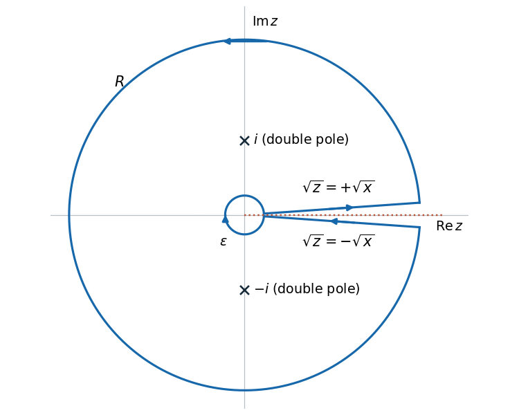

<h1 id="4/c/solution">Solution</h1>

↑ **Parent:** [C](../c.md)

Use a counterclockwise [keyhole contour](../../../../../keyhole-contour.md) around the positive real [branch cut](../../../../../branch-cut.md), with small radius $\varepsilon$ and large radius $R$. On the upper bank $\arg z=0$, so the integral tends to $I$. On the lower bank $\arg z=2\pi$, $z^{1/2}=-\sqrt{x}$, giving the negative of the upper-bank integrand. That bank is traversed from $R$ to $\varepsilon$, so its contribution also tends to $I$.

The outer circle contributes $O(R^{-3/2})$, since $f=O(R^{-5/2})$ and its length is $O(R)$. The small circle contributes $O(\varepsilon^{1/2})$, since $f=O(\varepsilon^{-1/2})$. Both vanish. Hence

$$
\boxed{C=\lim_{\varepsilon\to0,\,R\to\infty}\oint_{\Gamma_{\varepsilon,R}}f(z)\,dz=2I.}
$$

The contour encloses both double [poles](../../../../../pole.md) $\pm i$ but excludes the branch point.

**[Figure 1](#4/c/image-keyhole-contour-around-the-positive-real-branch-cut). Keyhole contour around the positive real branch cut**. The upper bank runs outwards and the lower bank runs inwards. The large circle is counterclockwise and the small circle is clockwise; both [poles](../../../../../pole.md) lie inside the contour. The gaps are enlarged for visibility.

## ↑ Ancestors (13)

1. [C](../c.md)
2. [4](../../4.md)
3. [Paper 2](../../../paper-2-split.md)
4. [2023](../../../split.md)
5. [Past exam of the mathematics course of the year 2 of the natural sciences course of the University of Cambridge](../../../../split.md)
6. [Mathematics course of the year 2 of the natural sciences course of the University of Cambridge](../../../../../mathematics-course-of-the-year-2-of-the-natural-sciences-course-of-the-university-of-cambridge.md)
7. [Year 2 of the natural sciences course of the University of Cambridge](../../../../../year-2-of-the-natural-sciences-course-of-the-university-of-cambridge.md)
8. [Year of the natural sciences course of the University of Cambridge](../../../../../year-of-the-natural-sciences-course-of-the-university-of-cambridge.md)
9. [Natural sciences course of the University of Cambridge](../../../../../natural-sciences-course-of-the-university-of-cambridge.md)
10. [Course of the University of Cambridge](../../../../../course-of-the-university-of-cambridge.md)
11. [University of Cambridge](../../../../../university-of-cambridge-split.md)
12. [List of universities](../../../../../list-of-universities.md)
13. [Codex Wiki](../../../../../split.md)
