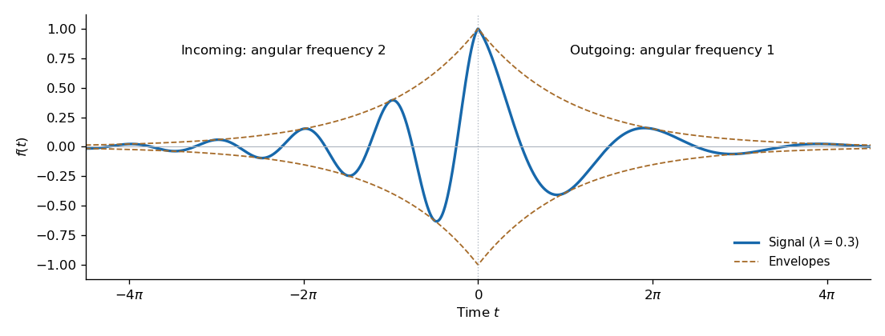

<h1 id="5/a/solution">Solution</h1>

↑ **Parent:** [A](../a.md)

The signal is continuous at zero with $f(0)=1$. Its envelope is $e^{-\lambda|t|}$, but its [angular frequency](../../../../../angular-frequency.md) falls from $2$ on the incoming side to $1$ on the outgoing side. Its one-sided slopes are $f'(0^-)=\lambda$ and $f'(0^+)=-\lambda$, producing a cusp at the peak. Both tails decay to zero.

**[Figure 2](#5/a/image-decaying-signal-with-a-frequency-change-at-closest-approach). Decaying signal with a frequency change at closest approach**. The illustration uses $\lambda=0.3$ to make the incoming and outgoing oscillations visible. Dashed curves show the envelopes $\pm e^{-\lambda|t|}$; the incoming oscillations have twice the outgoing [angular frequency](../../../../../angular-frequency.md).

Use $\widetilde f(\omega)=\int_{\mathbb R}e^{-i\omega t}f(t)\,dt$. Expanding each cosine into two exponentials and integrating its half-line gives

$$
\begin{aligned}
\widetilde f(\omega)
&=\frac12\left[\frac1{\lambda-i(\omega-2)}+\frac1{\lambda-i(\omega+2)}\right]\\
&\quad+\frac12\left[\frac1{\lambda+i(\omega-1)}+\frac1{\lambda+i(\omega+1)}\right].
\end{aligned}
$$

Equivalently,

$$
\boxed{\widetilde f(\omega)=\frac{\lambda-i\omega}{(\lambda-i\omega)^2+4}+\frac{\lambda+i\omega}{(\lambda+i\omega)^2+1}.}
$$

The positive $\lambda$ guarantees convergence of the [Fourier transform](../../../../../fourier-transform-split.md) integrals.

## ↑ Ancestors (13)

1. [A](../a.md)
2. [5](../../5.md)
3. [Paper 2](../../../paper-2-split.md)
4. [2023](../../../split.md)
5. [Past exam of the mathematics course of the year 2 of the natural sciences course of the University of Cambridge](../../../../split.md)
6. [Mathematics course of the year 2 of the natural sciences course of the University of Cambridge](../../../../../mathematics-course-of-the-year-2-of-the-natural-sciences-course-of-the-university-of-cambridge.md)
7. [Year 2 of the natural sciences course of the University of Cambridge](../../../../../year-2-of-the-natural-sciences-course-of-the-university-of-cambridge.md)
8. [Year of the natural sciences course of the University of Cambridge](../../../../../year-of-the-natural-sciences-course-of-the-university-of-cambridge.md)
9. [Natural sciences course of the University of Cambridge](../../../../../natural-sciences-course-of-the-university-of-cambridge.md)
10. [Course of the University of Cambridge](../../../../../course-of-the-university-of-cambridge.md)
11. [University of Cambridge](../../../../../university-of-cambridge-split.md)
12. [List of universities](../../../../../list-of-universities.md)
13. [Codex Wiki](../../../../../split.md)
