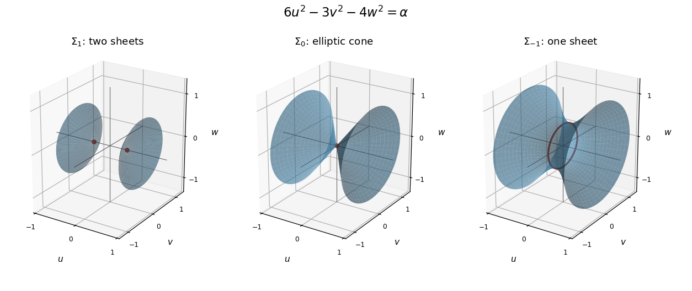

<h1 id="6/c/solution">Solution</h1>

↑ **Parent:** [C](../c.md)

In the [orthonormal basis](../../../../../orthonormal-basis.md) of part (b), the three [quadric surfaces](../../../../../quadric-surface.md) have the following forms. For $\alpha=1$,

$$
\frac{u^2}{1/6}-\frac{v^2}{1/3}-\frac{w^2}{1/4}=1,
$$

a [two-sheeted hyperboloid](../../../../../two-sheeted-hyperboloid.md) with axis $u$, vertices $(\pm1/\sqrt6,0,0)$, and one sheet on each side of the plane $u=0$. For $\alpha=0$,

$$
6u^2=3v^2+4w^2,
$$

an [elliptic cone](../../../../../elliptic-cone.md) with vertex at the origin and the same axis. For $\alpha=-1$,

$$
\frac{v^2}{1/3}+\frac{w^2}{1/4}-\frac{u^2}{1/6}=1,
$$

a [one-sheet hyperboloid](../../../../../one-sheet-hyperboloid.md) with axis $u$ and a waist [ellipse](../../../../../ellipse.md) at $u=0$, whose semiaxes are $1/\sqrt3$ along $v$ and $1/2$ along $w$. The sections at fixed $u$ enlarge away from the waist.

**[Figure 1](#6/c/image-the-two-sheeted-hyperboloid-elliptic-cone-and-one-sheet-hyperboloid-in-separate-orthonormal-coordinate-frames). The two-sheeted hyperboloid, elliptic cone and one-sheet hyperboloid in separate orthonormal coordinate frames**.

## ↑ Ancestors (13)

1. [C](../c.md)
2. [6](../../6.md)
3. [Paper 1](../../../paper-1-split.md)
4. [2024](../../../split.md)
5. [Past exam of the mathematics course of the year 2 of the natural sciences course of the University of Cambridge](../../../../split.md)
6. [Mathematics course of the year 2 of the natural sciences course of the University of Cambridge](../../../../../mathematics-course-of-the-year-2-of-the-natural-sciences-course-of-the-university-of-cambridge.md)
7. [Year 2 of the natural sciences course of the University of Cambridge](../../../../../year-2-of-the-natural-sciences-course-of-the-university-of-cambridge.md)
8. [Year of the natural sciences course of the University of Cambridge](../../../../../year-of-the-natural-sciences-course-of-the-university-of-cambridge.md)
9. [Natural sciences course of the University of Cambridge](../../../../../natural-sciences-course-of-the-university-of-cambridge.md)
10. [Course of the University of Cambridge](../../../../../course-of-the-university-of-cambridge.md)
11. [University of Cambridge](../../../../../university-of-cambridge-split.md)
12. [List of universities](../../../../../list-of-universities.md)
13. [Codex Wiki](../../../../../split.md)
