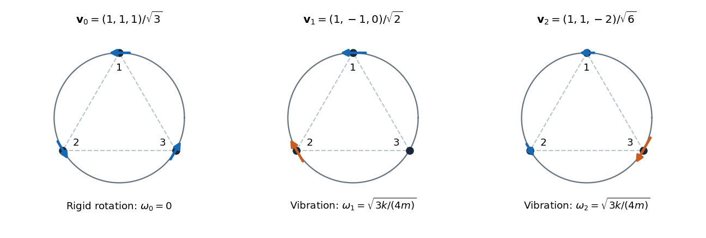

<h1 id="7/b/solution">Solution</h1>

↑ **Parent:** [B](../b.md)

Put $\theta_i=\theta_i^0+\eta_i$. Differentiating the spring length gives

$$
\delta\ell_{ij}=\frac{\sin(\theta_i^0-\theta_j^0)}{\sqrt3}(\eta_i-\eta_j),\qquad
(\delta\ell_{ij})^2=\frac14(\eta_i-\eta_j)^2.
$$

The springs are unextended at [equilibrium](../../../../../equilibrium-point-of-a-dynamical-system.md), so the quadratic [potential energy](../../../../../potential-energy.md) contains only the squares of these first-order extensions:

$$
U_2=\frac k8\left[(\eta_1-\eta_2)^2+(\eta_2-\eta_3)^2+(\eta_3-\eta_1)^2\right].
$$

The linearized [Euler-Lagrange equations](../../../../../euler-lagrange-equation.md) are therefore

$$
m\ddot{\boldsymbol\eta}+\frac k4
\begin{pmatrix}2&-1&-1\\-1&2&-1\\-1&-1&2\end{pmatrix}\boldsymbol\eta=0.
$$

The [stiffness matrix](../../../../../stiffness-matrix.md) is $(k/4)(3I-\mathbf 1\mathbf 1^T)$. Its [eigenvector](../../../../../eigenvector.md) $\mathbf 1=(1,1,1)^T$ has zero [eigenvalue](../../../../../eigenvalue.md), and every vector whose components sum to zero has [eigenvalue](../../../../../eigenvalue.md) $3k/4$. One convenient orthonormal set of [normal modes](../../../../../normal-mode.md) is

$$
\boxed{\begin{aligned}
\mathbf v_0&=\frac1{\sqrt3}(1,1,1)^T,&\omega_0&=0,\\
\mathbf v_1&=\frac1{\sqrt2}(1,-1,0)^T,&\omega_1&=\sqrt{\frac{3k}{4m}},\\
\mathbf v_2&=\frac1{\sqrt6}(1,1,-2)^T,&\omega_2&=\sqrt{\frac{3k}{4m}}.
\end{aligned}}
$$

Any orthonormal basis of the sum-zero plane is equally valid for the two degenerate [normal modes](../../../../../normal-mode.md). The general small motion is

$$
\boldsymbol\eta(t)=(A_0+B_0t)\mathbf v_0+\sum_{j=1}^2\left[A_j\cos(\omega_1t)+B_j\sin(\omega_1t)\right]\mathbf v_j.
$$

The linear drift in the [zero mode](../../../../../zero-mode.md) describes a slow uniform rotation. These are [angular frequencies](../../../../../angular-frequency.md); the ordinary [frequencies](../../../../../frequency.md) of the two vibrational modes are $\omega_1/(2\pi)$.

**[Figure 1](#7/b/image-tangential-displacement-patterns-of-the-three-bead-normal-modes). Tangential displacement patterns of the three bead normal modes**. Arrows show the signs and relative sizes of the angular displacements in one choice of orthonormal [normal modes](../../../../../normal-mode.md). The equal-arrow pattern is a rigid rotation, while the two sum-zero patterns have equal nonzero [angular frequency](../../../../../angular-frequency.md).

## ↑ Ancestors (13)

1. [B](../b.md)
2. [7](../../7.md)
3. [Paper 2](../../../paper-2-split.md)
4. [2024](../../../split.md)
5. [Past exam of the mathematics course of the year 2 of the natural sciences course of the University of Cambridge](../../../../split.md)
6. [Mathematics course of the year 2 of the natural sciences course of the University of Cambridge](../../../../../mathematics-course-of-the-year-2-of-the-natural-sciences-course-of-the-university-of-cambridge.md)
7. [Year 2 of the natural sciences course of the University of Cambridge](../../../../../year-2-of-the-natural-sciences-course-of-the-university-of-cambridge.md)
8. [Year of the natural sciences course of the University of Cambridge](../../../../../year-of-the-natural-sciences-course-of-the-university-of-cambridge.md)
9. [Natural sciences course of the University of Cambridge](../../../../../natural-sciences-course-of-the-university-of-cambridge.md)
10. [Course of the University of Cambridge](../../../../../course-of-the-university-of-cambridge.md)
11. [University of Cambridge](../../../../../university-of-cambridge-split.md)
12. [List of universities](../../../../../list-of-universities.md)
13. [Codex Wiki](../../../../../split.md)
