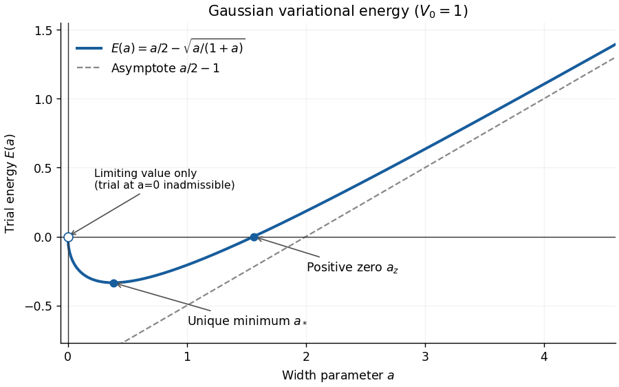

<h1 id="10/c/solution">Solution</h1>

↑ **Parent:** [C](../c.md)

Differentiating the [Gaussian variational bound for an attractive Gaussian well](../../../../../gaussian-variational-bound-for-an-attractive-gaussian-well.md) gives

$$
E'(a)=\frac12-\frac{V_0}{2\sqrt a(1+a)^{3/2}}.
$$

Thus an interior [stationary point](../../../../../stationary-point.md) obeys

$$
\boxed{\sqrt{a_*}(1+a_*)^{3/2}=V_0,\qquad a_*(1+a_*)^3=V_0^2.}
$$

The left side of the first equation increases strictly from zero to infinity, so there is exactly one such point. More explicitly,

$$
E''(a)=\frac{V_0(1+4a)}{4a^{3/2}(1+a)^{5/2}}>0,
$$

so $E$ is a [strictly convex function](../../../../../strictly-convex-function.md) on $a>0$ and $a_*$ is its global minimum. At that minimum the stationarity equation gives

$$
E(a_*)=\frac{a_*}{2}-a_*(1+a_*)=-\frac{a_*}{2}-a_*^2<0.
$$

There is a continuous limiting zero at $a=0$, although $y_T=1$ at exactly $a=0$ is not a [square-integrable function](../../../../../square-integrable-function.md) and hence is not an admissible trial. For a positive zero, division by $\sqrt a$ and squaring gives $a(1+a)=4V_0^2$, so

$$
\boxed{a_z=\frac{\sqrt{1+16V_0^2}-1}{2}}
$$

is the unique positive zero. The other quadratic root is negative and inadmissible. Near zero,

$$
E(a)=-V_0\sqrt a+\frac a2+O(a^{3/2}),
$$

so the graph leaves the origin with slope $-\infty$, falls to its unique negative minimum, rises through $a_z$, and grows as $a/2-V_0+O(a^{-1})$ at infinity.

**[Figure 1](#10/c/image-the-gaussian-variational-bound-for-an-attractive-gaussian-well-at-v-0-1-showing-its-negative-minimum-and-positive-zero). The Gaussian variational bound for an attractive Gaussian well at $V_0=1$, showing its negative minimum and positive zero**.

By the [Rayleigh-Ritz variational principle](../../../../../rayleigh-ritz-variational-principle.md),

$$
\boxed{E_0\leq E(a_*)=-\frac{a_*}{2}-a_*^2<0.}
$$

Thus the attractive well supports a negative-energy [bound state](../../../../../bound-state.md) for every $V_0>0$.

## ↑ Ancestors (13)

1. [C](../c.md)
2. [10](../../10.md)
3. [Paper 1](../../../paper-1-split.md)
4. [2025](../../../split.md)
5. [Past exam of the mathematics course of the year 2 of the natural sciences course of the University of Cambridge](../../../../split.md)
6. [Mathematics course of the year 2 of the natural sciences course of the University of Cambridge](../../../../../mathematics-course-of-the-year-2-of-the-natural-sciences-course-of-the-university-of-cambridge.md)
7. [Year 2 of the natural sciences course of the University of Cambridge](../../../../../year-2-of-the-natural-sciences-course-of-the-university-of-cambridge.md)
8. [Year of the natural sciences course of the University of Cambridge](../../../../../year-of-the-natural-sciences-course-of-the-university-of-cambridge.md)
9. [Natural sciences course of the University of Cambridge](../../../../../natural-sciences-course-of-the-university-of-cambridge.md)
10. [Course of the University of Cambridge](../../../../../course-of-the-university-of-cambridge.md)
11. [University of Cambridge](../../../../../university-of-cambridge-split.md)
12. [List of universities](../../../../../list-of-universities.md)
13. [Codex Wiki](../../../../../split.md)
