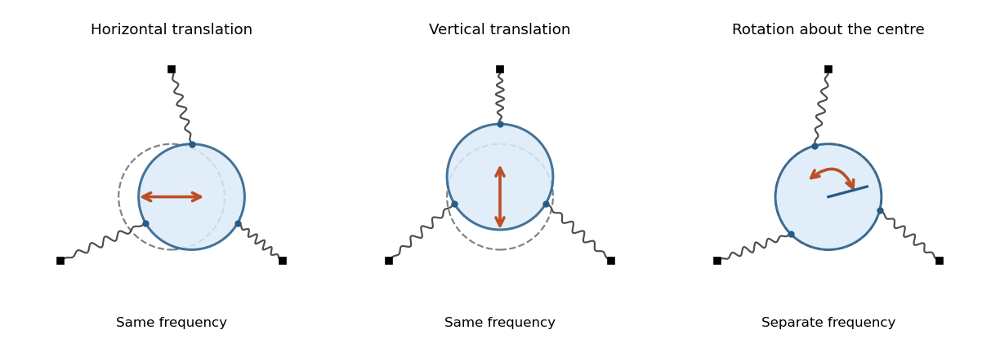

<h1 id="7/b/solution">Solution</h1>

↑ **Parent:** [B](../b.md)

The quadratic [Lagrangian](../../../../../lagrangian.md) is diagonal in $x,y,\theta$, so the [Euler-Lagrange equations](../../../../../euler-lagrange-equation.md) give two pure translations and one pure rotation. Their [angular frequencies](../../../../../angular-frequency.md) are

$$
\boxed{\omega_x^2=\omega_y^2=\frac{3k}{2m}\left(1+\frac{l-l_0}{l}\right),\qquad
\omega_\theta^2=\frac{6k(l-l_0)(a+l)}{mal}.}
$$

A horizontal translation has $(x,y,\theta)=(A\cos\omega_xt,0,0)$; a vertical translation has $(0,A\cos\omega_yt,0)$; and the rotational mode has $(0,0,A\cos\omega_\theta t)$. Any fixed-direction translation is another choice in the same two-dimensional degenerate [normal mode](../../../../../normal-mode.md) space. The rotation keeps the centre fixed.

**[Figure 1](#7/b/image-two-degenerate-translations-and-a-separate-rotation-of-a-disk-on-symmetric-radial-springs). Two degenerate translations and a separate rotation of a disk on symmetric radial springs**. Original schematic of the three [normal modes](../../../../../normal-mode.md); arrows indicate the independent motions, and the dashed disk marks the equilibrium position.

## ↑ Ancestors (13)

1. [B](../b.md)
2. [7](../../7.md)
3. [Paper 2](../../../paper-2-split.md)
4. [2025](../../../split.md)
5. [Past exam of the mathematics course of the year 2 of the natural sciences course of the University of Cambridge](../../../../split.md)
6. [Mathematics course of the year 2 of the natural sciences course of the University of Cambridge](../../../../../mathematics-course-of-the-year-2-of-the-natural-sciences-course-of-the-university-of-cambridge.md)
7. [Year 2 of the natural sciences course of the University of Cambridge](../../../../../year-2-of-the-natural-sciences-course-of-the-university-of-cambridge.md)
8. [Year of the natural sciences course of the University of Cambridge](../../../../../year-of-the-natural-sciences-course-of-the-university-of-cambridge.md)
9. [Natural sciences course of the University of Cambridge](../../../../../natural-sciences-course-of-the-university-of-cambridge.md)
10. [Course of the University of Cambridge](../../../../../course-of-the-university-of-cambridge.md)
11. [University of Cambridge](../../../../../university-of-cambridge-split.md)
12. [List of universities](../../../../../list-of-universities.md)
13. [Codex Wiki](../../../../../split.md)
