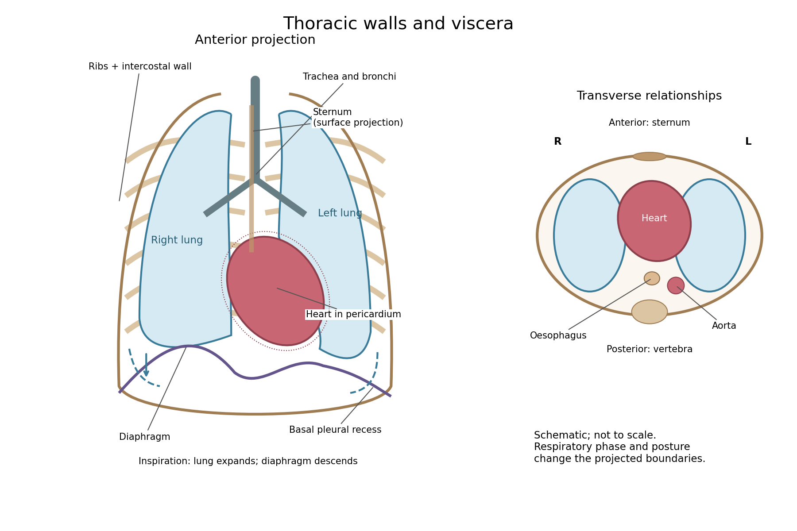
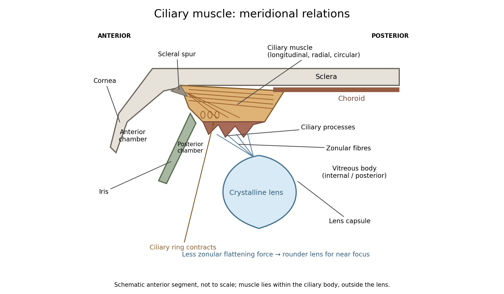

# Anatomy and physiology

↑ **Parent:** [First examination](../first-examination.md)

Original volume: [Examination papers for the Degree of Bachelor of Medicine by the University of Oxford (1864–1867)](../../../biology-bibliography.md#examination-papers-for-the-degree-of-bachelor-of-medicine-by-the-university-of-oxford-1864-1867). [Open the original paper in the scanned volume, PDF page 11](https://upload.wikimedia.org/wikipedia/commons/3/3e/Examination_papers_for_the_Degree_of_Bachelor_of_medicine_-_1864-67_(IA_b24757810).pdf#page=11).

Original questions are transcribed from the public-domain edition. Credit: Wellcome Collection; original supplied by Royal College of Physicians, London. [Source and public-domain rights statement](https://wellcomecollection.org/works/d7b9zgnx).

**Table of contents**

- [1](#1)
  - [Solution](#1/solution)
- [2](#2)
  - [Solution](#2/solution)
- [3](#3)
  - [Solution](#3/solution)
- [4](#4)
  - [Solution](#4/solution)
- [5](#5)
  - [Solution](#5/solution)
- [6](#6)
  - [Solution](#6/solution)
- [7](#7)
  - [Solution](#7/solution)
- [8](#8)
  - [Solution](#8/solution)
- [9](#9)
  - [Solution](#9/solution)
- [10](#10)
  - [Solution](#10/solution)
- [11](#11)
  - [Solution](#11/solution)
- [12](#12)
  - [Solution](#12/solution)

## 1

↑ **Parent:** [Anatomy and physiology](anatomy-and-physiology.md)

**Original question.**

Make a sketch of the walls of the Thorax together with the Viscera they contain ; and state the variations which may and do take place in the relations they hold to each other consistently with health.

<h3 id="1/solution">Solution</h3>

↑ **Parent:** [1](#1)

**The [thorax](../../../anatomy.md#thorax) is a mobile osteocartilaginous enclosure with two pleural compartments and a central [mediastinum](../../../anatomy.md#mediastinum); its visceral boundaries change normally with breathing and posture.** The sketch is an anterior projection, with the subject's right on the viewer's left. It distinguishes the lower margin of a [lung](../../../anatomy.md#lung) from the lower reflection of its [pleura](../../../anatomy.md#pleura): those are different boundaries.

**[Figure 1](#1/image-thoracic-walls-visceral-projection-and-respiratory-movement). Thoracic walls, visceral projection and respiratory movement**.

The posterior wall is formed by the twelve thoracic [vertebrae](../../../anatomy.md#vertebra) and adjacent parts of the [ribs](../../../anatomy.md#rib); laterally the [ribs](../../../anatomy.md#rib) and [intercostal muscles](../../../anatomy.md#intercostal-muscle) form a flexible wall. Anteriorly lie the [sternum](../../../anatomy.md#sternum), costal cartilages and anterior intercostal structures. The superior aperture communicates with the neck, while the [respiratory diaphragm](../../../anatomy.md#respiratory-diaphragm) closes the inferior aperture. The lower thoracic wall therefore overlaps upper abdominal organs: not every organ under a lower [rib](../../../anatomy.md#rib) is inside the pleural compartment.

Each [lung](../../../anatomy.md#lung) is covered by visceral [pleura](../../../anatomy.md#pleura). Parietal [pleura](../../../anatomy.md#pleura) lines the chest wall, upper surface of the [respiratory diaphragm](../../../anatomy.md#respiratory-diaphragm) and side of the [mediastinum](../../../anatomy.md#mediastinum), becoming continuous with visceral [pleura](../../../anatomy.md#pleura) at the root. The potential pleural space contains a lubricating fluid film; it is not normally an air-filled gap. The right [lung](../../../anatomy.md#lung) has three lobes, the left two, with the cardiac notch and lingula accommodating the leftward projection of the [heart](../../../physiology.md#heart). Each apex projects above the first [rib](../../../anatomy.md#rib) into the root of the neck. The roots carry the [bronchi](../../../anatomy.md#bronchus), pulmonary vessels, [nerves](../../../neuroscience.md#nerve) and lymphatic connections.[Gross Anatomy of the Lungs; Pleura of the Lungs: lobes, hilum and pleural layers](../../../anatomy-and-physiology-bibliography.md#anatomy-and-physiology-2e-by-j-gordon-betts-and-others/22-2-the-lungs)

The [heart](../../../physiology.md#heart) and [pericardium](../../../physiology.md#pericardium) occupy chiefly the middle part of the inferior [mediastinum](../../../anatomy.md#mediastinum), behind the [sternum](../../../anatomy.md#sternum) and between the [lungs](../../../anatomy.md#lung), with most of the cardiac bulk to the left of the median plane. The great vessels approach superiorly. The [trachea](../../../anatomy.md#trachea) divides into main [bronchi](../../../anatomy.md#bronchus) behind the upper central region; the [oesophagus](../../../anatomy.md#oesophagus) descends behind the airway and [heart](../../../physiology.md#heart). The descending thoracic [aorta](../../../physiology.md#aorta) lies posteriorly, chiefly left of the vertebral bodies; the azygos venous route lies chiefly on the right. The [thoracic duct](../../../physiology.md#thoracic-duct) and sympathetic chains belong to the posterior relations. A frontal projection superposes these structures and must not be mistaken for their order from front to back.

For a conventional quiet-breathing surface description, the lower [lung](../../../anatomy.md#lung) border reaches approximately the sixth [rib](../../../anatomy.md#rib) in the midclavicular line, eighth in the midaxillary line and tenth posteriorly near the scapular line. The pleural reflection descends approximately two [ribs](../../../anatomy.md#rib) farther at corresponding landmarks: eighth, tenth and twelfth. These are orientation points, not immutable lines in every healthy individual. Inferiorly, the extra pleural extent forms the [costodiaphragmatic recess](../../../anatomy.md#costodiaphragmatic-recess). The right diaphragmatic dome usually stands higher, related to the underlying [liver](../../../physiology.md#liver); the left is related to the [stomach](../../../physiology.md#stomach) and other abdominal viscera.

In inspiration the [respiratory diaphragm](../../../anatomy.md#respiratory-diaphragm) descends, the [rib](../../../anatomy.md#rib) cage expands and lower [lung](../../../anatomy.md#lung) margins move into the recesses; in expiration they retreat. The [heart](../../../physiology.md#heart) also shifts with the diaphragm and changes its surface projection as neighbouring [lung](../../../anatomy.md#lung) expands. Deep inspiration, quiet expiration and forced expiration therefore cannot share a single normal map. The [heart](../../../physiology.md#heart)'s own beat adds smaller cyclic movements.

Posture shifts the diaphragm and mediastinal contents: a supine position generally raises the domes compared with standing, while lateral positioning displaces mobile contents towards the dependent side. Body build, age, abdominal fullness and pregnancy change the available thoracic shape and diaphragmatic level. A distended [stomach](../../../physiology.md#stomach) can raise the left dome and alter the cardiac projection without implying primary cardiac disease. The clinically useful comparison records posture and respiratory phase before judging an apparent difference in organ position.

## 2

↑ **Parent:** [Anatomy and physiology](anatomy-and-physiology.md)

**Original question.**

Give an account of the distribution, functions, and connections, of the Glossopharyngeal Nerve.

<h3 id="2/solution">Solution</h3>

↑ **Parent:** [2](#2)

**The [glossopharyngeal nerve](../../../neuroscience.md#glossopharyngeal-nerve) is a mixed ninth [cranial nerve](../../../neuroscience.md#cranial-nerve): it carries pharyngeal and lingual sensation, posterior [tongue](../../../anatomy.md#tongue) taste, carotid sensory input, motor fibres to [stylopharyngeus](../../../anatomy.md#stylopharyngeus), and a secretomotor route to the [parotid gland](../../../anatomy.md#parotid-gland).** Its connections explain why its name alone understates its functions.

Rootlets leave the lateral [medulla oblongata](../../../neuroscience.md#medulla-oblongata), behind the olive and above those of the [vagus nerve](../../../neuroscience.md#vagus-nerve). They cross the posterior cranial fossa and leave through the [jugular foramen](../../../anatomy.md#jugular-foramen). Superior and inferior sensory [ganglia](../../../neuroscience.md#ganglion) lie at or near that passage. The cervical trunk descends in relation to the [internal carotid artery](../../../physiology.md#internal-carotid-artery) and [internal jugular vein](../../../anatomy.md#internal-jugular-vein), then turns forwards around [stylopharyngeus](../../../anatomy.md#stylopharyngeus). It reaches the pharyngeal wall between the superior and middle constrictors and divides towards the posterior [tongue](../../../anatomy.md#tongue), tonsillar region and [pharynx](../../../anatomy.md#pharynx). Its topographical association with the vagus does not make the two [nerves](../../../neuroscience.md#nerve) functionally identical.

The tympanic branch returns through the inferior tympanic canaliculus into the middle ear. Its tympanic plexus supplies the mucosa of the tympanic cavity, auditory tube and related air spaces and communicates with carotid sympathetic fibres. Preganglionic [parasympathetic](../../../neuroscience.md#parasympathetic) fibres continue through the [lesser petrosal nerve](../../../neuroscience.md#lesser-petrosal-nerve) to the [otic ganglion](../../../neuroscience.md#otic-ganglion). Postganglionic fibres then reach the [parotid gland](../../../anatomy.md#parotid-gland) with the [auriculotemporal nerve](../../../neuroscience.md#auriculotemporal-nerve), a branch of the mandibular division of the [trigeminal nerve](../../../neuroscience.md#trigeminal-nerve). This is a useful example of fibres originating in one cranial outflow and travelling for their last segment with another [nerve](../../../neuroscience.md#nerve).[Branches; Supplied Structures: tympanic plexus, lesser petrosal and parotid pathway](../../../neuroscience-bibliography.md#glossopharyngeal-nerve-by-complete-anatomy)

The branch to [stylopharyngeus](../../../anatomy.md#stylopharyngeus) is motor; contraction elevates and expands the [pharynx](../../../anatomy.md#pharynx) during swallowing. Pharyngeal branches contribute to the [pharyngeal plexus](../../../neuroscience.md#pharyngeal-plexus), together with the [vagus nerve](../../../neuroscience.md#vagus-nerve) and sympathetic connections. The principal motor supply of the pharyngeal constrictors is vagal: membership of a mixed plexus does not justify assigning every fibre or every pharyngeal [muscle](../../../anatomy.md#muscle) to the ninth [nerve](../../../neuroscience.md#nerve). Tonsillar branches supply the palatine tonsil and neighbouring mucosa. Lingual branches carry ordinary sensation and taste from the posterior third of the [tongue](../../../anatomy.md#tongue), including the vallate papillae even though these lie just anterior to the terminal groove.

The [carotid sinus nerve](../../../neuroscience.md#carotid-sinus-nerve) carries information from pressure-sensitive endings in the [carotid sinus](../../../physiology.md#carotid-sinus) and from the [carotid body](../../../physiology.md#carotid-body)'s chemical sensors. The first contributes to regulation of [blood pressure](../../../physiology.md#blood-pressure); the second responds especially to arterial [oxygen](../../../chemical-substance.md#oxygen) deficiency, with responses also influenced by [carbon dioxide](../../../chemical-substance.md#carbon-dioxide) and acidity. These are afferent functions, distinct from the motor and secretory branches.[Structure and Function; Nerves: distribution and sensory branches](../../../neuroscience-bibliography.md#neuroanatomy-cranial-nerve-9-glossopharyngeal-statpearls)

In the modern central account, branchial motor fibres arise from the [nucleus ambiguus](../../../neuroscience.md#nucleus-ambiguus), parasympathetic fibres from the inferior salivatory nucleus, visceral and taste afferents project towards the [solitary nucleus](../../../neuroscience.md#solitary-nucleus), and relevant general sensory fibres project to the spinal trigeminal system. These nuclear and reflex distinctions refine the gross anatomical description available in 1864. Pharyngeal touch can initiate swallowing and contributes to the afferent limb of the [gag reflex](../../../neuroscience.md#gag-reflex), whose principal motor limb is vagal. Ordinary sensation, taste, pharyngeal movement and secretion therefore need separate observations; the absence of one response does not by itself prove loss of every ninth-[nerve](../../../neuroscience.md#nerve) function.[Basic Science; examination of pharyngeal sensation, movement and reflexes](../../../neuroscience-bibliography.md#cranial-nerves-ix-and-x-in-clinical-methods)

## 3

↑ **Parent:** [Anatomy and physiology](anatomy-and-physiology.md)

**Original question.**

What properties must a substance possess to justify you in speaking of it as a “Food ?” Classify such substances.

<h3 id="3/solution">Solution</h3>

↑ **Parent:** [3](#3)

**A [food](../../../physiology.md#food) supplies material or usable chemical [energy](../../../energy.md) that contributes to the organism's maintenance, growth or normal function after ingestion and physiological processing.** It must be usable in the amount and form supplied, without its harmful effects defeating that nutritive role. Mere combustibility, a pleasant taste, or the presence of [carbon](../../../chemical-substance.md#carbon) and [nitrogen](../../../chemical-substance.md#nitrogen) is insufficient.

An edible material may need [digestion](../../../physiology.md#digestion) before its constituents can be absorbed. A [protein](../../../protein.md) need not enter the [blood](../../../physiology.md#blood) unchanged to nourish: [hydrolysis](../../../chemical-reaction.md#hydrolysis) supplies absorbable [amino acids](../../../chemical-substance.md#amino-acid). Conversely, a substance can burn in a laboratory yet furnish little accessible [energy](../../../energy.md) to human [metabolism](../../../metabolism.md). The nutritional value of a mixture depends on availability, proportions and the organism consuming it. No requirement says that each separate [food](../../../physiology.md#food) must contain every constituent of a complete diet.

A useful nineteenth-century division separates nitrogenous or plastic [foods](../../../physiology.md#food) from non-nitrogenous or respiratory [foods](../../../physiology.md#food). The first includes animal and plant [proteins](../../../protein.md), which supply [amino acids](../../../chemical-substance.md#amino-acid) for tissue renewal. The second includes [carbohydrates](../../../chemical-substance.md#carbohydrate) and [fats](../../../chemical-substance.md#fat), whose oxidation supplies much of the body's [energy](../../../energy.md). But the division is functional rather than absolute: [proteins](../../../protein.md) can also be oxidized, and [lipids](../../../chemical-substance.md#lipid) and [carbohydrates](../../../chemical-substance.md#carbohydrate) supply material for cellular structures as well as fuel. The modern account follows [anabolism](../../../metabolism.md#anabolism) and [catabolism](../../../metabolism.md#catabolism) rather than assigning each class one exclusive destination.[Anabolic and Catabolic Reactions: synthesis, breakdown and energy transfer](../../../anatomy-and-physiology-bibliography.md#anatomy-and-physiology-2e-by-j-gordon-betts-and-others/24-1-overview-of-metabolic-reactions)

A fuller classification includes [proteins](../../../protein.md); [carbohydrates](../../../chemical-substance.md#carbohydrate), including sugars and [starch](../../../chemical-substance.md#starch); [lipids](../../../chemical-substance.md#lipid), including [fats](../../../chemical-substance.md#fat) and essential fatty components; [water](../../../chemical-substance.md#water); and required [mineral](../../../planetary-science.md#mineral) constituents. [Water](../../../chemical-substance.md#water) provides solvent, transport medium and a participant in many reactions. [Mineral](../../../planetary-science.md#mineral) constituents supply, among other needs, ions for electrical and osmotic functions and material for mineralized tissues. Neither class has to supply combustible [energy](../../../energy.md) to be indispensable. Meat, milk, grain and legumes are mixtures spanning several classes, rather than chemically pure examples of just one.

In modern classification, [vitamins](../../../biology.md#vitamin) and other required micronutrients must also be included. Their specific deficiency roles and present classification should not be attributed wholesale to 1864. [Dietary fibre](../../../physiology.md#dietary-fibre) is not equivalent to digestible [starch](../../../chemical-substance.md#starch); it can have important intestinal functions, and fermentable fractions can contribute metabolites through the microbiota. The adequacy of a diet concerns the whole combination of nutrients and the person's requirements, not a single measure of heat released on burning it.[Macronutrients; Vitamins; Minerals: energy-yielding and non-energy-yielding nutritional requirements](../../../anatomy-and-physiology-bibliography.md#anatomy-and-physiology-2e-by-j-gordon-betts-and-others/24-7-nutrition-and-diet)

[Oxygen](../../../chemical-substance.md#oxygen) is essential to ordinary aerobic life, but in the usual dietary sense it is a respiratory input rather than an ingested [food](../../../physiology.md#food) class. Likewise, a drug that changes appetite or stimulates a physiological response is not thereby a substitute for nutritive material. A convincing experiment on [food](../../../physiology.md#food) value must distinguish failure to eat, failure to digest or absorb, and a genuine missing dietary constituent; maintaining equal gross [food](../../../physiology.md#food) mass alone does not control those differences.

## 4

↑ **Parent:** [Anatomy and physiology](anatomy-and-physiology.md)

**Original question.**

Give an account of the assimilation of Nitrogen' by Plants, and of the excretion of it by Animals.

<h3 id="4/solution">Solution</h3>

↑ **Parent:** [4](#4)

**[Plants](../../../organism.md#plant) generally incorporate combined [nitrogen](../../../chemical-substance.md#nitrogen) into organic compounds, whereas [animals](../../../organism.md#animal) eliminate the surplus [nitrogen](../../../chemical-substance.md#nitrogen) of metabolized compounds chiefly as [Ammonia](../../../chemical-substance.md#ammonia), [urea](../../../chemical-substance.md#urea) or [uric acid](../../../metabolism.md#uric-acid).** The two processes connect [nitrogen](../../../chemical-substance.md#nitrogen) chemistry to the organism's [carbon](../../../chemical-substance.md#carbon) supply, [water](../../../chemical-substance.md#water) economy and environment.

Roots take up [nitrate](../../../chemistry.md#nitrate) and [ammonium](../../../chemistry.md#ammonium) from their surroundings. [Nitrate](../../../chemistry.md#nitrate) must be reduced before its [nitrogen](../../../chemical-substance.md#nitrogen) can be incorporated in the usual amino form: [nitrate reductase](../../../enzyme.md#nitrate-reductase) produces [nitrite](../../../chemical-substance.md#nitrite), and [nitrite reductase](../../../enzyme.md#nitrite-reductase) produces [ammonium](../../../chemistry.md#ammonium). The balanced reduction, written without implying a single elementary reaction, is

$$
\boxed{\mathrm{NO_3^-}+10\mathrm{H^+}+8e^-\longrightarrow\mathrm{NH_4^+}+3\mathrm{H_2O}}.
$$

Reducing equivalents and [energy](../../../energy.md) must be supplied by [metabolism](../../../metabolism.md); [nitrate](../../../chemistry.md#nitrate) is not simply deposited unchanged inside every [protein](../../../protein.md).

In the modern biochemical account, [glutamine synthetase](../../../enzyme.md#glutamine-synthetase) incorporates [ammonium](../../../chemistry.md#ammonium) into [glutamine](../../../chemical-substance.md#glutamine), using [ATP](../../../molecule.md#adenosine-triphosphate); [glutamate synthase](../../../enzyme.md#glutamate-synthase) transfers that [nitrogen](../../../chemical-substance.md#nitrogen) to a [carbon](../../../chemical-substance.md#carbon) skeleton derived from [2-Oxoglutarate](../../../chemical-substance.md#2-oxoglutarate), producing [glutamate](../../../chemical-substance.md#glutamate). Further transfer and synthesis distribute [nitrogen](../../../chemical-substance.md#nitrogen) into other [amino acids](../../../chemical-substance.md#amino-acid), [proteins](../../../protein.md), [nucleotides](../../../molecule.md#nucleotide) and other [cell](../../../biological-cell.md) constituents. [Carbon](../../../chemical-substance.md#carbon) [metabolism](../../../metabolism.md) therefore provides both [energy](../../../energy.md) and skeletons for [nitrogen assimilation](../../../botany.md#nitrogen-assimilation). These named enzymes and reactions explain the process today; they were not a completed molecular scheme in 1864.[Nitrogen Assimilation: nitrate reduction and the GS/GOGAT cycle](../../../plant-biology-bibliography.md#nitrogen-uptake-assimilation-and-remobilization-in-plants)

Ordinary higher-plant [cells](../../../biological-cell.md) do not themselves reduce atmospheric [molecular nitrogen](../../../chemical-substance.md#molecular-nitrogen) merely because the gas surrounds the leaves. Biological [nitrogen fixation](../../../ecology.md#nitrogen-fixation) is performed by particular microorganisms; symbiotic associations can supply fixed [nitrogen](../../../chemical-substance.md#nitrogen) to a host plant. The later elucidation of root-nodule symbiosis should be distinguished from what the examiner could have expected. Organic [nitrogen](../../../chemical-substance.md#nitrogen) can also be taken up in suitable circumstances, so [nitrate](../../../chemistry.md#nitrate) and [ammonium](../../../chemistry.md#ammonium) are important routes rather than an exhaustive prohibition on every other source.[The Nitrogen Cycle: fixation, ammonification, nitrification and return to the atmosphere](../../../biology-bibliography.md#biology-2e-by-mary-ann-clark-and-others/46-3-biogeochemical-cycles)

A useful assimilation experiment grows comparable seedlings in a defined medium containing all required [minerals](../../../planetary-science.md#mineral) except combined [nitrogen](../../../chemical-substance.md#nitrogen), with parallel [nitrate](../../../chemistry.md#nitrate)- or [ammonium](../../../chemistry.md#ammonium)-supplied cultures. Initial seed reserves, contaminating [nitrogen](../../../chemical-substance.md#nitrogen), [water](../../../chemical-substance.md#water) and microbial growth must be allowed for. Growth and final [nitrogen](../../../chemical-substance.md#nitrogen) content are more informative than green appearance alone. A plant initially growing in a [nitrogen](../../../chemical-substance.md#nitrogen)-free solution may simply be consuming seed reserves; that observation does not demonstrate fixation of atmospheric [nitrogen](../../../chemical-substance.md#nitrogen).

Animals obtain most of their [nitrogen](../../../chemical-substance.md#nitrogen) from organic [food](../../../physiology.md#food). [Amino acid metabolism](../../../metabolism.md#amino-acid-metabolism) separates [nitrogen](../../../chemical-substance.md#nitrogen) handling from oxidation or reuse of the [carbon](../../../chemical-substance.md#carbon) skeleton. Free [Ammonia](../../../chemical-substance.md#ammonia) is toxic at high concentrations, and mammals convert much of their waste [nitrogen](../../../chemical-substance.md#nitrogen) into [urea](../../../chemical-substance.md#urea) in the [liver](../../../physiology.md#liver); the [kidneys](../../../anatomy.md#kidney) then eliminate it in [urine](../../../physiology.md#urine). [Uric acid](../../../metabolism.md#uric-acid) is also produced from [purine](../../../molecule.md#purine) breakdown. Renal [ammonium](../../../chemistry.md#ammonium) excretion has a separate important connection with acid-base balance. **[Urea](../../../chemical-substance.md#urea) formation and urinary excretion are different processes in different organs.**[Ammonia; Urea; Uric Acid: toxicity, water requirements and comparative routes](../../../biology-bibliography.md#biology-2e-by-mary-ann-clark-and-others/41-4-nitrogenous-wastes)

Many aquatic animals can release [Ammonia](../../../chemical-substance.md#ammonia) directly into abundant surrounding [water](../../../chemical-substance.md#water). Birds, many reptiles and many insects eliminate much [nitrogen](../../../chemical-substance.md#nitrogen) as relatively insoluble [uric acid](../../../metabolism.md#uric-acid), conserving [water](../../../chemical-substance.md#water); mammals generally depend more on soluble [urea](../../../chemical-substance.md#urea). These are broad physiological strategies with exceptions, not a rule that all animals have human [urine](../../../physiology.md#urine). Faecal [nitrogen](../../../chemical-substance.md#nitrogen) includes unabsorbed [food](../../../physiology.md#food) as well as endogenous material, while smaller losses can occur through [skin](../../../physiology.md#skin) and secretions. For a stated interval the accounting identity is

$$
\boxed{N_{\rm intake}-N_{\rm total\ loss}=\Delta N_{\rm body}}.
$$

Positive retention during growth and negative balance during tissue loss need not be errors of excretion. [Nitrogen](../../../chemical-substance.md#nitrogen) is redistributed or lost in compounds; it is not simply breathed out as all the atmospheric [nitrogen](../../../chemical-substance.md#nitrogen) passing through the [lungs](../../../anatomy.md#lung).

## 5

↑ **Parent:** [Anatomy and physiology](anatomy-and-physiology.md)

**Original question.**

What are the microscopic appearances presented by the more common varieties of Starch, and in what do their Chemical reactions differ from those of Dextrin and Inulin ?

<h3 id="5/solution">Solution</h3>

↑ **Parent:** [5](#5)

**[Starch granules](../../../chemical-substance.md#starch-granule) can often be distinguished by their shape, size distribution, hilum and lamellae; [dextrin](../../../chemical-substance.md#dextrin) and [inulin](../../../chemical-substance.md#inulin) are distinguished chiefly by their molecular constitution, solubility and chemical reactions.** An isolated particle of uncertain origin cannot always be identified uniquely by one feature.

In a [water](../../../chemical-substance.md#water)-mounted preparation of unheated [starch](../../../chemical-substance.md#starch), potato granules are usually relatively large, oval or pear-shaped, often with an eccentric hilum near the narrower end and conspicuous curved growth markings. Wheat gives a characteristic mixture of larger flattened lenticular granules and small rounded granules; the hilum and rings are less conspicuous. Rice [starch](../../../chemical-substance.md#starch) consists of very small angular or polyhedral granules, often still associated into compound groups. These are distributions rather than a guarantee that every potato granule is larger than every wheat granule.[Microscopic identification: potato, wheat and rice granule shape, hilum and striations](../../../pharmacology-and-toxicology-bibliography.md#starches-in-the-international-pharmacopoeia)

Maize commonly gives polygonal or rounded granules with a central point or fissured hilum; oats characteristically include aggregates of small angular granules. Arrowroot commonly has oval or elongated granules, sometimes with a transverse fissure towards one end. Preparation, variety and processing change the apparent population. Rotation between crossed polarizers shows the organized granule structure through a characteristic extinction cross in many intact granules. Swelling and loss of birefringence on heating with sufficient [water](../../../chemical-substance.md#water) help demonstrate [starch gelatinization](../../../chemical-substance.md#starch-gelatinization), although the precise [temperature](../../../temperature.md) depends on the [starch](../../../chemical-substance.md#starch) source.

Cold [water](../../../chemical-substance.md#water) normally leaves native [starch granules](../../../chemical-substance.md#starch-granule) as a suspension rather than a clear molecular solution. On heating, granules swell and a paste develops. With [iodine](../../../chemical-substance.md#iodine) in iodide solution, ordinary [starch](../../../chemical-substance.md#starch) rich in sufficiently long [amylose](../../../chemical-substance.md#amylose) helices produces an intense blue or blue-black complex. Its intensity depends on chain structure and conditions; the response can weaken on heating and return on cooling if the chains remain suitable. Continued acid or enzymatic [hydrolysis](../../../chemical-reaction.md#hydrolysis) shortens chains and eventually destroys this characteristic blue response.

[Dextrin](../../../chemical-substance.md#dextrin) denotes a range of shorter or modified [glucose](../../../chemical-substance.md#glucose) polymers derived from [starch](../../../chemical-substance.md#starch), rather than one pure substance. Many preparations dissolve or disperse in [water](../../../chemical-substance.md#water) more readily and no longer show intact native granules. Their [iodine](../../../chemical-substance.md#iodine) reactions vary with chain length: some give violet or reddish-brown colours, while extensively shortened material gives no characteristic colour. It is therefore too absolute to say that every [dextrin](../../../chemical-substance.md#dextrin) is chemically identical or that no [dextrin](../../../chemical-substance.md#dextrin) can react with [iodine](../../../chemical-substance.md#iodine). The modern international specifications themselves distinguish [starch](../../../chemical-substance.md#starch) modifications and their variable [iodine](../../../chemical-substance.md#iodine) colours.[Definition: mixtures of glucose polymers produced by starch or glycogen hydrolysis](../../../biochemistry-and-biophysics-bibliography.md#dextrins-in-mesh)[Identification; iodine colours and hydrolysis test in the specifications summary](../../../biochemistry-and-biophysics-bibliography.md#modified-starches-specifications-by-the-joint-fao-and-who-expert-committee-on-food-additives)

[Inulin](../../../chemical-substance.md#inulin) is principally a [fructose](../../../chemical-substance.md#fructose)-based [fructan](../../../chemical-substance.md#fructan), with a different linkage pattern from [glucose](../../../chemical-substance.md#glucose)-based [starch](../../../chemical-substance.md#starch). It occurs, for example, in chicory and related storage organs. It does not give [starch](../../../chemical-substance.md#starch)'s blue [iodine](../../../chemical-substance.md#iodine) complex. It dissolves more readily in hot [water](../../../chemical-substance.md#water), and may separate as deposits on cooling or precipitation, but such deposits are not the characteristic native [starch granules](../../../chemical-substance.md#starch-granule). [Hydrolysis](../../../chemical-reaction.md#hydrolysis) yields mainly [fructose](../../../chemical-substance.md#fructose), whereas complete [starch](../../../chemical-substance.md#starch) or [dextrin](../../../chemical-substance.md#dextrin) [hydrolysis](../../../chemical-reaction.md#hydrolysis) yields [glucose](../../../chemical-substance.md#glucose). A copper-reduction test after [hydrolysis](../../../chemical-reaction.md#hydrolysis) detects reducing products in both cases and is therefore insufficient by itself to distinguish them. Their different [hydrolysis](../../../chemical-reaction.md#hydrolysis) products, interpreted with [iodine](../../../chemical-substance.md#iodine) reaction and [microscopy](../../../optics.md#microscopy), give a more specific comparison.[CHEBI:15443: beta-(2→1)-fructan identity](../../../biochemistry-and-biophysics-bibliography.md#inulin-in-chebi)

A sound comparison uses separately labelled reference preparations, equal [iodine](../../../chemical-substance.md#iodine) conditions and separate unheated and heated mounts. Inspecting an unknown mixture only after boiling destroys much of the morphological evidence. The combined observations distinguish source-related morphology from the effects of processing.

## 6

↑ **Parent:** [Anatomy and physiology](anatomy-and-physiology.md)

**Original question.**

What are the characteristics of the Human Fœtus at seven months ?

<h3 id="6/solution">Solution</h3>

↑ **Parent:** [6](#6)

**A seven-month [fetus](../../../biology.md#fetus) is recognizably human in its formed organs and external parts but remains immature in [fat](../../../chemical-substance.md#fat) stores, respiratory function, [temperature](../../../temperature.md) control and feeding coordination.** The month count must be stated: calendar months, four-week obstetric months and time since conception are not interchangeable.

A useful modern benchmark is around 28 completed gestational weeks, counted from the last menstrual period, about two weeks more than the usual time since fertilization. At that stage a typical crown-to-heel length is about 38 cm and mass about 1 kg, with substantial normal variation. Those are illustrative modern averages, not measurements of a particular [fetus](../../../biology.md#fetus) or exact historical thresholds for a seventh month. A historical count from conception would place the same numerical week count later in modern gestational dating.[What does my baby look like? Crown-to-heel length at 28 gestational weeks](../../../reproductive-and-urinary-medicine-bibliography.md#week-28-of-pregnancy-by-the-nhs)[How your baby is changing: approximate mass, eyelid opening and developing fat](../../../reproductive-and-urinary-medicine-bibliography.md#week-28-of-pregnancy-by-healthlink-bc)

The body is slender compared with a term newborn because subcutaneous [fat](../../../chemical-substance.md#fat) is still limited. The [skin](../../../physiology.md#skin) is relatively thin and reddish, with wrinkles, [lanugo](../../../anatomy.md#lanugo) and a variable covering of [vernix caseosa](../../../biology.md#vernix-caseosa). Hair and nails are present but their growth and the firmness of the ear cartilage remain immature. The eyelids have separated and can open around this period; this should not be confused with adult visual acuity or fully mature pupillary responses. Limb movements occur, but sustained flexor posture and coordinated behaviour are less developed than at term.[Developmental characteristics at 23–27, 28–31 and 32–35 weeks: skin, posture, movement and eye responses](../../../reproductive-and-urinary-medicine-bibliography.md#developmental-care-guideline-by-nhs-greater-glasgow-and-clyde)

The major organs are present, yet their organization and functional reserve continue to mature. The [brain](../../../neuroscience.md#brain) is growing rapidly and its surface folding increases. The [lungs](../../../anatomy.md#lung) are developing gas-exchanging regions and [pulmonary surfactant](../../../anatomy.md#pulmonary-surfactant) production, but an early birth can still entail serious respiratory difficulty. Fetal respiratory movements do not demonstrate that the [lungs](../../../anatomy.md#lung) are already performing ordinary air breathing: before birth the [placenta](../../../biology.md#placenta) supplies gas exchange. [Fetal circulation](../../../physiology.md#fetal-circulation) still includes its characteristic shunts. Genital appearance and testicular descent, when relevant, can contribute to maturity assessment but do not provide a precise independent calendar.

Survival after birth is possible, especially with current neonatal support, but viability is a probability conditioned by maturity, circumstances and available care, not a switch thrown on one date. Modern intensive-care results must not be represented as outcomes achievable in 1864. Nor is there a physiological rule that a healthy eight-month [fetus](../../../biology.md#fetus) is intrinsically less viable than a seven-month [fetus](../../../biology.md#fetus). A description of several concordant maturity features is more defensible than assigning an exact age or prognosis from size alone.

## 7

↑ **Parent:** [Anatomy and physiology](anatomy-and-physiology.md)

**Original question.**

Give a short account of the several substances known as Hæmatocrystallin, Hæmatoidin, Hæmatin, Chlorophyll, Biliverdin, Taurin, Excretin, Glycogen, Gluten, Legumin.

<h3 id="7/solution">Solution</h3>

↑ **Parent:** [7](#7)

**These names refer to several unrelated chemical classes: [blood](../../../physiology.md#blood) and bile pigments, a photosynthetic pigment family, an amino sulfonic acid, a disputed historical faecal extract, and storage [polysaccharides](../../../chemical-substance.md#polysaccharide) or [proteins](../../../protein.md).** Similar colour or a historical name does not establish chemical identity.

_[Haematocrystallin](../../../protein.md#hemoglobin)_ denotes the crystallizable colouring substance of red [blood](../../../physiology.md#blood), now identified with [hemoglobin](../../../protein.md#hemoglobin). It combines a globin [protein](../../../protein.md) with iron-containing [haem](../../../chemical-substance.md#haem) groups. Within intact red [cells](../../../biological-cell.md) it reversibly binds [oxygen](../../../chemical-substance.md#oxygen); oxygenated and deoxygenated forms have different absorption spectra. Crystals obtained from [blood](../../../physiology.md#blood) differ with species and preparation. This is not the same thing as a crystal formed from an old tissue haemorrhage. The word does not mean that all circulating [blood](../../../physiology.md#blood) normally consists of free pigment crystals.[Hemoglobin: globin, haem and oxygen carriage](../../../biochemistry-and-biophysics-bibliography.md#examples-of-hemoproteins-by-the-university-of-utah)

_[Haematoidin](../../../physiology.md#haematoidin)_ is the yellow-orange to reddish pigment characteristically encountered in old extravasated [blood](../../../physiology.md#blood), sometimes as rhomboidal crystals or radiating clusters. It is associated with [bilirubin](../../../physiology.md#bilirubin) and lacks the iron retained in [haemosiderin](../../../chemical-substance.md#haemosiderin). The historical inference that any reddish [blood](../../../physiology.md#blood)-derived crystal must be the same substance as [haematocrystallin](../../../protein.md#hemoglobin) is therefore wrong. In a tissue preparation the local matrix and other constituents can complicate an exact chemical identification from appearance alone.[Results; Discussion: crystal morphology, bilirubin association and absence of iron](../../../biochemistry-and-biophysics-bibliography.md#hematoidin-crystals-in-sputum-smears-cytopathology-and-clinical-associations)

_[Haematin](../../../chemical-substance.md#hematin)_ is a dark iron-containing derivative of [haem](../../../chemical-substance.md#haem), obtained when the globin association and the iron's chemical environment are altered. In modern chemical usage, [hematin](../../../chemical-substance.md#hematin) is the ferric hydroxide form of the [haem](../../../chemical-substance.md#haem) pigment; [hemin](../../../chemical-substance.md#hemin) is the corresponding chloride form. Historical preparations and terminology were less consistently separated. Neither should be equated with iron-free [bilirubin](../../../physiology.md#bilirubin), and a [haem](../../../chemical-substance.md#haem)-derived crystal test is not the crystallization of intact [hemoglobin](../../../protein.md#hemoglobin).[Identity and chemical description: hydroxyl ferric protoporphyrin](../../../biochemistry-and-biophysics-bibliography.md#hematin-in-pubchem)[CHEBI:50385, formula and chlorido(protoporphyrinato)iron(III) identity](../../../biochemistry-and-biophysics-bibliography.md#hemin-in-chebi)

_[Chlorophyll](../../../metabolism.md#chlorophyll)_ is the green pigment system of photosynthetic organisms, present in organized pigment-[protein](../../../protein.md) assemblies in [chloroplasts](../../../biological-cell.md#chloroplast) in green plants. Modern chemistry distinguishes several [chlorophylls](../../../metabolism.md#chlorophyll): [chlorophyll a](../../../metabolism.md#chlorophyll-a), for example, has a magnesium-containing tetrapyrrolic ring system and a hydrophobic side chain. It absorbs light used in photosynthetic [energy](../../../energy.md) conversion. Extraction into alcohol can reveal the green pigment, but a leaf extract is a mixture rather than a chemically pure universal [chlorophyll](../../../metabolism.md#chlorophyll). Its green colour must not be attributed to iron in the same way as [haem](../../../chemical-substance.md#haem).[Molecular formula; description: magnesium-containing photosynthetic pigment](../../../biochemistry-and-biophysics-bibliography.md#chlorophyll-a-in-pubchem)

_[Biliverdin](../../../physiology.md#biliverdin)_ is a green, open-chain tetrapyrrolic pigment. In modern [haem catabolism](../../../chemical-substance.md#haem-catabolism), ring cleavage by [haem](../../../chemical-substance.md#haem) oxygenase releases iron and forms [biliverdin](../../../physiology.md#biliverdin); reduction then produces [bilirubin](../../../physiology.md#bilirubin). The pigments contribute to changing colours of some resolving haemorrhages and to bile-pigment chemistry. This sequence concerns degradation of the [haem](../../../chemical-substance.md#haem) group, not conversion of the entire globin [protein](../../../protein.md) directly into one green molecule.[Cellular Level: haem oxygenase and biliverdin reductase](../../../biochemistry-and-biophysics-bibliography.md#biochemistry-biliverdin-statpearls)

_[Taurin](../../../chemical-substance.md#taurine)_, now [taurine](../../../chemical-substance.md#taurine), is a colourless crystalline amino sulfonic acid with the structure $\mathrm{H_2NCH_2CH_2SO_3H}$. It contains sulfur and [nitrogen](../../../chemical-substance.md#nitrogen) and can form conjugates with bile acids, including [taurocholic acid](../../../physiology.md#taurocholic-acid). It is not itself a green bile pigment, an ordinary carboxylic [amino acid](../../../chemical-substance.md#amino-acid), or a standard [amino acid](../../../chemical-substance.md#amino-acid) directly inserted into [proteins](../../../protein.md) by translation. The chemical classification and formula distinguish it from neighbouring names in the list.[CHEBI:15891: identity as 2-aminoethanesulfonic acid and formula](../../../biochemistry-and-biophysics-bibliography.md#taurine-in-chebi)

_[Excretin](../../../physiology.md#excretin)_ was the name [William Marcet](../../../physiology.md#william-marcet) gave to a crystalline material extracted from human [faeces](../../../physiology.md#faeces). His contemporary account describes treatment with hot alcohol, removal of material with lime, extraction with ether, and formation of silky needle-like crystals; the material was insoluble in [water](../../../chemical-substance.md#water), soluble in ether and hot alcohol, and melted in the low-to-mid 90s Celsius. His 1859 account reports [carbon](../../../chemical-substance.md#carbon), hydrogen, [oxygen](../../../chemical-substance.md#oxygen) and sulfur and gives an equivalent-weight formula based on an assumed sulfur content. These are historical analytical claims, not a modern authenticated molecular specification. Later work questioned the purity and chemical individuality of [excretin](../../../physiology.md#excretin), so that old name alone does not establish a definite modern structure.[p. 523: later doubts about identity and possible impure sterol material](../../../biochemistry-and-biophysics-bibliography.md#excretin-in-a-text-book-of-physiological-chemistry-1914)[Archives of Medicine, volume 1, 1859, pp. 100–102: preparation, melting behaviour and composition](../../../biochemistry-and-biophysics-bibliography.md#on-excretine-by-william-marcet)

_[Glycogen](../../../metabolism.md#glycogen)_ is an animal [glucose](../../../chemical-substance.md#glucose)-storage [polysaccharide](../../../chemical-substance.md#polysaccharide), particularly important in the [liver](../../../physiology.md#liver) and [skeletal muscles](../../../physiology.md#skeletal-muscle). Its highly branched chains contain alpha-(1→4) links with alpha-(1→6) branch points. Preparations form opalescent dispersions and commonly show a reddish-brown [iodine](../../../chemical-substance.md#iodine) reaction rather than the intense blue associated with long [amylose](../../../chemical-substance.md#amylose) chains. [Hydrolysis](../../../chemical-reaction.md#hydrolysis) yields [glucose](../../../chemical-substance.md#glucose). [Liver](../../../physiology.md#liver) [glycogen](../../../metabolism.md#glycogen) can support the regulation of circulating [glucose](../../../chemical-substance.md#glucose), whereas [muscle](../../../anatomy.md#muscle) [glycogen](../../../metabolism.md#glycogen) mainly supports local [muscle](../../../anatomy.md#muscle) [metabolism](../../../metabolism.md); a modern account must distinguish those physiological destinations.[Introduction; Cellular Level: glucose storage, branching and distinct liver/muscle roles](../../../biochemistry-and-biophysics-bibliography.md#biochemistry-glycogen-statpearls)

_[Gluten](../../../protein.md#gluten)_ is the cohesive [protein](../../../protein.md)-rich material left when wheat dough is washed to remove much of its [starch](../../../chemical-substance.md#starch). It is not a single small molecule: modern analysis distinguishes gliadin and glutenin families whose associations contribute extensibility and elasticity. It is poorly soluble in [water](../../../chemical-substance.md#water) as a dough network, contains [nitrogen](../../../chemical-substance.md#nitrogen), and on full [hydrolysis](../../../chemical-reaction.md#hydrolysis) supplies [amino acids](../../../chemical-substance.md#amino-acid). Its nutritive role is that of a plant [protein](../../../protein.md) mixture, not a [nitrogen](../../../chemical-substance.md#nitrogen)-free [carbohydrate](../../../chemical-substance.md#carbohydrate).[Introduction; experimental comparison of the rheology of the two protein fractions](../../../biochemistry-and-biophysics-bibliography.md#changes-in-the-rheology-and-aggregation-behavior-of-wheat-glutenin-and-gliadin-mediated-by-low-sodium-salt)

_[Legumin](../../../protein.md#legumin)_ is a seed storage globulin associated particularly with peas and related legumes. A classical preparation extracts [protein](../../../protein.md) into suitable dilute salt solution and precipitates it under changed conditions. Modern [legumins](../../../protein.md#legumin) are 11S globulin assemblies, often hexamers formed from processed subunits. They are [nitrogen](../../../chemical-substance.md#nitrogen)-containing [proteins](../../../protein.md), chemically distinct from [starch](../../../chemical-substance.md#starch) despite occurring beside it in a seed. The older name vegetable casein indicates an analogy of precipitation or nutritive role; it does not establish identity with milk casein.[Abstract; results on precursor processing and 11S hexamer assembly](../../../biochemistry-and-biophysics-bibliography.md#pea-legumin-overexpressed-in-wheat-endosperm-assembles-into-an-ordered-paracrystalline-matrix)

## 8

↑ **Parent:** [Anatomy and physiology](anatomy-and-physiology.md)

**Original question.**

Contrast and compare the microscopic Anatomy of the Aorta with that of a Vena Cava.

<h3 id="8/solution">Solution</h3>

↑ **Parent:** [8](#8)

**Both the [aorta](../../../physiology.md#aorta) and a [vena cava](../../../physiology.md#vena-cava) have an endothelial lining and three broadly corresponding tunics; the [aorta](../../../physiology.md#aorta) is dominated by an elastic muscular media, whereas a caval [vein](../../../physiology.md#vein) has a relatively thin media and a prominent collagenous adventitia.** Their appearance reflects their different mechanical conditions, not simply the [oxygen](../../../chemical-substance.md#oxygen) content of their [blood](../../../physiology.md#blood).

The [tunica intima](../../../physiology.md#tunica-intima) of each begins with a continuous [endothelium](../../../anatomy.md#endothelium) on its [basement membrane](../../../anatomy.md#basement-membrane), supported by subendothelial [connective tissue](../../../anatomy.md#connective-tissue). A normal section must be distinguished from age-related or pathological thickening. In the [aorta](../../../physiology.md#aorta), the intima merges towards a very thick [tunica media](../../../physiology.md#tunica-media). Unlike a typical muscular [artery](../../../physiology.md#artery) with one conspicuous internal elastic boundary, an elastic [artery](../../../physiology.md#artery) contains so many [elastic lamellae](../../../anatomy.md#elastic-lamella) that selecting one line as the uniquely dominant elastic membrane is less useful.

The aortic media contains repeated, approximately concentric fenestrated [elastic lamellae](../../../anatomy.md#elastic-lamella), with [smooth muscle cells](../../../physiology.md#smooth-muscle-cell), [collagen](../../../protein.md#collagen) and other matrix components between them. The elastic elements extend during ventricular ejection and recoil between beats; [smooth muscle](../../../physiology.md#smooth-muscle) participates in matrix maintenance and regulation of wall properties. The outer [tunica adventitia](../../../physiology.md#tunica-adventitia) contains [collagen](../../../protein.md#collagen), [elastic fibres](../../../anatomy.md#elastic-fibre), [nerves](../../../neuroscience.md#nerve) and [vasa vasorum](../../../physiology.md#vasa-vasorum). Those small vessels serve the outer wall, which is too thick to be supplied entirely by diffusion from luminal [blood](../../../physiology.md#blood).[Slides MH 065 and MH 066, aorta: elastic lamellae, smooth muscle and outer wall](../../../anatomy-and-physiology-bibliography.md#blood-vessels-in-the-histology-guide)

A [vena cava](../../../physiology.md#vena-cava) has a wide lumen relative to its wall and is easily distorted or collapsed in a fixed empty preparation. Its intima is relatively thin. The media contains fewer circular smooth-[muscle](../../../anatomy.md#muscle) and elastic elements than the aortic media and is much less dominant. Its adventitia is often the thickest coat, with substantial [collagen](../../../protein.md#collagen), elastic tissue and conspicuous longitudinal bundles of [smooth muscle](../../../physiology.md#smooth-muscle), particularly in the inferior vena cava. The relative amount varies with the sampled caval region; a thin-walled [vein](../../../physiology.md#vein) must not be described as a vessel without any [muscle](../../../anatomy.md#muscle). [Vasa vasorum](../../../physiology.md#vasa-vasorum) and [nerves](../../../neuroscience.md#nerve) occur in its outer wall too.[Shared Structures; Arteries; Veins: tunics, elastic arteries and venous wall proportions](../../../anatomy-and-physiology-bibliography.md#anatomy-and-physiology-2e-by-j-gordon-betts-and-others/20-1-structure-and-function-of-blood-vessels)

Ordinary peripheral venous valves are folds of intima, but a valve is not a necessary feature of every large [vein](../../../physiology.md#vein) or every caval section. The [aorta](../../../physiology.md#aorta) likewise has no series of valves distributed down its wall; the aortic valve is at its cardiac origin. Thus two circular profiles alone should be compared by wall organization, not diagnosed by assuming the [vein](../../../physiology.md#vein) must display a valve.

An elastic-fibre stain makes the aortic lamellae conspicuous, while ordinary stained sections show nuclei and the relative distribution of [muscle](../../../anatomy.md#muscle) and [connective tissue](../../../anatomy.md#connective-tissue). A transverse section cuts longitudinal caval [muscle](../../../anatomy.md#muscle) bundles across, whereas a longitudinal section displays their length; recognizing orientation prevents confusing those bundles with glands or isolated cellular nodules. The low-pressure, highly compliant venous reservoir and the pressure-bearing elastic arterial conduit are consequently different uses of the same broad tissue classes.

## 9

↑ **Parent:** [Anatomy and physiology](anatomy-and-physiology.md)

**Original question.**

What conditions necessarily follow, what are known to modify powerfully the working of Apnæa ?

<h3 id="9/solution">Solution</h3>

↑ **Parent:** [9](#9)

**Sustained failure of respiratory gas exchange progressively depletes usable [oxygen](../../../chemical-substance.md#oxygen) and impairs elimination of [carbon dioxide](../../../chemical-substance.md#carbon-dioxide); its rate and visible effects depend strongly on the cause, initial stores, [metabolism](../../../metabolism.md) and remaining circulation.** Here the historical _apnæa_ is best read in its broad sense of suspended respiration and resulting asphyxial danger, rather than as one precisely defined modern sleep disorder.

Contemporary usage supports that reading: an 1858 review of [Marshall Hall](../../../physiology.md#marshall-hall)'s work explicitly joins drowning with other forms of [apnoea](../../../physiology.md#apnoea) or suspended respiration. An airway obstruction, drowning, absence of respiratory drive and failure of the respiratory apparatus can all interrupt effective ventilation, although they add different injuries. The historical label does not prove a single mechanism in every case.[Opening title and pp. 289–293: suspended respiration, airway obstruction and postural experiments](../../../anatomy-and-physiology-bibliography.md#prone-and-postural-respiration-in-drowning-and-other-forms-of-apnoea-review-1858)

When ventilation stops while ordinary [blood circulation](../../../physiology.md#blood-circulation) and [metabolism](../../../metabolism.md) continue, alveolar [oxygen](../../../chemical-substance.md#oxygen) is consumed and arterial oxygenation falls. [Carbon dioxide](../../../chemical-substance.md#carbon-dioxide) usually accumulates, with rising acidity; falling [oxygen](../../../chemical-substance.md#oxygen) delivery then impairs [ATP](../../../molecule.md#adenosine-triphosphate) production and especially threatens the [brain](../../../neuroscience.md#brain) and [heart](../../../physiology.md#heart). A conscious person may develop air hunger and vigorous respiratory efforts, followed in severe progression by impaired consciousness, gasping and loss of effective circulation. The sequence and colour changes are variable: cyanosis, convulsions or a particular pulse pattern are not individually necessary in every cause of [oxygen](../../../chemical-substance.md#oxygen) deprivation. If circulation has already stopped, simple arterial-gas descriptions no longer capture tissue delivery.

The distinction between [hypoxia](../../../biology.md#hypoxia) and [hypercapnia](../../../biology.md#hypercapnia) is important. [Oxygen](../../../chemical-substance.md#oxygen)-free inspired gas can cause profound [hypoxia](../../../biology.md#hypoxia) while [carbon dioxide](../../../chemical-substance.md#carbon-dioxide) is still exhaled; complete airway obstruction commonly produces both. Modern experimental comparisons show that [oxygen](../../../chemical-substance.md#oxygen) deficiency and raised [carbon dioxide](../../../chemical-substance.md#carbon-dioxide) interact in stimulating ventilation. One cannot assign all consequences to a single poisonous property of retained [carbon dioxide](../../../chemical-substance.md#carbon-dioxide).[Asphyxia; interactions of oxygen, carbon dioxide and acidity in ventilatory drive](../../../anatomy-and-physiology-bibliography.md#the-respiratory-system-basic-science-and-clinical-conditions/chemical-control-of-breathing)

The time course changes with the initial [oxygen](../../../chemical-substance.md#oxygen) store in the [lungs](../../../anatomy.md#lung) and [blood](../../../physiology.md#blood), the amount of oxygenated [blood](../../../physiology.md#blood) still reaching tissues, and the rate at which tissues consume it. Exercise, fever and struggling can accelerate depletion; a lower metabolic rate can slow it. [Temperature](../../../temperature.md) has several competing effects, so cold exposure is not a general guarantee of protection. Pulmonary volume, [haemoglobin](../../../protein.md#hemoglobin) concentration, existing [lung](../../../anatomy.md#lung) disease, airway patency and circulatory failure all change the relation between an interruption and tissue injury. Duration matters, but the same duration is not physiologically equivalent in every person and every mechanism.

A rough explanatory relation is

$$
\boxed{\text{time scale of oxygen depletion}\sim\frac{\text{usable oxygen store}}{\text{oxygen consumption rate}}}.
$$

It is an accounting guide, not a safe breath-holding limit or a formula for predicting irreversible injury. A modern laboratory analysis could record gas concentrations, respiratory movement, flow and circulation separately; visible chest movement alone does not demonstrate airflow through an obstructed airway.

Modern _[apnoea](../../../physiology.md#apnoea)_ can also mean a temporary absence of respiratory effort, for example after a fall in arterial [carbon dioxide](../../../chemical-substance.md#carbon-dioxide) following hyperventilation. That narrower phenomenon must not be confused with every use of the historical word. Hyperventilation does not reliably create a large extra [oxygen](../../../chemical-substance.md#oxygen) reserve in an already oxygenated person, and delayed air hunger is not proof that [oxygen](../../../chemical-substance.md#oxygen) supply remains adequate. Historical postural resuscitation experiments illustrate why airway patency and actual ventilation were distinguished; their methods should not be presented as current clinical instructions.

## 10

↑ **Parent:** [Anatomy and physiology](anatomy-and-physiology.md)

**Original question.**

What are the various conditions which affect the Phænomena known as “Rigor Mortis ?”

<h3 id="10/solution">Solution</h3>

↑ **Parent:** [10](#10)

**[Rigor mortis](../../../biology.md#rigor-mortis) is a temporary postmortem loss of muscular extensibility caused principally by depletion of [ATP](../../../molecule.md#adenosine-triphosphate) and persistent [actin](../../../protein.md#actin)–[myosin](../../../protein.md#myosin) attachment.** Its onset, intensity and disappearance depend on the previous state of the [muscle](../../../anatomy.md#muscle) and its environment; it is not a fixed clock.

After an initial period of relaxation, surviving [muscle](../../../anatomy.md#muscle) [metabolism](../../../metabolism.md) briefly maintains some [ATP](../../../molecule.md#adenosine-triphosphate). When supplies and regeneration fail, cross-bridges cannot detach normally, while disturbed [calcium](../../../chemical-substance.md#calcium) handling facilitates attachment and tension. The resulting stiffness is a local physicochemical change in [muscle](../../../anatomy.md#muscle), not a continuing voluntary contraction and not evidence that its motor [nerves](../../../neuroscience.md#nerve) remain alive. Later degradation of [muscle](../../../anatomy.md#muscle) structures removes the rigidity. This [ATP](../../../molecule.md#adenosine-triphosphate)-dependent explanation is modern; an 1864 answer could describe observations and their dependence on muscular condition without possessing the present cross-bridge model.[Rigor mortis: ATP depletion, calcium disturbance and eventual secondary relaxation](../../../anatomy-and-physiology-bibliography.md#postmortem-changes-statpearls)

Prior exertion, prolonged convulsive activity, fever or exhausting disease can leave smaller [energy](../../../energy.md) reserves and alter the interval before stiffness becomes evident. Starvation, wasting, age and [muscle](../../../anatomy.md#muscle) mass can influence how pronounced it appears. A well-nourished resting [muscle](../../../anatomy.md#muscle) and an exhausted [muscle](../../../anatomy.md#muscle) need not behave alike after death. Cause of death matters through such conditions, through [temperature](../../../temperature.md), and through injury or chemicals affecting [muscle](../../../anatomy.md#muscle) [metabolism](../../../metabolism.md); a named cause alone does not impose one universal timetable.

Warm conditions generally hasten biochemical changes, often bringing earlier rigor and faster subsequent loss through decomposition. Cooling generally slows the overall sequence and can prolong its persistence. There are qualifications: [muscle](../../../anatomy.md#muscle) shortening caused by low [temperature](../../../temperature.md) before rigor, freezing of tissue, and heat-induced [protein](../../../protein.md) coagulation are not interchangeable with ordinary rigor. Controlled [muscle](../../../anatomy.md#muscle) experiments measuring extensibility, [pH](../../../acid-base-chemistry.md#ph), [temperature](../../../temperature.md) and [ATP](../../../molecule.md#adenosine-triphosphate) demonstrate that shortening and completed rigor need not occur at the same stage.[Abstract: controlled temperature, pH, ATP and separation of shortening from loss of extensibility](../../../biochemistry-and-biophysics-bibliography.md#the-influence-of-temperature-on-shortening-and-rigor-onset-in-beef-muscle)

The stiffness becomes noticeable unevenly because [muscles](../../../anatomy.md#muscle) differ in size, condition and the way their resistance is tested. The customary progression from small facial and jaw [muscles](../../../anatomy.md#muscle) to larger limb groups is a practical generalization, not a biological wave proving that all other [muscles](../../../anatomy.md#muscle) were chemically unchanged until reached. Mechanical movement can break established resistance in a region, and the later appearance depends on how far the underlying process had progressed. Repeated manipulation therefore changes what the observer is trying to use as evidence.

A defensible observation records the environment, body condition, which [anatomical joints](../../../anatomy.md#anatomical-joint) resist passive movement, whether the resistance is local or widespread, and evidence of decomposition. It is interpreted alongside other observations rather than converted into an exact elapsed time. Rigor alone cannot establish an exact elapsed time.

## 11

↑ **Parent:** [Anatomy and physiology](anatomy-and-physiology.md)

**Original question.**

Write an account, and give a sketch of the relations of the Ciliary Muscle in the Human Eye.

<h3 id="11/solution">Solution</h3>

↑ **Parent:** [11](#11)

**The [ciliary muscle](../../../anatomy.md#ciliary-muscle) forms a ring within the anterior [ciliary body](../../../anatomy.md#ciliary-body), deep to the [sclera](../../../anatomy.md#sclera) and outside the zonular attachment system of the [crystalline lens](../../../anatomy.md#crystalline-lens).** Its arrangement connects an anterior scleral attachment to posterior and inward parts of the uveal tissues, allowing contraction to alter zonular tension.

**[Figure 2](#11/image-relations-of-the-ciliary-muscle-zonular-fibres-and-crystalline-lens). Relations of the ciliary muscle, zonular fibres and crystalline lens**.

In a meridional section, the anterior ciliary region lies just behind the corneoscleral junction. The [scleral spur](../../../anatomy.md#scleral-spur) gives attachment to anterior longitudinal [muscle](../../../anatomy.md#muscle) fibres. Posteriorly these fibres extend towards the [choroid](../../../anatomy.md#choroid) and its supporting tissues. Between the [sclera](../../../anatomy.md#sclera) outside and the ciliary processes inside, oblique or radial and circularly oriented smooth-[muscle](../../../anatomy.md#muscle) bundles complete the muscular mass. These fibre directions are regions of one coordinated [smooth muscle](../../../physiology.md#smooth-muscle), not three independently attached external ocular [muscles](../../../anatomy.md#muscle).[Scleral Spur: longitudinal ciliary-muscle attachment and relation to trabecular tissues](../../../anatomy-and-physiology-bibliography.md#anatomy-of-the-angle-by-the-american-academy-of-ophthalmology)

The ciliary processes project inward from the anterior folded part of the [ciliary body](../../../anatomy.md#ciliary-body), behind the root of the [iris](../../../anatomy.md#iris) and peripheral to the lens equator. Ciliary epithelium covers them; their vascular core and epithelial functions are distinct from the smooth-[muscle](../../../anatomy.md#muscle) bundles. The posterior, flatter ciliary region continues towards the [ora serrata](../../../neuroscience.md#ora-serrata), where the sensory [retina](../../../neuroscience.md#retina) ends. The [ciliary body](../../../anatomy.md#ciliary-body) is therefore continuous with [choroid](../../../anatomy.md#choroid) posteriorly and related to [iris](../../../anatomy.md#iris) anteriorly, while remaining a separately describable region.

[Zonular fibres](../../../anatomy.md#zonular-fibre) pass from the ciliary region to the capsule around the equator of the [crystalline lens](../../../anatomy.md#crystalline-lens). They cross the circumlental space; the [ciliary muscle](../../../anatomy.md#ciliary-muscle) does not insert directly into the transparent lens substance. The [posterior chamber](../../../anatomy.md#posterior-chamber) lies behind the [iris](../../../anatomy.md#iris) and in front of the lens and zonular apparatus, and communicates with the anterior chamber through the [pupil](../../../anatomy.md#pupil). The [vitreous body](../../../anatomy.md#vitreous-body) lies behind the lens and has its own relation to the posterior zonular region. These spaces must not be drawn as one cavity containing the [muscle](../../../anatomy.md#muscle) freely suspended in aqueous fluid.

For near [ocular accommodation](../../../anatomy.md#accommodation-vertebrate-eye), contraction reduces the effective diameter of the ciliary ring and changes its position, reducing the zonular forces that flatten the lens. The elastic capsule and lens substance then permit a rounder lens with greater [optical power](../../../geometrical-optics.md#optical-power). For distant viewing, relaxation restores greater flattening tension and lower power. Thus **ciliary contraction increases lens curvature by relieving a restraint; it does not pull the lens flatter.** The conventional mechanism is supported by observations of lens shape and optical changes during accommodation.[Cellular Level; Mechanism: contraction, zonular tension and lens thickening](../../../anatomy-and-physiology-bibliography.md#physiology-accommodation-statpearls)

Parasympathetic motor fibres reach the [muscle](../../../anatomy.md#muscle) through the [oculomotor nerve](../../../neuroscience.md#oculomotor-nerve), [ciliary ganglion](../../../neuroscience.md#ciliary-ganglion) and [short ciliary nerves](../../../neuroscience.md#short-ciliary-nerves). This motor pathway is distinct from the sensory visual input that initiates a near response. Changes in [pupil](../../../anatomy.md#pupil) size and convergence often accompany accommodation, but neither should be substituted for an observed change of lens power. With age, reduced lens deformability can impair near focus even though ciliary contraction still occurs. The sketch shows spatial relationships and the direction of the conventional mechanism, rather than a scale drawing or a claim that every historical theory of accommodation was correct.

## 12

↑ **Parent:** [Anatomy and physiology](anatomy-and-physiology.md)

**Original question.**

Give the Natural History of some venomous animal, or of some parasite, to the attacks of which our own species is subject.

<h3 id="12/solution">Solution</h3>

↑ **Parent:** [12](#12)

**[Ascaris lumbricoides](../../../organism.md#ascaris-lumbricoides) provides an example of a human [parasite](../../../ecology.md#parasite): the adult is an intestinal roundworm, while its infective stage is an embryonated egg acquired from a contaminated environment.** The account below gives the established modern life cycle; its full migratory detail should not be assumed to have been demonstrated by December 1864.

The adult is elongated, cylindrical and unsegmented, with a tapering body, a tough [cuticle](../../../anatomy.md#cuticle) and a mouth bordered by three prominent lips. Sexes are separate. The female is generally larger; the male has a characteristically curved posterior end. Their form distinguishes them from segmented [tapeworms](../../../organism.md#cestoda) and from an earthworm, despite superficial resemblance at a distance. Adults occupy the lumen of the [small intestine](../../../physiology.md#small-intestine), obtaining nourishment in the host's intestinal environment.

Females pass large numbers of eggs into the intestinal contents, and the eggs leave in [faeces](../../../physiology.md#faeces). Fertilized eggs have a thick shell, commonly with an outer mammillated coat; the coat may be absent in a decorticated egg. Unfertilized eggs have a different appearance and do not develop into the infective stage. Warmth, moisture, shade and time permit larval development inside suitable fertilized eggs. Freshly passed eggs are therefore not equivalent to fully developed infective eggs.[Causal Agents; Life Cycle; fertilized, unfertilized and decorticated egg descriptions](../../../microbiology-and-infectious-disease-bibliography.md#dpdx-ascariasis)

After an infective egg is swallowed, a larva hatches, crosses the intestinal mucosa and reaches the [liver](../../../physiology.md#liver) and then the [lungs](../../../anatomy.md#lung) through the circulation. It enters the pulmonary air spaces, ascends the bronchial tree to the throat, and is swallowed. Back in the [small intestine](../../../physiology.md#small-intestine), it develops into an adult and completes the cycle. No intermediate insect, fish or mammal is required for this human roundworm cycle.[Causes: intestinal hatching, pulmonary migration, swallowing and adult development](../../../microbiology-and-infectious-disease-bibliography.md#ascariasis-in-medlineplus) Development in the outside environment helps explain why ordinary immediate contact with newly passed [faeces](../../../physiology.md#faeces) is not the same exposure as swallowing mature eggs from contaminated soil.

The migrating larva and the adult affect different tissues. Many light intestinal infections are asymptomatic, whereas heavy burdens can impair [nutrition](../../../physiology.md#nutrition) or obstruct the intestine; wandering adults can enter biliary passages. Larval migration can produce respiratory [inflammation](../../../biology.md#inflammation). These effects arise from particular stages and burdens, not from venom injected by a biting organ. Eggs in a suitable stool preparation and the morphology of an expelled adult provide different kinds of identifying evidence; an early migratory infection need not yet supply eggs in stool.[Overview; Symptoms; Causes: intestinal adults, environmental transmission and pulmonary manifestations](../../../microbiology-and-infectious-disease-bibliography.md#about-ascariasis-by-the-centers-for-disease-control-and-prevention)

The natural history explains prevention: separating human waste from [food](../../../physiology.md#food) and [water](../../../chemical-substance.md#water) and limiting contaminated-soil ingestion interrupt transfer of eggs. It also explains why a household observation of a worm does not establish spontaneous generation inside the intestine. The absence of an intermediate host is compatible with a complex larval migration within the definitive host.

## ↑ Ancestors (9)

1. [First examination](../first-examination.md)
2. [1864](../../1864.md)
3. [Past exam of the medicine course of the University of Oxford](../../../past-exam-of-the-medicine-course-of-the-university-of-oxford.md)
4. [Medicine course of the University of Oxford](../../../university-of-oxford.md#medicine-course-of-the-university-of-oxford)
5. [Undergraduate course of the University of Oxford](../../../university-of-oxford.md#undergraduate-course-of-the-university-of-oxford)
6. [Course of the University of Oxford](../../../university-of-oxford.md#course-of-the-university-of-oxford)
7. [University of Oxford](../../../university-of-oxford.md)
8. [List of universities](../../../README.md#list-of-universities)
9. [Codex Wiki](../../../README.md)
