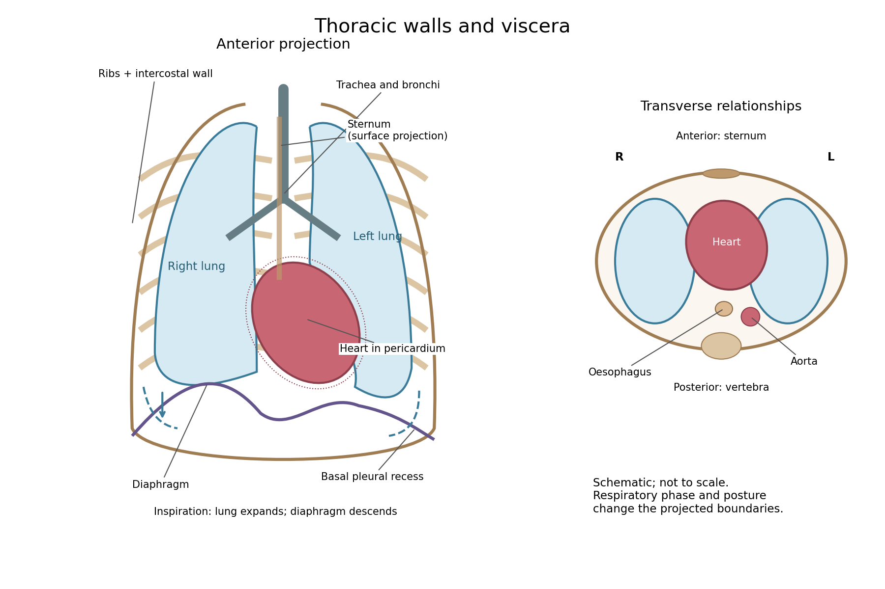

<h1 id="1/solution">Solution</h1>

↑ **Parent:** [1](../1.md)

**The [thorax](../../../../../thorax.md) is a mobile osteocartilaginous enclosure with two pleural compartments and a central [mediastinum](../../../../../mediastinum.md); its visceral boundaries change normally with breathing and posture.** The sketch is an anterior projection, with the subject's right on the viewer's left. It distinguishes the lower margin of a [lung](../../../../../lung.md) from the lower reflection of its [pleura](../../../../../pleura.md): those are different boundaries.

**[Figure 1](#1/image-thoracic-walls-visceral-projection-and-respiratory-movement). Thoracic walls, visceral projection and respiratory movement**.

The posterior wall is formed by the twelve thoracic [vertebrae](../../../../../vertebra.md) and adjacent parts of the [ribs](../../../../../rib.md); laterally the [ribs](../../../../../rib.md) and [intercostal muscles](../../../../../intercostal-muscle.md) form a flexible wall. Anteriorly lie the [sternum](../../../../../sternum.md), costal cartilages and anterior intercostal structures. The superior aperture communicates with the neck, while the [respiratory diaphragm](../../../../../respiratory-diaphragm.md) closes the inferior aperture. The lower thoracic wall therefore overlaps upper abdominal organs: not every organ under a lower [rib](../../../../../rib.md) is inside the pleural compartment.

Each [lung](../../../../../lung.md) is covered by visceral [pleura](../../../../../pleura.md). Parietal [pleura](../../../../../pleura.md) lines the chest wall, upper surface of the [respiratory diaphragm](../../../../../respiratory-diaphragm.md) and side of the [mediastinum](../../../../../mediastinum.md), becoming continuous with visceral [pleura](../../../../../pleura.md) at the root. The potential pleural space contains a lubricating fluid film; it is not normally an air-filled gap. The right [lung](../../../../../lung.md) has three lobes, the left two, with the cardiac notch and lingula accommodating the leftward projection of the [heart](../../../../../heart.md). Each apex projects above the first [rib](../../../../../rib.md) into the root of the neck. The roots carry the [bronchi](../../../../../bronchus.md), pulmonary vessels, [nerves](../../../../../nerve.md) and lymphatic connections.[Gross Anatomy of the Lungs; Pleura of the Lungs: lobes, hilum and pleural layers](../../../../../anatomy-and-physiology-2e-by-j-gordon-betts-and-others/22-2-the-lungs.md)

The [heart](../../../../../heart.md) and [pericardium](../../../../../pericardium.md) occupy chiefly the middle part of the inferior [mediastinum](../../../../../mediastinum.md), behind the [sternum](../../../../../sternum.md) and between the [lungs](../../../../../lung.md), with most of the cardiac bulk to the left of the median plane. The great vessels approach superiorly. The [trachea](../../../../../trachea.md) divides into main [bronchi](../../../../../bronchus.md) behind the upper central region; the [oesophagus](../../../../../oesophagus.md) descends behind the airway and [heart](../../../../../heart.md). The descending thoracic [aorta](../../../../../aorta.md) lies posteriorly, chiefly left of the vertebral bodies; the azygos venous route lies chiefly on the right. The [thoracic duct](../../../../../thoracic-duct.md) and sympathetic chains belong to the posterior relations. A frontal projection superposes these structures and must not be mistaken for their order from front to back.

For a conventional quiet-breathing surface description, the lower [lung](../../../../../lung.md) border reaches approximately the sixth [rib](../../../../../rib.md) in the midclavicular line, eighth in the midaxillary line and tenth posteriorly near the scapular line. The pleural reflection descends approximately two [ribs](../../../../../rib.md) farther at corresponding landmarks: eighth, tenth and twelfth. These are orientation points, not immutable lines in every healthy individual. Inferiorly, the extra pleural extent forms the [costodiaphragmatic recess](../../../../../costodiaphragmatic-recess.md). The right diaphragmatic dome usually stands higher, related to the underlying [liver](../../../../../liver.md); the left is related to the [stomach](../../../../../stomach.md) and other abdominal viscera.

In inspiration the [respiratory diaphragm](../../../../../respiratory-diaphragm.md) descends, the [rib](../../../../../rib.md) cage expands and lower [lung](../../../../../lung.md) margins move into the recesses; in expiration they retreat. The [heart](../../../../../heart.md) also shifts with the diaphragm and changes its surface projection as neighbouring [lung](../../../../../lung.md) expands. Deep inspiration, quiet expiration and forced expiration therefore cannot share a single normal map. The [heart](../../../../../heart.md)'s own beat adds smaller cyclic movements.

Posture shifts the diaphragm and mediastinal contents: a supine position generally raises the domes compared with standing, while lateral positioning displaces mobile contents towards the dependent side. Body build, age, abdominal fullness and pregnancy change the available thoracic shape and diaphragmatic level. A distended [stomach](../../../../../stomach.md) can raise the left dome and alter the cardiac projection without implying primary cardiac disease. The clinically useful comparison records posture and respiratory phase before judging an apparent difference in organ position.

## ↑ Ancestors (11)

1. [1](../1.md)
2. [Anatomy and physiology](../../anatomy-and-physiology-split.md)
3. [First examination](../../split.md)
4. [1864](../../../split.md)
5. [Past exam of the medicine course of the University of Oxford](../../../../split.md)
6. [Medicine course of the University of Oxford](../../../../../medicine-course-of-the-university-of-oxford.md)
7. [Undergraduate course of the University of Oxford](../../../../../undergraduate-course-of-the-university-of-oxford.md)
8. [Course of the University of Oxford](../../../../../course-of-the-university-of-oxford.md)
9. [University of Oxford](../../../../../university-of-oxford-split.md)
10. [List of universities](../../../../../list-of-universities.md)
11. [Codex Wiki](../../../../../split.md)
