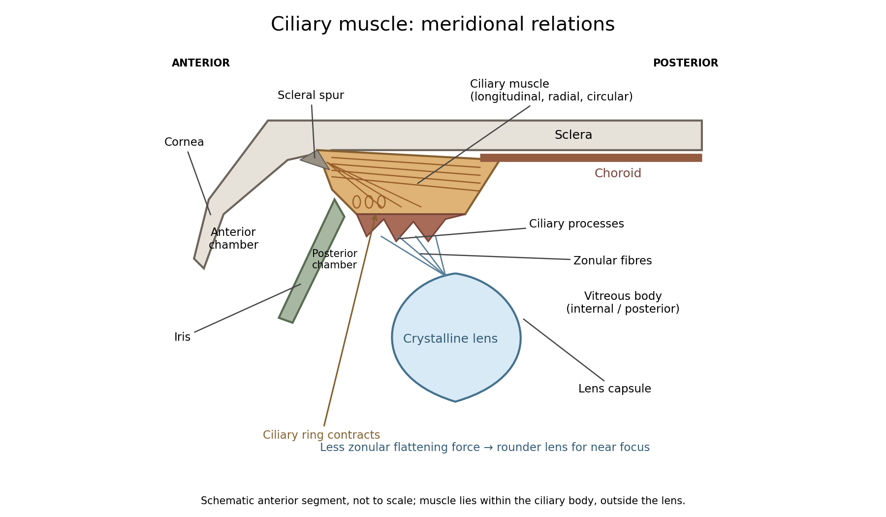

<h1 id="11/solution">Solution</h1>

↑ **Parent:** [11](../11.md)

**The [ciliary muscle](../../../../../ciliary-muscle.md) forms a ring within the anterior [ciliary body](../../../../../ciliary-body.md), deep to the [sclera](../../../../../sclera.md) and outside the zonular attachment system of the [crystalline lens](../../../../../crystalline-lens.md).** Its arrangement connects an anterior scleral attachment to posterior and inward parts of the uveal tissues, allowing contraction to alter zonular tension.

**[Figure 2](#11/image-relations-of-the-ciliary-muscle-zonular-fibres-and-crystalline-lens). Relations of the ciliary muscle, zonular fibres and crystalline lens**.

In a meridional section, the anterior ciliary region lies just behind the corneoscleral junction. The [scleral spur](../../../../../scleral-spur.md) gives attachment to anterior longitudinal [muscle](../../../../../muscle.md) fibres. Posteriorly these fibres extend towards the [choroid](../../../../../choroid.md) and its supporting tissues. Between the [sclera](../../../../../sclera.md) outside and the ciliary processes inside, oblique or radial and circularly oriented smooth-[muscle](../../../../../muscle.md) bundles complete the muscular mass. These fibre directions are regions of one coordinated [smooth muscle](../../../../../smooth-muscle.md), not three independently attached external ocular [muscles](../../../../../muscle.md).[Scleral Spur: longitudinal ciliary-muscle attachment and relation to trabecular tissues](../../../../../anatomy-of-the-angle-by-the-american-academy-of-ophthalmology.md)

The ciliary processes project inward from the anterior folded part of the [ciliary body](../../../../../ciliary-body.md), behind the root of the [iris](../../../../../iris.md) and peripheral to the lens equator. Ciliary epithelium covers them; their vascular core and epithelial functions are distinct from the smooth-[muscle](../../../../../muscle.md) bundles. The posterior, flatter ciliary region continues towards the [ora serrata](../../../../../ora-serrata.md), where the sensory [retina](../../../../../retina.md) ends. The [ciliary body](../../../../../ciliary-body.md) is therefore continuous with [choroid](../../../../../choroid.md) posteriorly and related to [iris](../../../../../iris.md) anteriorly, while remaining a separately describable region.

[Zonular fibres](../../../../../zonular-fibre.md) pass from the ciliary region to the capsule around the equator of the [crystalline lens](../../../../../crystalline-lens.md). They cross the circumlental space; the [ciliary muscle](../../../../../ciliary-muscle.md) does not insert directly into the transparent lens substance. The [posterior chamber](../../../../../posterior-chamber.md) lies behind the [iris](../../../../../iris.md) and in front of the lens and zonular apparatus, and communicates with the anterior chamber through the [pupil](../../../../../pupil.md). The [vitreous body](../../../../../vitreous-body.md) lies behind the lens and has its own relation to the posterior zonular region. These spaces must not be drawn as one cavity containing the [muscle](../../../../../muscle.md) freely suspended in aqueous fluid.

For near [ocular accommodation](../../../../../accommodation-vertebrate-eye.md), contraction reduces the effective diameter of the ciliary ring and changes its position, reducing the zonular forces that flatten the lens. The elastic capsule and lens substance then permit a rounder lens with greater [optical power](../../../../../optical-power.md). For distant viewing, relaxation restores greater flattening tension and lower power. Thus **ciliary contraction increases lens curvature by relieving a restraint; it does not pull the lens flatter.** The conventional mechanism is supported by observations of lens shape and optical changes during accommodation.[Cellular Level; Mechanism: contraction, zonular tension and lens thickening](../../../../../physiology-accommodation-statpearls.md)

Parasympathetic motor fibres reach the [muscle](../../../../../muscle.md) through the [oculomotor nerve](../../../../../oculomotor-nerve.md), [ciliary ganglion](../../../../../ciliary-ganglion.md) and [short ciliary nerves](../../../../../short-ciliary-nerves.md). This motor pathway is distinct from the sensory visual input that initiates a near response. Changes in [pupil](../../../../../pupil.md) size and convergence often accompany accommodation, but neither should be substituted for an observed change of lens power. With age, reduced lens deformability can impair near focus even though ciliary contraction still occurs. The sketch shows spatial relationships and the direction of the conventional mechanism, rather than a scale drawing or a claim that every historical theory of accommodation was correct.

## ↑ Ancestors (11)

1. [11](../11.md)
2. [Anatomy and physiology](../../anatomy-and-physiology-split.md)
3. [First examination](../../split.md)
4. [1864](../../../split.md)
5. [Past exam of the medicine course of the University of Oxford](../../../../split.md)
6. [Medicine course of the University of Oxford](../../../../../medicine-course-of-the-university-of-oxford.md)
7. [Undergraduate course of the University of Oxford](../../../../../undergraduate-course-of-the-university-of-oxford.md)
8. [Course of the University of Oxford](../../../../../course-of-the-university-of-oxford.md)
9. [University of Oxford](../../../../../university-of-oxford-split.md)
10. [List of universities](../../../../../list-of-universities.md)
11. [Codex Wiki](../../../../../split.md)
