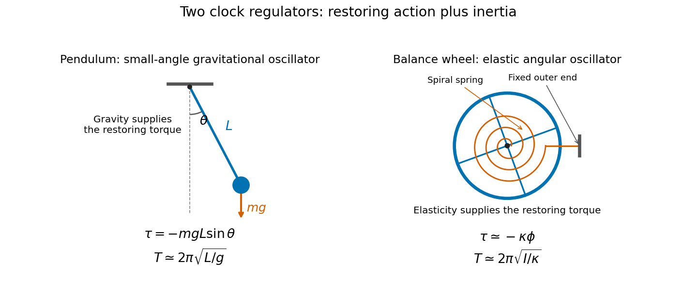

# Physics

↑ **Parent:** [First examination](../first-examination.md)

Original volume: [Examination papers for the Degree of Bachelor of Medicine by the University of Oxford (1864–1867)](../../../biology-bibliography.md#examination-papers-for-the-degree-of-bachelor-of-medicine-by-the-university-of-oxford-1864-1867). [Open the original paper in the scanned volume](https://upload.wikimedia.org/wikipedia/commons/3/3e/Examination_papers_for_the_Degree_of_Bachelor_of_medicine_-_1864-67_(IA_b24757810).pdf#page=5).

Original questions are transcribed from the public-domain edition. Credit: Wellcome Collection; original supplied by Royal College of Physicians, London. [Source and public-domain rights statement](https://wellcomecollection.org/works/d7b9zgnx).

**Table of contents**

- [1](#1)
  - [Solution](#1/solution)
- [2](#2)
  - [Solution](#2/solution)
- [3](#3)
  - [Solution](#3/solution)
- [4](#4)
  - [Solution](#4/solution)
- [5](#5)
  - [Solution](#5/solution)
- [6](#6)
  - [Solution](#6/solution)
- [7](#7)
  - [Solution](#7/solution)
- [8](#8)
  - [Solution](#8/solution)
- [9](#9)
  - [Solution](#9/solution)
- [10](#10)
  - [Solution](#10/solution)
- [11](#11)
  - [Solution](#11/solution)
- [12](#12)
  - [Solution](#12/solution)

## 1

↑ **Parent:** [Physics](physics.md)

**Original question.**

Explain the terms Molecule, Elasticity, Inertia, Force.

<h3 id="1/solution">Solution</h3>

↑ **Parent:** [1](#1)

A [molecule](../../../molecule.md) is an electrically neutral bound assembly of more than one [atom](../../../physics.md#atom-physics). It can contain identical atoms, as in $\mathrm O_2$, or different atoms, as in $\mathrm H_2O$. Discrete molecules are not a universal description of matter: an extended ionic crystal does not consist of separate neutral molecules corresponding to each empirical formula unit. The IUPAC definition also specifies binding sufficient to support a vibrational state.[Definition M04002](../../../chemistry-bibliography.md#iupac-compendium-of-chemical-terminology-gold-book-by-international-union-of-pure-and-applied-chemistry/molecule-in-the-iupac-gold-book)

[Elasticity](../../../elasticity-physics.md) is a body's tendency to recover its original configuration when the deforming [force](../../../force.md) is removed. Within a linear regime, [Hooke's law](../../../elasticity-physics.md#hooke-s-law) makes [stress](../../../continuum-mechanics.md#stress) proportional to [strain](../../../continuum-mechanics.md#strain), but elasticity does not require exact linearity. The [elastic limit](../../../elasticity-physics.md#elastic-limit) matters: permanent [plastic deformation](../../../continuum-mechanics.md#plastic-deformation) is a different response.

[Inertia](../../../classical-mechanics.md#inertia) is the property expressed by [Newton's first law](../../../force.md#newton-s-first-law): without a resultant external [force](../../../force.md), a body's [velocity](../../../classical-mechanics.md#velocity) remains constant in an [inertial frame of reference](../../../mathematical-physics.md#inertial-frame). [Mass](../../../classical-mechanics.md#mass) measures translational inertia. It is not a force acting against motion, and a moving body does not require a continuing forward force merely to keep moving.

A [force](../../../force.md) describes an interaction that changes [momentum](../../../momentum.md). In [Newtonian mechanics](../../../newtonian-mechanics.md),

$$
\boxed{\mathbf F_{\rm resultant}=\frac{d\mathbf p}{dt};\qquad
\mathbf F_{\rm resultant}=m\mathbf a\quad\text{for constant }m.}
$$

A force has magnitude and direction; its point of application also matters for the [torque](../../../momentum.md#torque) and hence the body's rotational response.

## 2

↑ **Parent:** [Physics](physics.md)

**Original question.**

Prove the impossibility of constructing a machine for producing perpetual motion.

<h3 id="2/solution">Solution</h3>

↑ **Parent:** [2](#2)

The relevant claim concerns a machine that repeats its complete operating cycle while delivering a continuing net output of [work](../../../energy.md#work) without a corresponding supply of [energy](../../../energy.md). **A machine cannot supply net work in a cycle without taking in energy or depleting an energy store.** This follows from [conservation of energy](../../../mathematical-physics.md#conservation-of-energy), an experimentally supported physical law rather than a theorem of pure logic.

Let $E$ include the machine's [internal energy](../../../internal-energy.md), [kinetic energy](../../../energy.md#kinetic-energy) and [potential energy](../../../energy.md#potential-energy). With $Q$ the net [heat](../../../heat.md) received and $W$ the net work delivered, the [first law of thermodynamics](../../../first-law-of-thermodynamics.md) gives

$$
\Delta E=Q-W.
$$

For a complete cycle all stores return to their initial values, so $\Delta E=0$ and $W=Q$. If there is neither heat input nor another energy input, $W=0$. A descending [mass](../../../classical-mechanics.md#mass), unwinding [spring](../../../elasticity-physics.md#spring), consumed fuel or discharged [battery](../../../electrical-circuit.md#electric-battery) supplies energy, but it cannot be omitted from the accounting while calling the result [perpetual motion](../../../first-law-of-thermodynamics.md#perpetual-motion).

Changing an overbalanced wheel's geometry does not evade the argument. A [conservative force](../../../energy.md#conservative-force) gives zero net work around a closed configuration cycle, while [friction](../../../newtonian-mechanics.md#friction) dissipates usable mechanical energy. Resetting a mechanism or returning a raised weight costs work that must be included.

Indefinitely continuing motion without useful output is a different possibility: an ideal frictionless oscillator or freely moving body need not stop. Connecting a load removes energy and changes that situation. A cyclic machine supplied with heat from only one reservoir and converting all that heat into work is excluded instead by the [Kelvin-Planck statement](../../../second-law-of-thermodynamics.md#kelvin-planck-statement) of the [Second law of thermodynamics](../../../second-law-of-thermodynamics.md). The first-law and second-law objections address different proposed energy balances.

## 3

↑ **Parent:** [Physics](physics.md)

**Original question.**

Define the centre of gravity of a body. What properties has the centre of gravity (1) with respect to the equilibrium of the body, (2) with respect to its motion ?

<h3 id="3/solution">Solution</h3>

↑ **Parent:** [3](#3)

In a uniform [gravitational field](../../../physics.md#gravitational-field), the [centre of gravity](../../../classical-mechanics.md#centre-of-gravity) is the point $G$ through which the resultant [gravitational weight](../../../force.md#weight-physics) acts. It coincides with the [center of mass](../../../classical-mechanics.md#center-of-mass):

$$
\boxed{\mathbf r_G=\frac{1}{M}\int\mathbf r\,dm,\qquad
\mathbf W=M\mathbf g.}
$$

Indeed the sum of the elemental gravitational [torques](../../../momentum.md#torque) about any origin is

$$
\int\mathbf r\times\mathbf g\,dm
=M\mathbf r_G\times\mathbf g.
$$

Replacing the distributed gravitational forces by the resultant at $G$ therefore preserves both total force and torque. A strongly nonuniform field need not permit the same identification.

For equilibrium, all external forces and torques must balance. A freely suspended rigid body supported at a pivot requires $G$ on the vertical through that pivot. With $G$ below the pivot, a small angular displacement raises its gravitational [potential energy](../../../energy.md#potential-energy) and gives a restoring torque; with $G$ above it, the equilibrium is unstable. A body supported on a horizontal base can remain at rest under its weight only if the vertical projection of $G$ lies within the region that the support forces can sustain. At an edge the overturning [torque](../../../momentum.md#torque) becomes decisive.

For motion, the [center-of-mass equation](../../../classical-mechanics.md#center-of-mass-equation) is

$$
\boxed{M\ddot{\mathbf r}_G=\sum\mathbf F_{\rm external}.}
$$

The centre moves as a particle carrying the total mass under the resultant external force, while rotation about it is governed by the external torque and [angular momentum](../../../momentum.md#angular-momentum). This separates translation from rotation; it does not determine a rigid body's full orientation from its centre's trajectory alone. In uniform gravity and negligible air resistance, a thrown rotating body has a parabolic centre-of-mass path even while its parts follow more complicated paths.

## 4

↑ **Parent:** [Physics](physics.md)

**Original question.**

Mention any properties which all elastic fluids possess in common.

<h3 id="4/solution">Solution</h3>

↑ **Parent:** [4](#4)

Here an [elastic fluid](../../../thermodynamics.md#elastic-fluid) means a [gas](../../../thermodynamics.md#gas) or vapour. Such a fluid is mobile, occupies the accessible space of its container, and is appreciably [compressible](../../../thermodynamics.md#compressibility). Its [pressure](../../../pressure.md) acts normally on a confining surface. In static equilibrium the stress at a point is isotropic: a fluid has no equilibrium resistance to a sustained shear deformation. Pressure can still vary with height through [hydrostatic equilibrium](../../../statistical-physics.md#hydrostatic-equilibrium); isotropy does not mean the same pressure at every position.

Reducing a confined gas's [volume](../../../geometry-and-topology.md#volume) at fixed [temperature](../../../temperature.md) normally raises its pressure. Heating at fixed volume normally raises the pressure, and gases exchange material through [diffusion](../../../thermodynamics.md#diffusion). Their particles are in continual thermal motion, whose momentum transfer gives a microscopic account of gas pressure in the [kinetic theory of gases](../../../kinetic-theory.md#kinetic-theory-of-gases).

For a dilute gas away from condensation, the approximate [ideal gas law](../../../ideal-gas.md#ideal-gas-law) is

$$
\boxed{pV=nRT.}
$$

It contains [Boyle's law](../../../second-law-of-thermodynamics.md#boyle-s-law) at fixed temperature and the corresponding temperature-expansion laws. These simple proportionalities are approximations, not exact properties of every elastic fluid at every density. Intermolecular interactions matter in a dense gas, and a vapour can [condense](../../../critical-phenomenon.md#condensation); the classification does not promise that every sample remains gaseous under arbitrary compression or cooling.

## 5

↑ **Parent:** [Physics](physics.md)

**Original question.**

What are the mechanical principles upon which the use of a pendulum in a clock, and of a balance wheel in a watch, depends ?

<h3 id="5/solution">Solution</h3>

↑ **Parent:** [5](#5)

Both instruments regulate a sequence of [time](../../../classical-mechanics.md#time-in-physics) intervals with an oscillator. A restoring action opposes displacement, while [inertia](../../../classical-mechanics.md#inertia) carries the moving part through equilibrium. Their repeated swings control an [escapement](../../../classical-mechanics.md#escapement), which releases the gear train in steps and supplies enough energy to offset frictional losses.

For a [simple pendulum](../../../simple-pendulum.md) of length $L$,

$$
\ddot\theta+\frac gL\sin\theta=0.
$$

At small amplitude, $\sin\theta\simeq\theta$, giving [simple harmonic motion](../../../classical-mechanics.md#simple-harmonic-motion) with

$$
\boxed{T\simeq2\pi\sqrt{\frac Lg}.}
$$

A real clock pendulum is a [physical pendulum](../../../mathematical-physics.md#physical-pendulum). If its pivot moment of inertia is $I_p$ and its centre of gravity is a distance $d$ below the pivot, its small-swing period is $2\pi\sqrt{I_p/(Mgd)}$. Gravity supplies the restoring torque. A controlled swing amplitude and stable dimensions are needed: large swings, thermal expansion and changing effective gravity alter the rate.

A watch's [balance wheel](../../../classical-mechanics.md#balance-wheel) turns back and forth about its spindle. A [torsion spring](../../../elasticity-physics.md#torsion-spring) supplies an approximately linear restoring torque $-\kappa\phi$, so

$$
I\ddot\phi+\kappa\phi=0,\qquad
\boxed{T\simeq2\pi\sqrt{\frac I\kappa}.}
$$

The restoring mechanism is elastic rather than gravitational. This makes the balance-spring system suitable for a portable watch, although disturbances, imperfect balance, changing spring properties and escapement interactions still affect the rate.

**[Figure 1](#5/image-gravitational-and-elastic-restoring-torques-in-clock-oscillators). Gravitational and elastic restoring torques in clock oscillators**. Original schematic comparing a pendulum with a balance wheel and spiral spring. Equations show ideal small-amplitude models, not the detailed construction of a particular historical clock.

Near independence of period from amplitude is [isochronism](../../../wave.md#isochronism). It is approximate for the simple pendulum: its leading correction is $T/T_0=1+\theta_0^2/16+\cdots$ with $\theta_0$ in radians. Keeping the oscillations repeatable therefore matters as well as selecting the nominal period.

## 6

↑ **Parent:** [Physics](physics.md)

**Original question.**

Distinguish between _quantity of heat_ and _temperature_ ; and describe the processes by which the specific heats of bodies are determined.

<h3 id="6/solution">Solution</h3>

↑ **Parent:** [6](#6)

[Temperature](../../../temperature.md) describes thermal state and determines the direction of spontaneous [heat transfer](../../../heat.md#heat-transfer). A quantity of [heat](../../../heat.md) is energy transferred because of a temperature difference. It depends on the process and is measured in energy units; it is not another name for temperature. Equal heat inputs need not produce equal temperature rises in different masses or substances.

For a specified process, the [specific heat capacity](../../../heat.md#specific-heat-capacity) is

$$
\boxed{c=\frac1m\frac{\delta Q}{dT}.}
$$

Over a modest range with nearly constant $c$ and no phase change, $Q=mc\Delta T$. For a gas the constraint matters: [heat capacity at constant pressure](../../../enthalpy.md#heat-capacity-at-constant-pressure) and [heat capacity at constant volume](../../../heat.md#heat-capacity-at-constant-volume) generally differ because expansion can do work.

In [method-of-mixtures calorimetry](../../../calorimetry.md#method-of-mixtures-calorimetry), a body of known mass $m_s$ at $T_s$ is transferred into water of mass $m_w$ at $T_w$ in a calibrated [calorimeter](../../../calorimetry.md#calorimeter) initially also at $T_w$. If the final uniform temperature is $T_f$, the vessel and immersed fittings have heat capacity $C_{\rm cal}$, and losses are negligible,

$$
m_sc_s(T_s-T_f)=(m_wc_w+C_{\rm cal})(T_f-T_w).
$$

Thus

$$
\boxed{c_s=\frac{(m_wc_w+C_{\rm cal})(T_f-T_w)}
{m_s(T_s-T_f)}.}
$$

Stirring, quick transfer, a lid, a temperature-time record and allowance for surrounding heat exchange improve the inference. Ignoring the calorimeter's heat capacity systematically misattributes part of the energy uptake.

An alternative is [electrical calorimetry](../../../calorimetry.md#electrical-calorimetry): measure $E=\int VI\,dt$ supplied to a heater and compare the temperature rise with a blank or separately calibrated vessel. At nearly constant properties, $E=(mc+C_{\rm cal})\Delta T+Q_{\rm loss}$. An [ice calorimeter](../../../calorimetry.md#ice-calorimeter) instead measures the mass melted at a known phase-change temperature, using $Q=m_{\rm melt}L_f$ with appropriate corrections. Steam condensation similarly uses latent heat. These methods infer transferred energy from different measurable effects; a thermometer reading alone does not measure a quantity of heat.

## 7

↑ **Parent:** [Physics](physics.md)

**Original question.**

What are the advantages and disadvantages of warming by open fire-places, by hot air, hot water, and steam, respectively ?

<h3 id="7/solution">Solution</h3>

↑ **Parent:** [7](#7)

Every arrangement must transfer thermal energy into the occupied space. The useful comparison is between [thermal radiation](../../../electromagnetic-radiation.md#thermal-radiation), [convection](../../../convection.md), energy transport through pipes or ducts, and the associated distribution and control.

- An [open fireplace](../../../heat.md#open-fireplace) gives rapid local radiant warming and a visible source. A chimney carries combustion products away and draws room air with it. Much energy can leave in the flue gases, replacement air can cool other parts of the room, and the temperature distribution can be uneven. The fact that a fire feels hot nearby does not establish a high whole-building heating efficiency.
- [Hot-air heating](../../../heat.md#hot-air-heating) warms and transports the air itself. Ducts can distribute heat rapidly to several rooms and can be combined with ventilation. Poor distribution gives draughts, noise or stratification; warm air delivered near the ceiling can leave the occupied region colder. Air motion can carry dust, while heating air without adding water lowers its [relative humidity](../../../physiology.md#relative-humidity). Indirectly heated air should be distinguished from introducing combustion gases into the room.
- [Hot-water heating](../../../heat.md#hot-water-heating) transports energy in circulating water and releases it through warm surfaces. Radiators exchange energy by both convection and radiation despite their name. A distributed closed circuit can give relatively even heating and separate room-air circulation from the furnace. It has thermal inertia, needs adequate circulation and control, and is vulnerable to leaks or freezing.
- [Steam heating](../../../heat.md#steam-heating) transfers substantial energy when steam condenses: the delivered latent heat is approximately $\dot mL$. This can transport heat effectively, but the system needs pressure management, condensate return and suitable traps. Hot surfaces and poor condensate management are disadvantages; temperature control and maintenance differ from those of a low-temperature water loop.

There is consequently no universal ranking from the heating medium alone. Useful delivered heat, ventilation losses, the building's [thermal insulation](../../../heat.md#thermal-insulation), the emitter temperature and the control arrangement determine the result. The same installed heat input can produce different comfort and different room-temperature distributions.

## 8

↑ **Parent:** [Physics](physics.md)

**Original question.**

What do you understand by the mean temperature of a place ? By what observations is it determined, and what are the causes which make the mean temperature of one place to differ from that of another ?

<h3 id="8/solution">Solution</h3>

↑ **Parent:** [8](#8)

The [mean temperature](../../../temperature.md#mean-temperature) of a place must specify both the measured quantity and the averaging interval. For a temperature record $T(t)$ over duration $\tau$, the time mean is

$$
\boxed{\overline T=\frac1\tau\int_0^\tau T(t)\,dt.}
$$

Equally spaced observations approximate this integral by their arithmetic mean. Irregular observations require time weighting; an unweighted average of many daytime readings and few night-time readings would be biased. A single afternoon observation cannot represent the daily mean.

Observations should use a calibrated [thermometer](../../../temperature.md#thermometer) at a stated, consistent exposure, shielded from direct sunlight and other radiative heating while allowing air exchange. Observation time, instrument changes, relocation and missing records must be considered. Daily means can be combined into monthly and annual means with appropriate duration weights. The common approximation $(T_{\max}+T_{\min})/2$ is a defined daily statistic, not an exact identity with the continuous time average.

A long-term [climatological normal](../../../geophysics.md#climatological-normal) additionally fixes a reference period. Modern conventional normals commonly use 30 years; that convention is different from claiming that an isolated year's mean is the permanent climate of a place.[Overview: conventional 30-year normals and available daily, monthly and annual products](../../../physics-bibliography.md#u-s-climate-normals-by-noaa)

Places differ because their energy balances and heat transport differ. [Latitude](../../../astrophysics.md#geographical-latitude) changes the distribution of incoming solar radiation and seasonal day length. Altitude, continental or maritime location, prevailing atmospheric circulation, ocean currents, cloud cover, snow cover and local terrain alter heating and cooling. Water's thermal storage moderates coastal variations, but a small annual range does not by itself determine a particular annual mean. Aspect and urban surfaces can also change local exposure. These factors must be distinguished from an artificial difference caused by comparing unlike instruments or observing schedules.[Factors governing a locality's climate](../../../physics-bibliography.md#climate-an-introduction-by-the-met-office)

## 9

↑ **Parent:** [Physics](physics.md)

**Original question.**

Describe the decomposition of light by a prism. What are Fraunhofer's lines ; what is their use in the construction of optical instruments, and what is the physical explanation of their existence ?

<h3 id="9/solution">Solution</h3>

↑ **Parent:** [9](#9)

An [optical prism](../../../geometrical-optics.md#prism-optics) separates a white-light beam because its [refractive index](../../../electromagnetic-wave.md#refractive-index) depends on [wavelength](../../../wave-equation.md#wavelength). [Snell's law](../../../partial-differential-equation.md#snell-s-law) therefore gives different emergence directions for different components. With ordinary visible dispersion, violet is deviated more strongly than red. A narrow entrance slit and a collimated beam make a resolved [spectrum](../../../linear-operator-theory.md#spectrum-functional-analysis); a broad overlapping bundle of rays would wash the colours and lines together.

For prism angle $A$ at [minimum deviation](../../../geometrical-optics.md#minimum-deviation), the symmetric ray path gives

$$
\boxed{n(\lambda)=\frac{\sin[(A+D_{\min}(\lambda))/2]}
{\sin(A/2)}.}
$$

Measuring a named line's deviation therefore fixes the material's refractive index at a reproducible wavelength.

The [Fraunhofer lines](../../../physics.md#fraunhofer-lines) are dark absorption features in the solar spectrum, mapped and labelled by [Joseph von Fraunhofer](../../../optical-physicist.md#joseph-von-fraunhofer). They provide useful spectral landmarks. Measuring a glass's refractive indices at several such lines characterizes [optical dispersion](../../../geometrical-optics.md#dispersion-optics), supports comparison of glasses, and helps design an [achromatic doublet](../../../geometrical-optics.md#achromatic-doublet) that brings selected colours to a common focus. Achromatism at two wavelengths does not remove every residual colour error.

The physical explanation is selective absorption. Radiation from the hotter underlying solar layers passes through material whose atoms and ions absorb strongly at their transition wavelengths. The same chemical species can emit at corresponding wavelengths under suitable excitation, connecting solar absorption with laboratory [emission spectra](../../../physics.md#emission-spectrum). Some lines in a ground-observed spectrum instead arise in Earth's atmosphere, so not every dark feature identifies solar material.

In modern terms, an atomic transition satisfies $\Delta E=h\nu=hc/\lambda$. This explains the reproducible spectral positions rather than treating the dark lines as gaps introduced by a defective prism. Resolving power, line width and source conditions still govern how accurately a particular feature can be measured.

## 10

↑ **Parent:** [Physics](physics.md)

**Original question.**

What evidence is there of the identity of frictional and of Voltaic electricity ?

<h3 id="10/solution">Solution</h3>

↑ **Parent:** [10](#10)

[Frictional electricity](../../../electrostatics.md#frictional-electricity) and [voltaic electricity](../../../electric-charge.md#voltaic-electricity) name different methods of producing electrical effects. Their identity is supported by showing common kinds of response and quantitative continuity between them, rather than merely observing that both can give a sensation.

Charges from either source show the same attraction and repulsion, can charge a conductor or capacitor, and can discharge through a circuit. A current from either source can generate a [magnetic field](../../../magnetic-field.md), produce resistive heating, and cause appropriate [electrolysis](../../../electrochemistry.md#electrolysis). Reversing the sign or current direction reverses the corresponding directional effects. Different observed strengths need not imply different electrical substances.

[Michael Faraday](../../../chemistry.md#michael-faraday) carried out a [comparison of common and voltaic electricity](../../../electrostatics.md#faraday-s-comparison-of-common-and-voltaic-electricity). In a specific magnetic test, he discharged a machine-charged jar battery through a galvanometer, using a wet thread in the discharge path; the needle's deflection connected ordinary static charge with a current's magnetic action. He also compared common and voltaic electricity quantitatively.[Third Series, §§7–8; paragraph 296 for the galvanometer arrangement and paragraphs 361–378 for quantitative comparison](../../../physics-bibliography.md#experimental-researches-in-electricity-volume-1-by-michael-faraday)

The modern distinction is mainly in the source characteristics. A friction machine commonly supplies a small charge at high [electric potential difference](../../../electric-field.md#electric-potential-difference), while a chemical cell can sustain a much larger continuing [electric current](../../../electric-charge.md#electric-current) at a lower voltage. An insulating gap or a poorly conducting path can therefore affect the demonstrations differently. Once charge passes through a specified circuit, its electric and magnetic action is not determined by whether mechanical rubbing or a chemical reaction originally supplied the energy.

For a specified electrode reaction with controlled current efficiency, [Faraday's laws of electrolysis](../../../electrochemistry.md#faraday-s-laws-of-electrolysis) express the quantitative relation

$$
\boxed{m=\frac{M}{zF}\,Q,\qquad Q=\int I\,dt.}
$$

Here $M$ is the product's molar mass, $z$ the electrons per reaction unit and $F$ the Faraday constant. Equal transferred charges give equal reaction equivalents under those conditions. Charge, voltage and current must be distinguished: equal voltages alone do not imply equal delivered quantities of electricity.

## 11

↑ **Parent:** [Physics](physics.md)

**Original question.**

Show how an induced electrical current can be obtained from a permanent steel magnet, or from the earth.

<h3 id="11/solution">Solution</h3>

↑ **Parent:** [11](#11)

A closed conducting coil linked by a changing [magnetic flux](../../../magnetic-field.md#magnetic-flux) develops an [electromotive force](../../../electric-charge.md#electromotive-force). For $N$ turns, [Faraday's law of induction](../../../maxwell-equations.md#faraday-s-law-of-induction) gives

$$
\boxed{\mathcal E=-N\frac{d\Phi_B}{dt},\qquad
\Phi_B=\int_S\mathbf B\cdot d\mathbf S.}
$$

With a permanent steel magnet, connect the coil to a sensitive [galvanometer](../../../electric-charge.md#galvanometer) and move a pole into or out of it. Entry and withdrawal give opposite deflections; exchanging the pole reverses the signs. Holding both magnet and coil stationary gives no sustained induction merely because a magnetic field is present. Moving the coil instead, or changing its orientation, can produce the same necessary flux change.

Earth's [magnetic field](../../../magnetic-field.md) can serve as the field source. Turn a many-turn coil so that its area normal changes direction relative to the terrestrial field. In an approximately uniform field, a steadily rotating coil has

$$
\Phi_B=BA\cos\omega t,\qquad
\boxed{\mathcal E=NBA\omega\sin\omega t.}
$$

Reversing a coil from one normal orientation to the opposite changes its flux linkage by $2NBA$. The Earth's weak field calls for an appropriate coil area, number of turns and detector sensitivity; it does not require a chemically supplied current in the detecting circuit. Faraday described terrestrial magneto-electric induction in his Second Series.[Second Series, §5: terrestrial magneto-electric induction](../../../physics-bibliography.md#experimental-researches-in-electricity-volume-1-by-michael-faraday)

The coil must provide a conducting return path for a circulating current. Its [electrical resistance](../../../electric-charge.md#electrical-resistance) and [self-inductance](../../../electromagnetism.md#self-inductance) affect the response. [Lenz's law](../../../maxwell-equations.md#lenz-s-law) fixes the sign: the induced effect opposes the change responsible for it. The moving system supplies mechanical work when current delivers energy or dissipates heat; a permanent magnet is not thereby an inexhaustible fuel.

## 12

↑ **Parent:** [Physics](physics.md)

**Original question.**

What explanations can you give of the following phenomena :—halos, water-spouts, hoar frost, hail ?

<h3 id="12/solution">Solution</h3>

↑ **Parent:** [12](#12)

A common [optical halo](../../../optics.md#optical-halo) is produced by refraction through hexagonal atmospheric ice crystals. For a $60^\circ$ prism path and ice refractive index about $1.31$, the [minimum deviation](../../../geometrical-optics.md#minimum-deviation) relation gives

$$
D_{\min}=2\arcsin\!\left(1.31\sin30^\circ\right)-60^\circ
\simeq22^\circ.
$$

Random suitable crystal orientations produce a ring around the Sun or Moon, with concentration near that minimum angle. [Optical dispersion](../../../geometrical-optics.md#dispersion-optics) puts red near the inner edge. Other crystal paths or orientations produce other halos and arcs; the explanation should not treat every ring as the water-drop mechanism of a [rainbow](../../../optics.md#rainbow).[Haloes and parhelia: hexagonal ice crystals](../../../physics-bibliography.md#optical-effects-nature-s-light-show-by-the-met-office)

A [waterspout](../../../geophysics.md#waterspout) is a rotating atmospheric column over water. Converging air and an [updraft](../../../geophysics.md#updraft) can stretch and intensify existing rotation; cooling and condensation make part of the funnel visible, while strong surface winds raise spray. The visible funnel is not simply a solid column of sea water sucked intact to the cloud. Fair-weather waterspouts and thunderstorm-associated tornadic waterspouts have different developmental settings; a single thunderstorm-only explanation does not cover both.[Fair-weather and tornadic categories](../../../physics-bibliography.md#what-is-a-waterspout-by-noaa)

[Hoar frost](../../../geophysics.md#hoar-frost) forms by deposition of atmospheric water vapour as ice on a sufficiently cold surface. The surface must be below freezing and below the relevant [frost point](../../../geophysics.md#frost-point). Radiative cooling on a clear quiet night can make a surface colder than air at ordinary thermometer height, so a positive reported air temperature does not rule out surface frost. Freezing previously formed liquid dew is [frozen dew](../../../geophysics.md#frozen-dew), a different formation route.[Depositional frost versus frozen dew; near-ground radiative cooling](../../../physics-bibliography.md#dew-and-frost-development-by-jeff-haby)

[Hail](../../../geophysics.md#hail) grows in a thunderstorm when ice embryos collect supercooled liquid droplets that freeze on them. A strong updraft increases residence time and can support growing stones; they fall out when their trajectories and weight take them out of adequate support. Clear and opaque ice layers reflect changing growth and freezing conditions. They are not proof that every layer required a complete repeated ascent and descent: horizontal movement and variations across an updraft matter too. Nor is the very cold cloud top necessarily the best growth region, because appreciable growth requires liquid water.[Hail growth, layering and the role of updrafts](../../../physics-bibliography.md#severe-weather-101-hail-basics-by-noaa)

## ↑ Ancestors (9)

1. [First examination](../first-examination.md)
2. [1864](../../1864.md)
3. [Past exam of the medicine course of the University of Oxford](../../../past-exam-of-the-medicine-course-of-the-university-of-oxford.md)
4. [Medicine course of the University of Oxford](../../../university-of-oxford.md#medicine-course-of-the-university-of-oxford)
5. [Undergraduate course of the University of Oxford](../../../university-of-oxford.md#undergraduate-course-of-the-university-of-oxford)
6. [Course of the University of Oxford](../../../university-of-oxford.md#course-of-the-university-of-oxford)
7. [University of Oxford](../../../university-of-oxford.md)
8. [List of universities](../../../README.md#list-of-universities)
9. [Codex Wiki](../../../README.md)
