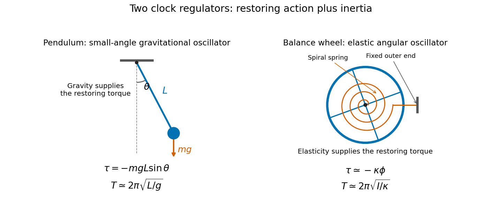

<h1 id="5/solution">Solution</h1>

↑ **Parent:** [5](../5.md)

Both instruments regulate a sequence of [time](../../../../../time-in-physics.md) intervals with an oscillator. A restoring action opposes displacement, while [inertia](../../../../../inertia.md) carries the moving part through equilibrium. Their repeated swings control an [escapement](../../../../../escapement.md), which releases the gear train in steps and supplies enough energy to offset frictional losses.

For a [simple pendulum](../../../../../simple-pendulum-split.md) of length $L$,

$$
\ddot\theta+\frac gL\sin\theta=0.
$$

At small amplitude, $\sin\theta\simeq\theta$, giving [simple harmonic motion](../../../../../simple-harmonic-motion.md) with

$$
\boxed{T\simeq2\pi\sqrt{\frac Lg}.}
$$

A real clock pendulum is a [physical pendulum](../../../../../physical-pendulum.md). If its pivot moment of inertia is $I_p$ and its centre of gravity is a distance $d$ below the pivot, its small-swing period is $2\pi\sqrt{I_p/(Mgd)}$. Gravity supplies the restoring torque. A controlled swing amplitude and stable dimensions are needed: large swings, thermal expansion and changing effective gravity alter the rate.

A watch's [balance wheel](../../../../../balance-wheel.md) turns back and forth about its spindle. A [torsion spring](../../../../../torsion-spring.md) supplies an approximately linear restoring torque $-\kappa\phi$, so

$$
I\ddot\phi+\kappa\phi=0,\qquad
\boxed{T\simeq2\pi\sqrt{\frac I\kappa}.}
$$

The restoring mechanism is elastic rather than gravitational. This makes the balance-spring system suitable for a portable watch, although disturbances, imperfect balance, changing spring properties and escapement interactions still affect the rate.

**[Figure 1](#5/image-gravitational-and-elastic-restoring-torques-in-clock-oscillators). Gravitational and elastic restoring torques in clock oscillators**. Original schematic comparing a pendulum with a balance wheel and spiral spring. Equations show ideal small-amplitude models, not the detailed construction of a particular historical clock.

Near independence of period from amplitude is [isochronism](../../../../../isochronism.md). It is approximate for the simple pendulum: its leading correction is $T/T_0=1+\theta_0^2/16+\cdots$ with $\theta_0$ in radians. Keeping the oscillations repeatable therefore matters as well as selecting the nominal period.

## ↑ Ancestors (11)

1. [5](../5.md)
2. [Physics](../../physics-split.md)
3. [First examination](../../split.md)
4. [1864](../../../split.md)
5. [Past exam of the medicine course of the University of Oxford](../../../../split.md)
6. [Medicine course of the University of Oxford](../../../../../medicine-course-of-the-university-of-oxford.md)
7. [Undergraduate course of the University of Oxford](../../../../../undergraduate-course-of-the-university-of-oxford.md)
8. [Course of the University of Oxford](../../../../../course-of-the-university-of-oxford.md)
9. [University of Oxford](../../../../../university-of-oxford-split.md)
10. [List of universities](../../../../../list-of-universities.md)
11. [Codex Wiki](../../../../../split.md)
