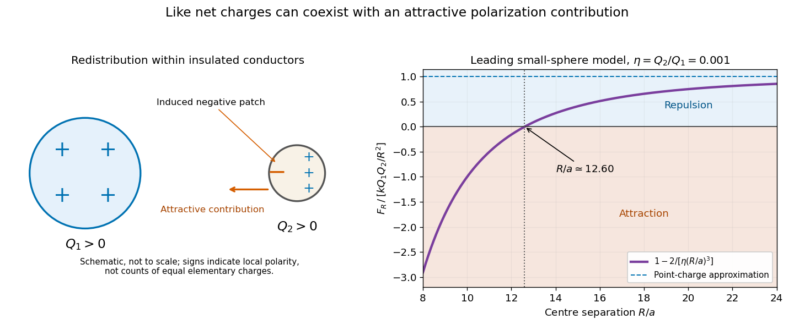

# Physics

↑ **Parent:** [First examination](../first-examination.md)

Original volume: [Examination papers for the Degree of Bachelor of Medicine by the University of Oxford (1864–1867)](../../../biology-bibliography.md#examination-papers-for-the-degree-of-bachelor-of-medicine-by-the-university-of-oxford-1864-1867). [Open the original paper in the scanned volume](https://upload.wikimedia.org/wikipedia/commons/3/3e/Examination_papers_for_the_Degree_of_Bachelor_of_medicine_-_1864-67_(IA_b24757810).pdf#page=29).

Original questions are transcribed from the public-domain edition. Credit: Wellcome Collection; original supplied by Royal College of Physicians, London. [Source and public-domain rights statement](https://wellcomecollection.org/works/d7b9zgnx).

**Table of contents**

- [1](#1)
  - [Solution](#1/solution)
- [2](#2)
  - [Solution](#2/solution)
- [3](#3)
  - [Solution](#3/solution)
- [4](#4)
  - [Solution](#4/solution)
- [5](#5)
  - [Solution](#5/solution)
- [6](#6)
  - [Solution](#6/solution)
- [7](#7)
  - [Solution](#7/solution)
- [8](#8)
  - [Solution](#8/solution)
- [9](#9)
  - [Solution](#9/solution)
- [10](#10)
  - [Solution](#10/solution)
- [11](#11)
  - [Solution](#11/solution)
- [12](#12)
  - [Solution](#12/solution)
- [13](#13)
  - [Solution](#13/solution)

## 1

↑ **Parent:** [Physics](physics.md)

**Original question.**

What are the Volume, the Mass, and the Weight of a body ? Has the same body the same weight under all circumstances ?

<h3 id="1/solution">Solution</h3>

↑ **Parent:** [1](#1)

The [volume](../../../geometry-and-topology.md#volume) $V$ is the three-dimensional space occupied by the body. Its [mass](../../../classical-mechanics.md#mass) $m$ measures its inertia: in [Newtonian mechanics](../../../newtonian-mechanics.md) the resultant [force](../../../force.md) is $m\mathbf a$. Its [gravitational weight](../../../force.md#weight-physics) is the [force](../../../force.md) exerted on it by [gravity](../../../physics.md#gravity),

$$
\boxed{\mathbf W=m\mathbf g.}
$$

For a uniform body, $m=\rho V$, where $\rho$ is its [mass density](../../../fluid-mechanics.md#density); more generally $m=\int\rho\,dV$. [Volume](../../../geometry-and-topology.md#volume) can change with [temperature](../../../temperature.md) or [pressure](../../../pressure.md) while the body's [mass](../../../classical-mechanics.md#mass) remains fixed in the classical closed-system model. Equal volumes of different materials need not have equal [masses](../../../classical-mechanics.md#mass).

**The same [mass](../../../classical-mechanics.md#mass) need not have the same [gravitational weight](../../../force.md#weight-physics).** The local [gravitational acceleration](../../../newton-s-law-of-universal-gravitation.md#gravitational-acceleration) changes between planets and with position on Earth. Outside a spherical Earth, $g(r)=GM_\oplus/r^2$, so increasing altitude reduces it. Earth's rotation and shape also affect terrestrial weighing: a scale at rest on the rotating Earth responds to the effective acceleration including the centrifugal contribution, rather than simply to a spherical gravitational field.

Distinguish [gravitational weight](../../../force.md#weight-physics) from [apparent weight](../../../force.md#apparent-weight). A supporting scale measures a contact [force](../../../force.md). In a vertically accelerating cabin, upward [acceleration](../../../classical-mechanics.md#acceleration) $b$ gives $N=m(g+b)$ while contact is maintained. During common [free fall](../../../newton-s-law-of-universal-gravitation.md#free-fall), $N=0$ although $mg$ remains nonzero. Immersion in a [fluid](../../../fluid-mechanics.md#fluid) can similarly reduce the support needed through [buoyancy](../../../fluid-mechanics.md#buoyancy), without removing the gravitational attraction. These distinctions explain why a change in a balance reading is not automatically a change of [mass](../../../classical-mechanics.md#mass).

## 2

↑ **Parent:** [Physics](physics.md)

**Original question.**

What is the law of universal gravitation ? How is it proved to be true ?

<h3 id="2/solution">Solution</h3>

↑ **Parent:** [2](#2)

For point masses $m_1,m_2$ separated by distance $r$, [Newton's law of universal gravitation](../../../newton-s-law-of-universal-gravitation.md) gives an attractive central [force](../../../force.md) of magnitude

$$
\boxed{F=G\frac{m_1m_2}{r^2}.}
$$

The vector force on body 2 is $-Gm_1m_2(\mathbf r_2-\mathbf r_1)/|\mathbf r_2-\mathbf r_1|^3$. For extended bodies one adds their elemental interactions. The [shell theorem](../../../mathematical-physics.md#spherical-shell-theorem) explains why a spherically symmetric body acts externally like its total [mass](../../../classical-mechanics.md#mass) placed at its centre.

The law has experimental and astronomical support, rather than a deductive proof from definitions. [Kepler's laws](../../../mathematical-physics.md#kepler-s-laws-of-planetary-motion) provide one test. For a circular orbit of radius $r$ and period $T$, the required [centripetal acceleration](../../../classical-mechanics.md#centripetal-acceleration) is $4\pi^2r/T^2$. With $T^2\propto r^3$, it varies as $r^{-2}$. The full elliptical-orbit analysis, with the [law of areas](../../../mathematical-physics.md#kepler-s-second-law) identifying a central interaction, gives the same inverse-square dependence and predicts the orbit's form.

The Earth–Moon comparison connects celestial motion to terrestrial falling. Using illustrative mean values $R_\oplus\simeq6.37\times10^6\,\mathrm m$, $r_M\simeq3.84\times10^8\,\mathrm m$ and $g_0\simeq9.81\,\mathrm{m\,s^{-2}}$, the inverse-square prediction is

$$
g_0\left(\frac{R_\oplus}{r_M}\right)^2\simeq2.70\times10^{-3}\,\mathrm{m\,s^{-2}}.
$$

The circular estimate $4\pi^2r_M/T_M^2$, with $T_M\simeq27.3$ days, is about $2.72\times10^{-3}\,\mathrm{m\,s^{-2}}$. Their agreement is the relevant check; the numbers are approximate mean-orbit values, not exact observations of a circular Moon.

The [Cavendish experiment](../../../newton-s-law-of-universal-gravitation.md#cavendish-experiment) adds a laboratory test. Small suspended masses twist a fine fibre when larger source masses are moved nearby. Comparing the [torque](../../../momentum.md#torque) with the suspension's calibrated restoring response measures the weak attraction between laboratory bodies. Reversing source positions helps separate the gravitational signal from a persistent instrumental offset. Planetary perturbations and additional laboratory geometries provide further tests of the common law. Its excellent accuracy in ordinary weak-field conditions does not make it an exact theory in every regime.

## 3

↑ **Parent:** [Physics](physics.md)

**Original question.**

Shew that the weight of a body floating in a fluid is equal to the weight of the fluid it displaces, and that the centres of gravity of the body and of the displaced fluid are in the same vertical line.

<h3 id="3/solution">Solution</h3>

↑ **Parent:** [3](#3)

Take a body floating at rest in a homogeneous [fluid](../../../fluid-mechanics.md#fluid), with uniform [gravity](../../../physics.md#gravity), no tether or other support, and negligible air [buoyancy](../../../fluid-mechanics.md#buoyancy). Imagine replacing the submerged part by the same volume of the surrounding [fluid](../../../fluid-mechanics.md#fluid). That imaginary fluid parcel would be at rest: the surrounding [hydrostatic pressure](../../../fluid-mechanics.md#hydrostatic-pressure) would balance its [gravitational weight](../../../force.md#weight-physics). The actual body experiences the same pressure traction over the submerged boundary, so the resulting [buoyant force](../../../fluid-mechanics.md#buoyancy) is upward with magnitude

$$
B=\rho_f gV_{\rm displaced}.
$$

The body's vertical [force](../../../force.md) balance therefore gives [Archimedes' principle](../../../fluid-mechanics.md#archimedes-principle) in the requested floating case:

$$
\boxed{mg=\rho_f gV_{\rm displaced}.}
$$

The argument determines displaced submerged volume, not necessarily the total [volume](../../../geometry-and-topology.md#volume) of a partly emerged body.

The pressure resultant acts through the [centre of buoyancy](../../../fluid-mechanics.md#centre-of-buoyancy), the [centre of mass](../../../classical-mechanics.md#center-of-mass) of the imaginary displaced fluid. Let $G$ be the body's [centre of gravity](../../../classical-mechanics.md#centre-of-gravity) and $B_c$ the [centre of buoyancy](../../../fluid-mechanics.md#centre-of-buoyancy). The two remaining external [forces](../../../force.md) are equal and opposite vertical forces. If their lines of action were distinct, they would form a nonzero [couple](../../../momentum.md#couple-mechanics) and the body would turn. Rotational equilibrium consequently requires

$$
\boxed{G\text{ and }B_c\text{ lie on the same vertical line}.}
$$

This is a condition for equilibrium, not sufficient evidence of its stability. Tilting changes the displaced shape and hence the position of the [centre of buoyancy](../../../fluid-mechanics.md#centre-of-buoyancy); the resulting [torque](../../../momentum.md#torque) determines whether the body returns towards its original orientation. A [centre of gravity](../../../classical-mechanics.md#centre-of-gravity) above the [centre of buoyancy](../../../fluid-mechanics.md#centre-of-buoyancy) does not by itself settle that floating-body stability question.

## 4

↑ **Parent:** [Physics](physics.md)

**Original question.**

What is the principle of a barometer ? What corrections have to be applied to the reading of a cistern barometer ?

<h3 id="4/solution">Solution</h3>

↑ **Parent:** [4](#4)

A mercury [barometer](../../../pressure.md#barometer) balances atmospheric [pressure](../../../pressure.md) against the hydrostatic head between the open cistern surface and the mercury surface in a closed tube. Writing $p_t$ for the pressure above the column, the ideal relation is

$$
\boxed{p_{\rm atm}=p_t+\rho_{\rm Hg}(T)g_{\rm local}h.}
$$

The relevant $h$ is the vertical difference between the two mercury levels. It is not simply the length of filled glass, and the top space need not be an absolutely perfect [vacuum](../../../physics.md#vacuum).

A [cistern barometer](../../../pressure.md#cistern-barometer) needs the following corrections or controlled adjustments:

- **Cistern level and scale zero.** When mercury rises in a fixed tube, the reservoir level falls. A fixed-zero scale must allow for both motions. For uniform tube area $A_t$ and effective cistern free area $A_c$, volume conservation gives $A_c\Delta z_c=-A_t\Delta z_t$, so $\Delta h=(1+A_t/A_c)\Delta z_t$. In a [Fortin barometer](../../../pressure.md#fortin-barometer), an adjustable cistern brings its surface to a fixed index before the column is read.
- **Temperature.** Both mercury density and scale length change. To express a corrected physical height $h$ as an equivalent height at reference density $\rho_0$ and standard gravity $g_s$, use $h_s=\rho(T)g_{\rm local}h/(\rho_0g_s)$. If a scale marked at the reference temperature expands with coefficient $\alpha_s$, while mercury has volume-expansion coefficient $\beta$, a reading $R$ at temperature difference $\Delta T$ has the first-order thermal factor $1+(\alpha_s-\beta)\Delta T$. For an ordinary metal scale warmer than its reference, the mercury-density effect dominates and the thermal correction reduces the reading.
- **Gravity.** The same physical mercury height represents a different [pressure](../../../pressure.md) where $g$ differs. Reduction to a conventional mercury pressure unit includes $g_{\rm local}/g_s$; this does not assert that local gravity has physically changed.
- **Capillarity, scale and sighting.** Correct the [capillary depression](../../../surface-tension.md#capillary-depression) and calibrated scale/index errors, read the proper part of the [meniscus](../../../surface-tension.md#meniscus-liquid), avoid parallax, and set the instrument vertical. Mercury contamination and changes in the [meniscus](../../../surface-tension.md#meniscus-liquid) can compromise a previously determined capillary correction.
- **Top-space pressure.** Trapped gas and mercury vapour add $p_t$. A significant trapped-air error cannot be cured by pretending the top space is empty.

The observational precautions are also described in the [Guide to Meteorological Instruments and Methods of Observation by the World Meteorological Organization](../../../physics-bibliography.md#guide-to-meteorological-instruments-and-methods-of-observation-by-the-world-meteorological-organization).[Part I, chapter 3, mercury barometers](../../../physics-bibliography.md#guide-to-meteorological-instruments-and-methods-of-observation-by-the-world-meteorological-organization) The quantitative corrections are separated in [Mercury Barometers and Manometers by W. G. Brombacher and others](../../../physics-bibliography.md#mercury-barometers-and-manometers-by-w-g-brombacher-and-others), particularly the cistern, temperature and gravity discussions. Reduction of a weather-station pressure to sea level is a separate atmospheric comparison, not an intrinsic correction to the instrument.[§§5.1–5.3, fixed and adjustable cisterns; §§8–10, capillarity, temperature and gravity; equation 45](../../../physics-bibliography.md#mercury-barometers-and-manometers-by-w-g-brombacher-and-others)

## 5

↑ **Parent:** [Physics](physics.md)

**Original question.**

By what means are the highest and the lowest known temperatures obtained, and how are such temperatures measured thermometrically ?

<h3 id="5/solution">Solution</h3>

↑ **Parent:** [5](#5)

For the historical laboratory context, intense heating could be obtained from an electric arc between carbon electrodes and from an oxyhydrogen flame. The first converts electrical [work](../../../energy.md#work) into a very hot emitting region; the second releases [chemical energy](../../../energy.md#chemical-energy) rapidly in [combustion](../../../chemical-reaction.md#combustion). An intense light or an ability to melt a particular solid establishes a useful physical effect, but does not by itself provide a calibrated numerical [temperature](../../../temperature.md).

The cold end could be reached by rapidly evaporating a volatile material and reducing the surrounding [pressure](../../../pressure.md). In [Faraday's carbon-dioxide and ether cooling experiment](../../../atomic-physics.md#faraday-s-carbon-dioxide-and-ether-cooling-experiment), a bath of solid [carbon dioxide](../../../chemical-substance.md#carbon-dioxide) and [diethyl ether](../../../chemical-substance.md#diethyl-ether) was placed under an air-pump receiver. Removing vapour promoted further cooling. Faraday's 1845 report gives an alcohol-thermometer reading near $-106\,{}^\circ\mathrm F$ in the atmospheric-pressure bath and $-166\,{}^\circ\mathrm F$, approximately $-110\,{}^\circ\mathrm C$, under reduced pressure. He explicitly noted thermometer lag, thickening alcohol and possible errors of several Fahrenheit degrees. These are dated reported estimates, not a claim to a modern cold-temperature record.[1845, printed p. 158: reduced-pressure bath, alcohol-thermometer graduation and uncertainty](../../../physics-bibliography.md#on-the-liquefaction-and-solidification-of-bodies-generally-existing-as-gases-by-michael-faraday)

Measurement must be separated from temperature production. A liquid-in-glass thermometer works only while its liquid, glass and graduation remain usable. A [gas thermometer](../../../temperature.md#gas-thermometer) infers [temperature](../../../temperature.md) from reproducible gas pressure or volume changes, with calibration and departures from ideal-gas behaviour accounted for. At high temperatures, suitable expansion or calorimetric [pyrometers](../../../temperature.md#pyrometer) can be compared against known points, but material changes and extrapolation introduce error. For example, transferring a hot body of known thermal properties into a [calorimeter](../../../calorimetry.md#calorimeter) estimates its starting [temperature](../../../temperature.md) only after allowing for its heat capacity and heat lost in transfer. The very hottest arc regions are not safely assigned the reading of an ordinary mercury thermometer.

Faraday's published lectures demonstrate the carbon-electrode electric light and electrical heating of platinum. They provide contemporary apparatus context; the later reprint's date is distinguished in its bibliography entry.[Lecture VI, carbon points and the heated platinum bridge](../../../physics-bibliography.md#on-the-various-forces-of-nature-by-michael-faraday)

## 6

↑ **Parent:** [Physics](physics.md)

**Original question.**

What is the boiling point of a fluid ? What causes will raise or lower the boiling point ?

<h3 id="6/solution">Solution</h3>

↑ **Parent:** [6](#6)

At a stated external [pressure](../../../pressure.md), the [boiling point](../../../critical-phenomenon.md#boiling-point) of a pure [liquid](../../../thermodynamics.md#liquid) is the temperature at which its saturation [vapor pressure](../../../thermodynamic-potential.md#vapor-pressure) equals that pressure. A vapour bubble inside the liquid must also withstand the hydrostatic head and any [capillary pressure](../../../surface-tension.md#capillary-pressure); the simple free-surface boiling-point rule neglects those small local corrections.

Increasing external [pressure](../../../pressure.md) raises the usual boiling point, while lowering it lowers the boiling point. The [Clapeyron equation](../../../thermodynamic-potential.md#clausius-clapeyron-relation) explains the direction:

$$
\frac{dp_{\rm sat}}{dT}=\frac{L}{T\Delta v}>0
$$

for ordinary vaporization with positive [latent heat](../../../thermodynamic-potential.md#latent-heat) $L$ and a larger vapour [specific volume](../../../thermodynamics.md#specific-volume). Consequently water can boil below its usual open-vessel temperature at altitude or under partial [vacuum](../../../physics.md#vacuum), and above it in a sufficiently pressurized vessel.

Composition also matters. A nonvolatile dissolved solute generally lowers the solvent's vapour pressure and produces [boiling-point elevation](../../../critical-phenomenon.md#boiling-point-elevation) at fixed external [pressure](../../../pressure.md). A volatile second component can instead raise or lower the boiling temperature according to the mixture's phase equilibrium; an [azeotrope](../../../chemistry.md#azeotrope) is a useful warning against applying the nonvolatile-solute rule to every mixture.

Finally, distinguish the equilibrium boiling point from the observed onset of bubbles. A smooth clean vessel or a shortage of nucleation sites can permit [superheating](../../../critical-phenomenon.md#superheating); agitation or suitable existing sites can make boiling begin nearer equilibrium. Heating power mainly controls the rate of sustained boiling under otherwise fixed conditions, rather than setting an arbitrary new equilibrium boiling point. A thermometer must be placed to measure the intended liquid or saturated vapour region, rather than a locally overheated wall.

## 7

↑ **Parent:** [Physics](physics.md)

**Original question.**

What reasons are there for supposing heat to be a form of motion ?

<h3 id="7/solution">Solution</h3>

↑ **Parent:** [7](#7)

The strong evidence is the reproducible conversion between mechanical [work](../../../energy.md#work) and thermal changes. In [Joule's paddle-wheel experiment](../../../internal-energy.md#joule-s-paddle-wheel-experiment), descending masses drive vanes in a liquid, and a measured input of mechanical [energy](../../../energy.md) produces a measured rise in [temperature](../../../temperature.md). Allowing for the vessel and thermal losses gives a quantitative mechanical equivalent. Sustained frictional heating, including [Rumford's cannon-boring experiment](../../../thermodynamics.md#rumford-s-cannon-boring-experiment), also challenged a simple account in which rubbing merely released a fixed stored supply of a material heat fluid.[1850, friction experiments and calorimetric corrections](../../../physics-bibliography.md#on-the-mechanical-equivalent-of-heat-by-james-prescott-joule)

Electrical and compressional experiments reinforce the connection. A resistor warms under [Joule heating](../../../electric-charge.md#joule-heating), with electrical input $\int VI\,dt$. A gas compressed with little [heat transfer](../../../heat.md#heat-transfer) can rise in [temperature](../../../temperature.md), showing that mechanical [work](../../../energy.md#work) can increase its [internal energy](../../../internal-energy.md). Conversely an expanding gas can perform [work](../../../energy.md#work) while cooling. Such experiments connect several kinds of change through a conserved [energy](../../../energy.md) balance.

The [kinetic theory of gases](../../../kinetic-theory.md#kinetic-theory-of-gases) supplies a microscopic model. Translational molecular motion produces momentum transfer to walls; for a dilute monatomic ideal gas,

$$
p=\frac13\frac NV m\langle v^2\rangle,
\qquad U=\frac32Nk_{\rm B}T.
$$

Thus increasing molecular kinetic [energy](../../../energy.md) is reflected in [temperature](../../../temperature.md) and pressure changes. These formulas describe a specified model, not a proof that every substance's [internal energy](../../../internal-energy.md) consists only of translational motion. Rotations, vibrations and intermolecular potential [energy](../../../energy.md) also matter.

In modern terminology, **[heat](../../../heat.md) is energy transferred because of a temperature difference**. The body has [internal energy](../../../internal-energy.md), and microscopic motion accounts for part of it. Calling heat “a form of motion” captures the historical rejection of a conserved material caloric, but should not obscure that distinction between stored [energy](../../../energy.md) and an energy-transfer process.

## 8

↑ **Parent:** [Physics](physics.md)

**Original question.**

Explain the formation of images by a plane mirror, and by a convex lens.

<h3 id="8/solution">Solution</h3>

↑ **Parent:** [8](#8)

A [plane mirror](../../../optical-instrument.md#plane-mirror) sends each incident ray into its specularly reflected direction, with equal incidence and reflection [angles](../../../geometry-and-topology.md#angle) measured from the surface normal. For a point object in front of the mirror, the backward extensions of the reflected rays meet at the reflected point behind the plane. The image is therefore **virtual, upright, equal in size and as far behind the mirror as the object is in front**. The actual rays do not travel behind the mirror. In coordinates with mirror plane $x=0$, the object point $(x,y,z)$ is mapped to $(-x,y,z)$.

A converging [convex lens](../../../geometrical-optics.md#convex-lens) refracts a paraxial pencil according to the [thin-lens equation](../../../geometrical-optics.md#thin-lens-equation)

$$
\boxed{\frac1u+\frac1v=\frac1f,\qquad m=-\frac vu,}
$$

where $u>0$ is the distance to a real object, $f>0$ is the [focal length](../../../geometrical-optics.md#focal-length), and $v>0$ denotes an image on the opposite side. Two constructed rays locate the image: a ray parallel to the [optical axis](../../../geometrical-optics.md#optical-axis) emerges towards the far [optical focus](../../../geometrical-optics.md#focus-optics), and a ray through the ideal thin lens's optical centre proceeds undeviated. Their intersection is a real image; if they diverge, their backward extensions locate a virtual one.

For $u>2f$ the real inverted image is reduced; at $u=2f$ it is equal in size; for $f<u<2f$ it is enlarged. At $u=f$ the emergent pencil is parallel and the image is at infinity in the ideal model. For $0<u<f$, the image is virtual, upright and enlarged on the object's side. A distant object gives an image near the far focal plane. The [lensmaker's equation](../../../geometrical-optics.md#lensmaker-s-equation) explains why shape alone does not guarantee convergence: the surrounding medium and [refractive index](../../../electromagnetic-wave.md#refractive-index) also matter. [Spherical aberration](../../../geometrical-optics.md#spherical-aberration), [chromatic aberration](../../../geometrical-optics.md#chromatic-aberration) and [diffraction](../../../quantum-scattering.md#diffraction) limit the ideal point-image construction. The statement that the centre ray is undeviated is the thin-lens approximation, rather than a general rule for a thick compound optical instrument.

## 9

↑ **Parent:** [Physics](physics.md)

**Original question.**

How do you account for the colours of a rainbow, of a soap-bubble, of mother-of-pearl ?

<h3 id="9/solution">Solution</h3>

↑ **Parent:** [9](#9)

For a primary [rainbow](../../../optics.md#rainbow), sunlight is refracted into a water drop, internally reflected once, and refracted out. The [refractive index](../../../electromagnetic-wave.md#refractive-index) varies with [wavelength](../../../wave-equation.md#wavelength), producing [optical dispersion](../../../geometrical-optics.md#dispersion-optics). If $i$ is the incidence angle and $r$ the refracted angle, a spherical-drop ray has deviation

$$
D=\pi+2i-4r,\qquad \sin i=n\sin r.
$$

A stationary deviation concentrates neighbouring rays into a bright angular region. For visible light in water, the primary bow lies around $42^\circ$ from the antisolar direction, with red outside violet. Each observer receives the suitable colour from drops on the corresponding cone; the bow is not a fixed coloured object attached to one particular group of drops. Further internal reflections produce secondary bows with different angles and colour order.

A [soap film](../../../physical-optics.md#soap-film) uses [thin-film interference](../../../physical-optics.md#thin-film-interference). Rays reflected from its two surfaces acquire an optical path difference $2nt\cos r$. With air on both sides of a nonabsorbing film, one of the surface reflections has a phase reversal. A constructive reflected condition is consequently

$$
\boxed{2nt\cos r=\left(j+\frac12\right)\lambda.}
$$

Different [thicknesses](../../../physics.md#thickness), angles and wavelengths therefore give different reflected colours. A sufficiently thin symmetric film becomes dark because its leading reflected contributions cancel. The colour is chiefly an interference effect, rather than a pigment carried by the soap.

[Mother-of-pearl](../../../optics.md#nacre), or [nacre](../../../optics.md#nacre), has a structured arrangement of mineral tablets and organic layers. Repeated refractive-index contrasts produce wavelength-selective reflection; surface grooves can also act as [diffraction gratings](../../../physical-optics.md#diffraction-grating). Thus both multilayer interference and surface diffraction can contribute. A representative repeating-layer condition is $2(n_1d_1\cos r_1+n_2d_2\cos r_2)=j\lambda$. Modern structural-colour measurements and modelling distinguish these two contributions instead of treating every nacre appearance as a single grating effect.[2021, Introduction and equation 1: aragonite–conchiolin layers versus surface grooves](../../../physics-bibliography.md#investigation-of-nacre-nanostructure-by-analyzing-its-structural-color-pattern-by-nicole-fan-and-others) That microscopic account uses later structural evidence, not techniques available to an 1865 candidate.

## 10

↑ **Parent:** [Physics](physics.md)

**Original question.**

Describe some form of Polariscope.

<h3 id="10/solution">Solution</h3>

↑ **Parent:** [10](#10)

A simple [polariscope](../../../optical-instrument.md#polariscope) contains a fixed [polarizer](../../../electromagnetic-wave.md#polarizer) and a rotatable [optical analyzer](../../../electromagnetic-wave.md#optical-analyzer), with a space for a specimen between them. A historically suitable implementation uses two [Nicol prisms](../../../electromagnetic-wave.md#nicol-prism). Each selects one linearly polarized component from the incident light through the crystal's optical action. A lamp and a collimating arrangement illuminate the first prism, and the observer examines the transmitted field through the second.

With no specimen and ideal elements, [Malus's law](../../../wave.md#malus-s-law) predicts

$$
\boxed{I=I_0\cos^2\theta,}
$$

where $I_0$ is the intensity after the polarizer and $\theta$ is the relative transmission-axis angle. Parallel settings are brightest; crossed settings give extinction. Rotating the analyser supplies an immediate check on the first element's polarization.

Insert a transparent [birefringent](../../../maxwell-equations.md#birefringence) plate between crossed elements with its principal directions oblique to their axes. The two components can acquire different phases, so they need not recombine into the original [linear polarization](../../../electromagnetic-wave.md#linear-polarization); light can then pass the crossed analyser. With white light, wavelength-dependent retardation gives colours. Rotation of the plate, and a check without it, distinguish this response from simple sample opacity or a poor extinction adjustment. An optically active sugar solution can instead rotate the polarization plane, as in [Biot's saccharimeter](../../../stereochemistry.md#biot-s-saccharimeter). The instrument therefore reveals changes of polarization through an analysed intensity, rather than making polarization directly visible to the eye.

## 11

↑ **Parent:** [Physics](physics.md)

**Original question.**

Two insulated spherical conductors (charged with the same electricity) are suspended near one another. What influence will they exercise upon one another ?

<h3 id="11/solution">Solution</h3>

↑ **Parent:** [11](#11)

At a large separation, the two like net charges give the familiar leading repulsion $kQ_1Q_2/R^2$, where $k=(4\pi\epsilon_0)^{-1}$ and $R$ is centre separation. Each conductor also changes the other's surface charge distribution through [electrostatic induction](../../../electric-charge.md#electrostatic-induction). The facing and remote surface charge densities need not remain equal, and an external insulating suspension prevents net charge transfer without preventing redistribution within either sphere.

**Like net charges do not guarantee repulsion for arbitrary conducting spheres at every separation.** Sufficiently unequal charges can give an attractive resultant after polarization. This does not contradict [Coulomb's law](../../../electrostatics.md#coulomb-s-law): the law still applies to the distributed charges, while the point-charge approximation has lost the relevant induced contribution.

A useful controlled example takes a small conducting sphere of radius $a$ and fixed positive charge $Q_2$ in the nearly uniform field of a much more strongly charged distant sphere. For $a\ll R$, the small sphere has [electric polarizability](../../../electrostatics.md#electric-polarizability) $\alpha=4\pi\epsilon_0a^3$ and induced dipole moment $p=\alpha E$. Its leading interaction energy is

$$
U(R)\simeq\frac{kQ_1Q_2}{R}-\frac12\alpha\left(\frac{kQ_1}{R^2}\right)^2.
$$

Differentiation gives the outward radial force

$$
\boxed{F_R\simeq\frac{kQ_1Q_2}{R^2}-\frac{2kQ_1^2a^3}{R^5}.}
$$

The second term is attractive. With $\eta=Q_2/Q_1>0$, this leading model gives $F_R<0$ when $\eta<2(a/R)^3$. One can choose a sufficiently small positive $\eta$ while retaining $a/R\ll1$, so the example does not require a neutral or earthed sphere. It is an asymptotic model, not an exact finite-sphere threshold.

**[Figure 1](#11/image-repulsion-and-attraction-in-a-leading-small-sphere-polarization-model). Repulsion and attraction in a leading small-sphere polarization model**. Original calculated curves for fixed positive charge ratio Q2/Q1=0.001. The force is normalized by the outward point-charge force. The curve assumes a/R is small and retains the leading induced-dipole term; it is not an exact two-sphere calculation or experimental data.

An exact analysis confirms that close-range attraction is possible for like-charged conducting spheres and identifies a special contact-charge ratio for which the force remains repulsive.[2012, Introduction and the like-charge attraction result](../../../physics-bibliography.md#electrostatics-of-two-charged-conducting-spheres-by-john-lekner) This later analysis supplies a precise qualification to the elementary expectation; the source question gives neither a charge ratio nor a separation regime that would justify asserting universal repulsion.

## 12

↑ **Parent:** [Physics](physics.md)

**Original question.**

How can the intensity of two Voltaic currents be compared ?

<h3 id="12/solution">Solution</h3>

↑ **Parent:** [12](#12)

Compare the currents using the **same calibrated detector and unchanged geometry**. With a [tangent galvanometer](../../../electric-charge.md#tangent-galvanometer), a circular coil gives $B_c=\mu_0NI/(2a)$ at its centre, perpendicular to the horizontal terrestrial field $B_H$. A small compass needle aligns with their resultant, so

$$
\tan\theta=\frac{B_c}{B_H},\qquad
\boxed{\frac{I_1}{I_2}=\frac{\tan\theta_1}{\tan\theta_2}.}
$$

Use the same coil and location, set its plane in the magnetic meridian, and reverse each current to help identify zero offsets or unwanted local fields. The needle must be sufficiently small relative to the coil for the nearly uniform central field approximation. A finite deflection is not generally proportional to current; replacing the tangent ratio by the angle ratio requires a small-angle approximation or a different calibrated instrument.

[Electrolysis](../../../electrochemistry.md#electrolysis) offers another comparison. With identical suitable [voltameters](../../../electrochemistry.md#voltameter), the same reaction and constant currents acting for equal times, the deposited mass or collected reaction product is proportional to charge $Q=It$, according to [Faraday's laws of electrolysis](../../../electrochemistry.md#faraday-s-laws-of-electrolysis). Thus $I_1/I_2=m_1/m_2$ when the same product is collected with equal current efficiency. For unequal observation times, compare $m_1/t_1$ with $m_2/t_2$. Gas collection additionally requires matching pressure, temperature and vapour corrections. Current-dependent side reactions can invalidate a naive product ratio.

An essential circuit qualification is that adding the detector can change the current. Either compare the currents in the circuits as actually measured or account for detector resistance and source loading. Comparing two voltaic sources' currents through one specified circuit is not the same as establishing a ratio of their [electromotive forces](../../../electric-charge.md#electromotive-force).

## 13

↑ **Parent:** [Physics](physics.md)

**Original question.**

What hypotheses have been invented to explain the phænomena of magnetism ?

<h3 id="13/solution">Solution</h3>

↑ **Parent:** [13](#13)

Several historical models represented the same broad magnetic observations in different ways:

- **Magnetic fluids and poles.** Opposite magnetic states were represented by two imponderable fluids, with attraction between unlike poles and repulsion between like poles. A magnetized body was described through separation of those fluids, often within elementary constituents. This gave useful mathematical pole descriptions, but the fluids were hypothetical entities, not liquids isolated in an experiment.
- **[André-Marie Ampère](../../../physicist.md#andre-marie-ampere)'s molecular currents.** Tiny circulating electric currents were proposed as the source of the elemental magnetic action. A current loop has a [magnetic dipole moment](../../../electromagnetism.md#magnetic-dipole-moment), so an array of such loops can reproduce a magnet's external field. This connects magnetism to the observed magnetic action of an [electric current](../../../electric-charge.md#electric-current).
- **[Wilhelm Eduard Weber](../../../physicist.md#wilhelm-eduard-weber)'s pre-existing molecular magnets.** The elemental magnets were assumed already present in unmagnetized material, with their directions cancelling in aggregate. An applied field turned them towards common alignment, giving a net [magnetization](../../../electromagnetism.md#magnetization) and a limiting [magnetic saturation](../../../electromagnetism.md#magnetic-saturation). This differs from supposing that the elementary magnetic separation is first created by the applied field.

[James Clerk Maxwell](../../../physicist.md#james-clerk-maxwell)'s later treatment explicitly contrasts the induction model associated with [Siméon Denis Poisson](../../../mathematics.md#simeon-denis-poisson) with Weber's permanently magnetic molecules and discusses the predicted saturation limit.[VolumeII, chapterVI, §442: Weber's theory of magnetic induction](../../../physics-bibliography.md#a-treatise-on-electricity-and-magnetism-by-james-clerk-maxwell) Its 1873 date is retained; the chapter is used to explain the earlier hypotheses, not attributed to an 1865 publication.

Experiments constrain these models. Cutting a magnet produces smaller magnets with both poles, rather than simply separating free north and south charges. A current loop and an ordinary magnet also have closely related external dipole fields. Such facts explain the utility of molecular dipoles and currents, but do not uniquely identify the microscopic constituents. Modern [magnetic domains](../../../electromagnetism.md#magnetic-domain), [electron spin](../../../angular-momentum-operator.md#electron-spin) and quantum magnetic ordering refine the account; classical loops and freely turning isolated molecular magnets are incomplete microscopic pictures of a real ferromagnet. An effective pole calculation must likewise be distinguished from claiming an observed isolated [magnetic monopole](../../../mathematical-physics.md#magnetic-monopole).

## ↑ Ancestors (9)

1. [First examination](../first-examination.md)
2. [1865](../../1865.md)
3. [Past exam of the medicine course of the University of Oxford](../../../past-exam-of-the-medicine-course-of-the-university-of-oxford.md)
4. [Medicine course of the University of Oxford](../../../university-of-oxford.md#medicine-course-of-the-university-of-oxford)
5. [Undergraduate course of the University of Oxford](../../../university-of-oxford.md#undergraduate-course-of-the-university-of-oxford)
6. [Course of the University of Oxford](../../../university-of-oxford.md#course-of-the-university-of-oxford)
7. [University of Oxford](../../../university-of-oxford.md)
8. [List of universities](../../../README.md#list-of-universities)
9. [Codex Wiki](../../../README.md)
